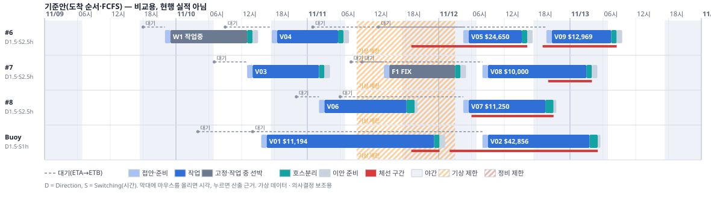
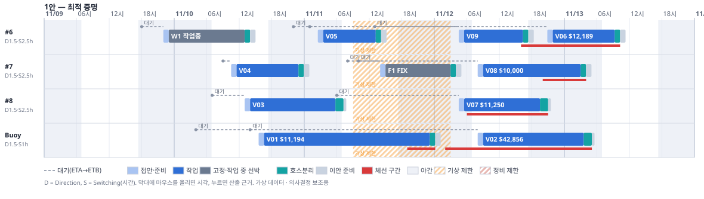
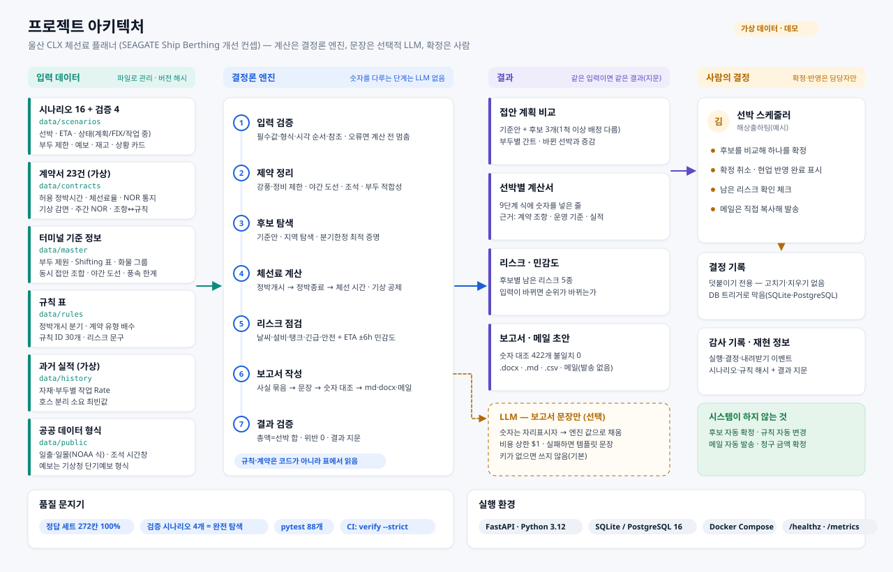
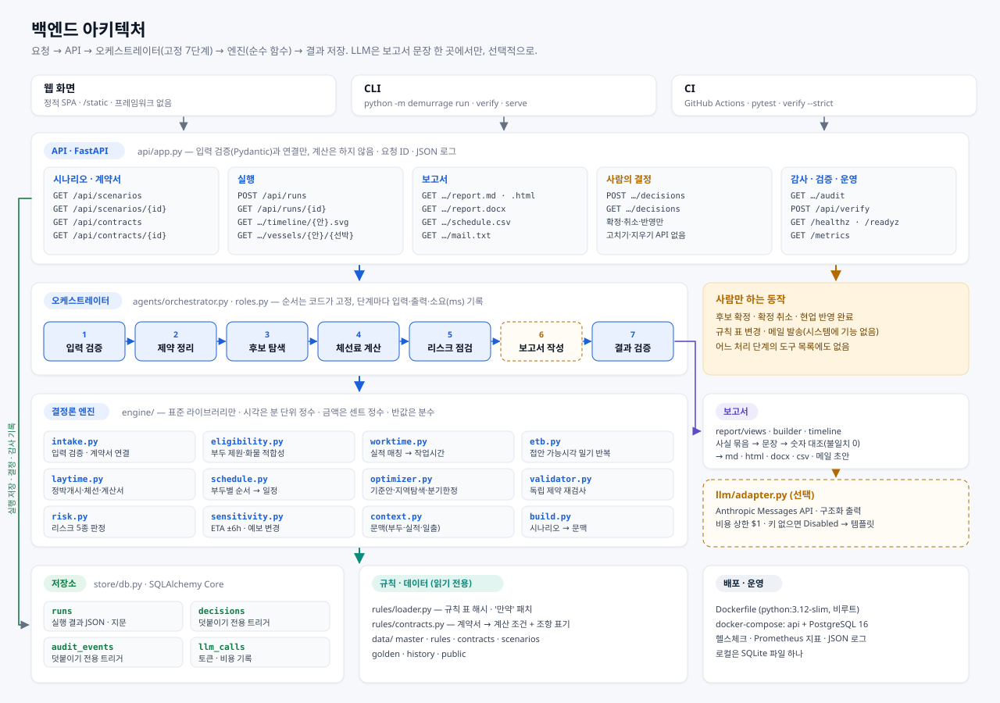

# 척화비 데모 — 최종 보고서 v0.2

울산 CLX 체선료 플래너 · SEAGATE 체선 관리 개선 컨셉 · 파이프라인 데모

- 작성 2026-11-09 · 작성 정민규(Infra/DevOps) · 상태: 데모 완성, 팀 검토 전
- 데이터는 모두 가상입니다. 계산 규칙은 현업 멘토링 PPT(06~09·11쪽)와 팀 요구사항서(최종 탭 FR-01~52, NFR-01~21)를 따랐고, 받지 못한 PPT 10쪽(Daylight)과 서로 맞지 않는 조건은 [가정]으로 두고 [11절](#11-한계와-확인할-것)에 모았습니다.
- 표기: [사실] 코드·실행으로 확인한 것 · [가정] 우리가 정한 값 · [확인 필요] 현업에 물어야 할 것

### v0.1(같은 날 오전)에서 바뀐 것

1. **질의응답 Agent를 뺐습니다.** 팀 결정에 따라 화면·API(`/ask`)·코드·테스트에서 모두 걷어냈습니다. 같은 질문("왜 1안이 싼가?")의 답은 계획 비교 화면과 계산서가 직접 보여 줍니다.
2. **화면을 SEAGATE 개선 컨셉으로 새로 만들었습니다.** 업무 시스템처럼 보이는 11개 화면(사이드바, 숫자 타일, 부두별 간트, 계산서 서랍, 계약서 문서 보기). 'Agent', 이모지 같은 도구 말투를 뺐습니다 → [`12-ui-design.md`](12-ui-design.md)
3. **가상 계약서 23건을 만들고 계산을 계약서에서 읽게 했습니다.** 계산서의 근거가 "계약서 CT-2611-05 Part I (H)"처럼 조항 번호로 붙습니다 → [`10-contracts.md`](10-contracts.md)
4. **시나리오를 5개에서 16개로 늘렸습니다.** 상황·판단할 점·확인할 것을 카드로 붙이고, 결과마다 근거를 정리했습니다 → [`11-scenarios.md`](11-scenarios.md)
5. **프로젝트·백엔드 아키텍처 다이어그램**을 새로 그렸습니다(4절).

---

## 0. 세 줄 요약

1. 팀 요구사항·피그마 워크플로우 7단계·멘토링 PPT 계산식을 옮긴 **끝까지 도는 파이프라인**을 만들고, 그 위에 SEAGATE의 Ship Berthing 옆에 붙는 확장 모듈을 가정한 화면을 얹었습니다. 접안 계획을 체선료로 비교하고, 금액마다 계약 조항을 붙이고, 확정은 사람이 합니다.
2. 대표 데모(강풍 예보 + 선박 9척)에서 **기준안(도착 순서) $112,919 → 1안 $87,489, 22.5% 절감**, 0.3초에 '모든 배정 중 가장 낮음'까지 증명합니다. 시나리오 16개 모두 후보 위반 0건, 1안 최적 증명입니다 [사실].
3. 손계산 정답 세트 **272칸 일치율 100%**, 검증 시나리오 4개는 완전 탐색 결과와 1안이 같고, 테스트 **88개 통과**, 코드 커버리지 88%입니다 [사실].

---

## 1. 무엇을 만들었나

### 1-1. 개선하려는 빈칸

우리 진단으로는 SEAGATE에 접안 계획·Berth Optimization·체선 리포트·Demurrage 요약이 이미 있습니다. 시스템은 기록하고 계산합니다. 비어 있는 것은 그 사이입니다 — **체선 '시간'(터미널이 재는 것)과 체선'료'(계약이 정하는 돈) 사이의 판단**을 사람이 엑셀과 계약서를 오가며 합니다.

이 데모는 그 사이를 세 가지로 메웁니다.

- **계획을 돈으로 비교** — 도착 순서 기준안과 후보 3개를 같은 간트에 놓고, 무엇을 옮겨서 얼마가 줄었는지 보여 줍니다.
- **금액마다 근거** — 9단계 계산서의 각 줄에 계약 조항·운영 기준·부두 기준·실적을 붙이고, 계약 조항은 눌러서 원문으로 갑니다.
- **사람이 결정, 기록은 남김** — 확정·취소·현업 반영은 담당자만 하고, 기록은 덧붙이기만 됩니다.

### 1-2. 화면 11개

| 묶음 | 화면 |
|---|---|
| 선석 운영 | 접안 계획 비교 · 입항 예정 선박(ETA 고쳐 다시 계산) · 부두·제약 |
| 체선료 | 선박별 계산서 · 리스크·민감도 |
| 계약 | 계약서 23건(문서 보기, 조항 강조) |
| 보고·결정 | 보고서·메일 초안 · 확정·이력 |
| 시나리오 · 관리 | 시나리오 라이브러리 16개 · 검증 · 아키텍처 |

피그마 워크플로우 7단계(입력 → 계산 → 후보 비교 → 리스크 → 보고서 → 일정 확정 → 검증)는 그대로 살아 있습니다. 화면이 단계별 탭에서 업무별 메뉴로 바뀌었을 뿐, 처리 순서는 오케스트레이터가 같은 7단계로 고정합니다.

---

## 2. 데모 실행 시나리오 (run scenario)

발표용 대본은 [`07-run-scenario.md`](07-run-scenario.md)에 있습니다.

### 2-1. 띄우는 법

```bash
cd demo && make setup && make serve
```

```bash
cd demo && docker compose up -d --build --wait
```

화면은 http://127.0.0.1:8000 (Compose도 같은 포트). 명령줄만으로는 `make run`이 보고서·메일·타임라인을 `out/`에 만듭니다.

### 2-2. 장면 — "강풍 특보 전날, 배 9척이 몰렸다"

- 11/11 09:00~11/12 03:00 풍속 17 m/s 예보(접안 한계 15 m/s) → 이 시간에는 어느 부두에도 새로 붙일 수 없습니다.
- #6에는 경유선 W1이 작업 중이고, #7에는 매수인 요청으로 11/11 14:00 접안이 확정된 FIX 선박 F1이 있습니다.
- 강풍 전 마지막 자리를 두고 두 배가 다툽니다.
  - V06(경유): 22:00에 먼저 왔지만 허용 36시간·하루 $16,000 — **기다려도 비용이 작은 배**
  - V05(항공유 긴급 출하): 01:00에 왔고 허용 12시간·하루 $36,000 — **기다리면 비싼 배.** 12시간은 계약서 CT-2611-05의 부분 화물 비례(36시간 × 30,000 ÷ 90,000)

### 2-3. 화면 순서와 보이는 숫자 [사실 — 2026-11-09 실행]

1. **접안 계획 비교** — 숫자 타일: 기준안 $112,919 / 1안 $87,489 / 절감 $25,431(22.5%) / 위반 0건 / 남은 리스크 2건. 간트에서 기준안과 1안을 번갈아 누르면 V05의 막대가 11/12 04:30에서 11/11 02:30으로 옮겨 갑니다.
2. **바뀐 것** — V05 −$24,650, V09 −$12,969, 대신 V06 +$12,189. V04는 #7의 FIX 앞 빈자리로, V03은 #8로 옮겨 #6을 비웠습니다.
3. **계산서(V06 누르기)** — "11/10 22:00 도착 → 선행 선박 대기 45.35h 기다려 #6 11/12 20:51 접안. 정박종료(11/12 16:00)보다 18.28h 늦게 호스 분리 → 체선 18.28h, $12,189." 9단계마다 식과 근거. '계약서 CT-2611-06 제10조' 칩을 누르면 계약서가 열리고 그 조항이 강조됩니다.
4. **리스크** — 날씨 급변 '해당'(FIX 선박 F1의 접안이 강풍 구간 안), 현장 안전 '해당'(야간 이안). V09 ETA +6시간, 강풍 6시간 늦게, 예보 해제 때 1안이 1위에서 내려갑니다.
5. **보고서·메일** — 보고서 숫자 345개·메일 77개를 엔진 값과 대조, 불일치 0건. LLM 키가 없어 템플릿 문장.
6. **확정** — 담당자 이름·이유를 적고, 남은 리스크 확인 체크 후 '1안 확정'. 결정 기록과 감사 기록에 덧붙고, 후보 상태가 '선택됨'으로 바뀝니다.
7. **검증** — 정답 세트 272/272칸, 완전 탐색 일치 4/4, 후보 위반 0.





보고서·메일 초안 원본: [`assets/S05-report.md`](assets/S05-report.md), [`assets/S05-report.html`](assets/S05-report.html), [`assets/S05-mail.txt`](assets/S05-mail.txt)

---

## 3. 시나리오 16개와 계약서 23건

시나리오는 체선료가 갈리는 상황별로 묶었습니다. 각각 상황·판단할 점·결과·근거는 [`11-scenarios.md`](11-scenarios.md)에 있습니다.

| 분류 | 시나리오 | 이 상황의 답 한 줄 |
|---|---|---|
| 기상 | S05 대표 데모, S02 강풍, S06 예보 갱신 | 강풍 전 마지막 자리는 '기다리면 비싼 배'에. 예보가 길어져도 순서는 그대로, 비용만 는다 |
| 기본 운영 | S01 평상시, S03 집중, S16 대규모 | FIX 앞 빈자리와 다른 화물 부두를 써서 #6을 비운다. 13척도 11초에 최적 증명 |
| 부두·설비 | S04 정비, S09 FIX 앞 빈자리, S13 #4 화학선 | 정비 전에 붙이면 작업은 계속된다. FIX를 밀지 않는 배만 빈자리에. 작은 배끼리 묶어 동시 접안 |
| 야간·조석 | S07 VLCC | 부이 하나에 세 척 — 순서로 줄일 수 있는 몫은 작고, 입항 일정 협의가 필요 |
| 계약 조건 | S08 Laycan, S14 계약 비교 | 시계가 이미 도는 배를 먼저. 기상 감면이 없는 계약의 배를 강풍 전에 |
| 화물 조합 | S10 경유선 3척 | 휘발유는 경유와 동시에 작업할 수 있다 |
| 재고 | S11 원유 탱크, S12 제품 재고 | 탱크가 못 받는 날 부이를 놀리지 않는다. 첫날 재고는 '기다리면 비싼 배'에 |
| 출하 마감 | S15 선적 기한 | 도착 순서로는 기한을 못 지킨다 → 기준안 '성립 안 함', 지키는 안 중 최저를 제시 |

계약서는 항해용선계약 6건, FOB 수출 매매계약 14건, CFR 도입 매매계약 3건입니다. 허용 정박시간·체선료율·NOR 통지·기상 감면·주간 NOR을 계약서에서 읽고, 조항마다 엔진 규칙 ID를 연결했습니다. 자세한 구조와 예는 [`10-contracts.md`](10-contracts.md).

---

## 4. 아키텍처 — 백엔드 · AI · 인프라

### 4-1. 프로젝트 아키텍처



데이터 파일(시나리오·계약서·터미널 기준 정보·규칙 표·과거 실적·공공 데이터 형식) → 결정론 엔진의 7단계 → 결과(계획 비교·계산서·리스크·보고서) → 사람의 결정. LLM은 보고서 문장 한 곳에서만, 선택적으로 씁니다.

### 4-2. 백엔드 아키텍처



- **API(FastAPI)** 는 입력 검증과 연결만 합니다. 시나리오·계약서 조회, 실행, 보고서 내려받기, 사람의 결정, 감사·검증·운영 엔드포인트로 나뉩니다 → [`02-backend.md`](02-backend.md)
- **오케스트레이터** 가 7단계 순서를 고정하고, 단계마다 입력·출력·소요 시간을 기록합니다. 숫자를 다루는 단계는 LLM을 쓰지 않습니다 → [`03-ai-agents.md`](03-ai-agents.md)
- **엔진**은 표준 라이브러리만 씁니다. 시각은 분 단위 정수, 금액은 센트 정수, 반값은 분수라 같은 입력이면 같은 결과가 나옵니다.
- **저장소**는 SQLAlchemy Core로 SQLite(로컬)와 PostgreSQL 16(Compose)을 같은 코드로 씁니다. 결정·감사 기록은 DB 트리거가 수정·삭제를 막습니다.
- **인프라**: 비루트 이미지 1개 + PostgreSQL, CI는 테스트 → 정답 세트(`verify --strict`) → 컨테이너 기동 → 컨테이너 안 검증 → 살아 있는 서비스에 정답 사례 질의 순서로 문을 지킵니다 → [`04-infra-devops.md`](04-infra-devops.md)

두 그림은 `scripts/make_diagrams.py`가 만들고, 화면의 '아키텍처' 메뉴에도 같은 파일이 뜹니다.

---

## 5. 사용한 기술과 고른 이유

| 영역 | 기술 | 고른 이유 |
|---|---|---|
| 언어 | Python 3.12 | 최적화·데이터·LLM SDK가 모두 파이썬, 팀 AI/DATA 3명이 바로 이어 받음 |
| 계산 엔진 | 표준 라이브러리만(분 정수 시각, 센트 정수 금액, Fraction) | 같은 입력 → 같은 출력. 설치할 것이 없어 서버·CI 어디서나 같은 코드 |
| 최적화 | 직접 구현한 분기한정 탐색 + 지역 탐색 | PPT의 절차형 규칙을 계산서와 같은 코드로 평가 → 숫자가 어긋날 틈이 없음. 6척 이하는 완전 탐색으로 대조 (ADR-004) |
| 계약 | 계약서 JSON(문서 + 조건 + 조항↔규칙) | 계산 조건과 근거가 한 파일에서 나옴. 조항 번호를 계산서에 그대로 인용 (ADR-011) |
| API | FastAPI + Pydantic v2 | 입력 검증·OpenAPI 문서가 저절로 생겨 FE·BE가 계약을 공유 |
| 저장 | SQLAlchemy Core + SQLite / PostgreSQL 16 | 같은 코드로 두 DB, 결정 기록은 트리거로 수정·삭제 금지 (ADR-007) |
| 화면 | 정적 HTML·CSS·바닐라 JS(한 파일), 간트는 화면에서 HTML로 | 빌드 없이 바로 뜸. 화면 11개지만 상태가 셋뿐이라 프레임워크 불필요 (ADR-008, ADR-013) |
| 보고서 | 마크다운 → HTML, python-docx, CSV(BOM), 서버 SVG 타임라인 | 피그마 '보고서 양식' 그대로, 한글이 엑셀·워드에서 안 깨짐 |
| LLM | Anthropic Python SDK(선택), 기본 모델 `claude-opus-5-5`, 구조화 출력 | 보고서 문장 한 곳만. 키가 없으면 템플릿으로 끝까지 (ADR-005) |
| 컨테이너·CI | Docker 다단계(python:3.12-slim, 비루트), Compose, GitHub Actions | 정답 사례가 하나라도 틀리면 merge·배포 차단 |
| 관측 | JSON 로그(request_id·run_id), Prometheus 형식 /metrics, 단계별 실행 로그 | 받는 쪽을 바꿔도 코드는 그대로 |

---

## 6. 트레이드오프 — 무엇을 고르고 무엇을 버렸나

결정 하나마다 [`adr/`](adr/README.md)에 'Context → 결정 → 버린 안 → 결과 → 다시 볼 때'로 적었습니다.

| # | 고른 것 | 버린 것 | 핵심 이유 |
|---|---|---|---|
| 001 | Python 하나 | Spring Boot API + Python 엔진 | 6주에 6명, 서비스 경계를 넘는 비용이 두 배 |
| 002 | 모듈러 모놀리스 | 마이크로서비스 | 어려운 건 처리량이 아니라 '숫자가 맞는가' |
| 003 | JSON 규칙 표 + 규칙 ID + 버전 해시 | 코드에 박기 / 룰 엔진 제품 | 멘토링 뒤 값이 계속 바뀜, 표만 바꾸면 결과·근거가 바뀜 |
| 004 | 분기한정 + 지역 탐색 직접 구현 | MILP/CP-SAT만 | 절차형 규칙을 두 번 구현하면 어긋날 위험 |
| 005 | 코드가 흐름, LLM은 보고서 문장만 | 자율 멀티 Agent | 재현성·비용·감사. 흐름이 고정이라 LLM이 정할 것이 없음 |
| 006 | 컨테이너 1개 + Postgres | 쿠버네티스 | 서비스 하나에 운영 부담만 큼 |
| 007 | 결정·감사는 덧붙이기 + DB 트리거 | ORM / 이벤트 스토어 | 표 4개에 ORM은 과함, 이력이 끝까지 남음 |
| 008·013 | 바닐라 JS, 업무형 화면 11개 | React SPA | 빌드 0, 상태가 단순. 화면이 더 커지면 다시 봄 |
| 009 | 공공데이터 제공자 + 폴백 | API 필수 | 서비스키 없이도 완주 |
| 010 | 독립 검증기 + 손계산 정답 + 완전 탐색 | 엔진 테스트만 | 같은 코드가 낸 값을 정답으로 쓰면 틀려도 모름 |
| 011 | 계약서를 데이터로, 조항↔규칙 연결 | 선박마다 숫자만 입력 | "그 12시간은 어디서 왔나"에 조항 번호로 답함 |
| 012 | 질의응답 Agent 제외 | 대화형 질의응답 | 팀 결정. 같은 답을 계획 비교·계산서가 직접 보여 줌, 프롬프트 주입·비용 위험 제거 |

---

## 7. 원리 — 어떻게 계산하나

### 7-1. 접안 시각(ETB) = 모든 조건을 만족하는 가장 이른 시각

PPT 06쪽의 'ETB는 조건별 접안 가능시간의 교집합'을 '밀어내기'로 구현했습니다.

1. 출발점 t = ETA + Direction, 앞 선박이 있으면 max(t, 앞 선박 ETU + Switching) — ETB-01
2. 규칙을 차례로 검사하고, 어긴 규칙이 있으면 t를 **그 규칙이 허락하는 가장 이른 시각으로 민다.** Last POB(ETB-03) · 새벽 02~08시(ETB-04) · 부두 제한 = 종료 + Direction(ETB-07) · 조석(ETB-08) · FIX 선박(ETB-02) · 동시 접안 = 상대 ETU − 2시간(ETB-05·06) · 재고(ETB-09)
3. 한 바퀴 동안 아무 규칙도 t를 밀지 않으면 끝(ETB-10). 마감을 넘기면 배정 불가(ETB-11).

민 기록(규칙 ID·어디서·어디로·사유)이 그대로 계산서 2단계의 근거와 요약 문장("선행 선박 대기 45.35h")이 됩니다.

### 7-2. 정박개시 → 정박종료 → 체선료 (PPT 09·11쪽, 조건은 계약서에서)

```
ETANR = NVL(NOR 제출, ETA)                                             LAY-01
정박개시 = ① ETANR·ETB < Laycan From → ETB (Early Loading)             LAY-02
          ② ETANR > Laycan To → ETB (Laycan Miss)                       LAY-03
          ③ ETANR < Laycan From → Laycan From 당일 06:00                LAY-04
          ④ 그 밖 → min(ETANR + 통지시간, ETB) (주간 NOR 계약은 Daylight 식) LAY-05/06
정박종료 = 정박개시 + 허용 정박시간(계약서, 부분 화물이면 비례)            LAY-07
체선 시간 = 호스분리 − 정박종료 − 기상 대기 × 계약 공제 비율, 0 미만이면 0  DEM-01·02
체선료 = 체선 시간 × 하루 체선료 ÷ 24 (센트 반올림)                       DEM-03
```

'기상 대기'는 **기상 제한이 없었다면 접안했을 시각 ~ 실제 ETB** 중 체선 기간에 든 시간입니다 [가정]. 공제 비율은 계약서마다 다릅니다(21건 절반, 2건 없음).

### 7-3. 후보 찾기 — 분기한정 탐색 ([`05-optimization.md`](05-optimization.md))

- 결정할 것은 '부두와 그 부두에서의 순서'뿐이고, 시각은 7-1의 엔진이 정합니다.
- ETB가 줄지 않는 순서로만 한 척씩 붙여도 가능한 모든 일정이 빠짐없이 나옵니다(정리). 그래서 같은 일정을 여러 번 만들지 않습니다.
- 하한은 '남은 배가 지금 붙일 수 있는 가장 빠른 시각에 붙었을 때의 체선료'. 같은 상태를 다시 만나면 K개까지만 남깁니다.
- 제한시간 안에 끝나면 '최적 증명', 못 끝나면 '최선 탐색 결과'와 최적성 갭을 표시합니다.
- 도착 순서로 배정할 수 없는 배가 있으면(S15) 기준안을 '성립 안 함'으로 표시하고 절감액을 계산하지 않습니다. 후보는 모든 배를 배정한 안만 냅니다.

### 7-4. 두 번 구현해 대조한다

ETB를 만드는 코드(밀어내기)와 완성된 일정을 검사하는 코드(독립 검증기)를 다른 방식으로 짰습니다. 손계산 정답(사람)과 엔진, 분기한정과 완전 탐색, 보고서 숫자와 계산 결과를 각각 맞대 봅니다.

---

## 8. 설계 원칙 7가지 — 어디에 있고 어떻게 확인하나

| 원칙 | 확인 방법 [사실] |
|---|---|
| ① 숫자는 엔진만, LLM은 문장만 (NFR-01) | `engine/`은 LLM을 import하지 않음(AST 검사). 숫자 섞인 LLM 문장은 템플릿으로 대체 |
| ② 확정은 사람만 (FR-47·NFR-16) | 확정은 `POST /decisions` 하나, 처리 단계의 도구 목록에 없음. 화면은 담당자 이름·리스크 확인 필수 |
| ③ 규칙·계약은 코드가 아닌 표에서 (NFR-04) | 규칙 표·계약서만 바꿔 금액이 바뀌는 시험(GC-09, S14) |
| ④ 기록은 덧붙이기만 (FR-47) | SQLite·Postgres 모두 UPDATE/DELETE가 'append-only' 오류 |
| ⑤ 같은 입력 → 같은 결과 (NFR-02) | 10회 실행 결과 지문 동일 |
| ⑥ 실패해도 끝까지 (NFR-10·11) | LLM 키·공공데이터 없이 전 과정 완주, 입력 오류면 계산 전에 멈추고 입력 보존 |
| ⑦ 근거 없는 숫자 없음 (FR-39) | 계산서 9단계 모두 식 + 근거 칩, 계약 조건은 조항 번호(테스트 `test_calc_sheet_cites_contract_clause_numbers`) |

---

## 9. 검증 결과 [사실 — 2026-11-09 실행]

### 9-1. 성공기준과 대조

| 팀 성공기준 | 결과 |
|---|---|
| ① 정답 세트 대비 체선료 자동 계산 일치율 100% | 15묶음·272칸 **100%** (`verify --strict`) |
| ② 검증 시나리오 전체에서 하드 제약 위반 0건, 기준안 대비 절감 확인 | 시나리오 16 + 검증 4개 후보 위반 **0건**. 기준안이 성립하는 19개는 절감 0 이상, S15는 '기준안 성립 안 함' |
| ③ 조건 입력 → 후보 비교 → 리스크 → 보고서 초안까지 끊김 없이 완주 | 화면·CLI·API·컨테이너 모두 완주, 실행 자체 검사 10/10 |

### 9-2. 시나리오별 숫자

[`11-scenarios.md`](11-scenarios.md)의 '한눈에' 표에 16개 모두 있습니다. 검증 시나리오 4개(완전 탐색 비교)는 다음과 같습니다.

| 시나리오 | 선박 | 기준안 | 1안 | 완전 탐색 |
|---|---|---|---|---|
| VAL-01 동일 화물 조합 | 5 | $4,200 | $0 | 12,960가지 → 일치 |
| VAL-02 Buoy 조석·야간 | 3 | $54,050 | $54,050 | 6가지 → 일치(개선 없음) |
| VAL-03 강풍·기상 공제 | 5 | $34,650 | $11,289 | 4,320가지 → 일치 |
| VAL-04 정비·FIX | 5 | $78,736 | $0 | 4,320가지 → 일치 |

### 9-3. 성능

| 선박 | 걸린 시간 | 결과 | 요구 |
|---|---|---|---|
| 8척(무작위, 부두 3곳) | 0.06초 | 최적 증명 | NFR-08: 30초 이내 ✔ |
| 12척(무작위) | 18.1초 | 최적 증명 | NFR-09: 60초 이내 ✔ |
| 13척(S16, 이동 가능 11척) | 약 11초 | 최적 증명 | ✔ |
| 16척(무작위) | 30초(제한) | 최선 탐색 결과, 기준안 대비 −41%, 갭 78.9% | 기록 — 하한이 약해 갭이 크게 보임 |

무작위 벤치마크는 v0.1 때 잰 값입니다. 이후 탐색 코드는 바뀌지 않았고, S16은 이번에 다시 쟀습니다.

### 9-4. 그 밖의 시험

- 테스트 88개: 정답 세트, 입력 오류 11건(없는 계약서 번호 포함), 무작위 80사례 완전 탐색 대조, 검증기 고장 주입, 재현성 10회, 규칙 표 변경, LLM 숫자 검문·비용 상한·전송 항목, 계약서 23건의 형식·규칙 연결, 시나리오 16개의 카드·계약서 번호, 계산서 조항 인용, 계약별 기상 공제 차이, 기준안 불성립 처리, API·DB 덧붙이기. 커버리지 88%(계산 모듈 91~97%).
- 화면: 내장 브라우저에서 11개 화면, 계산서 서랍, 계약서 조항 강조, 확정 창(기록·상태 변경), ETA 수정 후 재계산, S15(기준안 불성립)·S16(11초) 표시를 확인했습니다.
- 컨테이너(v0.1에서 확인): `docker compose up --wait` → 앱·DB healthy → 컨테이너 안 `verify --strict` → `scripts/smoke.py` 통과 → Postgres에서 결정 기록 UPDATE·DELETE가 트리거로 막힘.

---

## 10. 계산하지 않는 것 — 일부러 선을 그은 곳

- 청구·정산(실제 청구서 대조, 청구 기한 관리)은 팀 캔버스에서 제외했습니다. 계약서에 청구 기한 조항은 있지만 계산에 쓰지 않습니다.
- 매매계약의 체선료 상한·분담은 계산하지 않습니다. 화면의 금액은 계약서의 하루 체선료로 계산한 '예상' 금액입니다.
- 질의응답 Agent(구 FR-12)는 범위에서 뺐습니다.
- 메일은 초안만 만들고 보내지 않습니다. 확정도 시스템이 하지 않습니다.

---

## 11. 한계와 확인할 것

### 11-1. 하지 않은 것·못 한 것 [사실]

- **실제 LLM 호출은 하지 않았습니다.** API 키가 없어 LLM 경로는 가짜 LLM으로 경계(숫자 검문·비용 상한·폴백)만 시험했습니다. 키를 넣으면 `LLM_PROVIDER=anthropic`으로 켜집니다.
- **공공데이터 API는 부르지 않습니다.** 일출·일몰은 NOAA 식으로 계산하고(1~2분 오차), 조석 시간창·풍속 예보는 가상 값입니다.
- CSV·XLSX 템플릿 입력(FR-01 일부), 임시 조건 'A는 B보다 먼저'(FR-19), 제약 켜고 끄기(FR-21), 규칙 해석 대안 계산(FR-33), 리스크별 '확인함' 표시(FR-42)는 아직 없습니다 → [`08-traceability.md`](08-traceability.md).
- 이 폴더는 아직 git 저장소가 아니라 GitHub Actions를 실제로 돌리지 않았습니다(같은 단계를 로컬과 컨테이너에서 확인).
- 화면은 내장 브라우저(1440×900)에서 확인했고, 실제 현업 사용자 시험은 하지 않았습니다.

### 11-2. 현업에 물을 것 [확인 필요] — [`09-open-questions.md`](09-open-questions.md)

1. PPT 10쪽(Daylight 적용 흐름)이 없습니다. Laycan 분기와 Daylight 식의 우선순위가 맞는지.
2. 야간 도선 대상 조건 두 문장이 서로 맞지 않습니다. Last POB 판정은 ETA 기준인지 실제 도선 시각 기준인지.
3. '기상 체선 시간'의 정의와, 계약마다 공제 비율이 다른지(우리 예시는 절반 / 없음 두 가지).
4. 매매계약에서 SK에너지가 실제로 부담하는 금액(상한·분담)을 화면에 보여 줘야 하는지.
5. 일부러 늦게 붙이는 안(예: Laycan From까지 기다렸다 접안)을 후보로 보아도 되는지.

---

## 12. 파일 지도

```
demo/
  README.md                       빠른 시작
  src/demurrage/
    domain/ rules/ data/ engine/  안쪽 — 결정론 계산(표준 라이브러리만), rules/contracts.py가 계약서를 읽음
    agents/ report/ llm/          처리 단계·보고서·LLM 어댑터
    store/ api/ web/ cli.py       바깥 — 저장·API·화면(web/assets에 다이어그램)·명령
  data/
    contracts/                    가상 계약서 23건
    scenarios/                    시나리오 16개 (+ validation/ 4개)
    master/ rules/ golden/ history/ public/
  tests/                          88개
  scripts/  make_diagrams.py  smoke.py
  Dockerfile  docker-compose.yml  Makefile  .github/workflows/ci.yml
  docs/                           이 문서들 (assets/에 다이어그램·S05 보고서·타임라인)
```

| 문서 | 내용 |
|---|---|
| [`01-architecture.md`](01-architecture.md) | 구조·경계·데이터 흐름·피그마 단계 매핑 |
| [`02-backend.md`](02-backend.md) | API·DB·엔진 모듈·입력 형식 |
| [`03-ai-agents.md`](03-ai-agents.md) | 처리 단계(역할 모듈)·LLM 경계·권한·비용 |
| [`04-infra-devops.md`](04-infra-devops.md) | 컨테이너·CI 문지기·관측·보안 |
| [`05-optimization.md`](05-optimization.md) | 수리 모델·탐색·증명 요지·성능 |
| [`06-rules-and-golden-set.md`](06-rules-and-golden-set.md) | 규칙 ID 표·손계산 풀이 |
| [`07-run-scenario.md`](07-run-scenario.md) | 발표용 실행 대본 |
| [`08-traceability.md`](08-traceability.md) | 요구사항 ↔ 구현 ↔ 시험 |
| [`09-open-questions.md`](09-open-questions.md) | 현업 확인 질문 |
| [`10-contracts.md`](10-contracts.md) | 계약서 예시와 계산 연결 |
| [`11-scenarios.md`](11-scenarios.md) | 시나리오 16개 — 상황·결과·근거 |
| [`12-ui-design.md`](12-ui-design.md) | 화면 설계 — SEAGATE 개선 컨셉 |
| [`adr/`](adr/README.md) | 결정 기록 13개 |
