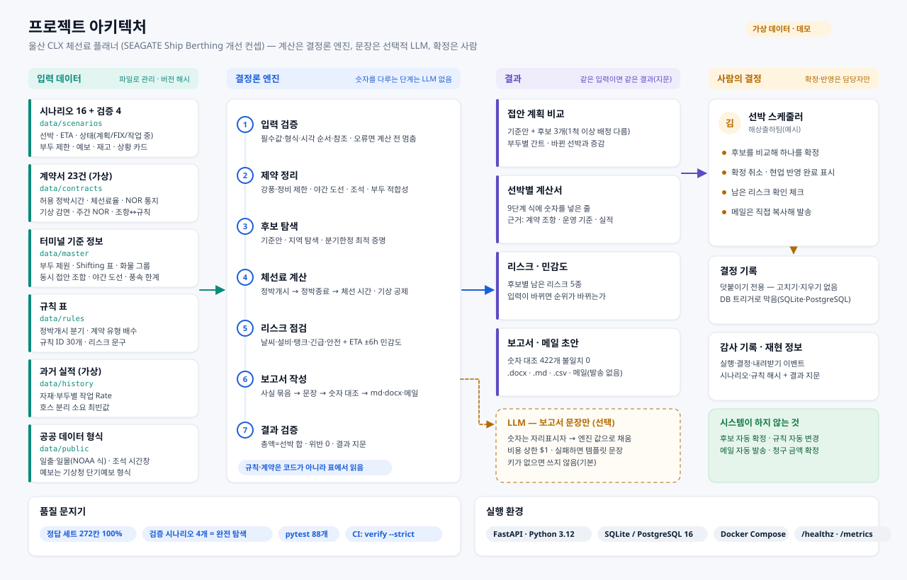
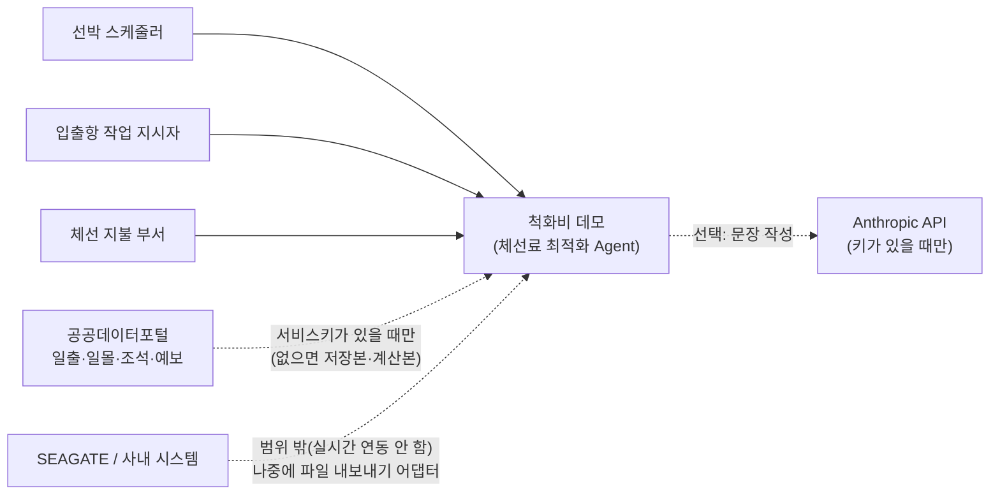
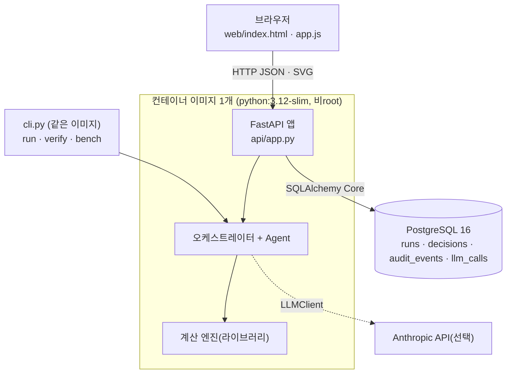
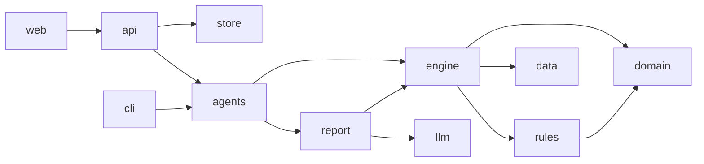
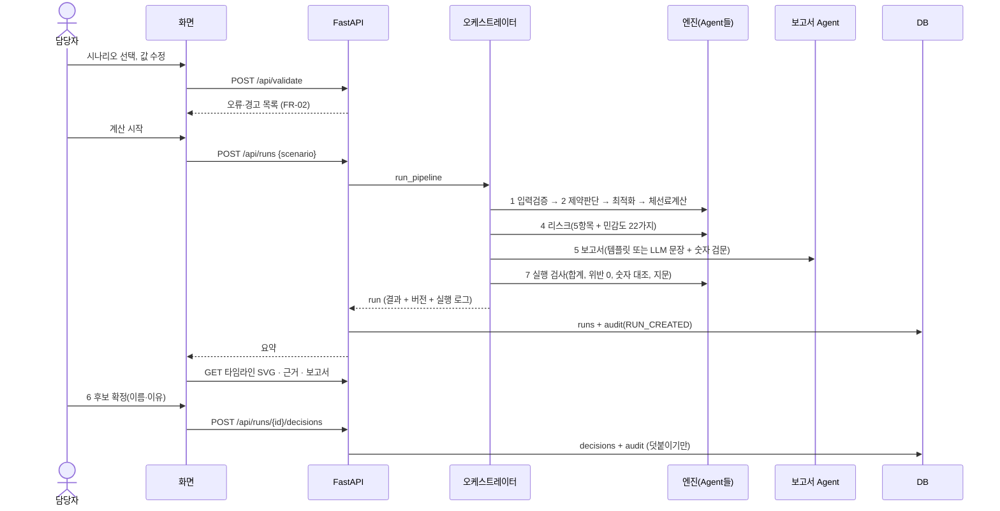

# 01. 아키텍처 — 전체 구조와 경계

- 작성 2026-11-09 · 대상: 팀 전원(특히 BE·Infra) · 근거: 팀 요구사항서(최종 탭), 피그마 '파이프라인' 프레임(워크플로우 Group 1, 한 장 플로우차트 58:358, 보고서 양식), 멘토링 PPT 06~11쪽, `docs/requirements/notion/인프라-데브옵스-가이드.md`
- v0.2 그림: 프로젝트 아키텍처 [`assets/architecture-project.svg`](assets/architecture-project.svg) · 백엔드 아키텍처 [`assets/architecture-backend.svg`](assets/architecture-backend.svg) (`scripts/make_diagrams.py`로 생성, 화면의 '아키텍처' 메뉴에도 같은 그림)



## 1. 맥락 — 누가, 무엇과 이어지나



- 범위 밖(팀 캔버스 제외 범위): 사내 시스템 실시간 연동, Agent의 자동 확정, 선박에 대한 도착 시각 요청, SOF 기반 정산·클레임, 예측 모델 고도화.
- 그래서 데이터는 '시나리오 파일(JSON) + 기준 정보 표 + 공공데이터 저장본'으로 들어오고, 결과는 '화면·보고서·메일 초안·CSV'로 나갑니다.

## 2. 컨테이너 — 무엇이 어디서 도나



- 서버 프로세스는 하나입니다. 계산 엔진은 별도 서비스가 아니라 같은 프로세스 안의 라이브러리입니다(ADR-002).
- 로컬에서는 DB가 SQLite 파일(`runtime/demurrage.db`), Compose·운영에서는 PostgreSQL입니다. 코드는 같고 `DATABASE_URL`만 다릅니다.

## 3. 구성요소 — 계층과 의존 방향

안쪽 계층은 바깥 계층을 모릅니다. 화살표는 '가져다 쓴다'입니다.



| 계층 | 모듈 | 하는 일 | 외부 패키지 |
|---|---|---|---|
| domain | `timeutil.py`, `money.py`, `model.py` | 시각(분 정수, KST), 금액(센트 정수), 모델 dataclass | 없음 |
| rules | `loader.py`, `contracts.py` | 규칙 표 5개 읽기, 버전 해시, `patch`로 '만약' 계산 / 계약서 → 계산 조건 + 조항 표기 | 없음 |
| data | `providers.py`, `solar.py` | 일출·일몰(시나리오 → 저장본 → NOAA 계산), 풍속 예보 → 기상 제한 | 없음 |
| engine | `intake` `eligibility` `worktime` `context` `etb` `laytime` `schedule` `validator` `optimizer` `sensitivity` `risk` `build` | 입력 검증 → 계산 문맥 → ETB → 체선료 → 기준안·후보 → 독립 검증 → 민감도·리스크 | 없음 |
| report | `views.py`, `builder.py`, `timeline.py` | 화면·API용 JSON, 보고서·메일·CSV·DOCX, 타임라인 SVG, 숫자 대조 | python-docx(선택) |
| llm | `adapter.py` | LLMClient 인터페이스, Anthropic·Disabled 구현, 비용 미터, 숫자 검문 | anthropic(선택) |
| agents | `roles.py`, `orchestrator.py` | 역할(처리 단계) 정의, 1~7단계 흐름·실행 로그 | 없음 |
| store | `db.py` | 실행·결정·감사·LLM 호출 저장, 덧붙이기 전용 트리거 | SQLAlchemy, psycopg |
| api / web / cli | `app.py`, `index.html·app.js·styles.css`, `cli.py`, `verify.py` | HTTP, 화면, 명령줄, 검증 일괄 실행 | FastAPI, uvicorn |

규칙: `engine`·`domain`·`rules`는 표준 라이브러리만 씁니다. 테스트(`test_calculation_modules_never_import_llm`)가 LLM import가 없는지 매번 확인합니다.

## 4. 한 번의 실행 — 데이터 흐름



## 5. 피그마 워크플로우 ↔ 코드

| 피그마 상자 (Group 1) | 코드 | 비고 |
|---|---|---|
| 시작(Trigger): 기상 악화 예보, 선박 여러 척 대기 | `data/scenarios/S05-storm-rush.json` (시나리오 16개 중 대표) | 과제 원문 4절 데모 예시 |
| 조건 입력 / 필수 값이 다 있나? | `engine/intake.py` `parse_scenario`, `check_assignability`, 화면 1단계 | 아니오면 입력으로 돌아감(422 + 입력 보존) |
| 제약 판단 (접안 가능 제품·조석·일출일몰·기상, FIX 고정) | `engine/eligibility.py`, `context.py`, `etb.py` | 한 장 플로우차트 58:358의 ①②③ + AND |
| 기준안 (도착 순서 FCFS) | `engine/schedule.py` `fcfs` | '비교용 기준안(현행 실적 아님)' 표시 |
| 체선료 최적화 (수리계획법으로 TOP 3) | `engine/optimizer.py` | 수리 모델은 `05-optimization.md`, 풀이는 분기한정(ADR-004) |
| 체선료 계산 (ETB·ETU, 산출 근거, 규칙 이름) | `engine/laytime.py`, `report/views.py` | PPT 09·11쪽 |
| 후보 비교 화면 (TOP K, 타임라인, 근거) | `report/timeline.py`, 화면 3단계 | |
| 남은 리스크·대안 / 입력이 바뀌면? | `engine/risk.py`, `engine/sensitivity.py` | |
| 후보 제안 보고서 작성 및 메일전송 | `report/builder.py` | 발송은 하지 않음(초안만) — 사람이 보냄 |
| 후보 확정 | `api/app.py` `/decisions`, `store/db.py` | Agent 경로 없음 |
| 정답 세트 / 검증 실행 / 검증 결과표 | `data/golden/`, `verify.py`, 화면 7단계 | |
| 데이터: 시나리오 파일·공공데이터 API·계약 규칙 테이블 | `data/scenarios/`, `data/providers.py`, `data/rules/` | |

피그마의 원칙 세 줄(① 금액은 규칙 엔진만, ② 확정은 담당자만, ③ 계약 규칙은 테이블에서)은 [`00-final-report.md` 7절](00-final-report.md#7-설계-원칙-7가지--어디에-있고-어떻게-확인하나)에서 코드·시험과 짝지었습니다.

## 6. 실행 결과(run) 데이터 모양

API·저장·화면·보고서가 모두 이 한 덩어리를 씁니다.

```text
run
├─ run_id, created_at, status(OK / INPUT_ERROR / NO_CANDIDATE), fingerprint(재현성 지문)
├─ versions { engine, rules{version, files, patch}, solver{method, k, time_limit_s} }
├─ input (받은 시나리오 그대로)            input_issues [오류·경고]
├─ scenario { id, title, hash, horizon, berths, movable, immovable, weather }
├─ restrictions [정비·사용자·기상]          eligibility · night_rules
├─ search { status, proven_optimal, lower_bound, gap, stats{노드·가지치기·상태 병합·시간} }
├─ baseline, candidates[] — 일정 한 안
│   └─ total, savings, signature(부두별 순서), violations, vessels[ 계산서 + evidence + reasons + pushes ]
├─ sensitivity { rows[바뀐 입력별 총액·순위], flagged{후보: 순위 바뀐 입력} }
├─ risks { 1안: [5항목], … }               open_assumptions [확인 필요]
├─ report { markdown, html, narrative, narrative_source, audit } , mail { subject, body }
├─ timeline_svgs { 기준안, 1안, … }          checks [실행 검사 10개]
└─ agent_log [순서, Agent, 단계, ms, 입력·출력 요약]   llm { calls, tokens, cost }
```

## 7. 팀이 나눠 맡기 좋은 경계 (제안 — 팀이 정함)

| 영역 | 맡기 좋은 역할 | 손댈 곳 | 지켜야 할 계약 |
|---|---|---|---|
| 계산 규칙·제약 | BE 또는 AI/DATA | `engine/etb.py`, `laytime.py`, `data/rules/*.json` | 규칙 ID, 정답 세트 통과 |
| 최적화 | AI/DATA | `engine/optimizer.py` | `optimize(ctx) → SearchResult`, 완전 탐색과 일치 |
| 리스크·보고서·LLM | AI/DATA·FE | `engine/risk.py`, `report/`, `llm/` | 숫자는 자리표시자, 숫자 대조 0건 |
| API·DB | BE | `api/app.py`, `store/db.py` | OpenAPI(/docs), 덧붙이기 전용 |
| 화면 | FE | `web/` | API 응답 모양(6절) |
| 인프라 | Infra/DevOps | `Dockerfile`, `docker-compose.yml`, `.github/`, `scripts/` | `verify --strict`·`smoke.py`가 문지기 |
