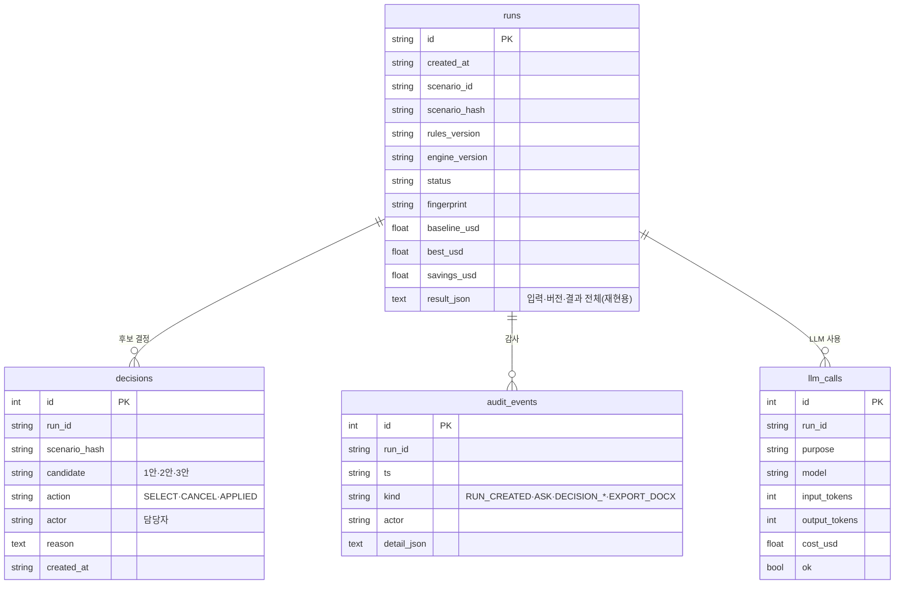
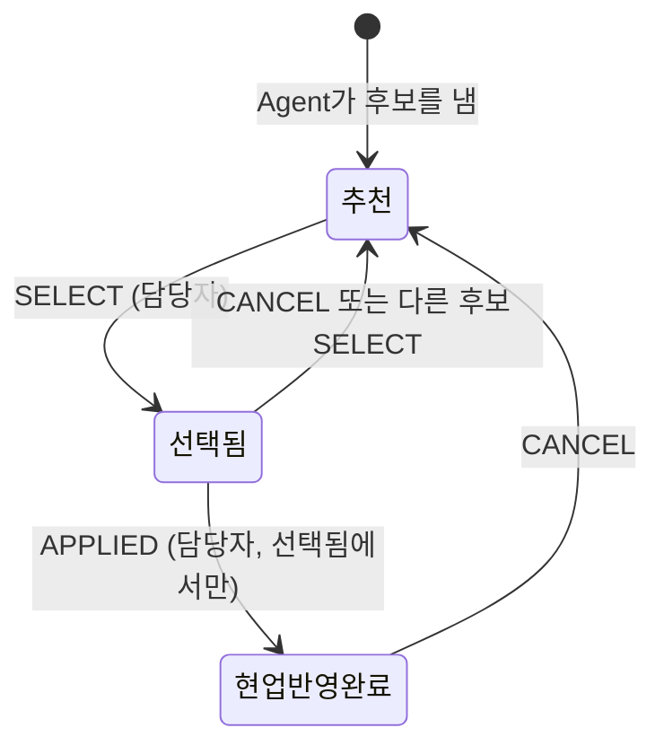

# 02. 백엔드 — API · 저장소 · 계산 엔진

- 작성 2026-11-09(v0.2 갱신: 계약서 API 추가, 질의응답 API 제거) · 코드: `src/demurrage/api/`, `store/`, `engine/`, `rules/contracts.py` · API 문서는 서버를 띄우고 `/docs`(OpenAPI)
- 그림: [`assets/architecture-backend.svg`](assets/architecture-backend.svg)

## 1. API

| 메서드 · 경로 | 하는 일 | 요구사항 |
|---|---|---|
| GET `/healthz` · `/readyz` | 살아 있나 · DB까지 준비됐나(컨테이너 헬스체크) | 운영 |
| GET `/metrics` | Prometheus 형식 지표(실행 수·시간, 결정 수, LLM 호출·비용, 마지막 정답 일치율) | 운영 |
| GET `/api/meta` | 엔진·규칙 버전, DB 종류, LLM 상태, 처리 단계 7개, 사람만 하는 동작 | NFR-16 |
| GET `/api/rules` | 규칙 표 5개 원문 + 버전 | NFR-04·05 |
| GET `/api/scenarios` · `/api/scenarios/{id}` | 시나리오 목록(상황 카드·분류·쓰는 계약서, `?validation=true`면 검증용 포함)·원문 | FR-01 |
| GET `/api/contracts` · `/api/contracts/{id}` | 계약서 목록(요약 + 쓰는 시나리오) · 원문(조항·리캡·계산 조건) | FR-26, FR-39 |
| POST `/api/validate` | 계산 전 입력 검증만 | FR-02 |
| POST `/api/runs` | 1~7단계 실행 후 저장. 입력 오류면 422 + 입력 그대로 | FR-01~46, NFR-11 |
| GET `/api/runs` · `/api/runs/{id}` | 실행 목록 · 전체 결과(+ 후보 상태) | NFR-02 |
| GET `/api/runs/{id}/timeline/{안}.svg` | 부두별 타임라인 그림 | FR-37 |
| GET `/api/runs/{id}/vessels/{안}/{선박}` | 산출 근거(값 + 규칙 + 밀린 이유 + 사유 분해) | FR-39, FR-32 |
| GET `/api/runs/{id}/report.md` · `.html` · `.docx` · `mail.txt` · `schedule.csv?label=` | 보고서·메일·일정 내려받기 | FR-44~46 |
| POST `/api/runs/{id}/decisions` | **사람의 결정**: SELECT · CANCEL · APPLIED (담당자 이름 필수) | FR-47·48 |
| GET `/api/runs/{id}/decisions` | 결정 이력 + 후보 상태(추천 → 선택됨 → 현업 반영 완료) | FR-48 |
| GET `/api/runs/{id}/audit` | 처리 단계 실행 로그 + 감사 기록 + LLM 호출 | NFR-17 |
| POST `/api/verify` | 정답 세트(묶음별 제목 포함)·검증 시나리오·완전 탐색 비교 | FR-50·51 |

결정·감사 기록을 **고치거나 지우는 API는 없습니다.** 취소도 'CANCEL 행 추가'입니다.

## 2. 저장소 (SQLAlchemy Core — SQLite·PostgreSQL 겸용)



- `decisions`·`audit_events`·`llm_calls`는 **덧붙이기 전용**입니다. SQLite는 `BEFORE UPDATE/DELETE ... RAISE(ABORT)` 트리거, PostgreSQL은 `forbid_change()` 함수 + `BEFORE UPDATE OR DELETE` 트리거로 막습니다. 두 DB 모두 시험했습니다(`test_human_decisions_are_append_only`, 컨테이너에서 psql로 직접 UPDATE·DELETE → `append-only table` 오류).
- 후보 상태는 저장하지 않고 **결정 기록을 처음부터 다시 읽어** 만듭니다(`candidate_states`). 그래서 상태와 이력이 어긋날 수 없습니다.



## 3. 계산 엔진 모듈

| 모듈 | 입력 → 출력 | 규칙 ID |
|---|---|---|
| `intake.py` | 시나리오 JSON → `Scenario` + 이슈(오류·경고). 필수값·형식·범위·시각 순서·중복·미등록 참조 | FR-02 |
| `eligibility.py` | 선박 × 부두 → 배정 가능 여부 + 제외 이유 | ELG-01·02 |
| `worktime.py` | (선박, 부두) → 작업·호스분리 소요(입력값 또는 실적 1차·2차 매칭) | WRK-01~04 |
| `context.py` | 시나리오 + 규칙 → 계산 문맥(기상 제한, 적합 부두, 작업 소요, Last POB 해제 시각, 동시 접안 짝) | ETB-03·05·06 |
| `etb.py` | (선박, 부두, 지금까지 배정) → 배정(ETB·작업·호스·ETU + 밀린 기록) 또는 불가 | ETB-01~11 |
| `laytime.py` | 배정 → 정박개시·종료, 체선 시간, 기상 공제, 금액, 근거, 사유 분해, **9단계 계산서(`calc_sheet`)** — 계약 조건은 계약서 값이 있으면 그것을, 없으면 규칙 표 기본값 | LAY-01~07, DEM-01~03 |
| `schedule.py` | 계획(우선순위 목록) → 일정 + 평가, 기준안(FCFS) | OPT-01 |
| `validator.py` | 완성된 일정 → 위반 목록(독립 구현) | 전부 |
| `optimizer.py` | 문맥 → 기준안 + 후보 K개 + 탐색 통계(하한·갭) | OPT-02 |
| `sensitivity.py` | 문서 + 후보 계획 → 바뀐 입력별 총액·순위 | FR-43 |
| `risk.py` | 일정 → 5항목 점검 + 대안·주의 문구 | FR-40·41 |

시각은 '2026-01-01 00:00 KST부터 지난 분'(정수), 금액은 센트(정수)입니다. 체선 시간처럼 1/2이 생기는 값만 `Fraction`을 씁니다. 그래서 자정·월말 경계와 합계(총액 = 선박별 합, 증감 합 = 절감액)가 늘 정확히 맞습니다(NFR-06).

## 4. 입력 형식 — 시나리오 JSON (요지)

```json
{
  "id": "S05-storm-rush", "title": "강풍 예보 + 선박 집중 (대표 데모)",
  "card": {"category": "기상", "situation": "…", "question": "…", "rules": ["WX-01", "ETB-07"], "clauses": ["CT-2611-05 Part I (H)"],
           "watch": ["1안이 V05를 강풍 전 #6에 붙이는지"], "order": 0},
  "horizon": {"start": "2026-11-10 00:00", "end": "2026-11-14 00:00"},
  "berths": ["#6", "#7", "#8", "Buoy"],
  "vessels": [
    {"id": "V05", "name": "MT JIRI PEARL", "vessel_type": "SPECIAL_PRODUCT", "grt": 26000, "dwt": 45000, "loa": 180, "pbl": 90,
     "draft": 10.5, "direction": "EXPORT", "material_code": "KR-JETA1", "qty": 30000, "eta": "2026-11-11 01:00",
     "status": "PLANNED", "priority": "URGENT", "contract_id": "CT-2611-05"},
    {"id": "F1", "status": "FIX", "fixed": {"berth": "#7", "etb": "2026-11-11 14:00"}, "work": {"hours": 12, "hose_term_h": 1}, "...": "..."},
    {"id": "W1", "status": "WORKING", "working": {"berth": "#6", "etb": "2026-11-09 22:00", "work_start": "2026-11-09 23:00"}, "...": "..."}
  ],
  "restrictions": [{"id": "M7", "berths": ["#7"], "start": "...", "end": "...", "reason": "MAINTENANCE", "note": "로딩암 정비"}],
  "weather_forecast": {"source": "가상 예보", "issued_at": "2026-11-09 17:00",
                       "segments": [{"from": "2026-11-11 09:00", "to": "2026-11-12 03:00", "wind_ms": 17}]},
  "tide_windows": {"Buoy": [["2026-11-10 03:10", "2026-11-10 07:10"]]},
  "inventory": [{"group": "CRUDE", "unit": "kl", "capacity": 850000, "opening": 600000, "daily_net": -120000}]
}
```

선박의 계약은 `contract_id`(계약서 번호, 권장)나 `contract`(조건을 직접 적기, 화면에서 고친 시나리오와의 호환용) 중 하나로 줍니다. 계약서 형식은 [`10-contracts.md`](10-contracts.md)에 있습니다.

- `work`가 없으면 과거 실적(`data/history/shipments.v1.csv`)으로 작업시간·호스분리를 추정합니다(FR-23).
- `sun`이 없으면 저장본 → NOAA 계산 순으로 일출·일몰을 정합니다(FR-05).
- 상태: ORDERED·PLANNED만 다시 배정하고, FIX·WORKING은 입력 그대로 둡니다(FR-10·11). COMPLETED는 계산에서 뺍니다.

## 5. 오류 처리

| 상황 | 처리 |
|---|---|
| 입력 오류(필수값·형식·범위·순서·중복·미등록·배정 부두 없음·작업시간 추정 불가) | 계산하지 않고 422 + 오류 목록(선박·항목·사유) + **입력 그대로** |
| 어떤 순서로도 붙일 수 없는 선박(마감·조석·기간 초과) | 후보 없음(`NO_FEASIBLE`) + 이유 |
| 규칙 patch 경로 오류 | 422 |
| LLM 실패·비용 초과·숫자 섞인 문장 | 템플릿 문장으로 계속, 이유를 `narrative_source`에 |
| DB에서 결정 수정·삭제 시도 | 트리거가 막음(append-only) |

## 6. 성능 (부두 3곳)

| 규모 | 시간 | 결과 |
|---|---|---|
| 데모 시나리오(선박 7~9척, 부두 4곳) | 0.03~0.2초 | 모두 최적 증명 |
| 8척 | 0.06초 | 최적 증명 |
| 12척 | 18초 | 최적 증명 |
| 16척 | 30초(제한) | 최선 탐색 결과, 갭 78.9% |
| 보고서·메일 초안 | 0.01초 미만(템플릿) | |

## 7. 이어서 개발할 때

**새 제약 하나 더하기** (예: 예선 척수)

1. `data/rules/rule_registry.v1.json`에 규칙 ID와 설명을 추가한다.
2. 값은 `data/master/terminal_ulsan_clx.v1.json`에 둔다(코드에 숫자를 쓰지 않는다).
3. `engine/etb.py` `_search`의 검사 목록에 '어기면 가장 이른 가능 시각으로 민다'를 한 블록 추가한다(Push 기록 포함).
4. `engine/validator.py`에 같은 제약을 **다른 방식으로** 검사하는 블록을 추가한다.
5. 손으로 계산한 정답 사례를 `data/golden/GC-xx.json`에 넣고 `python -m demurrage verify --strict`.
6. 분기한정 하한이 여전히 유효한지(ETB가 늦어지면 체선료가 줄지 않는지) 확인한다 — 무작위 대조 시험(`test_branch_and_bound_equals_brute_force_on_random_cases`)이 잡아 준다.

**API를 Spring Boot로 바꾸고 싶다면**: 엔진은 'JSON 시나리오 → JSON 결과'라서 지금 이미지를 계산 서비스로 두고(`POST /api/runs`), Spring Boot가 인증·사용자·결정 기록을 맡게 나눌 수 있습니다(ADR-001 '다시 볼 때').
