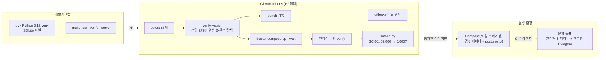

# 04. 인프라·DevOps — 어디서 어떻게 돌리고, 무엇이 문을 지키나

- 작성 2026-11-09 · 코드: `Dockerfile`, `docker-compose.yml`, 저장소 루트 `.github/workflows/demo-ci.yml`, `scripts/smoke.py`, `Makefile`, `.env.example`
- 출발점: `docs/requirements/notion/인프라-데브옵스-가이드.md`(11-05, '컨테이너 1개 + 관리형 Postgres + 정답 사례를 배포 문지기로'). 이 데모는 그 가이드의 **1단계를 실제로 만든 것**입니다.
- 2026-11-11 추가: EKS 사용 준비는 [14 EKS 배포 준비](14-eks-architecture.md)와 [연결·배포 가이드](../deploy/README.md)를 따릅니다. 아래 내용은 기존 로컬/Compose 구성의 기록입니다.

## 1. 한 장 그림



## 2. 실행 환경 세 가지

| | 로컬 개발 | Compose (로컬·스테이징) | 운영 목표(1→2단계) |
|---|---|---|---|
| 앱 | `make serve` (uvicorn, 127.0.0.1:8000) | 이미지 `chukhwabi-demurrage-demo` (python:3.12-slim, uid 10001) | 같은 이미지를 관리형 컨테이너 서비스(Cloud Run·Container Apps·ECS Express 중 교육과정이 주는 것) |
| DB | SQLite `runtime/demurrage.db` | postgres:16-alpine + 볼륨 | 관리형 PostgreSQL(자동 백업 + 시점 복구) |
| 설정 | 환경변수 | `.env`(저장소 밖) → compose | 비밀 저장소 → 환경변수 |
| LLM | 끔(기본) | `LLM_PROVIDER`로 선택 | 키는 비밀 저장소, 1회 상한 1달러 |
| 확인 | `make test verify` | `make up smoke` | 배포 직후 smoke → 사람 승인 → 전환 |

## 3. 컨테이너 설계

- **다단계 빌드**: 1단계에서 의존성만 `/opt/venv`에 설치, 2단계는 venv + `src/` + `data/`만 복사합니다. 테스트·문서·`.venv`는 `.dockerignore`로 뺍니다.
- **비root 실행**(uid 10001), `PYTHONDONTWRITEBYTECODE`, 쓰기 가능한 곳은 `/app/runtime`뿐.
- **헬스체크**: 이미지 안 `HEALTHCHECK`(/healthz)와 Compose의 `depends_on: service_healthy`(DB가 준비돼야 앱 시작). `/readyz`는 DB까지 확인합니다.
- **12요소 원칙**: 설정은 환경변수(`DATABASE_URL`, `LLM_*`, `PORT`), 로그는 stdout JSON, 상태는 DB에만(앱은 무상태라 여러 개 띄워도 됨), DB는 URL만 바꾸면 교체.
- 규칙 표·시나리오는 이미지에 들어갑니다(`DEMURRAGE_DATA_DIR=/app/data`). 규칙 값을 바꾸면 이미지도 새로 만들어 CI 문지기를 다시 통과해야 합니다 — 규칙 변경이 '조용히' 운영에 들어가지 않게 하려는 의도입니다.

## 4. CI/CD — 정답 사례가 문지기

| 순서 | 단계 | 막는 것 |
|---|---|---|
| 1 | `pytest tests` (88개) | 코드 회귀 |
| 2 | `python -m demurrage verify --strict` | 정답 세트 1칸이라도 틀림, 후보 위반 1건이라도, 완전 탐색과 1안 불일치 → merge 차단 |
| 3 | `bench` (기록만) | 성능 저하를 눈으로 확인 |
| 4 | gitleaks | 키·비밀이 저장소에 들어감(NFR-13) |
| 5 | `docker compose up -d --build --wait` | 이미지 빌드·기동 실패 |
| 6 | `docker compose --profile verify run --rm verify` | 이미지 안에서 정답 세트가 다르게 나옴(경로·버전 문제) |
| 7 | `python3 scripts/smoke.py http://localhost:8000` | **살아 있는 서비스**가 GC-01(52,000 → 6,000)을 다르게 계산, 실행 검사 실패 |
| 8 | (클라우드 결정 후) 이미지 푸시 → 스테이징 → smoke → 사람 승인 → 운영 | 규칙 변경이 승인 없이 운영에 들어감 |

[사실] 이 폴더는 아직 git 저장소가 아니라 GitHub에서 돌리지는 않았습니다. 같은 1~7단계를 로컬과 Docker Desktop에서 돌려 모두 통과했습니다(2026-11-09):

```text
■ health {'status': 'ok', 'engine': '0.1.0'}
■ ready  {'status': 'ready', 'db': 'postgresql'}
■ GC-01 정답 검문: 기준안 $52,000.00 / 1안 $6,000.00 (기대 52,000 / 6,000) → 통과
■ S5 통합 데모(v0.1 시나리오 ID, 지금은 S05): 최적 증명 · 기준안 $112,919 → 1안 $87,489 (절감 $25,431) · 실행 검사 10/10 → 통과
검문 통과
```

2026-11-11에 워크플로를 현재 작업 폴더 루트의 `.github/workflows/demo-ci.yml`로 옮기고 인프라 검사를 더했습니다. 이 폴더를 GitHub 저장소 루트로 사용할 때 `working-directory: demo`로 동작합니다. 아직 원격 GitHub 실행은 하지 않았습니다.

## 5. 관측 — 기술 지표와 업무 지표

| 무엇 | 어디서 | 예 |
|---|---|---|
| 접근 로그 | stdout JSON | `{"msg":"http","request_id":"…","path":"/api/runs","status":200,"ms":269.8}` |
| 실행 로그(Agent별) | `run.agent_log`, `GET /api/runs/{id}/audit` | 입력검증 2.6ms → 최적화 195ms(노드 420) → 리스크 56ms → 보고서 1.6ms |
| 지표 | `GET /metrics`(Prometheus 형식) | `demurrage_runs_total`, `demurrage_run_seconds_sum`, `demurrage_decisions_total`, `demurrage_llm_cost_usd`, `demurrage_golden_match_rate` |
| 감사 | `audit_events` 표 | RUN_CREATED, ASK(질문·거절 여부·도구), DECISION_SELECT/CANCEL/APPLIED, EXPORT_DOCX |
| 재현 | `runs.result_json` + `fingerprint` | 입력·규칙 버전·엔진 버전·탐색 설정이 같으면 지문이 같다(10회 시험) |

업무 지표 제안(인프라 가이드 4-7과 같음): 승인 대기 시간, 후보 채택률과 담당자가 1안 대신 다른 안을 고른 비율(결정 기록으로 계산 가능), 공공데이터 나이, LLM 실패율·비용.

## 6. 보안

| 위험 | 지금 막는 방법 | 남은 것(2단계) |
|---|---|---|
| 키가 저장소에 들어감 | `.env`는 `.gitignore`, `.env.example`만 공유, CI gitleaks | 운영은 비밀 저장소 + OIDC 배포 |
| 실데이터 노출 | 공개 데모·저장소에는 가상 데이터만(화면·보고서에 '가상 데이터' 표시) | 실데이터는 비식별 후 비공개 환경 |
| Agent가 확정·변경 | Agent 도구는 조회뿐, 확정은 사람 API 하나 | 로그인 사용자로 `actor` 채우기 |
| 기록 조작 | 결정·감사·LLM 호출은 DB 트리거로 수정·삭제 금지 | DB 계정 권한 분리(앱 계정은 INSERT만) |
| LLM로 민감 정보 유출 | 전송 허용 목록(요율·선박명·비고 제외) | 외부 전송 로그 점검 자동화 |
| 프롬프트 주입 | 자유 문장은 보내지 않음, 숫자는 자리표시자, 쓰기 도구 없음 | 문서 입력(메일·PDF)이 생기면 추출 결과 검증 강화 |
| 인증·HTTPS | **없음**(데모) | 관리형 수신(HTTPS) + SSO, 역할(스케줄러·지불 부서·관리자·읽기 전용) |

## 7. 백업·복구

- 잃으면 안 되는 것: 결정·감사 기록. 실행 결과는 입력·규칙 버전만 있으면 다시 계산할 수 있습니다(지문으로 같은지 확인).
- 운영은 관리형 Postgres의 자동 백업 + 시점 복구(PITR)를 켭니다. 목표값(얼마나 잃어도 되나·얼마나 걸려도 되나)은 현업과 정합니다 [확인 필요].
- Compose에서는 `pgdata` 볼륨을 `pg_dump`로 떠 둡니다.

## 8. 단계별 사다리

| 단계 | 내용 | 지금 |
|---|---|---|
| 1단계(마감용) | 컨테이너 1개 + DB 1개 + 자동 시험·검문 + 기본 관측 | **이 데모에서 완료** |
| 2단계 | 클라우드 배포(이미지 저장소·스테이징·운영), 로그인·역할, 비밀 저장소, 백업 목표, 대시보드 | 클라우드·LLM 제공 범위 확인 후 |
| 3단계 | 현업 데이터(SEAGATE 내보내기 파일 어댑터), 정해진 시각에 공공데이터 수집 작업, 당직·알림 | 주관 팀 자료를 받은 뒤 |

## 9. 운영 체크리스트

- [ ] `.env`를 만들고 `POSTGRES_PASSWORD`를 바꿨다
- [ ] `docker compose up -d --build --wait` → 두 컨테이너 healthy
- [ ] `python3 scripts/smoke.py http://localhost:8000` → 검문 통과
- [ ] `/metrics`에서 `demurrage_db_runs`가 늘어난다
- [ ] 규칙 표를 바꿨다면 `verify --strict`를 다시 돌렸고 결과를 '결정·변경 로그'(Notion)에 남겼다(팀 운영 방식)
- [ ] LLM을 켰다면 1회 상한(`LLM_COST_CAP_USD`)과 `/metrics`의 비용을 확인했다
