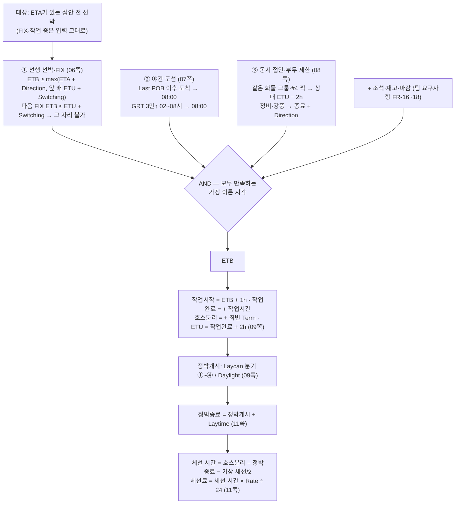

# 06. 계산 규칙과 손계산 정답 세트

- 작성 2026-11-09 · 규칙 원문: `data/rules/rule_registry.v1.json`(ID·이름·출처·상태), 값: `data/master/terminal_ulsan_clx.v1.json`, `data/rules/contract_rules.v1.json`
- 정답 세트: `data/golden/GC-01~15.json` — 사람이 손으로 계산한 값. 엔진이 낸 값을 정답으로 쓰지 않습니다.

## 1. 계산 흐름 — PPT 06 → 07 → 08 → 09 → 11쪽

## 2. 규칙 ID 표

| ID | 이름 | 내용 | 출처 | 상태 |
|---|---|---|---|---|
| ELG-01 | 부두 제원 | DWT·LOA(최소·최대)·PBL·Draft(수입선만) | FR-07 | 제원 값은 가정 |
| ELG-02 | 화물 그룹 | 자재코드 → 화물 그룹 → 취급 부두 | FR-08 | 매핑표는 가정 |
| WRK-01~04 | 작업 시각 | 작업시작 = ETB + 1h, 작업완료, 호스분리, ETU = 작업완료 + 2h | PPT 09 | PPT |
| ETB-01 | 선행 선박 | ETB ≥ max(ETA + Direction, 앞 배 ETU + Switching) | PPT 06 | PPT |
| ETB-02 | FIX 보호 | 다음 FIX ETB ≤ 예상 ETU + Switching → FIX 뒤로 | PPT 06 | PPT |
| ETB-03 | 야간 도선 Last POB | 대상 선박이 Last POB(일몰 − 1.5h/2h) 이후 밤에 도착 → 다음 08:00 | PPT 07 | **확인 필요** |
| ETB-04 | 새벽 02~08시 | GRT 3만↑: 접안 가능시각이 02:00 이상 08:00 미만 → 08:00 | PPT 07 | PPT |
| ETB-05 | 동일 화물 그룹 | {#6,#7,#8}, {#1-1,#1-2,#2-7} 같은 그룹 접안 중 → 상대 ETU − 2h | PPT 08 | PPT |
| ETB-06 | 부두 동시 접안 | #4-1·#4-2 → 상대 ETU − 2h, 둘 다 GRT 3,000 이하면 예외 | PPT 08 | PPT |
| ETB-07 | 부두 사용 제한 | 정비·강풍·사용자 제한 → 종료 + Direction, 하역 중인 배는 계속 | PPT 08 | PPT |
| ETB-08 | 조석 시간창 | 흘수 ≥ 기준이면 시간창 안에서만 | FR-17 | 시간창 값 가정 |
| ETB-09 | 재고 | 작업시작일 일말 재고가 범위 밖이면 가능한 날로 | FR-16 | 일 단위 단순화 |
| ETB-10 | ETB 통합 | 모든 제약의 AND, ETB가 바뀌면 전부 재검사 | PPT 06, FR-20 | PPT |
| ETB-11 | 출하 마감 | 마감 뒤 접안 불가 | FR-18 | 가정 |
| WX-01 | 강풍 접안 금지 | 예보 풍속 ≥ 15 m/s → 기상 부두 제한 | 팀 규칙표 | 가정 |
| LAY-01 | ETANR | NVL(NR_TENDER, ETA) | PPT 09 | PPT |
| LAY-02~05 | 정박개시 4분기 | Early Loading → ETB · Laycan Miss → ETB · 조기 도착 → From 06:00 · 그 밖 → min(ETANR + 6h, ETB) | PPT 09 | PPT |
| LAY-06 | Daylight | 원유선·제품선: 일출~일몰이면 +6h, 일출 전 당일 07:00, 일몰 후 다음 날 07:00, ETB가 이르면 ETB | FR-25 | **가정(PPT 10쪽 없음)** |
| LAY-07 | 정박종료 | 정박개시 + Laytime(계약 유형 배수) | PPT 11 | PPT |
| DEM-01~03 | 체선 시간·기상 공제·체선료 | 호스분리 − 정박종료 − 기상/2, × Rate ÷ 24 | PPT 11 | 기상 체선 정의는 가정 |
| OPT-01·02 | 기준안·후보 | FCFS, 후보 최대 3개(1척 이상 배정이 다름) | FR-34·35 | 팀 정의 |

규칙 문서·코드·정답 사례가 같은 ID를 쓰는지 시험이 매번 확인합니다(`test_rule_ids_in_code_are_registered`, `test_every_golden_check_cites_rule_ids`).

## 3. 정답 세트 15종

| ID | 다루는 규칙 | 사례 | 칸 |
|---|---|---|---|
| GC-01 | 두 척·한 부두 (SC-01을 PPT 규칙으로) | 1 | 기준안 52,000 / Y 먼저 6,000 / 최적화 |
| GC-02 | 정박개시 4분기 + 경계값 + NOR | 9 | |
| GC-03 | Daylight (일출·일몰·경계·선종) | 5 | |
| GC-04 | 야간 도선 Last POB·새벽창 + 경계 | 10 | |
| GC-05 | 동일 화물 그룹 | 3 | |
| GC-06 | #4-1·#4-2 (GRT 3,000 경계) | 3 | |
| GC-07 | 부두 사용 제한 + 작업 중 선박 | 4 | |
| GC-08 | FIX 보호 (같은 시각 경계) | 3 | |
| GC-09 | 기상 공제 + 규칙 표만 바꾸기 2종 | 3 | |
| GC-10 | 제원·화물 그룹 적합성, 자재코드 10개 | 10 + 매핑 | |
| GC-11 | 작업시간 추정 1차·2차 매칭·실적 없음 | 3 | |
| GC-12 | 세 척·두 부두 (상위 3개 후보) | 1 | |
| GC-13 | 강풍 뒤 새벽창 (제약 두 개 겹침) | 2 | |
| GC-14 | 재고 부족 | 2 | |
| GC-15 | 조석 시간창 + Last POB | 3 | |

합계 62사례·272칸, 일치율 100% [사실, 2026-11-09].

## 4. 손계산 풀이 (대표 4개)

### GC-01 — 두 척·한 부두 (부두 #4-1: Direction 1h, Switching 1h)

조건: 앞 배 W0가 11/10 06:00에 이안. X: ETA 02:00, 허용 24h, 하루 48,000(시간당 2,000), 작업 14h. Y: ETA 04:00, 허용 12h, 하루 96,000(시간당 4,000), 작업 8h. 호스분리 1h, 모두 Laycan 안·화학선(Daylight 미적용).

| | 기준안 X 먼저: X | Y | Y 먼저: Y | X |
|---|---|---|---|---|
| ETB | 06:00 + 1h = **07:00** | X ETU 24:00 + 1h = **11/11 01:00** | **07:00** | Y ETU 18:00 + 1h = **19:00** |
| 작업 | 08:00~22:00 | 11/11 02:00~10:00 | 08:00~16:00 | 20:00~11/11 10:00 |
| 호스분리 | 23:00 | 11/11 11:00 | 17:00 | 11/11 11:00 |
| 정박개시 = min(ETANR + 6h, ETB) | min(08:00, 07:00) = 07:00 | min(10:00, 11/11 01:00) = 10:00 | 07:00 | min(08:00, 19:00) = 08:00 |
| 정박종료 | 11/11 07:00 | 22:00 | 19:00 | 11/11 08:00 |
| 체선 시간 | 0 | 13h | 0 | 3h |
| 체선료 | 0 | **52,000** | 0 | **6,000** |

→ 기준안 52,000, 1안(Y 먼저) 6,000, 절감 46,000. SC-01 손계산(`docs/requirements/09-first-steps.md`)과 시각까지 같습니다.

### GC-09 — 기상 공제

강풍(17 m/s) 11/10 08:00~20:00 → #4-1 접안 금지 [08:00, 21:00). ETA 07:30 → 08:30은 금지 구간 → **ETB 21:00**. 정박개시 = min(07:30 + 6h, 21:00) = 13:30, Laytime 6h → 정박종료 19:30. 작업 22:00~11/11 08:00, 호스분리 11/11 09:00 → 공제 전 체선 13.5h. 기상이 없었다면 ETB 08:30 → 기상 대기 [08:30, 21:00) 중 체선 기간에 든 [19:30, 21:00) = 1.5h → 공제 0.75h → **12.75h × 1,000 = 12,750**.
규칙 표에서 공제 비율만 0으로 → 13,500. #4 Direction만 2h로 → ETB 22:00, 공제 전 14.5h, 기상 2.5h·공제 1.25h → 13,250. (코드는 그대로 — NFR-04 시연 2종)

### GC-12 — 세 척·두 부두 (#1-1: D1·S1.5h, #6: D1.5·S2.5h)

A: ETA 00:00·허용 12h·시간당 2,000·작업 10h / B: 01:00·24h·1,000·20h / C: 02:00·6h·3,000·6h (호스 1h, 모두 Laycan 안·특수제품선).

| 배정(부두: 순서) | A | B | C | 합계 |
|---|---|---|---|---|
| 기준안: #1-1 A→C, #6 B | 0 | 0 | 15:30 접안, 9.5h → 28,500 | **28,500** |
| **1안**: #1-1 C→B, #6 A | 0 | 13:30 접안, 4.5h → 4,500 | 03:00 접안, 2h → 6,000 | **10,500** |
| **2안**: #1-1 A, #6 C→B | 0 | 15:00 접안, 6h → 6,000 | 03:30 접안, 2h → 6,000 | **12,000** |
| **3안**: #1-1 A→B, #6 C | 0 | 15:30 접안, 6.5h → 6,500 | 6,000 | **12,500** |
| #1-1 C, #6 A→B | 0 | 17:00, 8h → 8,000 | 6,000 | 14,000 |
| 나머지 부두 나누기 7가지 | | | | 21,000 이상 |
| 한 부두에 몰기 12가지 (대표 #1-1 C→A→B만 손계산) | | | | 40,000 이상 |

허용 시간이 짧고 비싼 C를 먼저 보내는 것이 핵심입니다. 엔진의 후보 1·2·3안 금액과 1안 부두별 순서가 이 표와 같습니다.

### GC-13 — 제약 두 개가 겹칠 때 (#7: D1.5h, GRT 4만)

강풍 11/10 20:00~11/11 01:00 → 금지 [20:00, 02:30). ETA 21:00 → 22:30(금지) → **02:30**(ETB-07) → 새벽창 [02:00, 08:00) → **08:00**(ETB-04). 기상이 없었다면 22:30(새벽창 아님) → 기상 대기 9.5h. 정박개시 = ETANR 21:00 + 6h = 03:00(ETB가 더 늦음), Laytime 12h → 정박종료 15:00, 호스분리 20:00 → 체선 5h, 기상 대기는 허용 시간 안에 끝나 공제 0 → **10,000**. Laytime 2h면 정박종료 05:00 → 기상 대기 중 [05:00, 08:00) 3h가 체선 기간 → 공제 1.5h → 13.5h → **27,000**.

## 5. 해석을 정한 곳 [가정]

| 곳 | 정한 해석 | 이유 |
|---|---|---|
| Laycan From·To | 날짜만 오면 From 00:00, To 23:59. ETANR = From·To(경계)는 ④ | PPT 비교식 그대로(<, >) |
| Daylight 경계 | 일출·일몰 시각과 같으면 '사이' | FR-25 문장 "일출~일몰 사이" |
| Last POB 범위 | ETA가 [Last POB, 다음 날 08:00) 안이면 대상(자정 넘은 도착 포함) | 'ETA ≥ Last POB'를 밤 전체로 읽음 |
| GRT 5만 정확히 | 일몰 − 1.5h(5만 이하) | PPT의 '5만 이하'·'5만 이상'이 겹침 |
| 동시 접안 배타 구간 | [ETB, ETU − 2h) = [ETB, 작업완료) | 'ETB = 상대 ETU − 2h'를 양쪽에 대칭으로 |
| FIX 경계 | ETU + Switching = FIX ETB도 불가 | PPT 'FIX ETB ≤ 예상 ETU + SWITCHING → 접안불가' |
| 기상 체선 시간 | 기상이 없었다면의 ETB ~ 실제 ETB 중 체선 기간 | 규칙 적용 순서와 무관한 정의 |
| 재고 | 작업시작일에 물량 전부, 일말 기준 | FR-16 '일 단위' |
| 작업시간 반올림 | 분 단위 반올림(ROUND_HALF_UP) | |
| 최빈 Term 동률 | 짧은 쪽 | 결정론 |

## 6. 정답 사례를 더하는 법

1. 조건을 작게(배 1~3척) 정하고, **엔진을 돌리기 전에** 손으로 시각·금액을 계산한다(이 문서 4절처럼 표로).
2. `data/golden/GC-xx.json`에 `defaults`(공통 조건)와 `cases`(조건·기대값)를 적는다. 기대값 칸: `etb`, `laytime_start`, `laytime_end`, `hose_off`, `demurrage_hours`, `amount_usd`, `pushes`(밀어낸 규칙 순서), `plans`(순서 지정), `optimizer`(후보 금액).
3. `python -m demurrage verify --strict` — 다르면 엔진이 틀렸는지 손계산이 틀렸는지 규칙 문서로 따진다. 엔진 값을 정답으로 옮겨 적지 않는다.
