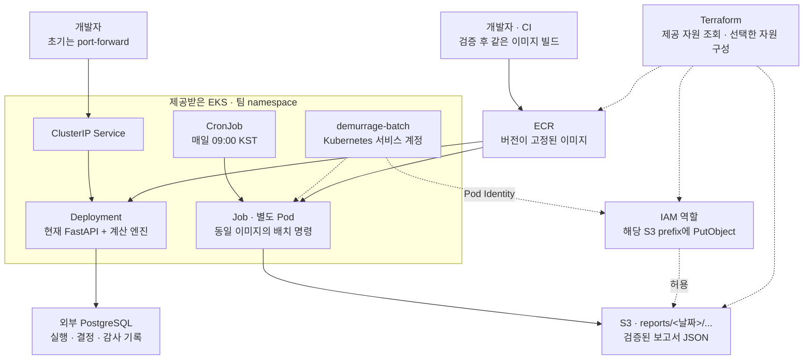

# 14. EKS 배포 준비 — 설정의 이유와 우리가 맡을 일

작성: 2026-11-11. 대상은 현재 저장소에서 실행 가능한 Python 데모다. [배포 순서와 명령](../deploy/README.md), [YAML](../deploy/k8s/base/), [Terraform](../deploy/terraform/).

## 1. 이번에 연결할 구조

Terraform은 AWS 자원 설정을 관리한다. EKS는 컨테이너 실행을 관리한다. CronJob은 시간에 맞춰 Job을 만든다. API 요청은 사용자 흐름이고, 배치는 종료형 계산 작업이다. API와 배치는 같은 계산 엔진·이미지를 쓰며 실행 방식과 권한을 나눈다.

현재 배치는 가상 시나리오로 **계산 → 검증 → 저장** 연결을 확인하기 위한 첫 작업이다. 오늘 날짜의 실제 선박·기상 정보를 자동 수집하는 기능은 아직 구현하지 않았다. `fetch-public`도 현재 실제 API를 호출하지 않는 계산본 저장 코드여서, 수집 배치를 완성했다고 보지 않는다.

## 2. 왜 이렇게 설정했나

| 선택 | 프로젝트에서의 이유 | 남는 제약·다음 조건 |
|---|---|---|
| 제공받은 EKS 사용 | 다음 주 자원의 소유 범위가 아직 불명확하다. 공용 클러스터를 재생성하는 구성을 피한다 | VPC·노드·접근 경로·add-on은 제공자와 확인 |
| S3·ECR 생성은 선택 | 기존 자원을 그대로 사용하면서 팀이 직접 만들 범위도 열어 둔다 | 기존 자원 정책은 제공자가 관리 |
| 같은 이미지, 다른 실행 명령 | API와 배치가 같은 엔진·규칙 버전을 사용한다 | 배포 버전과 입력을 함께 기록해야 재현 가능 |
| API 1 replica + Recreate | 현재 Store가 시작할 때 테이블과 트리거 DDL을 실행한다. 첫 연결에서 동시 초기화를 줄인다 | 고가용성·무중단 배포는 제공하지 않는다. 마이그레이션 분리 후 replica/전략 변경 |
| 외부 PostgreSQL | Pod 교체와 DB 데이터 수명을 분리하고 기존 SQLAlchemy 경로를 사용한다 | DB 제공·접속·백업·복구·권한 확인 필요 |
| Startup probe | 시작과 DB 초기화에 시간을 준다 | 시작 시간은 실제 환경에서 측정해 조정 |
| readiness는 DB까지, liveness는 프로세스 | DB가 끊기면 요청 대상에서 제외하고, DB 장애만으로 API를 반복 재시작하지 않게 한다 | DB가 복구되는지와 장애 지속 시간을 관측 |
| ClusterIP | 현재 API에 사용자 인증이 없다. 연결 검증에는 port-forward로 충분하다 | 공개 서비스에는 Spring/SSO·TLS·Ingress를 연결 |
| API와 배치 서비스 계정 분리 | 보고서 저장에 필요한 S3 권한을 배치에만 준다 | 노드 IMDS 접근 제한도 제공자가 확인해야 완전한 역할 격리에 가까워진다 |
| Pod Identity | 사람의 access key를 이미지·Secret에 넣지 않고 임시 자격 증명을 사용한다 | 지원되는 노드·Agent·SDK·네트워크 조건 확인 |
| CronJob 일단 중지 | 잘못된 버킷/권한 상태에서 예약 작업이 먼저 실패하지 않게 한다 | 수동 Job과 S3 확인 후 활성화 |
| Forbid + 재시도 2회 + 실행 한도 600초 | 같은 CronJob의 겹침과 끝나지 않는 작업을 제한한다 | 수동 Job과 다른 CronJob까지 막는 전역 잠금은 아니다 |
| JSON 하나 + S3 조건부 쓰기 | 보고서 파일 일부만 저장되는 상태와 같은 논리 결과의 덮어쓰기를 줄인다 | 중복 계산은 가능하다. 계산 결과가 달라지면 다른 키로 보존 |
| 비root + 읽기 전용 root | 프로그램이 써야 하는 임시 경로를 명시하고 실행 권한을 제한한다 | `/tmp`, `/app/runtime`은 임시 공간이며 업무 데이터 영속 저장소가 아니다 |
| CPU·메모리 requests/limits | namespace 스케줄링과 한 작업의 자원 사용 범위를 명시한다 | 250m/256Mi 요청, 1 CPU/1Gi 한도는 초기값이다. 부하 측정으로 바꾼다 |
| LLM 기본 끔 | 인프라 연결·정답 검증 단계에서 외부 모델 가용성·요금에 의존하지 않는다 | 실제 LLM은 계약된 공급자·키·비용 상한 확인 후 연결 |
| state 원격 저장 + S3 잠금 | 팀원들이 같은 관리 기록을 공유하고 동시 적용 충돌을 줄인다 | state 버킷 bootstrap·운영자 권한·버전 관리가 필요 |

Pod Identity의 권한은 `reports/*`에 `s3:PutObject`만 기본 허용한다. API에는 이 역할을 연결하지 않는다. S3에 저장하는 고객 관리 KMS 키를 쓰면 `kms:GenerateDataKey`를 해당 키에 추가한다. 이 정책은 배치가 현재 수행하는 작업에 맞춘 것이며, 향후 입력 수집·읽기 기능을 더할 때 필요한 권한을 별도로 추가한다.

S3 보고서에는 배치 실행 결과가, PostgreSQL에는 API에서 생성한 실행·결정·감사가 남는다. 이 둘의 작업 목록을 통합하는 API는 이번 범위에 포함하지 않았다. 배치가 자동으로 접안 계획을 확정하거나 메일을 보내지는 않는다.

## 3. 우리가 이 아키텍처를 떠받치는 일

| 팀의 일 | 구체적인 산출물 | 완료 확인 |
|---|---|---|
| 입력 계약 정하기 | 선박·계약·기상 데이터의 JSON schema, 누락/오류 처리, 기준 시각 | 같은 입력으로 API·배치가 같은 검사를 통과 |
| 계산의 정답 지키기 | 손계산 정답 세트, 규칙 ID·출처·버전, 독립 검증기 | 배포 전 `make test`·`make verify` 통과 |
| 배포를 재현 가능하게 만들기 | 이미지 태그/digest, 설정값, Terraform plan, 배포 이력 | 이전 버전으로 다시 배포할 수 있음 |
| 실패를 끝까지 드러내기 | 실패 exit code, 재시도 정책, 오류 분류와 작업 ID | S3 권한 오류가 Job 실패로 보이고 알림 대상이 됨 |
| 중복을 처리하기 | 날짜·입력·버전·결과로 정한 저장 키, 조건부 PUT | 같은 배치를 재실행해 기존 JSON이 보존됨 |
| 상태를 안전하게 남기기 | DB 결정·감사 기록, S3 결과, 복구 절차 | Pod 교체 뒤에도 조회 가능하고 백업 복원이 확인됨 |
| 사람 권한과 프로그램 권한 나누기 | 사용자 EKS 권한, 배치 IAM 역할, DB 계정, 비밀 관리 | 프로그램이 사람의 access key 없이 동작 |
| 운영 상태 보기 | API health/ready, Job 성공/실패, 실행 시간, 메모리, DB·S3 오류 | 실패를 팀이 발견하고 원인을 좁힐 수 있음 |
| 업무 정확성 보기 | 마지막 성공 입력 시각, 데이터 신선도, 실행 검사, 규칙 버전 | HTTP 200이어도 오래된 데이터·잘못된 계산을 구분 |
| 비용과 규모 제어하기 | replica·자원 한도·배치 주기·로그/파일 보존 정책 | 프로젝트 예산과 quota 안에서 데모 실행 |

인프라 담당자 한 명이 모든 코드를 작성할 필요는 없다. 예를 들어 AI/DATA는 입력·규칙·배치의 실패 조건을, BE는 API·인증·DB 경계를, Infra는 배포·IAM 연결·관측을 맡을 수 있다. 장애 시 어디서 멈췄는지와 다음 담당자가 누구인지는 함께 합의해야 한다.

## 4. 지금부터 자원 연결까지의 작업 순서

1. **지금:** 로컬 API·배치·정답 검증, YAML 렌더링, Terraform mock 검사. 실데이터 없이 실행 경로를 고정한다.
2. **자원을 받는 날:** 계정·리전·namespace·ECR·S3·DB·Pod Identity 조건과 역할 소유 범위를 확인한다.
3. **첫 연결:** 이미지 push → DB Secret/CA → API 배포 → health/ready/smoke → 수동 Job → S3 확인.
4. **예약 시작:** CronJob 활성화와 다음 회차 성공을 확인하고 실패 로그/알림 경로를 점검한다.
5. **운영 보강:** 실제 입력 어댑터, 인증·TLS, 마이그레이션 분리, 중앙 로그·실패 알림, 백업 복구를 순서대로 붙인다.

## 5. Spring Boot + Python 방향으로 확장할 때

[ADR-014·015](adr/README.md)에 있는 Spring Boot 앞단과 Python 계산/LangGraph 분리 방향은 별도로 유지한다. 이 저장소에는 아직 그 Spring Boot 애플리케이션이나 LangGraph 서비스 구현이 없으므로, 작동하지 않는 이미지 주소와 API 경로를 배포 대상으로 추가하지 않았다.

구현이 준비되면 다음을 덧붙인다.

- Spring용 ECR 이미지·Deployment·내부 Service, Spring Actuator 상태 검사와 별도 자원 한도.
- Python 서비스는 현재처럼 내부 Service로 유지하고, Spring이 해당 주소를 호출한다.
- 두 서비스의 OpenAPI 계약·오류 형식·요청 ID·timeout을 맞춘다. 긴 작업은 작업 ID와 상태 조회를 구현한 후 실행한다.
- 사용자 인증·권한·승인 기록의 소유자를 Spring으로 옮기고 DB schema·마이그레이션 소유권을 나눈다.
- 브라우저에서 공개 접근할 경로에만 Ingress·TLS·인증을 연결한다. Python 계산 Pod를 곧바로 공개하지 않는다.
- LangGraph를 도입해도 계산 엔진의 정답 검증과 사람만 수행하는 확정 경계를 유지한다.

## 6. 제공자에게 요청할 항목

- EKS 사용자 접근과 팀 namespace 권한, 노드 CPU 아키텍처·quota·네트워크 접속 경로.
- ECR push/pull, S3 보고서 prefix, 별도 Terraform state 버킷과 잠금 권한.
- Pod Identity 지원 여부·Agent·노드 권한과 배치 역할 연결. 노드 자격 증명 IMDS 접근 제한.
- PostgreSQL·CA·백업 정책과 EKS에서 DB/S3/ECR/EKS Auth API로 나갈 수 있는 경로.
- 제공되는 중앙 로그·실패 알림·모니터링 도구와 예산/자원 반납 기준.

외부 자원을 받은 뒤의 server dry-run·실제 배포·S3 저장·DB 복구 검증은 로컬 설정 검사로 대체되지 않는다. 각 연결 단계의 증거를 배포 기록에 남긴다.
