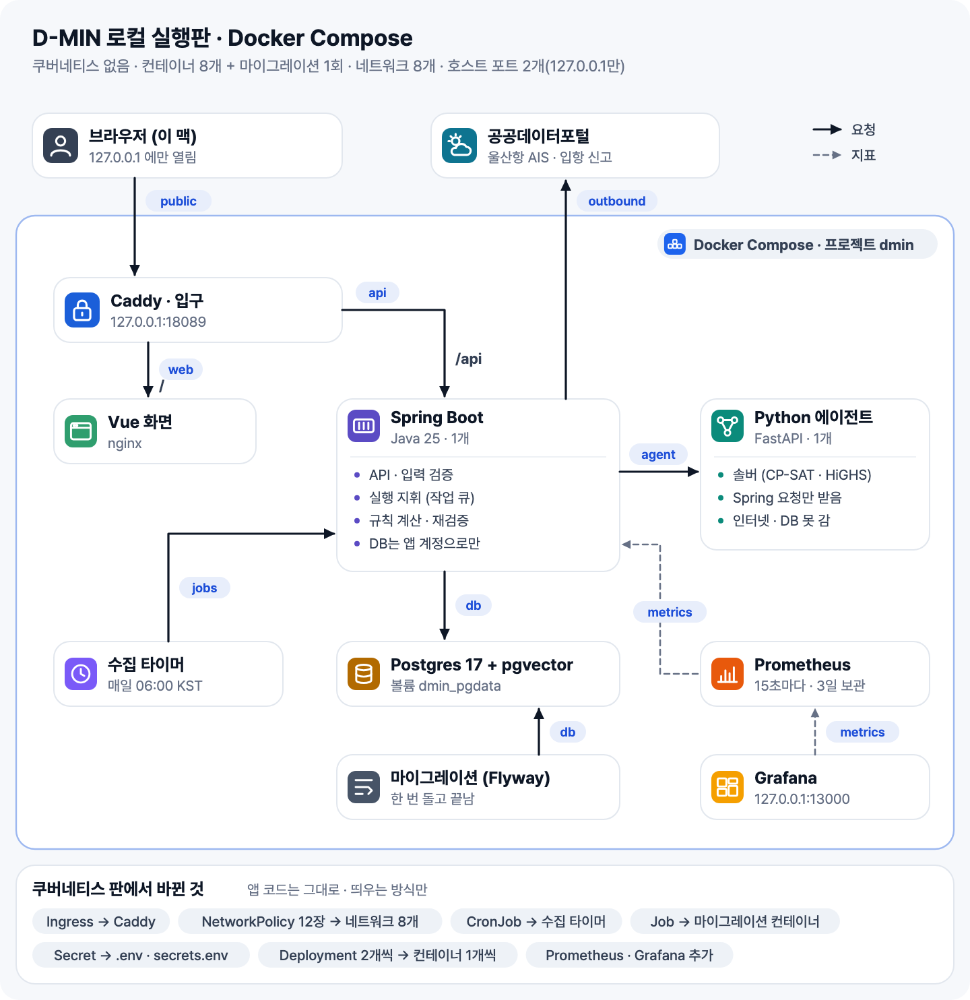

# dmin-local-compose — D-MIN 실행판 (아키텍처 v1.2 · Docker Compose)

아키텍처 정의서 **v1.2(EC2 한 대 + Docker Compose 안)** 에 맞춰 백엔드(Spring) · 에이전트(Python) · 프론트(Vue)를 한 번에 띄우는 실행판이다. 데이터(JSON·CSV)를 넣으면 **Spring**이 검사·저장하고, **Python** 엔진이 접안 후보를 찾고, **Spring**이 같은 식으로 처음부터 다시 계산해 시각 5개와 금액이 1분·1센트까지 맞는지 대조한다.

- 기준: 팀 Figma '아키텍처 다이어그램'의 To-Be 보드(EC2 + Docker Compose 배치안) · 정의서 탭 '아키텍처 초안 v1.2 제안 (EC2 안)'
- v1.1(EKS 안)에서 달라진 것은 **띄우는 방식**이다: 쿠버네티스 대신 Docker Compose 하나로 띄운다. 아래에서 '쿠버네티스 판'은 v1.1에 맞춰 kind 클러스터로 돌리던 이전 실행판을 말한다(이 저장소에는 올리지 않았다)
- 2026-11-16 결과: `make verify-full` **검사 118개 모두 통과**(예시 3척 · 54척 두 벌을 두 엔진으로, 금액이 쿠버네티스 판과 같다). 멈췄다 켜기 26초, 지웠다 다시 띄우기 29초 뒤에도 데이터는 그대로였다
- `server/` · `agent/` · `front/`는 이 실행판을 위해 만든 구현이다. 팀 저장소의 server · front · agent와는 별개이고, 같은 버전·규칙(Spring Boot 4.1 · Java 25 · Python 3.13 · Vue 3)을 따른다
- `agent/src/dmin_agent/berth_sim/`은 팀원 최적화 코드의 복사본이다(고치지 않는다 · 출처와 파일 목록은 그 폴더의 `VENDORED.md`)
- **프로토타입이다.** 로그인이 없어 인터넷에 그대로 열면 안 된다 → [6. 아직 없는 것](#6-아직-없는-것-인터넷에-열기-전에)

## 1. 띄우기

준비물: Docker Desktop(가용 메모리 3GiB 권장), Python 3 · make(Xcode Command Line Tools), curl · openssl(맥 기본). kind·kubectl·helm은 필요 없다.

```bash
cd dmin-local-compose
make up
```

```bash
make verify
```

- `make up`: 비밀값 → 이미지 3개(Spring·Python은 빌드 안에서 정답 테스트) → DB → 마이그레이션 → 앱. 처음 약 5분, 코드를 안 고쳤으면 `SKIP_BUILD=1 make up`
- 처음 `make up`은 `.env`를 `.env.example`에서 만들고 DB·Grafana 비밀번호를 `runtime/secrets.env`에 새로 만든다. 둘 다 커밋되지 않는다
- 공공데이터 키는 `.env`의 `PUBLIC_DATA_SERVICE_KEY`에 넣는다(선택). 없으면 실시간 AIS·입항 신고·매일 수집만 꺼진다. 키를 바꾼 뒤에는 `make restart`
- 화면: <http://127.0.0.1:18089> → 메뉴 **데이터 실행**
- Grafana: <http://127.0.0.1:13000> — 아이디 `admin`, 비밀번호는 `runtime/secrets.env`의 `GRAFANA_PASSWORD`

## 2. 구조



| 컨테이너 | 하는 일 | 쿠버네티스 판에서는 |
|---|---|---|
| `dmin-caddy` | 입구. `/`는 Vue, `/api`는 Spring. `/internal`·`/actuator`는 넘기지 않는다 | Ingress(Traefik) |
| `dmin-front` | Vue 화면 (nginx) | Deployment 2개 |
| `dmin-server` | Spring: API · 실행 지휘 · 규칙 계산 · 공공데이터 | Deployment 2개 |
| `dmin-agent` | Python: 솔버 | Deployment 1개 |
| `dmin-postgres` | DB (RDS 자리) | StatefulSet |
| `dmin-migrate` | Flyway 마이그레이션. 한 번 돌고 끝난다 | Job |
| `dmin-collector` | 매일 06:00 KST에 Spring의 수집 경로를 깨운다 | CronJob |
| `dmin-prometheus` · `dmin-grafana` | 지표 수집(3일 보관) · 대시보드 | 없었음(메모리 때문에 뺐었다) |

누가 누구에게 닿는지는 `compose.yaml`의 **네트워크 8개**가 정한다(쿠버네티스 판의 NetworkPolicy 12장 자리). `web`(Caddy↔Vue) · `api`(Caddy↔Spring) · `agent`(Spring↔Python) · `db`(Spring↔Postgres) · `jobs`(수집 타이머→Spring) · `metrics`(Prometheus→Spring, Grafana→Prometheus)는 밖으로 나가는 길이 없는 내부 네트워크다. 호스트 포트는 Caddy와 Grafana만, 127.0.0.1에만 연다.

## 3. 자주 쓰는 명령

| 명령 | 하는 일 |
|---|---|
| `make status` | 컨테이너 상태와 `/api/system/status` |
| `make logs` | Spring·Python 최근 로그 |
| `make data` | `data/inbox/`의 파일을 넣고 후보 계산까지 (`FILE=경로`로 한 파일만) |
| `make collect` | 공공데이터 수집을 지금 한 번 |
| `make stop` · `make start` | 지우지 않고 멈추기 · 다시 켜기 |
| `make backup` | DB 데이터 백업 → `runtime/` |
| `make down` | 컨테이너 지우기. **DB 볼륨은 남는다** |
| `make clean CONFIRM=yes` | DB·지표 볼륨과 `runtime/`까지 전부 지우기 |
| `make test` | 컨테이너 없이 단위 테스트 |

데이터 형식과 검사 규칙은 [data/README.md](data/README.md)(쿠버네티스 판과 같다).

## 4. 쿠버네티스 판과 달라지는 점 (얻은 것 · 내준 것)

- **얻은 것**: 띄우는 데 필요한 것이 Docker 하나다. 클러스터 부품(Traefik·CoreDNS 등)이 없어 메모리를 덜 쓰고, 설정이 `compose.yaml` 한 파일에 다 보인다. Prometheus·Grafana를 같이 띄울 자리가 생겼다.
- **끊김**: Spring이 한 개라 다시 뜨는 동안 `/api`가 끊긴다. 쿠버네티스 판은 2개라 하나를 지워도 계속 답했다. 끊기는 시간은 `make verify` 10단계가 잰다(이 맥에서는 2~3초였다).
- **멈춘 컨테이너**: 프로세스가 죽으면 Docker가 다시 띄운다. 죽지 않고 멈춰만 있으면 `unhealthy` 표시만 하고 다시 띄우지 않는다(`make status`로 보고 `make restart`).
- **DB 데이터**: 볼륨에 있어 `make down`으로는 안 지워진다. 쿠버네티스 판은 `make down`이 DB까지 지웠다.
- **Python의 인터넷**: 지금은 막혀 있다(쿠버네티스 판과 같다). LLM 문장 노드를 붙일 때 `agent` 네트워크의 `internal: true`를 빼면 된다.

## 5. EC2로 옮길 때 바뀌는 것 (여기에는 없다)

| 자리 | 로컬 (이 폴더) | EC2 |
|---|---|---|
| DB | `dmin-postgres` 컨테이너 | RDS for PostgreSQL 17 + pgvector (서비스에서 뺀다) |
| 입구 | HTTP `127.0.0.1:18089` | `Caddyfile`에 도메인 → 80·443, HTTPS 인증서 자동 |
| 이미지 | 이 맥에서 빌드 | ECR에서 받기 (태그 = 커밋 SHA) |
| 비밀값 | `.env` · `runtime/secrets.env` | 배포 때 Secrets Manager에서 읽어 같은 이름으로 넣기 |
| AWS 권한 | 없음 | 인스턴스 역할(S3). Python 컨테이너의 메타데이터 접근은 막는다 |

## 6. 아직 없는 것 (인터넷에 열기 전에)

지금은 `127.0.0.1`에만 열려 있어 이 컴퓨터 밖에서는 접속되지 않는다. 서버에 올려 밖에 열려면 아래가 먼저 있어야 한다(2026-11-16 점검).

- **로그인 · 권한**: `/api` 전체가 열려 있다. 주소를 알면 누구나 데이터를 보고, 계산을 돌리고, 결정을 기록할 수 있다
- **HTTPS · 접속 기록**: 입구(Caddy)가 HTTP만 받고 접속 기록을 남기지 않는다
- **요청 한도**: IP·사용자별 속도 제한이 없다(Caddy 기본판에는 속도 제한 모듈이 없다). 실행 대기열 길이와 데이터 개수에도 한도가 없고, 같은 데이터의 중복 실행만 막는다
- **로그 회전**: 컨테이너 로그에 크기 제한이 없다
- **멈춘 컨테이너**: 죽지 않고 응답만 멈춘 컨테이너는 저절로 다시 뜨지 않는다

이미 있는 것: 요청 본문 10MB 한도 · 입력 검사 · 솔버는 한 번에 1개 · 내부 네트워크 분리 · DB 계정 분리 · 컨테이너 권한 최소. `make verify`가 확인한다.

## 7. 폴더

```text
dmin-local-compose/
├── compose.yaml     컨테이너 9개 · 네트워크 8개 · 볼륨 3개
├── Makefile         자주 쓰는 명령
├── caddy/           입구 설정 (Caddyfile)
├── postgres/        DB를 처음 만들 때 앱 계정을 만드는 스크립트
├── observability/   Prometheus 설정 · Grafana 데이터 소스와 대시보드
├── server/          Spring Boot 4.1 · Java 25
├── agent/           FastAPI · Python 3.13 — 팀 엔진(berth_sim · CP-SAT, 기본) + 기존 엔진(HiGHS)
├── front/           Vue 3 · Vite → nginx
├── rules/           규칙 표 사본
├── data/            inbox(넣는 곳) · samples(정답 있는 예시) · templates(CSV 틀) · out(결과)
├── scripts/         up · secrets · stop-start · status · db-data · collector · verify.py · dmin-data.py · sync-engine
├── docs/assets/     구조 그림 (python3 docs/assets/make_figure.py 로 다시 만든다)
└── runtime/         비밀번호 · 백업 · 검증 기록 (커밋 안 됨)
```
