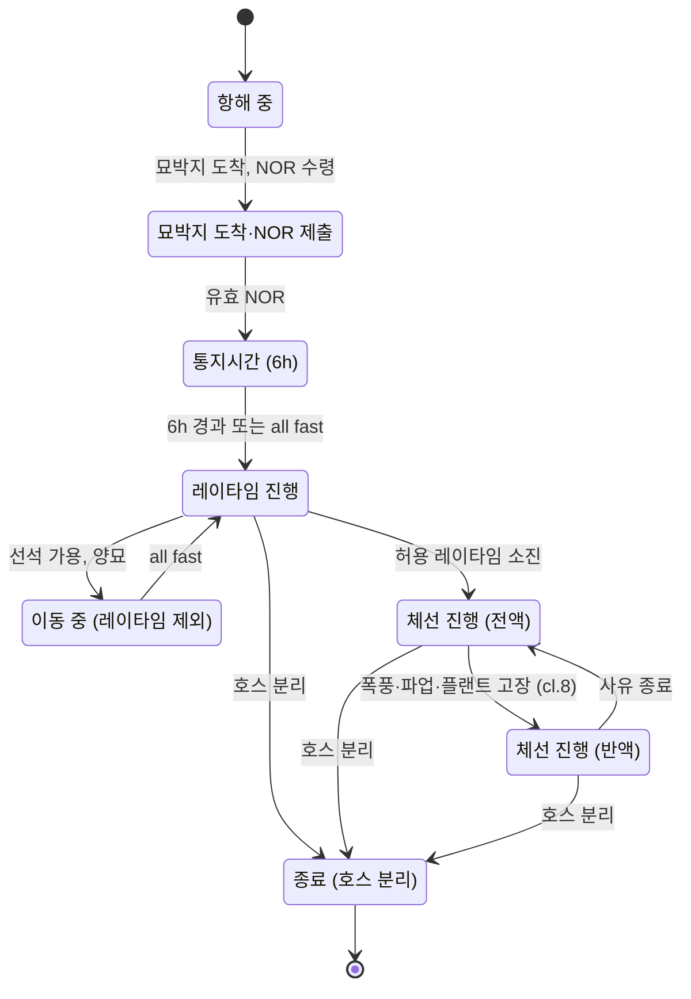
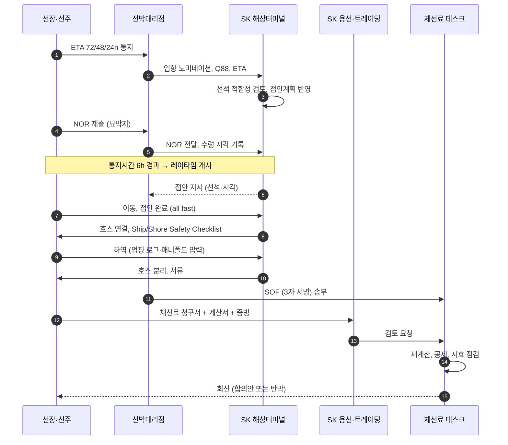
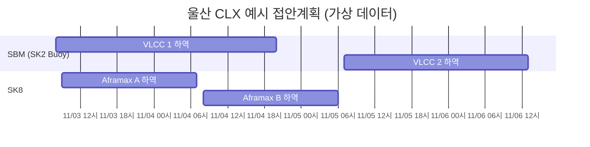
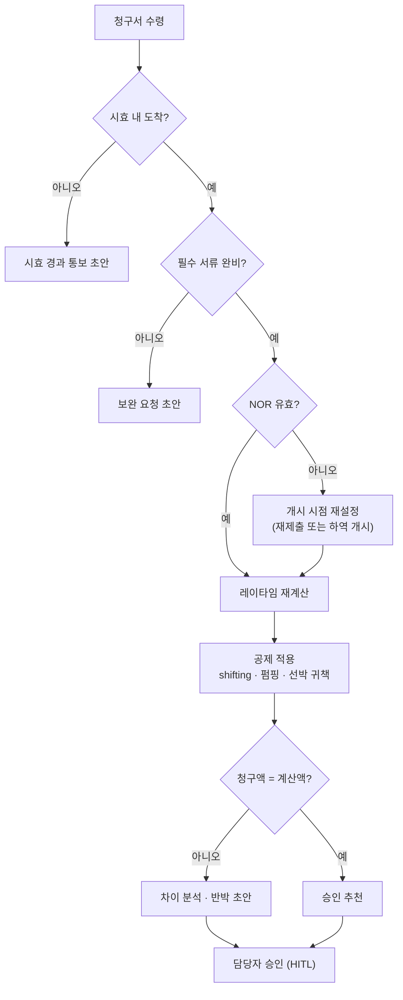
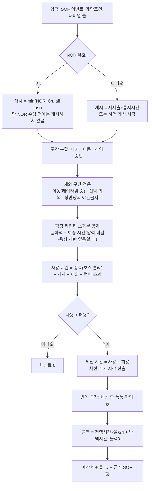

# 프로세스 흐름 — 항차 타임라인, 역할 간 흐름, 레이타임 시계

- 작성일: 2026-11-02
- 갱신: 2026-11-02 — CLOCK 프로토타입(`../../clock/`) 검증 결과 반영. §6 순서도에서 펌핑 초과 공제를 사용 시간 계산 앞으로 옮기고, NOR 전 개시 금지를 넣었다.
- 용도: 체선료가 생기는 과정을 그림으로 익히고, 각 단계에서 Agent가 무엇을 해야 하는지 연결한다. 다이어그램은 Mermaid로 작성했으며 Obsidian·GitHub에서 그대로 렌더된다.
- 기준: 탱커 항해용선(Asbatankvoy), 양하항 = 울산 CLX SK 선석. 수치는 [가정].

---

## 1. 양하항 항차 타임라인 — 어느 구간이 레이타임에 들어가나

```mermaid
flowchart LR
  A["레이캔·노미네이션"] --> B["ETA 통지<br/>72/48/24h"]
  B --> C["묘박지 도착<br/>arrived ship"]
  C --> D["NOR 제출"]
  D --> E["통지시간 6h"]
  E --> F["선석 대기"]
  F --> G["이동 shifting"]
  G --> H["접안 완료<br/>all fast"]
  H --> I["호스 연결"]
  I --> J["하역 작업"]
  J --> K["호스 분리"]
  K --> L["서류·출항"]
  classDef count fill:#dbeafe,stroke:#2563eb,color:#111827
  classDef nocount fill:#f3f4f6,stroke:#9ca3af,color:#111827
  classDef edge fill:#fef3c7,stroke:#d97706,color:#111827
  class F,H,I,J count
  class G nocount
  class E,K edge
```

| 구간 | 레이타임 산입 | 비고 |
|---|---|---|
| 도착 → NOR | 아니오 | NOR을 늦게 내면 선주 손해 |
| 통지시간 6h | 아니오, 단 그 사이 접안 완료되면 그 시점부터 산입 | Asbatankvoy cl.6 |
| 선석 대기 | **예** | 체선료의 주 원인. 용선주 위험(reachable on arrival) |
| 이동 shifting | 아니오(레이타임 중) / 쟁점(체선 중) | cl.7 |
| 접안 완료 → 호스 연결 → 하역 | **예** | 선박 귀책 지연은 공제 |
| 호스 분리 | 종료 시점 | 서류 대기 산입 여부는 서식별 |

---

## 2. 레이타임 시계의 상태 전이

Agent CLOCK 모듈은 이 상태 기계 그대로다. SOF 이벤트가 들어올 때마다 상태를 전이시키고, 각 상태에 머문 시간을 "산입 / 제외 / 전액 체선 / 반액 체선"으로 누적한다.

---

## 3. 역할 간 흐름 — 누가 무엇을 주고받나

| 단계 | 생성되는 데이터 | Agent 모듈·액션 |
|---|---|---|
| 1~2 | ETA, Q88, 노미네이션 | INTAKE: 파싱, 누락 표시. SCHED: 초기 접안계획 |
| 4~5 | NOR 제출·수령 시각 | CLOCK: 유효성 1차 점검(도착 시각 대조), 개시 예정 시각 계산 |
| 6~7 | 대기 시작, 접안 지시 | EXPOSURE: "이 순서면 체선 돌입 시각·금액" 예측, 임계 알림 |
| 8~11 | SOF 이벤트, 펌핑 로그 | CLOCK: 상태 전이, 공제 후보 기록(shifting, 중단 사유) |
| 12 | SOF 확정 | CLOCK: 레이타임 계산서 확정판 생성 |
| 13~16 | 청구서, 회신 | CLAIM: 재계산·차이 분석·시효 점검, COMMS: 회신 초안, HITL 승인 |

---

## 4. 선석 일정과 체선료 — 2개 선석, 4척 예시 [가정]

읽는 법: VLCC 2가 11/04 06:00에 NOR을 냈다면 레이타임은 12:00에 시작하고, SBM은 야간 계류가 불가하므로 가장 빠른 계류는 11/05 07:00이다. 허용 36시간 중 19시간을 대기로 쓰고 하역에 들어가는 셈이다. 이 "대기 → 레이타임 소진 → 체선" 연쇄를 선석별·선박별로 한눈에 보는 것이 시뮬레이터의 목적이다.

---

## 5. 사후 클레임 처리 흐름

---

## 6. 레이타임 계산 알고리즘 (CLOCK 룰 엔진의 뼈대)

- 펌핑 초과분은 사용 시간을 구하기 **전에** 뺀다(`04` §0 템플릿·TC-04와 같은 순서). 체선을 다 계산한 뒤에 빼면 체선 개시 시각과 반액 구간이 달라질 수 있다.
- 접안 완료가 NOR보다 먼저면(선석에서 NOR) NOR 수령 시점에 개시한다.

계산 규칙의 조항 매핑과 룰 ID는 `05-charter-party-clauses.md`, 숫자로 따라가는 예제는 `04-worked-examples.md`.

---

## 7. 데모 스토리 — "선박 한 척이 SK 부두에 붙기까지, 그리고 그 시간의 가격" [추천]

1. **D1 02:30** VLCC가 울산 묘박지에서 NOR을 낸다. SBM은 야간 계류 불가. 화면에는 "레이타임 개시 예정 08:30, 가장 빠른 계류 07:00~08:00" 표시.
2. **D1 08:00** 계류 완료. 레이타임 시계가 08:00에 돌기 시작(통지시간 만료보다 접안이 먼저).
3. **D2 06:00** 두 번째 VLCC가 NOR. 첫 배가 아직 하역 중이라 대기. 화면에 "현재 순서면 D3 04:00 체선 돌입, 예상 노출 ○○달러".
4. **D2 14:00** 강풍으로 하역 중단 알림. 첫 배의 종료가 늦어지고 두 번째 배의 노출액이 올라간다.
5. **변경 영향 설명(EXPLAIN)**: 담당자가 두 번째 VLCC의 ETB를 다음 날 아침으로 미루는 변경을 입력하면 "이 변경으로 체선 n시간, 약 $X. 사유: SBM 야간 계류 불가(ULS-SBM-NIGHT)"를 근거와 함께 표시. SEAGATE Berth Optimization이 낸 대안도 같은 방식으로 체선료 관점에서 비교. 담당자가 승인.
6. **2주 뒤** 선주 청구서 도착. CLAIM이 SOF와 대조해 shifting 2시간 공제 누락과 반액 구간 6시간을 찾아 차액을 제시. 담당자 승인 후 회신.

시뮬레이터는 1~5를, 계산 예제는 6을 다룬다.
