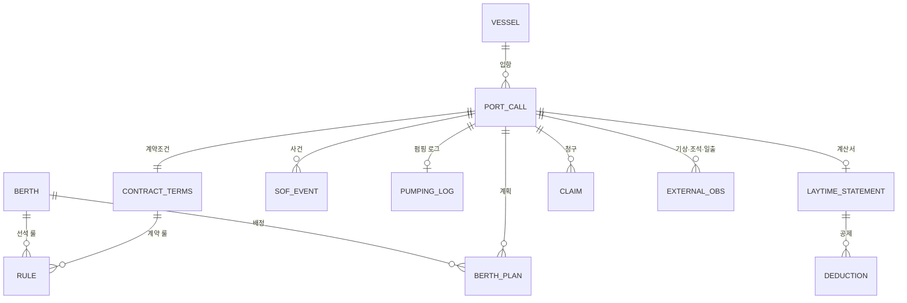

# 데이터 사전 — 체선료 Agent가 다루는 엔티티와 필드

- 작성일: 2026-11-02
- 갱신: 2026-11-02 — CLOCK 프로토타입(`../../clock/`) 검증 결과 반영. SOF_EVENT `reason_code` 필드와 사유 코드 STRIKE·FIRE·EXPLOSION, NOR 재제출 표기, PUMPING_LOG, BERTH_PLAN `berth_ready_at` 추가.
- 용도: (1) 팀원이 SOF·타임시트·접안계획에 어떤 필드가 있는지 익힌다. (2) DB 스키마, 합성 데이터 생성기, MCP tool 입출력의 공통 어휘가 된다.
- 출처 열: SEAGATE(포털 데이터·공개 페이지), AGENT(선박대리점), CP(계약), API(공공 API), SYN(합성), TERM(터미널 운영 기록)
- 시각은 모두 **현지시각(KST) + 시간대 표기**로 저장하고, 계산은 UTC 변환 없이 현지시각 기준 running hours로 한다 [추천]. SOF가 UTC로 온 경우 변환 로그를 남긴다.

---

## 1. 엔티티 관계

---

## 2. VESSEL — 선박 (SEAGATE Ship Particulars / Q88 대응)

| 필드 | 타입 | 예시 | 출처 | 사용 모듈 |
|---|---|---|---|---|
| imo | string(7) | 9XXXXXX | AGENT/Q88 | 전체 |
| name | string | HANRIVER STAR (가상) | Q88 | 전체 |
| vessel_type | enum | VLCC, SUEZMAX, AFRAMAX, LR2, LR1, MR, CHEM, LPG | Q88 | SCHED |
| dwt | number(t) | 300000 | Q88 | SCHED(ULS-DWT-MAX) |
| gt | number | 160000 | Q88 | SCHED(ULS-SK38-DAYTIME 판정) |
| loa_m / beam_m | number | 333 / 60 | Q88 | SCHED |
| draft_arrival_m | number | 20.5 | AGENT | SCHED(ULS-DRAFT-UKC) |
| manifold_spec | string | 16" ×3 | Q88 | INTAKE |
| pump_capacity_m3h | number | 3×5,500 | Q88 | CLAIM(펌핑 워런티) |
| flag / owner / operator | string | — | Q88 | INTAKE |
| last_sire_date | date | — | Vetting | INTAKE(참고) |

## 3. BERTH — 선석 (SEAGATE Mooring Facilities 대응)

| 필드 | 타입 | 예시 | 출처 |
|---|---|---|---|
| berth_id | string | SK8, SK2B | SEAGATE/UPA |
| terminal | enum | ULSAN_CLX, INCHEON_CLX | SEAGATE |
| berth_type | enum | PIER, DOLPHIN, SBM | SEAGATE |
| max_dwt | number | 150000 | UPA 표 |
| depth_m | number | 18 | UPA 표 |
| length_m | number | 400 | UPA 표 |
| cargo_types | list | CRUDE, OIL | UPA 표 |
| rules | list<rule_id> | [ULS-SK38-DAYTIME, ULS-PILOT-MANDATORY] | 05 문서 |
| shifting_minutes_default | number | 90 (부두) / 120 (SBM) | [가정] |
| hose_connect_minutes / hose_disconnect_minutes | number | 60 / 60 | [가정] |
| unberth_minutes | number | 60 | [가정] |

## 4. PORT_CALL — 입항 건(노미네이션)

| 필드 | 타입 | 예시 | 출처 |
|---|---|---|---|
| call_id | string | ULS-2026-11-0007 | 시스템 |
| vessel_imo | fk | — | — |
| operation | enum | LOAD, DISCHARGE | AGENT |
| cargo | string | CRUDE / NAPHTHA / LPG | AGENT |
| quantity | number + unit | 2,000,000 bbl | AGENT |
| laycan_from / laycan_to | datetime | — | CP |
| eta / eta_updates[] | datetime + 이력 | 72/48/24h 통지 | AGENT |
| requested_berth | string | SK2B | AGENT |
| agent / charterer / counterparty | string | — | AGENT/CP |
| sk_role | enum | CHARTERER, BUYER_DES, SELLER_FOB, SELLER_CFR | CP (`01` §3) |
| status | enum | NOMINATED, ARRIVED, WAITING, SHIFTING, BERTHED, COMPLETED, SAILED, CLAIMED, CLOSED | 시스템 |

## 5. CONTRACT_TERMS — 계약 조건 (CP + 매매계약)

| 필드 | 타입 | 예시 | 출처 |
|---|---|---|---|
| form | enum | ASBATANKVOY, SHELLVOY6, BPVOY4, GTC_BP, GTC_SHELL, OTHER | CP |
| layer | enum | CHARTER_PARTY, SALES_CONTRACT | CP |
| laytime_total_hours | number | 72 | CP Part I |
| laytime_this_port_hours | number | 36 | 계산 또는 매매계약 |
| reversible | bool | true | CP |
| notice_hours | number | 6 | CP |
| demurrage_rate_usd_day | number | 120000 | CP Part I |
| half_rate_events | list<enum> | [FIRE, EXPLOSION, STORM, STRIKE, PLANT_BREAKDOWN] | cl.8 |
| pumping_warranty_hours / pumping_warranty_psi | number | 24 / 100 | Rider |
| time_bar_notice_days / time_bar_docs_days | number | 60 / 90 | 서식별 |
| required_documents | list | [NOR, SOF, TIMESHEET, PUMPING_LOG, LOP] | 서식별 |
| shifting_counts_on_demurrage | enum | YES, NO, DISPUTED | 계약 문구 |
| rider_clauses_text | text | — | CP |
| rules | list<rule_id> | — | 05 문서 |

## 6. SOF_EVENT — 사실기록 이벤트

| 필드 | 타입 | 설명 |
|---|---|---|
| event_id | string | — |
| call_id | fk | — |
| event_type | enum | 아래 표 |
| ts_local | datetime(KST) | 사건 시각 |
| source | enum | MASTER, AGENT, TERMINAL, AIS, PILOT |
| remarks | text | "강풍으로 터미널 지시 중단" 등 |
| reason_code | enum | OPS_STOPPED의 사유 코드(아래). 다른 이벤트는 비움 |
| evidence_ref | string | SOF 페이지·행, 로그 파일 |
| confidence | number | OCR·파싱 신뢰도 |

**event_type 표준 목록** [추천]

| 코드 | 의미 | 레이타임 역할 |
|---|---|---|
| EOSP | 항해 종료(End of Sea Passage) | 도착 판정 보조 |
| PILOT_STATION_ARR | 도선사 승선 지점 도착 | — |
| ANCHORED | 묘박지 투묘 | **도착선 판정**, NOR 유효성 대조 |
| NOR_TENDERED | NOR 제출 | 개시 계산 |
| NOR_RECEIVED | NOR 수령 | 개시 계산(기준) |
| FREE_PRATIQUE | 검역 허가 | 법적 준비 |
| CUSTOMS_CLEARED | 통관 | 법적 준비 |
| PILOT_ON_BOARD | 도선사 승선(이동용) | 이동 시작 보조 |
| ANCHOR_AWEIGH | 양묘 | **이동 시작** |
| FIRST_LINE | 첫 줄 | — |
| ALL_FAST | 접안 완료 / 계류 완료 | **개시 대안, 이동 종료** |
| GANGWAY | 갱웨이 설치 | — |
| SSSCL_DONE | 안전점검표 완료 | — |
| HOSES_CONNECTED | 호스 연결 | — |
| OPS_COMMENCED | 하역 개시 | 무효 NOR 시 개시 대안 |
| OPS_STOPPED | 하역 중단(사유 코드) | 공제·반액 후보 |
| OPS_RESUMED | 하역 재개 | — |
| OPS_COMPLETED | 하역 완료 | 펌핑 시간 계산 |
| HOSES_DISCONNECTED | 호스 분리 | **종료** |
| DOCS_ON_BOARD | 서류 완료 | 서류 대기 산입 판단 |
| LAST_LINE | 마지막 줄(이안) | 선석 해방 |
| PILOT_AWAY | 도선사 하선 | — |
| COSP | 항해 개시 | — |

**NOR 재제출**: 별도 코드 없이 NOR_TENDERED·NOR_RECEIVED를 새 `event_id`로 한 번 더 기록한다. 첫 NOR이 도착(ANCHORED) 전이면 무효이고, 도착 이후 첫 재제출이 개시 기준이 된다(LAW-NOR-ARRIVAL, `05` §2-1).

**OPS_STOPPED 사유 코드** (`reason_code`): WEATHER, SHORE_TANK, SHIP_EQUIPMENT, SHORE_EQUIPMENT, DOCUMENTS, SAFETY, STRIKE, FIRE, EXPLOSION, OTHER — 반액·공제 판정의 입력. cl.8 반액 사유(CONTRACT_TERMS `half_rate_events`)와의 대응은 WEATHER→STORM, SHORE_EQUIPMENT→PLANT_BREAKDOWN [가정], STRIKE·FIRE·EXPLOSION은 같은 이름. SHIP_EQUIPMENT는 선박 귀책 공제(ASB-07-VESSEL-FAULT)로 간다.

**PUMPING_LOG** — 펌핑 로그 요약. 펌핑 보증 초과 공제(RIDER-PUMPING)의 증거다.

| 필드 | 타입 | 설명 |
|---|---|---|
| call_id | fk | — |
| avg_manifold_psi | number | 평균 매니폴드 압력. 계약 `pumping_warranty_psi`와 비교 |
| shore_restriction | bool | 육상 배압·수용 제한이 있었는지. true면 펌핑 초과 공제 불가 |
| source | enum | MASTER(선박 펌핑 로그), TERMINAL(터미널 배압 기록·"육상 제한 없음" 확인서) |
| evidence_ref | string | 펌핑 로그·확인서(LOP)의 위치 |

실하역 시간은 따로 적지 않고 SOF에서 계산한다(OPS_COMMENCED~OPS_COMPLETED에서 OPS_STOPPED 구간을 뺀 값).

## 7. LAYTIME_STATEMENT — 레이타임 계산서

| 필드 | 타입 | 설명 |
|---|---|---|
| statement_id / call_id / layer | — | 계산서는 CP·매매계약 레이어별로 1장씩 |
| nor_received_at | datetime | — |
| notice_expiry_at | datetime | NOR + notice_hours |
| all_fast_at | datetime | — |
| laytime_start_at / start_rule | datetime / rule_id | min 규칙 또는 대안 |
| laytime_end_at / end_rule | datetime / rule_id | 호스 분리 |
| deductions[] | list<DEDUCTION> | 아래 |
| used_hours | number | 소수 시간 |
| allowed_hours | number | — |
| demurrage_hours | number | — |
| demurrage_start_at | datetime | 체선 개시 |
| half_rate_hours | number | — |
| amount_usd | number | — |
| alt_calculations[] | list | 쟁점별 대안 계산 |
| issues[] | list<issue> | 쟁점 플래그(코드, 설명, 근거) |
| version / computed_at / rules_version | — | 재현성 |

**DEDUCTION**: from_ts, to_ts, hours, category(SHIFTING, VESSEL_FAULT, PUMPING_EXCESS, PORT_NIGHT_PROHIBIT, BALLAST, OTHER), rule_id, evidence_ref, disputed(bool)

## 8. CLAIM — 체선료 청구

| 필드 | 타입 | 설명 |
|---|---|---|
| claim_id / call_id / layer | — | — |
| counterparty / direction | string / enum(INBOUND, OUTBOUND) | 받은 청구 / 우리가 낼 청구 |
| received_at | datetime | 시효 기산 |
| time_bar_deadline | datetime | 양하 완료 + time_bar_docs_days |
| claimed_hours / claimed_amount_usd | number | 상대 계산 |
| computed_hours / computed_amount_usd | number | 우리 계산 |
| variance_usd / variance_reasons[] | number / list | 차이 사유(코드 + 설명) |
| documents_received[] / documents_missing[] | list | 서식 필수 목록 대비 |
| status | enum | RECEIVED, UNDER_REVIEW, DRAFT_REPLY, APPROVED, SETTLED, REJECTED, TIME_BARRED |
| hitl_decision / decided_by / decided_at | — | 승인 기록 |

## 9. BERTH_PLAN — 접안계획 (SEAGATE Berthing Plan 대응)

| 필드 | 설명 |
|---|---|
| plan_id, berth_id, call_id | — |
| sequence_no | 선석 내 순서 |
| planned_shift_start / planned_all_fast / planned_hoses_off / planned_unberth | 계획 시각 |
| actual_* | 실적(SOF에서 채움) |
| berth_ready_at | 이 배를 받을 수 있게 선석이 빈 시각(앞 선박 LAST_LINE 실적, 정비 종료 등). 묘박 대기를 "선석 점유"와 "선석은 비었지만 야간·기상 제한"으로 나누는 입력(`05` §7-2) |
| constraints_checked[] | 적용 룰과 결과(통과·위반·가정) |
| exposure_usd_at_plan | 계획 시점의 체선료 노출 예측 |
| plan_version / proposed_by(AGENT, HUMAN) / approved_by | HITL |

## 10. EXTERNAL_OBS — 외부 관측·예보 (핸드오프 §10 API)

| 필드 | 출처 | 용도 |
|---|---|---|
| wind_speed_ms, wave_height_m, ts | KMA 해양기상관측 | 반액 증빙, 중단 예측 |
| tide_height_m, ts | KHOA 조석예보 | UKC·접안 시간창 |
| sunrise, sunset, civil_twilight | KASI 출몰시각 | "주간" 판정(가정 교체 시) |
| ais_position, ais_status, ts | AIS(가능 시) | 도착·NOR 대조 |

---

## 11. SEAGATE 데이터와의 매핑 [추론 — 로그인 전용 메뉴는 이름만 확인, `../seagate-diagnosis.md` §1-2]

| SEAGATE 메뉴 (로그인 전용 포함) | 우리 엔티티 | 비고 |
|---|---|---|
| Ship Particulars | VESSEL | Q88 필드 대응 |
| Mooring Facilities, 부두제약관리, Report > 부두제약 | BERTH, RULE(ULS-*, INC-*) | 현업의 제약 원본일 가능성 → 룰셋은 이것을 참조·확인 |
| Berth Reservation (Berth Rez, 원유재고예측, 제품재고관리) | PORT_CALL(노미네이션), 육상 탱크 여유 입력 | 탱크 여유는 하역 속도·중단 사유(SHORE_TANK)의 입력 |
| Ship Berthing (Order List, Berthing Schedule, ETB Change Log, Berth Optimization) | BERTH_PLAN(계획·실적·버전) | ETB 변경 1건을 체선료 영향으로 번역하는 것이 Agent의 역할. 최적화 솔버는 새로 만들지 않음 |
| Berthing Simulation | — | 학습용 시뮬레이터와 역할이 겹치므로 제품 기능으로는 만들지 않음 |
| Cargo Working, Performance Record | SOF_EVENT(TERMINAL source), OPS_*, PUMPING_LOG(TERMINAL source) | 터미널 측 시각·배압 기록. 선장·대리점 SOF·펌핑 로그와 대조 |
| Performance Summary > Demurrage, Report > 체선리스트·체선지표·체선사유·주간체선 | 체선 **시간** 지표·사유 코드 | 금액·클레임까지 다루는지는 미확인(진단 §7 질문 1). CLAIM은 이 지표와 계약 레이어를 잇는다 |
| Ship Vetting, Ship Inspection | VESSEL.vetting_* | 참고 |
| Entry Guide, Safety Regulation, Notice | RULE, OPS_STOPPED 사유 보조 | 공개 자료 |

SEAGATE에 **없을 가능성이 높은 것**(가설, 인터뷰로 확인): CONTRACT_TERMS(레이타임 허용·요율·통지시간·시효·반액 사유), NOR 유효성·SOF 원문 대조, LAYTIME_STATEMENT(공제·반액·쟁점 포함), CLAIM(청구서 대조·차이·시효 카운트다운), EXTERNAL_OBS 연동. 이것이 `08-seagate-gap-analysis.md`의 핵심이다.

---

## 12. 합성 데이터 생성 지침 [추천]

- 선박 제원은 공개 선급 분포(VLCC 300~320k DWT, Aframax 100~120k, MR 45~50k)에서 샘플링하고 모든 레코드에 `synthetic: true`를 둔다.
- SOF는 §6 표준 이벤트를 순서대로 생성하되, 각 간격(대기·이동·연결·하역·중단)을 분포에서 뽑는다. 하역 시간은 수량 ÷ min(선박 펌프 능력, 육상 수용 능력).
- 분쟁 패턴(조기 NOR, 체선 중 이동, 폭풍 중단, 펌핑 미달, 서류 지연)을 전체의 30~40%에 의도적으로 주입하고 정답 플래그를 함께 저장한다.
- 생성 시드와 버전을 기록해 Golden Set을 재현 가능하게 한다.
