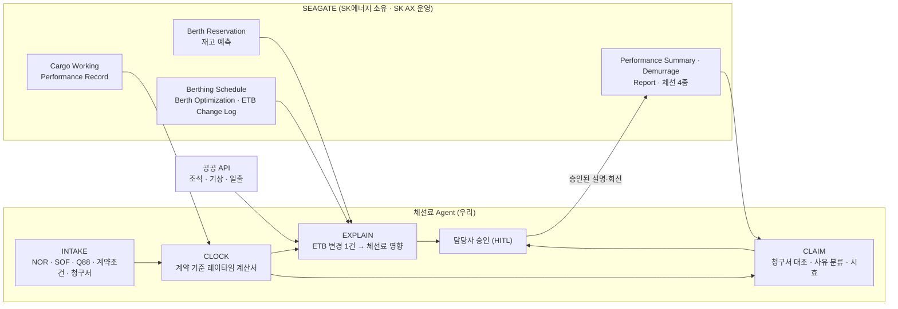

# 기존 SEAGATE와 우리 프로젝트의 차이

- 작성일: 2026-11-02 (같은 날 작성된 `../seagate-diagnosis.md`의 로그인 전용 메뉴 확인 결과를 반영해 다시 썼다)
- 용도: "SEAGATE가 이미 있는데 뭐가 다르냐"는 질문에 한 장으로 답한다. 발표·멘토 미팅·범위 논의에 사용.
- 근거: SEAGATE 공개 영역과 사이트맵의 로그인 전용 메뉴 전체 [사실]. **로그인 뒤 화면은 아무도 보지 못했고 기능은 메뉴 이름으로 추정**했다 [추론]. 가설은 `../seagate-diagnosis.md` §7 질문으로 검증한다.

---

## 1. 한 줄 요약 [추천]

> **SEAGATE는 체선 "시간"을 재고 집계한다. 우리는 그 시간을 계약(레이타임·NOR·예외·시효)으로 번역해 체선"료"로 만들고, 접안 변경 1건이 돈으로 얼마인지 설명하며, 선주 청구서를 대조한다.**

SEAGATE는 SK에너지 울산CLX의 부두 운영 시스템이다(SK에너지 소유, SK AX 운영) [사실]. 선석 예약, 재고 예측, 접안계획, Berth Optimization, Berthing Simulation, 체선 리포트 4종, Demurrage 요약까지 **기록과 계산은 이미 한다**. 비어 있는 자리는 그 기록과 계산 "사이", 특히 **터미널이 재는 대기 시간과 계약으로 정해지는 체선료 사이의 간극(진단 H4)**이다. 우리는 대체가 아니라 그 사이를 메우는 레이어다.

---

## 2. SEAGATE가 이미 하는 것 — 그래서 우리가 만들지 않는 것

| 업무 단계 | SEAGATE 로그인 메뉴 [사실, 메뉴명] | 추정 기능 [추론] | 우리가 **만들지 않는** 것 |
|---|---|---|---|
| 예약 | Berth Reservation: Berth Rez, 원유재고예측, 제품재고관리 | 선석 예약을 탱크 재고와 함께 관리 | 예약·재고 화면 |
| 심사 | Ship Vetting, Ship Inspection(4종), Ship Particulars | 선박 적격·검사·제원 | 선박 심사 기능(핸드오프 Pre-Arrival 범위는 입력으로만 재사용) |
| 계획 | Ship Berthing: Order List, Berthing Schedule, 부두제약관리, Berth Optimization, ETB Change Log / Berthing Simulation | 접안 순서·시각, 제약 관리, 최적화, 시뮬레이션, 변경 이력 | **선석 최적화 솔버, 시뮬레이션 화면** |
| 하역 | Cargo Working, Performance Record | 작업 진행·실적 기록 | 실적 기록 화면 |
| 사후 | Performance Summary(Cargo·Berth·Berth Share·**Demurrage**·Evaluate), Report(**체선리스트·체선지표·체선사유·주간체선**·부두제약·선박사이즈) | 체선 시간 지표 집계·사유 분류 리포트 | **체선 대시보드·KPI 화면** |

핸드오프 문서의 후보 C(접안계획 재조정)·E(체선 분석)는 이 표와 겹치므로 그대로 추진하지 않는다 [추천].

---

## 3. 렌즈의 차이

| 축 | SEAGATE (추정) | 우리 프로젝트 |
|---|---|---|
| 체선의 정의 | 대기 **시간**(운영 지표), 사람이 고르는 사유 코드 | 계약상 레이타임 초과 **금액**. NOR 유효성, 통지시간, 이동 제외, 반액, 펌핑 공제, 시효까지 |
| 데이터 원천 | 터미널이 입력한 시각 | 터미널 기록 + 선장·대리점 SOF 원문 + 계약 조건 + 기상·조석 관측 |
| 시점 | 사후 집계(리포트) + 계획(최적화) | 변경 시점의 **설명**("이 ETB 변경으로 체선 n시간, 약 $X, 사유") + 사후 **대조**(청구서 vs 재계산) |
| 화면 구조 | 재고·계획·체선이 서로 다른 메뉴(진단 H2) | 한 질문에 한 답: 선박 1척의 시계와 금액, 변경 1건의 영향 |
| 입력 | 웹 입력(비정형 문서는 사람이 옮겨 적음, 진단 H3) | NOR·SOF·Q88·청구서 PDF·메일 파싱 후 SEAGATE 기록과 대조 |
| 판단 | 최적화 결과를 사람이 설명·합의(진단 H5) | 근거(룰 ID·SOF 행·조항)가 붙은 설명 초안 + 담당자 승인 |

---

## 4. 기능 대 기능 매핑

| SEAGATE 화면 | 우리가 더하는 것 | 모듈 |
|---|---|---|
| Ship Particulars | Q88 파싱 결과와 대조, 펌프 능력을 펌핑 워런티 판정 입력으로 | INTAKE, CLAIM |
| 부두제약관리, Report > 부두제약 | 제약을 **룰 ID가 붙은 데이터**로 받아 모든 판정에 출처 첨부 | 룰셋 |
| Berthing Schedule, ETB Change Log | **ETB 변경 1건의 체선료 영향 설명**: 후속 선박별 체선 돌입 시각·금액·사유, 두 계산(쟁점 포함) | EXPOSURE·EXPLAIN |
| Berth Optimization, Berthing Simulation | 대체하지 않음. 최적화가 낸 대안을 **체선료 관점에서 비교·설명**해 합의를 돕는다 | SCHED(설명 역할로 축소) |
| Cargo Working, Performance Record | 터미널 시각과 **선장·대리점 SOF를 자동 대조**, 불일치·조기 NOR 플래그 | INTAKE, CLOCK |
| Performance Summary > Demurrage | 시간 지표 옆에 **계약 기준 레이타임 계산서**(개시·공제·반액·금액·쟁점) | CLOCK |
| Report > 체선사유 | 사람이 고른 코드 대신 **증거(기상 관측·앞 선박 종료·야간 규칙) 기반 사유 분류 초안** | CLAIM(REASON) |
| (없음) | 선주·거래처 **청구서 대조**, 차이 분석, 시효 카운트다운, 회신 초안, 승인 로그 | CLAIM, COMMS |

---

## 5. 데이터로 본 차이

SEAGATE에 **있을 것으로 보이는** 것: ETB·접안 순서·변경 이력, 부두 제약, 하역 실적 시각, 체선 시간 지표·사유 코드, 탱크 재고 예측.
SEAGATE에 **없을 가능성이 높은** 것(가설): 계약 조건(레이타임 허용·요율·통지시간·시효·반액 사유), NOR 유효성과 SOF 원문 대조, 공제·반액이 반영된 레이타임 계산서, 선주 청구서와의 차이, 기상·조석 관측 연동.

이 가설이 맞는지 여부가 프로젝트 범위를 결정한다. 진단 §7 질문 1("Demurrage 요약과 체선 리포트는 시간 지표인가, 금액·클레임까지인가")을 가장 먼저 묻는다.

---

## 6. 학습용 시뮬레이터의 위치

`demurrage-simulator.html`(게시 링크는 `00-README.md`)은 **제품 기능이 아니라 학습 도구**다. 접안 순서 변경 1건이 선박별 레이타임·체선료로 어떻게 번역되는지 움직이며 익히고, "대안 순서 탐색"으로 그 번역을 반복 체험한다. SEAGATE에 이미 있는 Berth Optimization·Berthing Simulation을 대체하지 않는다. 다만 시뮬레이터의 "변경 → 선박별 시계 → 금액 → 쟁점" 설명 패턴은 그대로 Agent의 EXPLAIN 출력 형식이 된다 [추천].

---

## 7. 통합 그림 — SEAGATE 위에 얹기

중복하지 말 것: 대시보드·최적화 솔버·안내 페이지. 규정은 KB로 참조만 하고, UI는 **검토 콘솔(내부)** 하나로 한정한다 [추천].

---

## 8. 차별점이 성립하려면 확인해야 할 것 (진단 §7과 합침)

1. Performance Summary의 Demurrage와 체선 리포트가 시간 지표인가, 금액·클레임까지 다루는가. 체선료 정산은 누가 어떤 도구로 하는가. → 금액까지 다룬다면 CLAIM은 "연동"으로 축소하고 EXPLAIN·대조에 집중.
2. 체선사유는 누가 언제 입력하고 무엇을 결정하는 데 쓰는가. → 증거 기반 분류의 가치 판단.
3. Berth Optimization·Simulation은 실제로 쓰이는가, 안 쓰이면 왜인가. → 설명·합의 레이어의 가치 판단.
4. ETB 변경 빈도와 통보 방식, 1건 처리 시간. → EXPLAIN의 가치 판단.
5. NOR·SOF가 어떤 경로로 들어오고 SEAGATE 기록과 대조하는가. → INTAKE·CLOCK의 가치 판단.
6. 과제를 낸 곳이 SK에너지 생산조정팀인지 SK AX인지, 기대 수준(아이디어·PoC·실사용).

---

## 9. 발표용 문장 후보 [추천]

- "SEAGATE는 체선 **시간**을 잽니다. 우리는 그 시간을 **계약으로 번역해 돈**으로 만들고, 바꾸면 얼마가 달라지는지 설명합니다."
- "SEAGATE 위에 얹는 레이어입니다. 대시보드도 솔버도 새로 만들지 않습니다. 기록과 계산 **사이**를 메웁니다."
- "듀얼 브레인을 공장에서 부두까지: AI가 체선료 영향과 근거를 내놓으면, 담당자가 결정합니다."
