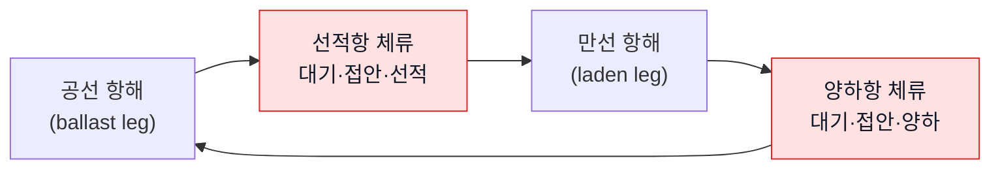

# M1 · 해운 시장과 탱커 운송의 기초

- 핵심 질문: 누가, 어떤 배로, 무엇을, 얼마에 나르고, 그 과정에서 "시간"은 누구의 돈인가?
- 선수 자료: 영상 1편, `../01-demurrage-primer.md`
- 표기: [사실] / [추론] / [확인 필요] / [가정]

## 학습 목표
1. 정유사의 해상 공급망을 선적·양하 관점에서 그린다.
2. 탱커 선형(size class)과 울산 SK 선석의 적합 관계를 설명한다.
3. 참여자 10여 곳이 각각 무엇을 얻고 무엇을 잃는지 말한다.
4. 운임 지수(Worldscale, TCE)와 체선료율의 관계를 설명한다.
5. 2026년 시장 상황이 왜 "대기 1시간의 값"을 키우는지 설명한다.

---

## 1. 정유사의 해상 공급망 — 부두는 매출의 관문

울산 CLX는 하루 84만 배럴을 처리하는 국내 최대 원유 처리시설이고 자체 부두 8곳을 갖고 있다 [사실, `../seagate-handoff.md` §1-5]. 이 숫자를 배 한 척과 비교해 보자.

| 항목 | 값 | 의미 |
|---|---|---|
| 정제 처리량 | 84만 배럴/일 | — |
| VLCC 1척 적재량 | 약 200만 배럴 [사실, 선형 일반치] | **약 2.4일치 원유** |
| 원유 도입 빈도(추정) | 2~3일에 VLCC 1척꼴 [추론] | SBM 2기가 쉬지 않고 돌아야 함 |
| 제품 수출 | MR·LR 탱커로 경유·항공유·나프타 등 수출. SK이노베이션 매출의 약 70%가 수출 [사실, 핸드오프] | 제품 부두의 회전율이 매출 속도 |

흐름: **중동·기타 산지 → VLCC(원유) → SBM 계류 → 해저 배관 → 원유 탱크 → 정제 → 제품 탱크 → SK 부두(SK3~8) → MR·LR·케미컬·LPG선 → 아시아 수요처**. 배가 들어오지 못하면 탱크가 넘치거나(원유 수입 지연 시 생산 차질), 제품 탱크가 차서 출하가 막힌다. 그래서 터미널의 "시간"은 단순 물류가 아니라 **생산 일정과 매출 회전의 병목**이다.

> 울산항 전체로 보면 2026년 7월 액체화물이 1,517만 톤으로 전년 동월보다 17% 늘었고, 비중동산 원유 수입이 증가했다 [사실, `../seagate-diagnosis.md` §4]. 도입선이 바뀌면 도착 패턴이 흔들리고, 불규칙한 도착은 선석 혼잡과 대기를 만든다 [추론].

---

## 2. 탱커 선형과 울산 선석의 궁합

| 선형 | DWT 범위(대략) | 전형 적재 | 주 화물 | 울산 SK 선석 적합(최대 DWT 기준) |
|---|---|---|---|---|
| VLCC | 200,000~320,000 | 약 200만 bbl | 원유 | SK2·SK3 Buoy(SBM, 325,000) |
| Suezmax | 120,000~200,000 | 약 100만 bbl | 원유 | SK8(150,000)까지 |
| Aframax / LR2 | 80,000~120,000 | 60~70만 bbl | 원유·연료유 / 정제품(LR2는 코팅 탱크) | SK8, SK7(130,000) |
| Panamax / LR1 | 55,000~80,000 | 35~50만 bbl | 정제품 | SK7, SK6(70,000) |
| MR | 25,000~55,000 | 약 30만 bbl | 정제품·케미컬 | SK7, SK6, SK5 일부 |
| Handysize·연안 | 25,000 이하 | — | 제품·케미컬·아스팔트 | SK1~5 |
| VLGC / MGC(LPG) | 45,000~55,000 / 20,000~35,000 | 8만 m³ / 3~4만 m³ | LPG | SK6(LPG, 70,000), Gas Pier |

- 선형 수치는 업계 일반 범위이고 [사실], 선석 최대 DWT는 울산항만공사 공개 표다(기준일 미표기, `../seagate-handoff.md` §1-4) [사실].
- "적합"은 DWT·수심·길이·화물 종류를 모두 만족해야 한다. 룰 엔진의 `ULS-DWT-MAX`, `ULS-DRAFT-UKC`가 이 표에서 나온다.
- SBM(Single Buoy Mooring)은 해상 부이에 선수를 매고 해저 호스로 양하한다. 부두보다 기상에 민감하고, SK 규정상 야간 계류가 불가하다 [사실, Entry Guide]. VLCC는 SBM 외 대안이 없으므로 **SBM 가동률이 원유 도입의 상한**이다 [추론].

### 2-1. 왜 큰 배를 쓰나
운송 단가는 배가 클수록 낮다(규모의 경제). 대신 한 척의 하루 가치가 크다. VLCC 하루 용선료가 2026년 9월 120만 달러로 사상 최고를 기록했다 [사실, 핸드오프 §3]. 즉 **배가 크고 비쌀수록 대기 1시간의 값도 크다.**

---

## 3. 참여자와 이해관계 — 같은 1시간을 누가 어떻게 보나

| 참여자 | 역할 | 시간에 대한 관심 |
|---|---|---|
| 선주 Owner | 배와 선원을 제공 | 배가 돈을 버는 건 항해할 때. 항구 체류는 손실 → 체선료로 보전 |
| 용선주 Charterer | 화물 운송을 위해 배를 빌림(정유사·트레이더·메이저) | 레이타임 안에 끝내야 비용 0. 넘기면 체선료 |
| 트레이더 Trader | 원유·제품 매매 주체. SK는 전문 자회사(SK트레이딩인터내셔널)를 둔 것으로 SEAGATE 회사소개에 나온다 [사실, `../seagate-diagnosis.md` §3 H4] | 매매계약의 레이타임·체선료 조항을 관리. 용선 조직과 터미널 사이의 "계약 보유자" |
| 용선중개인 Broker | 선주·용선주 매칭, recap 작성 | 계약 조건의 1차 기록자 |
| 선박대리점 Agent | 항구에서 선주·용선주 대리. NOR 전달, SOF 작성, 수속 | SOF 시각의 1차 기록자. 양쪽을 동시에 대리하기도 해 이해충돌 가능 |
| 터미널 Terminal (SK 해상터미널) | 선석·하역 설비 운영, 안전 규정 | 선석 회전율·안전. 지연 원인의 당사자이자 기록자 |
| 도선사·예선 Pilot/Tugs | 접·이안 보조 | 가용 시간대가 접안 시각을 제약 |
| 항만당국·PTMS | 입출항 통제 | 규정(야간·기상)이 "통제 밖 사유"의 근거가 되기도 함 |
| 검정인 Surveyor | 수량·품질 검정, 탱크 검사 | 검사 지연 = 준비 완료 지연 |
| P&I 클럽 | 선주 책임보험, 분쟁 자문 | 체선료 분쟁 해설 자료의 주요 출처 |
| 선급 Class / 검사 Vetting | 선박 안전 인증·적합성 심사 | Vetting 지연 = 접안 지연 |

핵심 인사이트: **체선료는 선주↔용선주의 문제처럼 보이지만, 시간을 실제로 쓰는 쪽은 터미널이고 계약을 쥔 쪽은 트레이딩이다.** 세 조직의 정보가 합쳐져야 체선료를 관리할 수 있다 [추론, `../seagate-diagnosis.md` H4].

---

## 4. 운임의 언어

| 용어 | 뜻 | 체선료와의 관계 |
|---|---|---|
| Worldscale (WS) | 탱커 운임의 표준 지수. 항로별 기준운임(flat rate, USD/톤)을 매년 공표하고 실제 운임은 그 백분율(WS 80 = 기준의 80%)로 표시 [사실] | 기준운임 계산에 항구 체류 시간 가정(레이타임 72시간 등)이 들어 있음. 체선료율 자체는 별도 협상 |
| TCE (Time Charter Equivalent) | 항해용선 운임을 하루 수익으로 환산한 값 | 선주가 생각하는 "하루의 값". 체선료율은 대체로 시장 TCE 수준을 참고해 협상 [추론] |
| Lumpsum / USD per ton | 총액 운임 / 톤당 운임 | — |
| Spot / Term(COA) | 단건 계약 / 장기 운송 계약(Contract of Affreightment) | COA에도 항차별 레이타임·체선료 조항이 있음 |
| Demurrage rate (PDPR) | 체선료율, per day pro rata | 하루 단위 표시, 시간·분 비례 정산 |
| AFRA | 평균 운임 지수(선형별) | 매매계약에서 용선계약이 없을 때 체선료 기준으로 쓰이기도 함 [확인 필요] |

왜 체선료율이 시장을 따라가나: 선주 입장에서 배가 항구에 묶인 하루는 "다른 화물을 실을 수 있었던 하루"다. 운임이 높을수록 기회비용이 커지고 체선료율 협상도 높아진다 [추론]. 2026년처럼 운임이 급등한 해에는 체선료율도 높게 고정된 계약이 많을 것이다.

---

## 5. 항해의 시간 구조 — 배는 어디서 돈을 벌고 어디서 잃나

- 선주는 항해 구간에서 운임을 벌고, 항구 구간은 비용만 든다. 그래서 **항구 시간을 미리 약속(레이타임)하고 초과분은 배상(체선료)**받는다 [사실].
- 울산 양하항의 체류 시간 = 대기 + 이동 + 접안·연결 + 양하 + 분리·서류 + 이안. 이 중 **대기**가 용선주 위험, **양하 속도**는 선박(펌프)과 육상(배압·탱크) 양쪽 책임이 섞인다. M3·M4에서 각 구간의 귀책을 다룬다.

---

## 6. 2026년 시장이 체선료에 주는 의미 [사실 + 추론]

| 사실 | 의미 |
|---|---|
| 2026-04 호르무즈 봉쇄로 중동 원유 수급 불안, 비중동산·우회 원유 증가 [사실, 진단 §4] | 도착 일정 불규칙 → 선석 혼잡과 대기 증가 [추론] |
| 2026-07 울산항 액체화물 +17% [사실] | 물량 증가 → 선석 점유율 상승 |
| 2026-09 VLCC 용선료 사상 최고 120만 달러/일 [사실] | 체선료율 상승 압력 → 대기 1시간 값 상승 [추론] |
| 제재 대상 유조선 900척 이상, SIRE 2.0 전면 시행 [사실, 핸드오프] | Vetting 지연·거절이 접안 지연의 새 원인 |
| SK 울산CLX '듀얼 브레인'·'1인 1에이전트' [사실] | AI가 분석·제안, 사람이 결정하는 틀이 회사 언어 |

---

## 7. 자주 하는 오해

1. "체선료는 벌금이다" → 아니다. 계약으로 미리 정한 배상액(liquidated damages)이며 손해 입증이 필요 없다 [사실].
2. "운임에 항구 시간이 다 들어 있다" → 레이타임만큼만 들어 있다. 초과는 별도다.
3. "큰 배가 들어오면 터미널이 돈을 번다" → 터미널(정유사)은 화주다. 큰 배가 기다리면 돈을 잃는다.
4. "대기 시간은 선주 손해다" → 레이타임 안이면 용선주의 '무료 시간'이고, 넘기면 용선주가 선주에게 돈을 낸다. 선주 손해가 아니라 용선주 비용이다.
5. "SEAGATE가 체선료를 계산한다" → SEAGATE는 체선 **시간** 지표를 집계하는 것으로 보인다. 계약 기준 금액은 다른 곳(트레이딩·용선)에서 계산될 가능성이 높다 [추론, 진단 H4].

---

## 8. Agent에 주는 시사점
- 선형·선석 적합성은 결정론적 룰(`ULS-DWT-MAX`, `ULS-DRAFT-UKC`)로, 시장 요율은 계약 데이터(`CONTRACT_TERMS.demurrage_rate_usd_day`)로 들어온다.
- "대기 1시간의 값"을 화면에 항상 띄우는 것(EXPOSURE)이 이 모듈의 결론이다.

## 확인 문제
1. VLCC 1척(200만 배럴)은 울산 CLX 처리량(84만 배럴/일)의 며칠치인가?
2. Worldscale 80은 무슨 뜻이며, 체선료율은 Worldscale로 정해지는가?
3. 선주·용선주·트레이더·터미널 중 "시간을 실제로 쓰는 쪽"과 "계약을 쥔 쪽"은 각각 누구인가?

**정답** 1. 약 2.4일치(2,000,000 ÷ 840,000). 2. 해당 항로 기준운임의 80%. 체선료율은 별도 협상이며 Worldscale이 직접 정하지 않는다. 3. 터미널(운영) / 트레이딩·용선 조직(계약). 둘의 정보가 합쳐져야 체선료를 관리할 수 있다.
