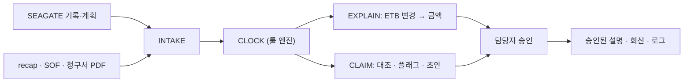

# M6 · 데이터와 Agent로 연결

- 핵심 질문: M1~M5에서 배운 것을 어떻게 필드·룰·플래그·평가로 옮겨 "근거 있는 체선료 Agent"를 만드나?
- 선수 자료: `../06-data-dictionary.md`, `../08-seagate-gap-analysis.md`, `../seagate-diagnosis.md` §6
- 표기: [사실] / [추론] / [추천]

## 학습 목표
1. 개념 → 데이터 필드 → 룰 ID → 모듈의 매핑표를 읽고 빈칸을 채운다.
2. 룰 엔진 설계 원칙 8가지를 설명하고 "LLM이 하면 안 되는 일"을 구분한다.
3. 쟁점 플래그 카탈로그와 두 계산 병기 방식을 설계한다.
4. Golden set과 평가 지표를 설계한다.
5. SEAGATE 위에 얹는 통합 그림과 데모 시나리오를 설명한다.

---

## 1. 개념 → 데이터 → 룰 매핑

| 개념(모듈) | 데이터 필드(`../06`) | 룰 ID(`../05`) | 모듈 | 입력 원천 |
|---|---|---|---|---|
| 선형·선석 적합(M1) | VESSEL.dwt/draft, BERTH.max_dwt/depth | ULS-DWT-MAX, ULS-DRAFT-UKC | SCHED/EXPLAIN | Q88, UPA 표, SEAGATE Ship Particulars·부두제약 |
| 체선료율·요율 단위(M1·M2) | CONTRACT_TERMS.demurrage_rate_usd_day | ASB-08-RATE-PRORATA | CLOCK | recap |
| 허용 레이타임·가역(M2·M3) | laytime_total_hours, laytime_this_port_hours, reversible | 계약 Part I | CLOCK | recap, 선적항 SOF |
| 통지시간(M3) | notice_hours | ASB-06-NOR-START | CLOCK | recap |
| NOR 유효성(M3) | SOF_EVENT ANCHORED/NOR_RECEIVED/FREE_PRATIQUE, AIS | (판정 체크리스트) | CLOCK/CLAIM | SOF, AIS |
| 개시 규칙(M3) | ltStart, start_rule | ASB-06-NOR-START | CLOCK | 계산 |
| 이동 제외(M3·M4) | ANCHOR_AWEIGH→ALL_FAST | ASB-07-SHIFTING-EXCL | CLOCK | SOF |
| 선박 귀책·펌핑(M3·M4) | OPS_STOPPED(SHIP_*), pumping_warranty_*, 펌핑 로그 | ASB-07-VESSEL-FAULT, RIDER-PUMPING | CLAIM | 펌핑 로그, 터미널 배압 |
| 야간·기상 접안 제한(M4) | BERTH.rules, 접안 지시·불가 기록 | ULS-SBM-NIGHT, ULS-SK38-DAYTIME, ULS-DAYTIME-DEF | SCHED/EXPLAIN | Entry Guide, 터미널 기록 |
| 반액(M3) | OPS_STOPPED(WEATHER), EXTERNAL_OBS.wind/wave | ASB-08-HALF-RATE | CLOCK | KMA, 터미널 중단 지시 |
| 종료(M3) | HOSES_DISCONNECTED, DOCS_ON_BOARD | ASB-11-END-HOSES, 서식별 DOCS-WAIT | CLOCK | SOF |
| 시효·서류(M5) | time_bar_*_days, required_documents, CLAIM.received_at | SV6/BPV4-TIMEBAR, RIDER-DOCS | CLAIM | recap, 청구서 |
| 매매계약 레이어(M2·M5) | CONTRACT_TERMS.layer=SALES_CONTRACT | SALES-* | CLAIM | GTC |
| ETB 변경 영향(M4) | BERTH_PLAN.planned_* 버전 | (계산) | EXPLAIN | SEAGATE ETB Change Log |

연습: 표에 없는 개념(검역, 용선주 지시 이동, 서류 대기)을 한 줄씩 추가해 보라(`07` 연습 7-11).

---

## 2. 룰 엔진 설계 원칙 8가지 [추천]

1. **결정론**: 시간 비교·합산·요율 곱셈은 코드가 한다. LLM은 숫자를 계산하지 않는다.
2. **출처가 붙은 룰**: 룰마다 `rule_id`, 조항, 원문 참조, 확인 상태(confirmed/assumed/disputed). 판정 결과에는 룰 ID + SOF 행 + 계산식이 붙는다.
3. **프로파일 계층**: 기본(Asbatankvoy) → 서식(Shellvoy·BPVOY) → Rider → 매매계약 레이어. 상위가 하위를 덮어쓴다.
4. **쟁점은 판정하지 않는다**: 해석이 갈리는 항목은 두 계산을 내고 플래그한다(§3).
5. **시각 정규화**: 현지시각 + tz, 제출/수령 구분, 24:00 규칙, 소수 시간 계산·표시 반올림.
6. **버전과 재현성**: 룰셋 버전, 계산기 버전, 입력 스냅샷을 계산서에 기록한다. 같은 입력은 같은 출력.
7. **테스트 우선**: Golden set(TC-01~)을 먼저 두고 룰을 추가할 때마다 회귀 테스트.
8. **사람 승인**: write 계열(접안계획 반영, 회신 발송)은 초안만. 확정은 승인 API로(핸드오프 §5-4 거버넌스).

### 2-1. LLM이 맡는 일 / 맡지 않는 일
| 맡는 일 | 맡지 않는 일 |
|---|---|
| recap·SOF·청구서 PDF·메일에서 구조화 데이터 추출(INTAKE) | 시간 합산·요율 계산·체선 시각 산출 |
| 쟁점·차이를 사람 말로 설명, 회신 초안(COMMS) | 쟁점의 최종 판정 |
| 애매한 SOF 문구 해석 후보 제시("stopped due to shore" → SHORE_TANK? SHORE_EQUIPMENT?) | 룰 변경 |
| 사용자 질문에 규정 근거 찾아 답하기(KB) | 접안 확정·클레임 확정 |

---

## 3. 쟁점 플래그 카탈로그 [추천]

| 코드 | 상황 | 계산 A(선주 유리) | 계산 B(용선주 유리) | 담당자에게 보여줄 것 |
|---|---|---|---|---|
| SHIFT_ON_DEM | 체선 중 이동 | 산입 | 공제 | 두 금액, 차이, 계약 문구, 판례 한 줄 |
| NIGHT_WAIT | 야간 접안 제한 대기 | 산입(reachable) | 불산입(cl.6) | 규칙 주체(당국/터미널), 대기 시간, 두 금액 |
| WX_HALF_SCOPE | 레이타임 중 폭풍 | 반액 없음 | 결과적 체선분 반액 | 기상 기록, 두 금액 |
| WX_WAITING | 대기 중 폭풍(체선 중) | 전액 | 반액 | 선석 가용 여부 |
| NOR_EARLY | 도착 전 NOR | 유효(수락됨) | 무효(재제출/하역 개시) | AIS·ANCHORED 대조, 대리점 수령 문구 |
| DOCS_WAIT | 서류 대기 | 산입 | 불산입 | 서식 조항 |
| LOAD_PORT_UNKNOWN | 선적항 사용분 미확인 | 가정값 | — | 가정 표시, 자료 요청 |
| PUMPING_SHORE | 펌핑 미달 vs 육상 제한 | 공제 불가(LOP) | 공제 | 배압·탱크 기록 대조 결과 |

UI 원칙: 플래그 행은 노란 배지, 두 금액 병기, "담당자 선택" 버튼, 선택 이유 기록(감사 로그).

---

## 4. Golden set과 평가

| 항목 | 설계 |
|---|---|
| 단위 | 1 TC = 계약 조건 + SOF(+펌핑·기상) + 정답(개시·종료·공제·체선·금액·플래그 목록) |
| 씨앗 | `../04` TC-01~05, `07` 연습문제, `08` 케이스 |
| 규모 | 1차 20건(손으로 검증) → 2차 50건(합성 생성기, `../06` §12) → 현업 샘플이 오면 교체 |
| 분포 | 정상 40%, 단일 쟁점 40%, 복합 쟁점 20%. 서식 2종 이상, 매매계약 레이어 포함 |
| 지표 | 금액 정확도(±USD 1), 개시·종료 시각 정확도, 플래그 재현율·정밀도, 근거 첨부율(100% 목표), 파싱 정확도(SOF 행), 처리 시간 |
| 회귀 | 룰 변경·파서 변경마다 전체 TC 자동 실행 |
| 사람 대조 | 팀원 2명이 독립 손계산 → 불일치면 정답 재검토 |

---

## 5. SEAGATE 위에 얹는 그림과 데모

- 읽어오는 것(가능하다면): Ship Particulars, 부두제약, Berthing Schedule·ETB Change Log, Cargo Working·Performance Record, 체선 리포트의 사유 코드(`../08` §4).
- 더하는 것: 계약 레이어, NOR·SOF 대조, 계약 기준 계산서, ETB 변경의 금액 영향, 청구 대조, 시효 관리.
- 데모(`../03` §7): 노미네이션 → NOR → 대기 → 접안 → 강풍 → ETB 변경 설명 → 2주 뒤 청구서 대조. 시뮬레이터가 1~5, 계산 예제가 6.

---

## 6. MCP 도구 설계 스케치 [추천, 핸드오프 §5-4 확장]

| MCP 서버 | tool | 입력 | 출력 |
|---|---|---|---|
| `laytime-engine` | `compute_laytime` | contract_terms, sof_events, options | laytime_statement(+issues, alt_calculations) |
| `laytime-engine` | `explain_change` | berth_plan_before, berth_plan_after | 선박별 체선 시각·금액 차이, 사유 |
| `laytime-engine` | `review_claim` | claim, statement_ours | variance_reasons, time_bar_status, missing_docs |
| `terminal-kb` | `search_rules` | query | 룰·조항·출처 |
| `ocean-data` | `get_marine_obs`, `get_sun_times` | time range | 풍속·파고, 일출몰 |
| `seagate-bridge`(가능 시) | `get_berth_plan`, `get_events` | call_id | 계획·실적 |

모든 tool은 읽기 또는 초안 생성만. 확정은 콘솔 승인.

---

## 7. 첫 2주 구현 계획 [추천]

| 주 | 할 일 | 완료 기준 |
|---|---|---|
| 1 | 룰 스키마 확정, Asbatankvoy 기본 룰 10개 적재, CLOCK 계산기 작성 | TC-01~05 전부 통과 |
| 1 | SOF 표준 이벤트 파서(표 형식 → 이벤트) | 예제 SOF 5건 파싱 정확도 100% |
| 2 | 쟁점 플래그 3종(SHIFT_ON_DEM, NIGHT_WAIT, WX_HALF_SCOPE) + 두 계산 | 플래그 재현율 100% on TC |
| 2 | EXPLAIN: 계획 2개 비교 → 선박별 차이 | 시뮬레이터 결과와 일치 |
| 2 | 합성 생성기 20건, 회귀 테스트 파이프라인 | CI에서 전체 TC 실행 |

---

## 8. 자주 하는 오해
1. "LLM이 계산도 하면 편하다" → 재현성·근거가 무너진다. 계산은 코드.
2. "쟁점도 AI가 판정해야 완성" → 판정은 책임의 문제. 두 계산과 근거를 내는 것이 완성이다.
3. "룰은 코드에 하드코딩" → 데이터로 두어야 출처·버전·확인 상태를 관리할 수 있다.
4. "Golden set은 나중에" → 룰을 하나 적재하기 전에 TC부터.

## 확인 문제
1. "체선 중 이동"을 Agent가 어떻게 처리해야 하나?
2. 룰 프로파일 계층 네 단계는?
3. Golden set 지표 중 "근거 첨부율"의 목표치와 이유는?

**정답** 1. 판정하지 않고 SHIFT_ON_DEM 플래그 + 두 계산(산입/공제) + 근거를 담당자에게. 2. 기본(Asbatankvoy) → 서식 → Rider → 매매계약 레이어. 3. 100%. 모든 판정에 룰 ID·SOF 행·조항이 붙어야 설명 가능하고 감사 가능하다(핸드오프 원칙).
