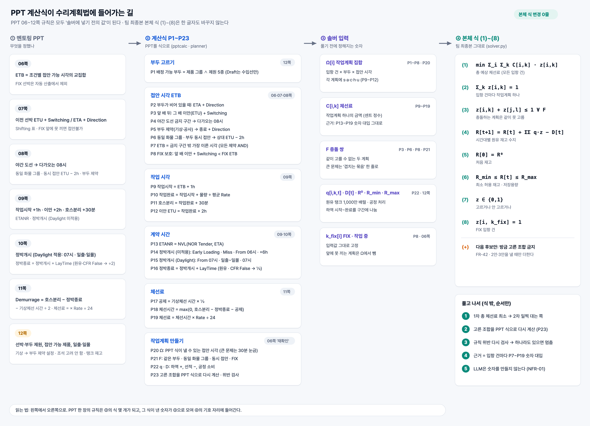
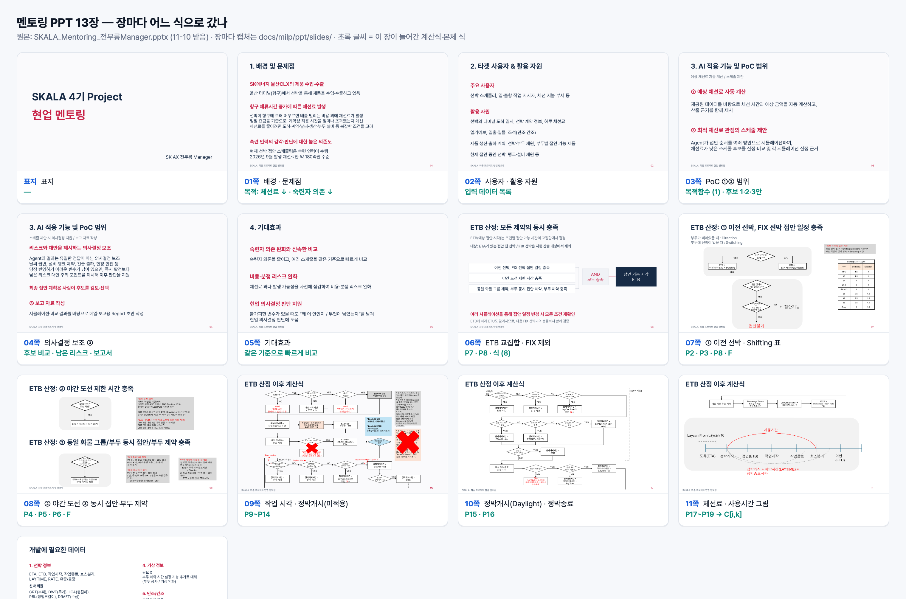
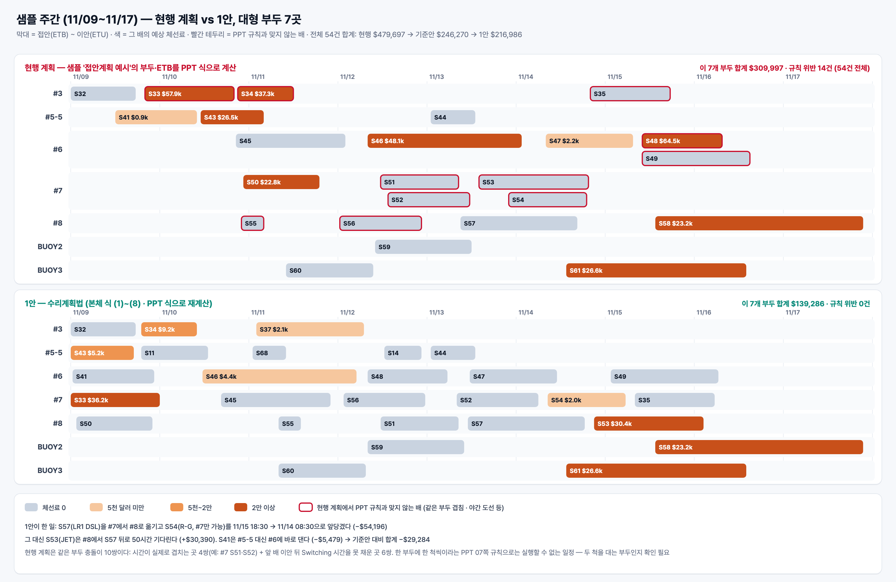
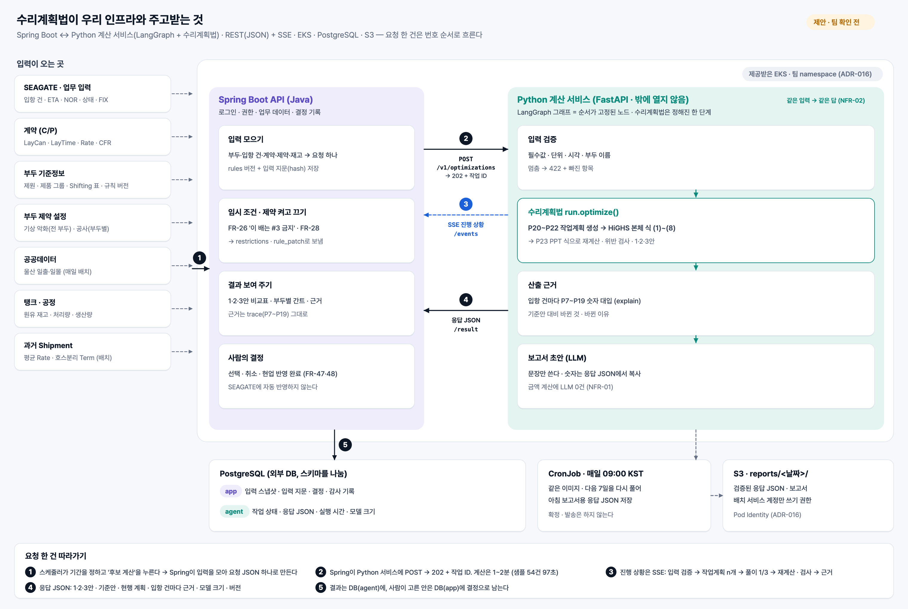

# 멘토링 PPT 기준 수리계획법 — 최종 식 · 적용 · 결과

- 작성 2026-11-12 · 원본: `SKALA_Mentoring_전무룡Manager.pptx`(13장) · `Sample data.xlsx` · 팀 최종본 식: [../milp-final.md](../milp-final.md)
- 그림: [figures/](figures/) · 장마다 캡처: [slides/](slides/) · 결과 JSON: [out/](out/)
- 표기: 대괄호 안이 아래첨자다 (`z[i,k]` = z에 아래첨자 ik). 시각은 KST, 금액은 USD.

## 0. 결론

1. **식은 그대로다.** 팀 최종본 본체 식 (1)~(8)을 한 글자도 바꾸지 않았다. PPT 06~12쪽의 규칙은 모두 '솔버에 넣기 전의 값'(작업계획 Ω, 충돌 쌍 F, 체선료 C, 재고 q)을 만드는 계산식 P1~P23이 됐다. 규칙이 바뀌면 식이 아니라 규칙 표 `rules/terminal.json`의 값을 바꾼다.
2. **전체 체선료 최적화다.** 목적함수는 모든 입항 건의 체선료 합이고, 어느 부두에 댈지도 솔버가 정한다. 샘플 54건은 부두 후보·부두 사이 제약·원유 탱크로 전부 이어져 있어 부두별로 나눠 풀 수 없다.
3. **샘플 주간 결과**: 1안 **$216,985.68**. 기준안(ETA 순서, 가장 이른 부두) $246,269.93보다 **$29,284.25(11.9%) 낮다**. 규칙 위반 0, 계산 97초.
   - 부두 배정을 현행 계획대로 묶고 순서만 바꾸면 $362,079.02. 부두마다 따로 최적화하면 동일 화물 그룹 충돌 3건이 생기고, 고쳐 맞추면 $432,325.41.
4. **검산**: 무작위 60건에서 식으로 푼 1·2·3안이 '순서를 전부 계산한 답', '작업계획 조합을 전부 해 본 답'과 모두 같았다.



## 1. PPT 장별 레퍼런스

PPT를 장마다 캡처했다 ([slides/](slides/)). 13장을 한 장에 모은 그림:



| 쪽 | 정한 것 | 이 문서에서 간 곳 |
|---|---|---|
| [01](slides/ppt-p01.png) | 9월 체선료 약 180억 원, 접안 스케줄은 숙련자가 짠다 | 목적함수 (1) |
| [02](slides/ppt-p02.png) | 사용자(스케줄러·작업 지시자·지불 부서), 쓸 자료 | 요청 JSON의 항목 (6절) |
| [03](slides/ppt-p03.png) | ① 예상 체선료 + 산출 근거 ② 접안 순서를 여러 안으로 시뮬레이션해 낮은 후보 비교 | C[i,k] + 근거(trace), 1·2·3안 |
| [04](slides/ppt-p04.png) | 정답이 아니라 의사결정 보조, 최종 선택은 사람 | 후보안만 내고 확정은 사람 (6절 5단계) |
| [05](slides/ppt-p05.png) | 같은 기준으로 빠르게 비교 | 기준안·현행 계획을 같은 식으로 계산 |
| [06](slides/ppt-p06.png) | ETB = 조건별 접안 가능 시각의 교집합(AND), FIX는 자동 산출 제외, 바뀌면 전부 재확인 | P7 · P8 · 식 (8) · P23 |
| [07](slides/ppt-p07.png) | 빈 부두 ETA + Direction, 앞 배 ETU + Switching, Shifting 표, FIX 앞에 못 끼면 접안불가 | P2 · P3 · P8 · F |
| [08](slides/ppt-p08.png) | 야간 도선 → 다가오는 08시, 동일 화물 그룹·부두 동시 접안 → ETU − 2h, 부두 제약 → 종료 + Direction | P4 · P5 · P6 · F |
| [09](slides/ppt-p09.png) | 작업시작 ETB + 1h, 이안 완료 + 2h, 호스분리 완료 + 30분, ETANR, 정박개시(Daylight 미적용) | P9~P14 |
| [10](slides/ppt-p10.png) | 정박개시(Daylight 적용, 07시·일출·일몰), 정박종료, 원유 && CFR False → LayTime ÷ 2 | P15 · P16 |
| [11](slides/ppt-p11.png) | Demurrage = 호스분리 − 정박종료 − 기상체선 시간 ÷ 2, 체선료 = × Rate ÷ 24, 사용시간 그림 | P17~P19 → C[i,k] |
| [12](slides/ppt-p12.png) | 선박·부두 제원, 일출·일몰 공공데이터, 기상은 부두 제약 설정으로, 조석은 고려 안 함, 원유 탱크 30기·1,000만 배럴 | P1 · P5 · 식 (4)~(6) |

09쪽에는 빨간 X가 두 개 있다. 하나는 'ETA와 N/R Tender가 없으면 정박개시를 못 낸다'는 경고 상자, 다른 하나는 '과거 호스분리 − 완료(Term)의 최빈값' 설명이다. 그래서 **호스분리 = 작업완료 + 30분**으로 계산했다 [내 해석, 멘토 확인 필요].

## 2. 최종 식

### 2-1. 본체 — 팀 최종본 그대로 (solver.py)

```text
(1)  min  Σ_i Σ_k  C[i,k] · z[i,k]                       총 예상 체선료 (모든 입항 건)
(2)  Σ_k z[i,k] = 1                     ∀ i              입항 건마다 작업계획 하나
(3)  z[i,k] + z[j,l] ≤ 1                ∀ (i,k,j,l) ∈ F  충돌하는 작업계획은 같이 고르지 않는다
(4)  R[t+1] = R[t] + Σ_i Σ_k q[i,k,t]·z[i,k] − D[t]      시간대별 원유 재고 수지
(5)  R[0] = R⁰                                           처음 재고
(6)  R_min ≤ R[t] ≤ R_max                                최소 허용 재고 · 저장용량
(7)  z[i,k] ∈ {0,1},  R[t] 연속
(8)  z[i, k_fix[i]] = 1                 ∀ i ∈ FIX        FIX · 작업 중 입항 건
(+)  Σ_{(i,k)∈S} z[i,k] ≤ |I| − 1                        다음 후보안을 낼 때만 (FR-42)
```

- 작업계획 k 하나 = (부두 b, 접안 시각 s). 그래서 z가 정해지면 **부두 배정과 순서가 함께** 정해진다.
- 큰 문제에서는 (3)을 쌍마다 쓰지 않고 '같은 시각에 겹치는 작업계획 묶음'마다 한 줄로 쓴다(Σ z ≤ 1). 고를 수 있는 조합은 같고 줄 수만 준다 — 무작위 56건에서 두 방식의 답이 같았다.

### 2-2. 체선료 C[i,k] — PPT 09·10·11쪽을 한 줄로 (pptcalc.py)

```text
C[i,k] = (Rate[i] ÷ 24) × max(0,  h[i,k] − ℓ[i,k] − λ[i]·A[i] − ½·W[i,k])        P18 · P19

  a[i,k] = s[i,k] + 1h                                작업시작          P9   (09쪽)
  c[i,k] = a[i,k] + T[i,b]                            작업완료          P10  T = 물량 ÷ 평균 Rate (과거 Shipment)
  h[i,k] = c[i,k] + 30분                              호스분리          P11  (09쪽, 빨간 X 해석)
  u[i,k] = c[i,k] + 2h                                이안 ETU          P12
  ETANR  = NVL(NOR Tender, ETA)                                         P13
  ℓ[i,k] = 정박개시 (아래 갈래, 위에서부터 처음 맞는 것)                P14 · P15
  λ[i]   = ½ (원유선 이고 CFR False) · 그 밖 1                           P16  (10쪽)
  W[i,k] = | 기상 악화 제약 시간 ∩ [ℓ[i,k], h[i,k]] |                    P17  (11쪽 + 멘토 설명)
```

정박개시 ℓ (P14 Daylight 미적용 = 특수·윤활유·화학제품선, P15 Daylight 적용 = 원유선·석유제품선):

| 갈래 | 조건 | 정박개시 |
|---|---|---|
| Early Loading | ETANR < LayCan From 이고 ETB < LayCan From | ETB |
| LayCan Miss | ETANR > LayCan To | ETB |
| 조기 도착 | ETANR < LayCan From | From 날 06시 (Daylight 적용 선박은 07시) |
| LayCan 안 · 미적용 | 그 밖 | min(ETANR + 6h, ETB) |
| LayCan 안 · Daylight | 일출 < ETANR < 일몰 → ETANR + 6h · ETANR ≤ 일출 → 그날 07시 · ETANR ≥ 일몰 → 다음 날 07시 | 그 값과 ETB 중 이른 쪽 |

팀 최종본 식 (20) `C = (r/24)·max(0, H − ℓ − A − e)`의 기호 자리에 PPT 값이 들어간 것과 같다: H = 호스분리 h, A → λ·A, 공제 e → ½·W, δ_setup = 1h, δ_hose = 30분, δ_departure = 2h.

### 2-3. 작업계획 Ω[i] — 어떤 접안 시각을 만드나 (P1~P8, P20)

```text
Ω[i] = { (b, s) :  b ∈ B[i],  s = φ[i,b](τ),  u ≤ 계획 종료 }                           P20

  B[i]  = 제품 그룹을 받고 제원 5종(Max DWT · Max/Min LOA · Min PBL · Max Draft)이 맞는 부두    P1 (12쪽)
          비어 있는 항목은 비교하지 않고, Draft는 수입선만 본다
  τ ∈  { ETA[i] + Direction[b] }                         빈 부두                         P2 (07쪽)
     ∪ { u[j,l] + Switching[b]   : 같은 부두의 다른 작업계획 }                            P3 (07쪽)
     ∪ { u[j,l] − 2h             : 동일 화물 그룹 · 부두 동시 접안 짝의 작업계획 }          P6 (08쪽)
  φ[i,b](τ) = τ가 금지 구간 안이면 그 구간의 끝, 아니면 τ                                  P7 (06쪽 AND)
     금지 구간: 야간 도선(→ 다가오는 08시)  P4 · 부두 제약 [시작, 종료 + Direction)  P5 · 계획 시작 전
  FIX 선박 앞에 끼는 계획(u + Switching ≥ FIX ETB)은 만들지 않는다                        P8 (07쪽 '접안불가')
```

- 접안 시각은 **PPT 식이 낼 수 있는 값만** 만든다. 그래서 솔버가 고르는 것은 사실상 '부두 배정과 순서'이고, 시각은 PPT 06~08쪽이 정한다. PPT 03쪽 '접안 순서를 여러 방안으로 시뮬레이션'을 모든 순서에 대해 한 번에 하는 셈이다.
- 위 τ를 끝까지 모두 만들면(EXACT) 정확하다. 입항 건이 많아 계획이 1,500개를 넘으면 금지 구간을 피한 시각을 30분 눈금으로 만들고(GRID), 고른 배정·순서를 P23에서 PPT 식으로 다시 계산해 눈금 틈을 없앤다.
- 야간 도선 P4: 대상은 (GRT ≥ 7.5만) 또는 (GRT ≤ 3만 · 수입선 · Draft ≥ 10.5). ETA ≥ Last POB(일몰 − 1.5h, GRT 5만 초과는 − 2h)이면 다가오는 08시. 따로 GRT ≥ 3만이면 02:00~08:00 접안 금지 → 08시.

### 2-4. 충돌 쌍 F · FIX (P8, P21)

```text
같은 부두 b:               s[j,l] < u[i,k] + Switching[b]  그리고  s[i,k] < u[j,l] + Switching[b]   → 충돌
동일 화물 그룹 (08쪽):     b, b' ∈ {#6,#7,#8} 또는 {#1-1,#1-2,#2-7}, 같은 제품 그룹,
                          s[j,l] < u[i,k] − 2h  그리고  s[i,k] < u[j,l] − 2h                        → 충돌
부두 동시 접안 (08쪽):     {b, b'} = {#4-1, #4-2} 이고 두 배가 모두 GRT 3,000 이하가 아니면, 위와 같은 식
FIX 보호 (07쪽):           뒤에 서는 쪽이 FIX면 같은 시각도 충돌 — 'FIX ETB ≤ 예상 ETU + Switching → 접안불가'
```

### 2-5. 재고 q · D (P22)와 다시 계산 (P23)

```text
q[i,k,t] = ± 물량[i] × | [τ_t, τ_t+1) ∩ [a[i,k], c[i,k]) | ÷ T[i,b]     하역 +, 선적 −
D[t]     = 공정 처리량 × 구간 길이                                       원유 탱크 30기를 하나로 (12쪽)
```

P23: 솔버가 고른 조합을 PPT 식(P2~P19)으로 처음부터 다시 계산하고, 모든 규칙을 다시 검사한다(PPT 06쪽 '모든 조건 재확인'). 위반이 하나라도 있으면 결과를 내지 않고 멈춘다. 솔버의 '최적'을 그대로 믿지 않기 위한 장치다.

### 2-6. 규칙이 바뀌면 고칠 곳 — 식이 아니라 표

| 바뀌는 것 | `rules/terminal.json` | 지금 값 |
|---|---|---|
| Shifting 표 | `berths[].switching_h · direction_h` | PPT 07쪽 표 (#5-1~#5-4는 표에 없어 #5-5 값) |
| 야간 도선 대상 · Last POB · 새벽 시간 | `night_pilotage` | PPT 08쪽 |
| 동일 화물 그룹 · 동시 접안 부두 | `pair_rules` | {#6,#7,#8} · {#1-1,#1-2,#2-7} · {#4-1,#4-2} |
| 작업시작 · 호스분리 · 이안 | `work` | 1h · 0.5h · 2h |
| 정박개시 시각 · Daylight 선종 | `laytime` | +6h · 06시/07시 · 07시 · 원유선·석유제품선 |
| LayTime 절반 조건 | `laytime.factor` | 원유 · CFR False → ½ |
| 기상 공제 비율 · 세는 구간 | `demurrage.weather_ratio · weather_basis` | ½ · `USED`(정박개시~호스분리). `DEMURRAGE`·`WAIT`로 바꿀 수 있다 |

요청 한 건에만 다르게 쓰려면 요청 JSON의 `rule_patch`에 넣는다 (예: `{"demurrage.weather_basis": "WAIT"}`).

## 3. 어떻게 적용되었나 — 한 척 따라가기

샘플 주간의 **S54** (LR1 석유제품선, R-G 수출, #7만 가능, ETA 11/13 08:00, 하루 $24,312)를 기준안과 1안에서 같은 식으로 계산한 산출 근거다. 응답 JSON의 `trace`를 그대로 옮겼다.

| 식 | 기준안 (ETA 순서) | 1안 (수리계획법) |
|---|---|---|
| P7 접안 ETB | 11/15 18:30 — S57 이안 + Switching | **11/14 08:30 — S52 이안 + Switching** |
| P9 작업시작 = ETB + 1h | 11/15 19:30 | 11/14 09:30 |
| P10 작업완료 = + 작업시간 18h | 11/16 13:30 | 11/15 03:30 |
| P11 호스분리 = + 30분 | 11/16 14:00 | 11/15 04:00 |
| P12 이안 = 완료 + 2h | 11/16 15:30 | 11/15 05:30 |
| P13 ETANR | 11/13 08:00 (NOR 없음 → ETA) | 같음 |
| P15 정박개시 (Daylight) | 11/13 14:00 — 일출~일몰 사이 → ETANR + 6h | 같음 |
| P16 정박종료 = + LayTime 36h | 11/15 02:00 | 같음 |
| P18 체선시간 | max(0, 11/16 14:00 − 11/15 02:00) = 36h | max(0, 11/15 04:00 − 11/15 02:00) = **2h** |
| P19 체선료 = × $24,312 ÷ 24 | $36,468.00 | **$2,026.00** |

1안은 #7에서 S57(DSL)을 #8로 보냈다. 그래서 S54가 S52 바로 뒤에 선다. 정박개시는 그대로이고 호스분리만 34시간 당겨져 체선료가 $34,442 줄었다.

다른 규칙이 걸린 예:

- **야간 도선 P4 + 원유 LayTime 절반 P16** — S60 (VLCC, GRT 156,597, ETA 11/10 22:00): Last POB(일몰 17:21 − 2h) 뒤 도착 → ETB = 11/11 08:00. 정박개시 = 다음 날 07시(일몰 뒤 도착). 정박종료 = 07:00 + 72h × ½ = 11/12 19:00. 호스분리 11/12 06:00이 더 이르므로 $0.
- **부두 제약 P5 + 기상 공제 P17** (기상 악화 변형, 11/12 06:00~18:00 전 부두) — S59 (VLCC, BUOY2, ETA 11/12 06:00): ETB = 제약 종료 18:00 + Direction 1.5h = 19:30. 정박개시 = 그날 07시(일출 전 도착). 사용시간 [07:00, 11/13 20:00] 안의 기상 시간 11h → 공제 5.5h. 체선시간 = max(0, 20:00 − 19:00 − 5.5h) = 0 → $0.
- **FIX P8 + 부두 바꾸기** (API 예시, 6절) — FIX 선박 F가 #8에 11/12 08:00. 수리계획법은 A(DSL)를 #6 대신 #8에 대 F 앞에 끝내고(이안 + Switching 2.5h < FIX ETB), 비운 #6에 B(R-G)를 기상 제약 끝 17:30에 바로 댄다. 기준안 $25,641.62 → 1안 $7,192.30.

## 4. 부두별 최적화인가, 전체 최적화인가

**전체 체선료 최적화다.** 이유는 셋이다.

1. 목적함수 (1)이 모든 입항 건의 C를 한 번에 더한다. 한 부두의 합을 따로 줄이는 식이 아니다.
2. 부두 배정이 결정에 들어 있다. 작업계획 = (부두, 접안 시각)이라, 같은 배가 #6·#7·#8 중 어디로 갈지를 솔버가 고른다.
3. 부두 사이를 묶는 규칙이 있다. 동일 화물 그룹(#6·#7·#8, #1-1·#1-2·#2-7), 부두 동시 접안(#4-1·#4-2), 원유 탱크(BUOY2·BUOY3·#8의 원유가 같은 탱크로 들어간다).

그래서 샘플 54건은 한 덩어리로 이어진다. 소형선 S41(DSL)은 #5-5와 #6 둘 다 갈 수 있어 소형 부두와 대형 부두를 잇고, S33(MEOH)은 #3과 #7을, S37(BENZENE)은 #4-1과 #3을 잇는다.

같은 식·같은 입력으로 최적화 범위만 바꿔 보았다 (`run.py --compare`):

| 범위 | 총 예상 체선료 | 실행 가능? |
|---|---:|---|
| A 전체 최적화 (부두 배정 + 순서, 부두 사이 규칙·탱크까지) = 1안 | **$216,985.68** | 예, 위반 0 |
| B 부두 배정은 현행 계획대로, 순서·시각만 최적화 | $362,079.02 | 예 |
| C 부두마다 따로 최적화 (다른 부두와의 규칙·탱크는 안 봄) | 종이 위 합계 $339,108.52 | **아니오** — 동일 화물 그룹 충돌 3건 (S16·S29, S45·S51, S45·S57) |
| C를 같은 부두·같은 순서로 실제 규칙에 맞춰 다시 계산 | $432,325.41 | 예 |

- 부두마다 따로 풀면 종이 위에서는 싸 보이지만(C), 다른 부두와 같은 제품을 동시에 싣는 일정이 나와 실행할 수 없다. 고쳐 맞추면 전체 최적화보다 $215,339.73 비싸다.
- B와 A의 차이($145,093.34)는 부두를 바꿔 댈 수 있어서 생긴다. 다만 현행 계획에는 한 부두에 두 척이 겹친 곳이 있어(5-1절) B가 그 배들을 한 줄로 세우느라 비싸진 몫도 들어 있다.
- 전체 최적화는 **한 배의 손해로 다른 배들의 이익을 사는 맞바꿈**을 한다. 1안에서 S53은 #8에서 50시간 더 기다려 +$30,390이지만, 그 덕에 S54(−$34,442)·S57(−$19,754)·S41(−$5,479)이 줄어 합계가 $29,284 내려갔다. 부두마다 따로 보면 이 맞바꿈이 보이지 않는다.

계산을 나누는 것은 다른 이야기다. 서로 전혀 이어지지 않는 입항 건 묶음은 따로 풀어 더해도 전체 최적과 같다 (`run.py`의 `components()`가 자동으로 나눈다). 목표는 그대로 전체 합이고, 계산만 빨라진다.

## 5. 결과 보고

### 5-1. 샘플 주간 (Sample data.xlsx '접안계획 예시', ETB 11/09~11/15)

- 입력: 68행 중 같은 (부두, ETA, ETB, ETU, 업무) 행을 한 배의 여러 화물로 보고 합쳐 **54건**. 계획 시작(11/09 00:00)에 이미 대 있던 2건(S32 #3, S36 #4-1)은 '작업 중'으로 고정. 계획 기간 11/09~11/19.
- 엑셀에 없는 값은 [가정]으로 넣었다 (7절). 금액은 이 가정에서의 값이다.

| 일정 | 총 예상 체선료 | 기준안 대비 | 규칙 위반 |
|---|---:|---:|---:|
| 현행 계획 (엑셀의 부두·ETB를 PPT 식으로 계산) | $479,697.11 | +$233,427.18 | 14 |
| 기준안 (ETA 순서, 가장 이른 부두 · FR-41) | $246,269.93 | — | 0 |
| **1안 (수리계획법)** | **$216,985.68** | **−$29,284.25 (−11.9%)** | 0 |
| 2안 · 3안 | $216,985.68 | −$29,284.25 | 0 |



- **1안이 바꾼 것**: S57을 #7 → #8, 그래서 S54가 #7에서 34시간 일찍 선다. S41은 #5-5 대신 #6에 바로 댄다. S53은 #8에서 S57 뒤로 기다린다. 나머지 바뀐 배들은 체선료가 0인 소형선의 부두 바꾸기다.
- **2안·3안이 1안과 같은 금액인 이유**: 다른 점이 체선료 0인 배들의 부두뿐이다(18~20척). 금액으로는 차이가 없으니 현장 편의로 고르면 된다. 금액이 다른 다음 안을 원하면 (+) 식을 '체선료가 있는 배의 배정이 달라야 한다'로 바꿀 수 있다 [팀 결정].
- **현행 계획을 PPT 규칙으로 보면**: 같은 부두 충돌 10쌍(시간이 실제로 겹치는 곳 4쌍: #1-1 S06·S08, #6 S48·S49, #7 S51·S52, #7 S53·S54 + Switching 시간을 못 채운 곳 6쌍), 도착 + Direction보다 이른 ETB 2건, Last POB 뒤 도착인데 08시 전 접안 2건. 한 부두에 한 척씩이라는 PPT 07쪽 규칙으로는 실행할 수 없는 일정이라 금액도 크다. 한 부두에 두 척을 대는 곳이 있는지 확인이 필요하다.
- **계획 시작 전에 이미 쌓인 체선료**도 모든 일정에 똑같이 들어 있다. 예: S28은 ETA가 11/04라 11/09 00:00에 바로 대도 $41,128.31. 비교에는 영향이 없다.

### 5-2. 기상 악화 변형 (11/12 06:00~18:00, 전 부두) [가정]

| 일정 | 총 예상 체선료 | 기준안 대비 |
|---|---:|---:|
| 현행 계획 | $461,842.20 (규칙 위반 20) | +$211,520.27 |
| 기준안 | $250,321.93 | — |
| **1안** | **$232,687.18** | **−$17,634.75 (−7.0%)** |

- 6척이 '제약 종료 + Direction'으로 밀렸다 (#6·#7·BUOY2는 19:30, 소형 부두는 19:00). P5가 그대로 작동한다.
- **찾은 것 — 일부러 늦게 대면 공제가 커진다.** 기상체선 시간을 '사용시간과 겹친 시간'(기본 `USED`)으로 세면, 배를 더 늦게 대 사용시간이 기상 시간과 더 겹치게 할수록 공제(½)가 커진다. 그런 조합은 $230,223.66까지 내려가지만, PPT 식의 ETB(가장 이른 접안 가능 시각)가 아니라서 후보안에는 넣지 않고 응답의 `notes`에만 남겼다. 기상체선 시간을 어느 구간으로 세는지 멘토 확인이 필요하다 (11-10에 찾은 것과 같은 현상).

### 5-3. 모델 크기와 시간

| | 샘플 주간 | 기상 변형 | API 예시 (6절) |
|---|---:|---:|---:|
| 움직이는 입항 건 | 52 | 52 | 3 |
| 작업계획 (z 변수) | 39,477 (30분 눈금) | 36,646 | 19 (EXACT) |
| 제약식 · 0 아닌 계수 | 9,474 · 170만 | 8,891 | 21 |
| 풀이 횟수 · 시간 | 3회 · 85초 (전체 97초) | 3회 · 99초 | 3회 · 0.02초 |

- 한 번 풀 때마다 1차 총 체선료 최소 → 2차 같은 금액 안에서 일찍 대는 쪽 (EXACT는 3차로 계획 번호까지) 순서로 푼다. 같은 입력이면 같은 순위가 나오게 하려는 것이다 (NFR-02).
- 솔버는 HiGHS (scipy 1.18.1의 `scipy.optimize.milp`). 무료(MIT)라 이미지에 그대로 넣는다.

### 5-4. 검산

`validate.py --n 60` (무작위 60건: 대형 부두 #6·#7·#8, 원유 #8·BUOY, 화학 #4-1·#4-2, 제품 #1-1·#1-2·#2-7 묶음, 2~5척, FIX·기상 제약·원유 탱크 섞음)

| 검사 | 무엇과 비교 | 결과 |
|---|---|---|
| A | 부두 배정 × 순서를 전부 PPT 식으로 계산한 1·2·3안 (재고 없는 사례) | 50건 모두 같음 |
| B | 작업계획의 모든 조합을 하나씩 해 본 1·2·3안 | 36건 모두 같음 |
| C | 식 (3)을 쌍으로 넣은 답 = 겹치는 묶음으로 넣은 답 | 56건 모두 같음 |
| G | 30분 눈금(GRID) + PPT 재계산의 1안 = 정답 1안 | 53건 모두 같음 |

모든 후보안은 나오기 전에 P23 재검사를 거친다. 위반이 있으면 결과 대신 오류를 낸다 — 이번 실행에서 0건이었다.

## 6. 인프라와 주고받는 것



기준은 ADR-014(Spring Boot + Python 두 서비스), ADR-015(REST + SSE), ADR-016(EKS)이다. 아래 경로 이름과 저장 위치는 **제안**이다 [팀 확인 필요].

### 6-1. 요청 한 건의 흐름

1. 스케줄러가 기간을 정하고 '후보 계산'을 누른다. Spring이 업무 DB에서 입항 건·계약·부두 제약·재고를 모아 **요청 JSON 하나**로 만든다. 입력 스냅샷과 지문(hash), 규칙 표 버전을 `app` 스키마에 남긴다.
2. Spring이 Python 서비스에 `POST /v1/optimizations` → `202` + 작업 ID. Python 서비스는 클러스터 안에서만 보인다(ClusterIP).
3. Python 서비스의 LangGraph 그래프가 정해진 순서로 돈다: 입력 검증 → **수리계획법 `run.optimize()`** → 산출 근거 → 보고서 초안. 진행 상황은 SSE(`/events`)로 흘린다. 수리계획법은 LLM이 고르는 도구가 아니라 고정된 한 단계다.
4. 결과는 **응답 JSON** (`/result`). `agent` 스키마에 저장하고 Spring이 화면에 보여 준다 (1·2·3안 비교표, 부두별 간트, 입항 건마다 산출 근거).
5. 사람이 한 안을 고르면 Spring이 결정으로 기록한다 (FR-47·48). SEAGATE에 자동으로 반영하지 않는다.

### 6-2. 주고받는 JSON — 계약

요청 (= `cases/*.json`과 같은 모양, 예: [cases/example-request.json](cases/example-request.json)):

```json
{
  "request_id": "REQ-20261112-001",
  "plan": {"start": "2026-11-10T00:00", "end": "2026-11-16T00:00"},
  "arrivals": [{
    "id": "B", "class": "PP", "biz": "IM|EX|DI|DO", "cargo_group": "R-G", "qty": 300000,
    "eta": "2026-11-10T09:00", "nor_tender": null,
    "grt": 29597, "dwt": 45000, "loa": 183.0, "pbl": 85.5, "draft": 12.64,
    "contract": {"laycan_from": "…", "laycan_to": "…", "laytime_h": 36, "rate_usd_day": 26252, "cfr": false},
    "work": {"rate_per_h": 11145},
    "status": "PLANNED|FIX|WORKING", "fix": {"berth": "#8", "etb": "…"}, "berths": ["선택: 지정 부두"]
  }],
  "restrictions": [{"id": "WX-1", "reason": "WEATHER|WORK", "berths": ["*"], "start": "…", "end": "…"}],
  "inventory": [{"group": "CRUDE", "opening": 5500000, "min": 3000000, "max": 10000000,
                 "flows": [{"from": "…", "to": "…", "use_per_h": 35000}]}],
  "sun": {"2026-11-10": ["06:53", "17:21"]},
  "current_plan": [{"id": "B", "berth": "#6", "etb": "…"}],
  "rule_patch": {"demurrage.weather_basis": "USED"},
  "options": {"generation": "auto", "grid_min": 30, "max_wait_h": 120}
}
```

| 요청 항목 | 어디서 오나 | 식에서 쓰는 곳 |
|---|---|---|
| `arrivals[].eta · nor_tender · status · fix` | SEAGATE · 업무 입력 | P2 · P13 · 식 (8) |
| `arrivals[].contract` | 계약(C/P) | P14~P16 · P19 |
| `arrivals[].grt…draft · cargo_group` | 선박 제원 · 자재코드 → 제품 그룹 | P1 · P4 · P6 |
| `arrivals[].work.rate_per_h` | 과거 Shipment 평균 Rate (배치로 미리 계산) | P10 |
| `restrictions` | 부두 제약 설정 화면 (기상 악화 · 공사) | P5 · P17 |
| `inventory` | 원유 탱크 재고 · 공정 처리량 | 식 (4)~(6) |
| `sun` | 공공데이터 일출·일몰 (매일 배치). 없으면 근사식 | P4 · P15 |
| `current_plan` | 지금 SEAGATE에 있는 계획 (선택) | 비교용 |
| `rule_patch` · `options` | 임시 조건 · 제약 켜고 끄기 (FR-26·28) | 규칙 표 · 생성 설정 |

응답 (예시를 줄인 것, 전체는 [out/EXAMPLE-3.response.json](out/EXAMPLE-3.response.json)):

```json
{
  "request_id": "REQ-20261112-001", "request_hash": "53caa8107d00a515", "status": "OK",
  "engine": {"version": "ppt-milp/1.0", "rules_version": "ulsan-clx/ppt-v1", "solver": "HiGHS (scipy 1.18.1)",
             "formulas": "팀 최종본 본체 식 (1)~(8) — 변경 없음", "objective": "전체 입항 건의 총 예상 체선료 최소화 (부두별 합이 아님)"},
  "baseline": {"total_usd": 25641.62, "plans": ["…"], "violations": []},
  "candidates": [{
    "rank": 1, "status": "OPTIMAL", "total_usd": 7192.3, "delta_vs_baseline_usd": -18449.32, "violations": [],
    "changes_vs_baseline": [{"arrival_id": "B", "from": {"berth": "#6", "etb": "2026-11-11T15:56", "usd": 18449.32},
                             "to": {"berth": "#6", "etb": "2026-11-10T17:30", "usd": 0.0}, "delta_usd": -18449.32}],
    "plans": [{"arrival_id": "B", "berth": "#6", "etb": "2026-11-10T17:30", "hose_off": "2026-11-11T21:56", "etu": "2026-11-11T23:26",
               "laytime_start": "2026-11-10T15:00", "laytime_end": "2026-11-12T03:00", "demurrage_usd": 0.0,
               "why_etb": "ETA + Direction → 부두 제약 WX-1이라 그 끝으로",
               "trace": [{"rule": "P7", "text": "접안 ETB = 11/10 17:30 — …"}, {"rule": "P9", "text": "작업시작 = ETB 11/10 17:30 + 1h = 11/10 18:30"}, "…"]}]
  }],
  "components": [{"plans": 19, "mode": "EXACT", "variables": 19, "rows": 21, "seconds": 0.02}],
  "notes": [], "elapsed_seconds": 0.04
}
```

- 화면의 '산출 근거'는 `trace`를 그대로 보여 준다. 보고서 초안을 쓰는 LLM도 이 JSON만 읽고, 숫자는 복사만 한다 (NFR-01: 금액 계산에 LLM 0건).
- 상태 값: `OK` · `INFEASIBLE`(식 (2)(3)(6)(8)을 모두 지키는 조합 없음 → '실행 가능한 후보 없음', FR-43). 후보마다 `OPTIMAL` 또는 `TIME_LIMIT`(제한시간 안에 최적 증명 못 함 → 그때까지의 최선안 + 갭, NFR-09).

### 6-3. 경로 (제안)

| 서비스 | 경로 | 하는 일 |
|---|---|---|
| Python | `POST /v1/optimizations` | 요청 JSON 받기 → `202 {job_id, request_hash}` |
| Python | `GET /v1/optimizations/{job_id}` | 상태: queued · running · done · failed |
| Python | `GET /v1/optimizations/{job_id}/events` | SSE: 입력 검증 → 작업계획 n개 → 풀이 1/3 … → 재검사 → 근거 |
| Python | `GET /v1/optimizations/{job_id}/result` | 응답 JSON |
| Spring | `POST /api/schedules/{id}/optimize` · `GET …/events` | 화면이 부르는 곳. 권한 확인 후 Python을 부르고 SSE를 중계 |
| Spring | `POST /api/runs/{id}/decisions` | 사람의 결정 (데모에 이미 있음) |

### 6-4. 운영에서 지킬 것

- **같은 입력 → 같은 답 (NFR-02)**: 요청 지문(`request_hash`)·엔진 버전·규칙 표 버전을 함께 저장한다. 같은 지문이 다시 오면 저장된 결과를 돌려준다.
- **시간**: 풀이 한 번의 제한시간 120초(`time_limit`), 작업 전체 10분. 샘플 54건이 97초라 화면은 기다리게 하지 않고 작업 ID + SSE로 받는다.
- **자원**: HiGHS는 CPU를 여러 개 쓴다 (샘플 실행에서 약 2.7코어). Python Pod 요청 2 CPU부터 시작하고, 메모리는 실제 실행에서 재서 정한다 (아직 재지 않았다).
- **배치**: CronJob(매일 09:00 KST)이 같은 이미지로 다음 7일을 다시 풀어 응답 JSON을 S3 `reports/<날짜>/`와 DB에 남긴다. 확정·발송은 하지 않는다.
- **규칙 표**: `rules/terminal.json`은 이미지에 넣고 버전을 응답에 남긴다. 운영 중 바꾸려면 DB 표로 옮기고 Spring이 요청에 실어 보낸다 [팀 결정].
- 정해야 하는 것 [팀 확인 필요]: 경로 이름, 작업 큐를 둘지(한 Pod 한 작업으로 시작), 규칙 표를 이미지와 DB 중 어디에 둘지, 과거 Shipment 평균 Rate 배치를 누가 맡을지.

## 7. 가정과 확인할 것

### 7-1. 샘플 주간에 넣은 가정 (엑셀에 없는 값)

- **선박 제원**: 그 배가 쓴 부두 크기에 맞는 '선박 제원 Sample' DWT 구간 평균 (BUOY → VLCC 29만~30만, #8 수입 → Aframax 원유선, #7·#8 수출 → LR1 7만~8만, #6 → MR 4만~5만, #3 → 3만~4만, 소형 부두 → 부두 제원 안으로 맞춘 소형선). BUOY2에 댄 VLCC는 흘수를 21.01 m로 낮췄다 (평균 21.54 m는 BUOY2 최대 21.21 m를 넘는다).
- **제품 그룹**: 그 부두가 받는 그룹에서 골랐다. 동일 화물 그룹 부두 묶음에서는 현행 계획에서 겹치는 배끼리 다르게 골랐다.
- **작업시간**: 엑셀의 (ETU − ETB) − 3h (PPT 09쪽 작업시작 +1h, 이안 +2h를 거꾸로 푼 값).
- **계약**: 일 체선료 = DWT 구간 평균, LayTime 원유 72h(CFR False → 36h) · 제품 36h · 소형 24h, LayCan = ETA 전날 00:00 ~ 다음 날 23:59, NOR 없음.
- **원유 탱크**: 저장용량 1,000만 · 최소 허용 300만 · 처음 550만 배럴, 공정 처리 시간당 3.5만 배럴.
- **FIX**: 엑셀에 표시가 없어 없음. 계획 시작 전에 이미 대 있던 2척만 고정.
- 일출·일몰은 공공데이터 대신 근사식(NOAA)으로 계산했다. 운영에서는 요청의 `sun`에 공공데이터 값을 넣는다.

### 7-2. 멘토께 확인할 것

1. 09쪽 빨간 X 두 개 — 호스분리를 '완료 + 30분'으로 확정한 것인지, 'ETA·N/R Tender가 없으면 경고'를 없앤 것인지.
2. 기상체선 시간을 세는 구간 — 사용시간 전체와 겹친 시간인지(지금), 체선 기간과 겹친 시간인지, 기상 때문에 기다린 시간인지. 앞의 둘은 '일부러 늦게 대기'가 더 싸지는 문제가 있다 (5-2절).
3. 한 부두에 두 척을 대는 곳이 있는지 — 샘플 '접안계획 예시'에서 #1-1·#6·#7(2쌍)에 시간이 겹치는 배가 있다.
4. 야간 도선 대상 — '(3만톤 이하 AND 수입선 AND Draft ≥ 10.5)'와 'GRT 3만 이하는 야간 도선 제한 X'가 서로 맞지 않는다. 지금은 앞의 조건을 적힌 대로 두고 Last POB는 일몰 − 1.5h를 썼다.
5. LayTime 절반 조건이 '원유 && CFR False'가 맞는지.
6. 동일 화물 그룹의 '화물 그룹'이 엑셀의 제품 그룹(DSL, JET …)인지.
7. 원유 탱크의 최소 허용 재고와 공정 처리량.

## 8. 파일과 다시 돌리기

| 파일 | 하는 일 |
|---|---|
| `slides/ppt-p00-cover.png`, `ppt-p01.png` … `ppt-p12.png` | PPT 장마다 캡처 (LibreOffice로 PDF → PNG, 한글 글꼴을 맞춰서) |
| `build_master.py` → `rules/terminal.json`, `rules/sample_plan.json` | 엑셀 4개 시트 + PPT 표(Shifting · 야간 도선 · 동시 접안 · 작업 시각 · 정박개시) → 규칙 표 |
| `pptcalc.py` | P1~P19 — 한 척의 한 작업계획 계산 + 산출 근거 |
| `planner.py` | P20~P23 — 작업계획 Ω · 충돌 F · 재고 q 만들기, 기준안, 검산 도구 |
| `solver.py` | 본체 식 (1)~(8) → HiGHS, 2·3안, 재계산·재검사 |
| `run.py` | 서비스 입구 `optimize(요청) → 응답`, 묶음 나누기, 범위 비교 |
| `validate.py`, `fleet.py` | 무작위 검산 |
| `cases/` | 샘플 주간 · 기상 변형 · API 예시 요청 |
| `out/` | 응답 JSON · 요약 · 검산 기록 |
| `figures/make_figures.py` | 그림 4장 (SVG → PNG) |

```bash
python3 docs/milp/ppt/build_master.py "<Sample data.xlsx 경로>"
python3 docs/milp/ppt/cases/build_sample_week.py
python3 docs/milp/ppt/run.py cases/sample-week.json --compare
python3 docs/milp/ppt/validate.py --n 60
python3 docs/milp/ppt/figures/make_figures.py
```

scipy가 필요하다 (시스템 `python3` 3.14에 scipy 1.18.1이 있다. `demo/.venv`에는 없다).
