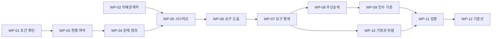

# 요구사항 분석 단계 — 해야 할 작업, 시나리오 작성법, 지금 우리가 할 일

- 작성일: 2026-11-04 · 짝 문서: [`01-prd-guide.md`](01-prd-guide.md)(원칙), [`03-prd-v0.md`](03-prd-v0.md)(결과물), [`04-scenarios.md`](04-scenarios.md)(시나리오), [`gantt/gantt.md`](gantt/gantt.md)(일정)
- 표기: [사실] / [추론] / [추천] / [가정] / [확인 필요] ([`../domain/00-README.md`](../domain/00-README.md) §3)
- 교육과정이 정한 요구사항 분석 산출물 양식이 따로 있으면 그 양식이 우선이다. 아래 내용은 그 양식에 옮겨 담을 재료다 [확인 필요].

---

## 1. 이 단계가 하는 일

요구사항 분석 단계의 목적은 **"무엇을 만들지"를 이해관계자와 합의하고, 검증할 수 있는 문장으로 고정하는 것**이다. 여기서 정한 것이 설계·구현의 입력이 된다. 이 단계가 허술하면 뒤 단계의 비용이 커진다.

이 단계가 끝났다고 말할 수 있는 조건(Exit criteria)은 아래 일곱 가지다.

| # | 조건 | 우리 상태 (2026-11-04) |
|---|---|---|
| 1 | 이해관계자가 확인한 요구 목록이 있다 | 없음 — 현업 확인 0건 |
| 2 | 모든 Must 요구에 인수 기준이 있다 | 초안 있음 (`03` §6) |
| 3 | 모든 Must 요구가 시나리오 한 개 이상에 나온다 | 초안 있음 (`04` §3) |
| 4 | 우선순위·범위·비목표가 명시되어 있다 | 초안 있음, 코어(A/B) 결정 대기 |
| 5 | 열린 질문과 가정마다 담당·기한이 있다 | 초안 있음 (`03` §9·§11) |
| 6 | 추적표가 있다 (요구 ↔ 시나리오 ↔ 테스트 ↔ 작업) | 초안 있음 (`03` §12) |
| 7 | 팀 리뷰 결과가 결정 로그에 남아 있다 | 없음 — 리뷰 전 |

## 2. 해야 할 작업 12개



| WP | 작업 | 입력 | 하는 일 | 산출물 | 끝났다고 보는 기준 | 우리 상태 |
|---|---|---|---|---|---|---|
| WP-01 | 프로젝트 조건 확인 | 과제 정의서, 멘토, 운영진 | 마감·평가 기준·필수 기술·제공 자원 확인 | 프로젝트 조건표 | 네 항목이 적히거나, [확인 필요]와 담당·기한이 붙음 | 없음 — 어느 문서에도 없다 (질문지 Q6) |
| WP-02 | 이해관계자 식별 | 진단 문서, 프로세스 지도 | 역할·관심·영향·확인 방법 정리 | 이해관계자 표 | 확인할 사람이 3명 이상 지목됨 | 일부 — 프로토타입에 12곳×RACI [가정] |
| WP-03 | 현행(AS-IS) 파악 | SEAGATE 공개 자료, 도메인 문서 | 청구 검토·ETB 변경이 지금 어떻게 돌아가는지 | AS-IS 흐름 2장 | 단계마다 사람·도구·시간이 적히고 가설 표시가 있음 | 일부 — 진단 §1~3, 흐름은 [추론] |
| WP-04 | 문제 정의·가설 | WP-03 | 문제 문장, 가설 H1~H5, 검증 질문 | 문제 정의 | 가설마다 검증 질문과 "답이 바꾸는 결정"이 붙음 | 있음 — 진단·정의서. 현업 확인은 0 |
| WP-05 | 사용자·시나리오 | WP-02~04 | 대표 시나리오와 예외 시나리오 작성 | 시나리오 명세 | 대표 흐름·예외 흐름·정답 데이터가 있음 | 일부 — `04` v0 |
| WP-06 | 요구 도출 | 시나리오, 인터뷰, 문서, 프로토타입 | 요구 후보 수집, 출처 표기 | 요구 후보 목록 | 후보마다 "어디서 나왔나"가 적힘 | 일부 |
| WP-07 | 요구 분석·명세 | WP-06 | 분류, 중복·충돌 정리, EARS 문장화, ID 부여 | 요구사항 표 | 한 줄 한 요구, 모호어 0 | 일부 — `03` §6 |
| WP-08 | 우선순위·범위 | WP-07 | MoSCoW, 분기(A/B) 표시, 비목표 | 우선순위 표 | Must만으로 데모·평가가 성립 | 일부 — 분기 의존 |
| WP-09 | 인수 기준·평가 계획 | WP-07 | 요구별 인수 기준, 평가셋·지표 설계 | 인수 기준 열, 평가 계획 | Must 전부에 인수 기준이 있음 | 일부 — 골든 TC 있음, 30건·20건 세트는 계획만 |
| WP-10 | 가정·위험 관리 | 전 단계 | 가정 목록, 위험 표 | 가정·위험 대장 | 가정마다 확인 질문·담당·기한 | 일부 — 룰 47개 중 29개가 [가정] |
| WP-11 | 검증(Validation) | WP-05~10 | 팀 리뷰, 멘토 인터뷰, 프로토타입 시연 | 리뷰 기록, 수정 목록 | 이해관계자 확인을 거친 요구가 생김 | 없음 |
| WP-12 | 추적·기준선·변경 관리 | 전부 | 추적표, 버전, 변경 요청 절차 | 추적표, v1 기준선 | 모든 Must가 시나리오·테스트·작업에 연결됨 | 이번에 시작 (`03` §12) |

## 3. 시나리오를 쓰는 법

### 3-1. 시나리오의 종류

| 종류 | 한 줄 | 언제 쓰나 |
|---|---|---|
| 사용자 시나리오 | 한 사람의 하루 속 이야기. 서술형 | 문제를 같이 이해할 때, 발표 |
| 유스케이스(명세형 시나리오) | 행위자·사전조건·기본 흐름·예외 흐름·사후조건을 표로 | 요구 도출과 검증. 이 폴더가 쓰는 형식 |
| 사용자 스토리 | "<역할>로서 <기능>을 원한다. <이유> 때문이다" 한 줄 | 일정 계획, 백로그 |
| 업무 흐름(AS-IS/TO-BE) | 지금의 일과 바뀐 뒤의 일을 흐름도로 | 무엇이 바뀌는지 합의할 때 |
| 평가(테스트) 시나리오 | 입력과 정답이 확정된 사례 | 인수 기준 확인 (골든 케이스) |
| 예외·오남용 시나리오 | 입력이 틀렸거나 일부러 잘못 쓰는 경우 | AI 제품에서 특히 필수 |

### 3-2. 시나리오 명세 양식

```text
ID / 이름
목적(가치)     이 시나리오가 끝나면 누가 무엇을 얻는가
행위자         사람 역할과 시스템
사전 조건      시작 전에 참이어야 하는 것
트리거         무엇이 시나리오를 시작하게 하는가
기본 흐름      번호 단계. 단계마다 "누가 무엇을" (7±3단계)
대안·예외 흐름 기본 흐름의 몇 번 단계에서 갈라지는가
사후 조건      끝난 뒤 참이어야 하는 것 (기록, 승인 상태 등)
관련 요구      INT-, CLK- … ID
정답·데이터    어떤 케이스로 재현하고 정답은 어디 있는가
인수 기준      통과/실패를 가르는 조건
근거 등급      CONFIRMED / DOC / VIRTUAL / HYPOTHESIS
확인 질문      이 시나리오를 현업에 확인할 때 묻는 질문 (Q#)
```

### 3-3. 좋은 시나리오의 여덟 가지 기준

1. 구체적인 사건과 숫자가 있다 (선박 이름, 시각, 금액).
2. 목표가 하나다. 목표가 둘이면 나눈다.
3. 기본 흐름이 7±3단계다. 길면 쪼갠다.
4. 예외 흐름이 있다. 행복한 경로만 있으면 미완성이다.
5. 사람의 일과 시스템의 일이 단계마다 구분된다.
6. 끝났을 때 관측할 수 있는 결과가 있다.
7. 재현할 데이터와 정답이 있다.
8. 요구 ID와 양방향으로 이어진다.

### 3-4. 시나리오에서 요구를 뽑는 법

시나리오의 단계 하나하나에서 "시스템이 하는 일"을 찾아 EARS 문장으로 옮기면 요구사항이 된다. 예를 들어 S-A1의 4단계 "CLOCK이 계약대로 재계산한다"는 **CLK-01**이 되고, 인수 기준은 그 단계의 정답 데이터(TC-01~05)에서 나온다. 예외 흐름은 "If … then" 요구(CLK-04, COM-04)가 된다.

### 3-5. 커버리지 점검

- 모든 Must 요구가 시나리오 한 개 이상에 나오는가 → `04` §3 표의 빈칸을 본다.
- 모든 예외 흐름에 대응하는 요구가 있는가.
- 시나리오가 한 번도 쓰지 않는 요구는 필요 없는 요구일 수 있다 → 출처를 다시 묻는다.

## 4. 요구를 끌어내는 방법과 우리 프로젝트의 사정

| 기법 | 무엇을 하나 | 우리에게는 |
|---|---|---|
| 인터뷰 | 이해관계자에게 직접 묻는다 | 멘토 질문지(Q1~Q14). 가장 중요한데 아직 안 했다 |
| 문서 분석 | 기존 문서·시스템 자료를 읽는다 | 진단 문서, 도메인 문서 00~09, 용선계약 조항 맵 — 완료 |
| 관찰·현장 체험 | 일하는 모습을 본다 | 불가능 → 시뮬레이터와 모의 클레임(ULSAN GLORY) 롤플레이로 대체 |
| 프로토타입 시연 | 만든 것을 보여 주고 반응을 얻는다 | 프로토타입 v3 — 멘토에게 보일 수 있음. 반응이 곧 요구 |
| 워크숍 | 팀이 모여 시나리오를 같이 그린다 | 팀 내 30분 리뷰 (§7 단계 4) |
| 벤치마킹 | 비슷한 사례를 본다 | 외부 사례 7건 정리 완료 (프로토타입 P18) |

인터뷰를 할 때의 요령:

1. 예/아니오가 아니라 "최근 한 건을 처음부터 끝까지 이야기해 주세요"로 묻는다.
2. 말로 듣지 말고 자료(화면 캡처, 양식, 샘플)를 요청한다. 질문지의 "받아 올 자료"가 그것이다.
3. "왜"를 두 번 더 묻는다. 요구 뒤의 이유가 진짜 요구다.
4. 답은 그 자리에서 기록하고, 하루 안에 문서에 반영한다 (질문지 "인터뷰 직후 할 일").
5. 들은 것과 우리 해석을 구분해 적는다 ([사실] vs [추론]).

## 5. 우선순위를 정하는 법

1. 후보를 MoSCoW로 나눈다 (`01` §7-1).
2. 분기(A/B)에 걸린 요구는 "A만", "B만", "공통"으로 표시한다. 코어가 정해지면 안 고른 쪽은 Won't로 내린다.
3. Must 판정 질문: "이게 없으면 데모와 평가가 성립하는가? 수작업으로 우회할 수 있는가?" 우회할 수 있으면 Should다.
4. 같은 등급 안에서는 [가치 1~5] ÷ [노력 1~5]로 순서만 정한다. 점수는 정렬용이지 판정이 아니다 [추천].
5. 마감이 고정이므로 일정이 밀리면 날짜를 미루지 말고 Could부터 뺀다.

## 6. 검증(Validation)과 리뷰

| 방법 | 누가 | 무엇을 확인하나 |
|---|---|---|
| 팀 리뷰 30분 | 팀원 전원 | 요구 문장이 이해되는가, 빠진 시나리오가 없는가, 우선순위에 이견은 없는가 |
| 멘토 인터뷰 | 멘토 | 문제가 실제인가, 코어(A/B), 쟁점과 용어가 맞는가 |
| 프로토타입 시연 | 멘토·팀 | 시나리오 S-A1/S-B1이 현업의 일과 닮았는가 |
| 인수 기준 리허설 | 평가 담당 | 골든 케이스로 지금 통과/실패가 갈리는가 (dry-run) |
| 추적표 점검 | PM | 연결이 끊긴 요구·시나리오·작업이 없는가 |

팀 리뷰 안건(30분): ① 한 장 요약 읽기(3분) ② 결정 대기 항목 D-01~D-06 훑기(5분) ③ 요구사항 표에서 "우리 생각과 다른 행" 표시된 것만 토론(15분) ④ 비목표와 이미 만든 것의 처분 확인(5분) ⑤ 결정 로그에 기록(2분).

## 7. 지금 우리가 할 일 (순서대로)

| 단계 | 할 일 | 산출물 / 끝난 기준 | 소요 [추천] | 간트 |
|---|---|---|---|---|
| 0 | 입력 확정: 마감일, 팀 인원·역할, 평가 기준, 과제 정의서 유무 확인 | 프로젝트 조건표. 모르면 [확인 필요]와 담당 | 30분 | T-201 |
| 1 | 멘토 질문지 메일 발송. 질문지 Doc의 "미리 보낼 메일" 탭에서 성함·팀명·연락처 칸 채우기 | 발송 완료. 답이 늦으면 일정 전체가 밀리므로 가장 먼저 | 15분 | T-101 |
| 2 | 팀원 각자 `03` §6을 읽고 "우리 생각과 다른 행"에 표시 | 이견 목록 | 각자 30분 | T-204 |
| 3 | `04` 시나리오 리뷰, AS-IS 흐름이 실제와 같은지 아는 대로 표시 | 시나리오 수정본 | 1시간 | T-205, T-203 |
| 4 | 팀 리뷰 30분 (§6) → PRD v0 합의 (M0) | 결정 로그에 D-02·D-05·D-06 포함 기록 | 30분 | T-204 |
| 5 | 평가셋 설계 시작: 골든 TC + ULSAN GLORY 모의 청구 입력 형식 변환 | EVL 설계 메모 | 반나절 | T-801, T-501 |
| 6 | 멘토 인터뷰 진행, 답을 하루 안에 반영 → D-01 결정 (G1) | PRD v1: 코어 확정, 안 고른 분기는 부록 | 인터뷰 후 1~2일 | T-102, T-103, T-206 |
| 7 | 요구사항 기준선 v1 선언, 설계 단계로 이행 | 변경은 변경 요청으로만 | — | G1 |

하지 말아야 할 것:

- **구현을 더 키우지 않는다.** 지금은 구현이 검증보다 앞서 있다. 새 기능은 요구가 확인된 뒤에 추가한다.
- **가상 수치로 효과를 주장하지 않는다.** 연 절감액($240,000~$2.39M)은 전부 가정이다.
- **요구 문장에 구현 방식을 섞지 않는다.**
- **마감을 모르는 채 날짜를 확정하지 않는다.** 간트의 날짜는 [가정]이다.

## 8. 이 폴더의 산출물과 일반 산출물 이름

| 일반 산출물 | 이 폴더 | 비고 |
|---|---|---|
| 요구사항 정의서(명세서) | `03` §6 | 기능·비기능 요구 |
| 유스케이스 명세·시나리오 | `04` | |
| 업무 프로세스 AS-IS/TO-BE | `04` §1 | 가설. 인터뷰로 검증 |
| 이해관계자 분석 | `03` §2 | |
| 인수 기준·테스트 계획 | `03` §6·§8 | EVL 요구 |
| 위험 관리 대장 | `03` §10 | |
| 요구사항 추적표 | `03` §12 | |
| WBS·일정 | `gantt/` | `tasks.csv`가 원본 |

## 9. 간트를 고치는 법

1. `gantt/gantt.config.json`에서 시작일과 마감일을 고친다. 마감일이 확정되면 `deadline_status`도 "확정"으로 바꾼다.
2. `gantt/tasks.csv`에서 작업을 고친다. 날짜는 `start_pct`·`end_pct`(남은 기간 대비 %)로 쓰거나, 확정된 날짜는 `start_date`·`end_date`에 쓴다. 날짜 열이 있으면 그것이 우선한다.
3. 터미널에서 `python3 docs/requirements/gantt/make_gantt.py`를 실행한다. `gantt.html`, `gantt.md`, `tasks.resolved.csv`가 다시 만들어진다.
4. 코어 A/B가 정해지면 `gantt.html` 위쪽의 분기 버튼으로 안 고른 쪽 레인을 접어 본다.
