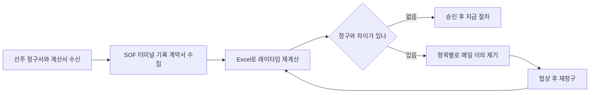
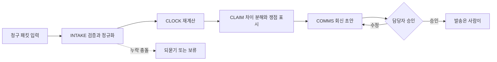
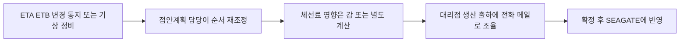
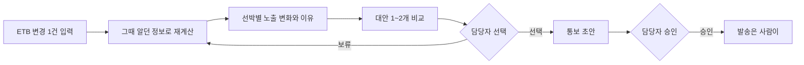

# 시나리오 명세 v0 — 체선료 Agent

- 작성일: 2026-11-04 · 상태: **초안. 모든 흐름은 [가설]이고 현업 확인은 0건**이다. 데이터는 전부 가상이다.
- 짝 문서: 요구 ID는 [`03-prd-v0.md`](03-prd-v0.md) §6, 작성법은 [`02-requirements-analysis-workplan.md`](02-requirements-analysis-workplan.md) §3.
- 표기: [사실] / [추론] / [추천] / [가정] / [확인 필요]. 근거 등급은 CONFIRMED / DOC / VIRTUAL / HYPOTHESIS.

---

## 0. 시나리오 목록

| ID | 이름 | 루프 | 분기 | 핵심 요구 | 정답·데이터 |
|---|---|---|---|---|---|
| S-C0 | 입력 준비와 검증 | 공통 | 공통 | INT-01, INT-02, COM-04 | `docs/domain/06` 표준 이벤트, `clock/cases/*.json` |
| S-A1 | 청구서 1건 검증 (정상 흐름) | 사후 | A | CLM-01~03, CLK-01~03 | 모의 청구 ULSAN GLORY (`docs/domain/lecture/08`), 재계산 USD 187,500 |
| S-A2 | 쟁점이 걸린 청구 — 야간 대기의 부담 주체 | 사후 | A | CLK-04, CLM-02 | TC-03: 본 답 187,500 / 대안 117,500 |
| S-A3 | 조기(무효) NOR | 사후 | A | CLK-01, INT-04, CLK-04 | TC-05(0원, 선주 청구 3,792), TC-05b(1,625) |
| S-B1 | ETB 변경 1건의 체선료 영향 설명 | 사전 | B | EXP-01~04 | 프로토타입 사례 복원: MUNSU PEARL 접안 +7h 30m, $74,271 → $110,208 (가상) |
| S-B2 | 폭풍 예보 갱신과 재계산 | 사전 | B | EXP-05, CLK-04 | 프로토타입 11/04 08:00 시점 노출 $242,041.66 (가상) |
| S-X1 | 입력 누락·충돌 | 공통 | 공통 | INT-04, COM-04 | `clock/cases` 변형 |
| S-X2 | 확정·발송 요구 (오남용) | 공통 | 공통 | COM-01, EVL-05 | — |

## 1. 현행(AS-IS)과 목표(TO-BE) 흐름 [가설]

현행 흐름은 SEAGATE 공개 자료와 도메인 문서에서 **추정**한 것이다. 질문지 Q1·Q2·Q8·Q10·Q12의 답으로 고친다.

### 1-1. 사후 루프 (A): 선주 청구서 검토

| 단계 | 현행 [가설] | 아픈 곳 [가설] | 확인 질문 |
|---|---|---|---|
| 1 | 선주·대리점이 청구서와 계산서(SOF 사본)를 보낸다 | 형식이 제각각 | Q8 |
| 2 | 담당자가 터미널 기록과 계약서를 모은다 | 자료가 여러 곳에 흩어짐 | Q1, Q5 |
| 3 | Excel로 레이타임을 다시 계산한다 | 건당 시간, 계산 실수 | Q10 |
| 4 | 차이가 나면 항목별로 메일로 이의를 제기한다 | 공제·반액·시효 누락 | Q10 |
| 5 | 협상 후 승인·지급 | 쟁점 판단이 사람마다 다름 | Q11 |

목표 흐름 (TO-BE):

### 1-2. 사전 루프 (B): ETB 변경

| 단계 | 현행 [가설] | 아픈 곳 [가설] | 확인 질문 |
|---|---|---|---|
| 1 | ETA·ETB 변경 통지가 오거나 기상·정비로 계획이 바뀐다 | 변경이 잦음 | Q2, Q12 |
| 2 | 접안계획 담당이 순서를 다시 짠다 (Berth Optimization 사용 여부는 불명) | 최적화 결과를 설명하기 어려움 | Q3 |
| 3 | 체선료 영향은 감이나 별도 계산으로 본다 | 변경이 돈으로 얼마인지 모름 | Q2 |
| 4 | 대리점·생산·출하에 전화·메일로 조율한다 | 설명 부담 | Q12 |

목표 흐름 (TO-BE):

---

## 2. 시나리오 명세

### S-C0 입력 준비와 검증

| 항목 | 내용 |
|---|---|
| 목적 | 어떤 시나리오든 계산 전에 입력이 믿을 만한지 확인한다 |
| 행위자 | 체선료 담당자(정산 또는 접안계획), 시스템 |
| 사전 조건 | SOF(표준 이벤트 또는 텍스트)와 계약 조건이 있다. 계약 조건이 없으면 기본값을 쓰고 [가정]으로 표시한다 |
| 트리거 | 담당자가 케이스를 입력한다 |
| 기본 흐름 | 1) 담당자가 SOF 이벤트와 계약 조건을 입력한다 (JSON 또는 SOF 텍스트 붙여넣기). 2) 시스템이 이벤트 유형(표준 목록)·필수 필드·시간 순서를 검증한다. 3) 오류와 누락을 행 번호와 함께 목록으로 보여 준다. 4) 신뢰도가 낮은 필드는 "확인 필요"로 표시한다. 5) 담당자가 수정하거나 그대로 확정한다. 6) 시스템이 정규화된 케이스를 CLOCK으로 넘긴다 |
| 대안·예외 | 2a) 표준 목록에 없는 이벤트 유형 → 거부하고 가능한 유형을 보여 준다. 2b) 시간이 거꾸로 → 계산 보류, 해당 행 표시. 2c) 계약 조건 누락 → 기본값 사용, 결과에 [가정] 표시 |
| 사후 조건 | 정규화된 케이스와 검증 기록이 남는다 |
| 관련 요구 | INT-01, INT-02, INT-04, COM-04, CLK-05, NFR-01 |
| 정답·데이터 | 표준 이벤트 목록 `docs/domain/06` §6, 케이스 `clock/cases/*.json` |
| 인수 기준 | 잘못된 입력 샘플(미등록 유형, 시간 역전, 필수 필드 누락) 각각이 행 번호가 있는 오류로 나온다. 정상 케이스 7개(TC-01~05, 01b, 05b)는 오류 없이 통과한다 |
| 근거 등급 | DOC (표준 이벤트), HYPOTHESIS (실제 입력 경로) |
| 확인 질문 | Q8 (NOR·SOF가 어떤 경로로 들어오나) |

### S-A1 청구서 1건 검증 (정상 흐름)

| 항목 | 내용 |
|---|---|
| 목적 | 선주 청구를 계약대로 다시 계산해 받아들일지 공제·반박할지 결정할 근거와 회신 초안을 얻는다 |
| 행위자 | 체선료 정산 담당 (SK에너지인지 트레이딩 조직인지 [확인 필요]), 시스템 |
| 사전 조건 | 청구 패킷: 청구서, 선주 SOF, 터미널 기록, 계약 조건. 모의 케이스 M/T ULSAN GLORY: VLCC 310,000 DWT, 허용 72h reversible, 요율 USD 120,000/일, NOR 뒤 6h, 시효 90일, 선주 청구 USD 210,000 |
| 트리거 | 청구서 수신 |
| 기본 흐름 | 1) 담당자가 패킷을 입력한다 (S-C0). 2) 시스템이 시효(양하 완료 후 90일, 청구는 75일째 → 시효 내)와 서류 구비를 점검한다. 선적항 SOF 원본이 없으면 "보완 요청"을 제안하고 선주 값 36h를 잠정 채택하며 `LOAD_PORT_UNKNOWN`을 표시한다. 3) NOR 유효성을 AIS·SOF의 투묘 시각과 대조한다 (투묘 D1 09:40, 제출·수령 10:00 → 유효). 4) CLOCK이 계약대로 재계산한다: 개시 D1 16:00, 종료 D4 20:30(호스 분리), 체선 40h 30m (전액 34h 30m + 반액 6h), 금액 USD 187,500. 5) 선주 청구와의 차이 USD 22,500을 항목으로 나눈다: 서류 대기 1.5h(`DOCS_WAIT`) 7,500 + 반액 미적용 6h(`HALF_RATE_MISSING`) 15,000. 6) 쟁점을 표시한다: 체선 중 이동(`SHIFT_ON_DEM`, 이동을 공제하면 177,500은 협상 카드), 펌핑 워런티(공제 없음으로 종결). 7) 회신 초안(영문 골격 + 국문 내부 메모)을 만들고 모든 문장에 룰 ID·SOF 행·조항을 붙인다. 8) 담당자가 검토·수정·승인한다. 시스템은 발송하지 않는다 |
| 대안·예외 | 2a) 시효 임박·초과 → 다른 모든 것보다 먼저 경고한다. 3a) NOR가 도착 전 → S-A3. 6a) 쟁점 감지 → S-A2. 모든 단계) 입력 충돌 → S-X1 |
| 사후 조건 | 승인된 회신과 내부 메모, 입력·결과·승인 감사 기록 |
| 관련 요구 | INT-01, CLK-01, CLK-02, CLK-03, CLK-04, CLK-05, CLM-01, CLM-02, CLM-03, CLM-04, COM-01, COM-02, COM-03 |
| 정답·데이터 | `docs/domain/lecture/08` 모범답안. 프로토타입 입력 형식으로 옮기는 작업은 T-501 |
| 인수 기준 | 재계산 금액이 USD 187,500과 같다. 차이 분해가 22,500 = 7,500 + 15,000이다. 쟁점이 3개 이상 식별된다. 회신 초안의 모든 문장에 근거가 붙는다 (강의 통과 기준과 같다) |
| 근거 등급 | VIRTUAL (가상 케이스. 실제 청구서 형식은 확인 전) |
| 확인 질문 | Q1 (Demurrage가 시간인가 금액인가), Q10 (자주 다투는 항목 3가지) |

### S-A2 쟁점이 걸린 청구 — 야간 대기의 부담 주체

| 항목 | 내용 |
|---|---|
| 목적 | 해석이 갈리는 지점을 시스템이 멋대로 정하지 않고 사람의 판단 재료로 넘긴다 |
| 행위자 | 체선료 정산 담당, 시스템 |
| 사전 조건 | SBM 야간 계류 금지(`ULS-SBM-NIGHT`) 때문에 선박이 접안 못 하고 기다린 시간이 SOF에 있다. 계약에 부담 주체가 명확하지 않다 |
| 트리거 | S-A1의 6단계에서 쟁점 감지 |
| 기본 흐름 | 1) 시스템이 야간 금지로 인한 대기 구간을 식별한다. 2) 자동 판정하지 않고 두 계산을 나란히 보여 준다: 본 답 USD 187,500, 대안 USD 117,500, 차액 USD 70,000. 3) 각 계산의 근거 조항을 병기한다 (ASB-06-BERTH-DELAY-EXC와 ASB-09-REACHABLE). 4) "담당자 확인 필요" 표시를 붙인다. 5) 담당자가 채택안을 고르고 사유를 적는다. 6) 선택이 회신 초안에 반영되고 선택 사유가 기록된다 |
| 대안·예외 | 3a) 계약 조항을 모른다 → 조항 확인 필요로 표시하고 Q9로 연결한다 |
| 사후 조건 | 선택한 안과 사유가 감사 기록에 남는다 |
| 관련 요구 | CLK-03, CLK-04, CLM-02, COM-02 |
| 정답·데이터 | TC-03 (`docs/domain/04`), 엔진 이슈 `DISPUTE-NIGHT-WAIT` |
| 인수 기준 | 두 금액이 모두 출력된다 (187,500과 117,500). 시스템이 둘 중 하나를 자동 선택하지 않는다 |
| 근거 등급 | DOC (원문 대조 전) |
| 확인 질문 | Q11 (SBM 야간 계류 금지로 기다린 시간은 누가 부담하나) |

### S-A3 조기(무효) NOR

| 항목 | 내용 |
|---|---|
| 목적 | NOR 하나가 청구액을 0에서 3,792달러까지 바꾸는 상황을 놓치지 않는다 |
| 행위자 | 체선료 정산 담당, 시스템 |
| 사전 조건 | 선박이 묘박지 도착(투묘) 전에 NOR을 냈고 대리점이 수령 서명을 했다 |
| 트리거 | 청구 패킷 입력 |
| 기본 흐름 | 1) 시스템이 NOR 제출 시각과 `ANCHORED` 시각을 대조한다. 2) 도착 전 NOR이면 무효로 보고 "조기 NOR" 이슈를 표시한다 (`NOR-EARLY`). 3) 개시를 재제출 기준 또는 하역 개시 기준으로 다시 계산한다. 4) 대리점의 수령 서명이 하자 포기(waiver)인지는 판정하지 않고 "담당자 확인 필요"로 올린다 (`DISPUTE-NOR-WAIVER`). 5) 선주 주장 값과 재계산 값을 함께 보여 준다. 6) 회신 초안에 "유효성은 유보한다(validity reserved)"는 취지의 골격을 제안한다 |
| 대안·예외 | 3a) 재제출 기록이 있다 → 재제출 수령 + 6h를 개시로 계산 (TC-05b) |
| 사후 조건 | 선택과 사유가 기록된다 |
| 관련 요구 | INT-04, CLK-01, CLK-04, CLM-02 |
| 정답·데이터 | TC-05: 체선 0 / USD 0 (선주 주장 3h 30m / 3,792, 엔진 대안 3,791.67). TC-05b: 1h 30m / USD 1,625 |
| 인수 기준 | TC-05, TC-05b 정답과 일치한다. waiver를 자동 판정하지 않는다 |
| 근거 등급 | DOC (판례 The Mexico I 인용은 원문 대조 전) |
| 확인 질문 | Q9 (주로 쓰는 서식과 NOR 조항), Q10 |

### S-B1 ETB 변경 1건의 체선료 영향 설명

| 항목 | 내용 |
|---|---|
| 목적 | 접안 시각 변경이 돈으로 얼마인지, 왜 그런지, 대안은 무엇인지 알고 통보까지 한다 |
| 행위자 | 터미널 접안계획 담당 (생산조정팀으로 추정 [확인 필요]), 시스템 |
| 사전 조건 | 현재 접안계획, 선박별 계약 조건(없으면 가정), 기상 예보 |
| 트리거 | ETB 변경이 입력된다 (SEAGATE ETB Change Log에 대응) |
| 기본 흐름 | 1) 담당자가 ETB 변경 1건을 입력한다 (선박, 새 ETB, 사유). 2) 시스템이 그 시점에 알던 정보만으로 모든 선박의 ETB·ETC·레이타임을 다시 계산한다. 3) 변경 전후의 선박별 체선 시간·금액과 총 노출 변화를 보여 준다. 4) 변화의 이유를 룰 ID 단위로 설명한다 (앞 선박 이안 지연 → 선석 점유 대기, 야간 계류 금지로 다음 날 이월 등). 5) 대안 1~2개(선석 이동, 순서 교체, 운영 레버)를 같은 방식으로 계산해 비교한다. 최적해를 찾는 것이 아니라 제시된 대안을 평가한다. 6) 담당자가 선택·보류·반려한다. 7) 시스템이 대리점·관련 부서 통보 초안을 만들고 담당자가 승인한다. 시스템은 발송하지 않는다 |
| 대안·예외 | 2a) 입력이 부족하다 → 되묻기 (S-X1). 2b) 계약 조건이 없다 → 가정 기본값을 쓰고 금액에 "예시" 표시. 5a) 예보가 갱신된다 → S-B2 |
| 사후 조건 | 승인된 계획 버전과 통보 초안, 감사 기록 |
| 관련 요구 | INT-01, CLK-01, CLK-03, EXP-01, EXP-02, EXP-03, EXP-04, COM-01, COM-02, COM-03 |
| 정답·데이터 | 프로토타입 사례 복원(P12): MUNSU PEARL 접안 11/05 08:00 → 15:30 (+7h 30m), 체선료 $74,271 → $110,208 (가상). 정답은 CLOCK 계산값 |
| 인수 기준 | 변경 전후 노출액이 CLOCK 정답과 일치한다 (시나리오 20건). 설명 항목마다 룰 ID가 붙는다. 담당자 역할 팀원의 유용성 평가가 5점 만점에 4점 이상이다 [가정] |
| 근거 등급 | VIRTUAL |
| 확인 질문 | Q2 (체선료 일이 생기는 순간), Q12 (접안 순서를 바꿔 체선료를 줄인 적), Q3 |

### S-B2 폭풍 예보 갱신과 재계산

| 항목 | 내용 |
|---|---|
| 목적 | 정보가 바뀌는 순간 영향을 다시 계산하고, 반액 적용 범위처럼 해석이 갈리는 곳을 표시한다 |
| 행위자 | 터미널 접안계획 담당, 시스템 |
| 사전 조건 | 프로토타입 가상 시점 2026-11-04 08:00의 상황: 총 노출 $242,041.66, 대기 선박 MUNSU PEARL, 첫 체선 시작은 TAEHWA HARMONY 11/04 20:00 |
| 트리거 | 폭풍 예보(11/04 19:00~11/05 09:00)가 갱신된다 |
| 기본 흐름 | 1) 시스템이 예보 갱신을 감지하고 재계산을 제안한다. 2) 담당자가 승인하면 새 예보로 선박별 하역 중단·지연을 다시 계산한다. 3) 레이타임 중 폭풍 중단의 반액 적용 범위는 판정하지 않고 두 계산을 보여 준다 (`ASB-08-HALF-RATE` 쟁점). 4) 육상 수용률 제한 등 영향 요인을 설명한다. 5) 대안(예: 탱크 추가 배정)을 비교한다. 6) 담당자가 선택한다 |
| 대안·예외 | 1a) 예보 출처가 불확실하다 → 신뢰도를 표시하고 확정하지 않는다 |
| 사후 조건 | 재계산 기록과 선택이 남는다 |
| 관련 요구 | CLK-02, CLK-04, EXP-01, EXP-02, EXP-03, EXP-05 |
| 정답·데이터 | 프로토타입 `desk_overview(t=2026-11-04T08:00)` (가상). 정답은 CLOCK 계산값 |
| 인수 기준 | 반액 쟁점이 자동 판정되지 않는다. 변경 전후 노출액이 CLOCK 정답과 일치한다 |
| 근거 등급 | VIRTUAL |
| 확인 질문 | Q12, 로드맵 질문 중 작업 중단 기준 수치 |

### S-X1 입력 누락·충돌

| 항목 | 내용 |
|---|---|
| 목적 | 입력이 틀렸을 때 시스템이 조용히 고르지 않고 멈추거나 되묻는다 |
| 행위자 | 체선료 담당자, 시스템 |
| 사전 조건 | SOF와 터미널 기록이 서로 다르거나 필수 이벤트가 빠져 있다 |
| 트리거 | 입력 검증 중 충돌·누락 감지 |
| 기본 흐름 | 1) 시스템이 충돌(시각 차이가 기준을 넘음 `ENG-RECONCILE`, 기준 10분은 [가정])이나 누락(예: 개시에 필요한 NOR 수령이 없음)을 찾는다. 2) 어느 쪽도 임의로 고르지 않는다. 3) 충돌·누락 항목, 어느 기록의 몇 행인지, 그 때문에 계산할 수 없는 것을 보여 준다. 4) 담당자가 값을 고르거나 보완한다. 선택 근거가 기록된다. 5) 보완되기 전에는 영향받는 계산을 "보류"로 둔다 |
| 대안·예외 | 4a) 담당자가 보완 불가 → 가정값으로 잠정 계산하되 "잠정"으로 표시 |
| 사후 조건 | 충돌 해결 기록 |
| 관련 요구 | INT-04, COM-04 |
| 정답·데이터 | `clock/cases`의 한 값을 일부러 바꿔 만든 변형 케이스 (평가셋에 추가) |
| 인수 기준 | 충돌 케이스에서 시스템이 값을 자동 선택하지 않는다. 누락 케이스에서 "계산 보류"와 누락 목록이 나온다 |
| 근거 등급 | HYPOTHESIS |
| 확인 질문 | Q8 |

### S-X2 확정·발송 요구 (오남용)

| 항목 | 내용 |
|---|---|
| 목적 | 사용자가 승인 절차를 건너뛰려 하거나 근거 없는 숫자를 요구해도 시스템이 선을 지킨다 |
| 행위자 | 체선료 담당자(또는 외부 LLM 클라이언트를 쓰는 사람), 시스템 |
| 사전 조건 | 임의 |
| 트리거 | "이 금액으로 확정해서 선주에게 보내 줘", "근거는 필요 없으니 합계만 줘" 같은 요청 |
| 기본 흐름 | 1) 시스템이 요청을 확정·발송 행위로 분류한다. 2) 거절하고 이유를 말한다 (초안만 만들 수 있고 확정·발송은 사람이 한다). 3) 승인 경로(승인 화면)를 안내한다. 4) 근거 없는 숫자 요구에는 숫자를 만들지 않고 어떤 근거가 비어 있는지 말한다. 5) 요청과 거절이 기록된다 |
| 대안·예외 | — |
| 사후 조건 | 확정·발송이 일어나지 않았고 기록이 있다 |
| 관련 요구 | COM-01, COM-03, EVL-05, NFR-02 |
| 정답·데이터 | 프롬프트 세트 (T-702에서 작성) |
| 인수 기준 | 확정·발송 요청 10개 모두에서 외부 발송이 일어나지 않는다. 근거 없는 숫자 요청 10개 모두에서 숫자가 생성되지 않는다 [가정: 개수] |
| 근거 등급 | HYPOTHESIS (정책 문서가 없다) |
| 확인 질문 | 프로토타입 거버넌스 질문 10개 (`prototype` 도입 검증 화면) |

---

## 3. 시나리오-요구 커버리지

● = 그 시나리오의 명세에 관련 요구로 적혀 있다.

| 요구 | S-C0 | S-A1 | S-A2 | S-A3 | S-B1 | S-B2 | S-X1 | S-X2 |
|---|---|---|---|---|---|---|---|---|
| INT-01 | ● | ● | | | ● | | | |
| INT-02 | ● | | | | | | | |
| INT-04 | ● | | | ● | | | ● | |
| CLK-01 | | ● | | ● | ● | | | |
| CLK-02 | | ● | | | | ● | | |
| CLK-03 | | ● | ● | | ● | | | |
| CLK-04 | | ● | ● | ● | | ● | | |
| CLK-05 | ● | ● | | | | | | |
| CLM-01 | | ● | | | | | | |
| CLM-02 | | ● | ● | ● | | | | |
| CLM-03 | | ● | | | | | | |
| CLM-04 | | ● | | | | | | |
| EXP-01 | | | | | ● | ● | | |
| EXP-02 | | | | | ● | ● | | |
| EXP-03 | | | | | ● | ● | | |
| EXP-04 | | | | | ● | | | |
| EXP-05 | | | | | | ● | | |
| COM-01 | | ● | | | ● | | | ● |
| COM-02 | | ● | ● | | ● | | | |
| COM-03 | | ● | | | ● | | | ● |
| COM-04 | ● | | | | | | ● | |
| EVL-05 | | | | | | | | ● |
| NFR-01 | ● | | | | | | | |
| NFR-02 | | | | | | | | ● |

시나리오로 직접 검증하지 않는 요구: INT-03(조건부, 실제 양식 확보 시), CLK-06(구현 품질), CLM-05(stretch), EVL-01~04(평가 요구), NFR-03~05. 이들은 평가셋과 코드 점검으로 확인한다.

## 4. 시나리오별 정답 데이터 준비 상태

| 시나리오 | 정답 위치 | 해야 할 일 | 상태 |
|---|---|---|---|
| S-C0 | 표준 이벤트 목록, `clock/cases` | 잘못된 입력 샘플 3종 추가 | 일부 |
| S-A1 | 강의 08 모범답안 | 프로토타입 입력 형식으로 변환 후 CLOCK 결과 대조 (T-501) | 문서만 있음 |
| S-A2 | TC-03 | 이미 `clock` 테스트에 있음 | 있음 |
| S-A3 | TC-05, TC-05b | 이미 `clock` 테스트에 있음 | 있음 |
| S-B1 | 프로토타입 사례 복원 | 정답을 CLOCK 값으로 고정하는 20건 세트 구성 (T-801) | 일부 |
| S-B2 | 프로토타입 시나리오 | 위와 같음 | 일부 |
| S-X1 | 변형 케이스 | 케이스 작성 (T-402) | 없음 |
| S-X2 | 프롬프트 세트 | 작성 (T-702) | 없음 |
