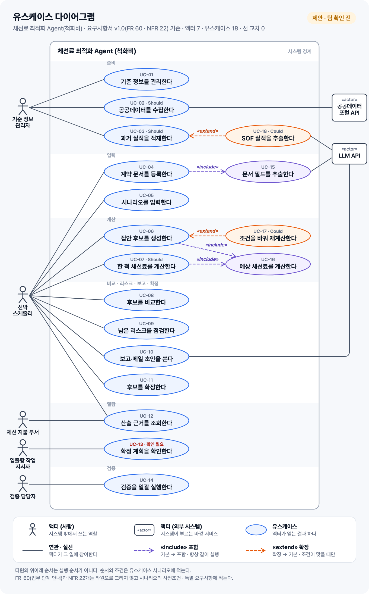

# 유스케이스 다이어그램

- 작성: 2026-11-11 · 상태: **제안 (팀 확인 전)**
- 기준: 팀 구글 문서 '[판교_2반_1조] 프로젝트정의 요구사항서'의 **실시간 탭 3절** (FR-01~60, NFR-01~22. 1.0 탭과 내용이 같다)
- 시나리오: [`13-usecase-scenarios.md`](13-usecase-scenarios.md)
- 그림 파일: [`usecase/usecase-diagram.png`](usecase/usecase-diagram.png) · [`usecase/usecase-diagram.svg`](usecase/usecase-diagram.svg) · 생성기 `usecase/make_usecase_diagram.py`
- 피그마: 팀 파일 SKALA-P2-1의 '파이프라인' 프레임 안, ['유스케이스 다이어그램' 프레임](https://www.figma.com/design/mDE8EoyYV0dS2WjtBLUoet/SKALA-P2-1?node-id=140-643) (2026-11-11에 옮김. 4배 크기, 선은 도형에 붙은 커넥터). 생성기와 이어져 있지 않으므로 모델을 고치면 피그마 쪽도 따로 고친다

## 1. 그림



액터 7 · 유스케이스 18 · 연관 19 · «include» 3 · «extend» 2 · 선 교차 0.

## 2. 그리는 규칙

요소는 넷, 선은 셋이다. [1][2]

| 무엇 | 모양 | 뜻 | 가르는 질문 |
|---|---|---|---|
| 시스템 경계 | 큰 네모, 이름은 왼쪽 위 | 안은 우리 시스템이 하는 일, 밖은 액터 | 우리가 만드는 범위인가 |
| 액터 | 막대 인형. 외부 시스템은 «actor» 상자로 그려도 된다 [3] | 시스템 **밖에서** 시스템과 직접 주고받는 **역할** | 이 사람(시스템)이 우리 시스템과 직접 주고받는가 |
| 유스케이스 | 타원, 이름은 '~한다' | 액터가 시스템에서 얻는 **결과 하나** | 이걸 끝내면 액터가 '됐다' 하고 자리를 뜰 수 있는가 |
| 연관 (association) | 실선 | 액터가 그 유스케이스에 참여한다 | 액터와 유스케이스 사이인가 |
| 포함 «include» | 점선 화살표, **기본 → 포함** | 기본이 실행되면 **항상** 같이 실행된다 [4] | 빠지면 기본이 완성되지 않는가 |
| 확장 «extend» | 점선 화살표, **확장 → 기본** | **조건이 맞을 때만** 기본에 끼어든다. 기본은 확장 없이도 완결된다 [5] | 없어도 기본이 끝나는가 |

지킬 것 다섯 가지.

1. **액터는 역할이다.** 사람 이름이나 직함이 아니다. 한 사람이 여러 역할을 맡을 수 있다. [3]
2. **실선은 액터와 유스케이스 사이에만 긋는다.** 액터끼리, 유스케이스끼리는 실선으로 잇지 않는다. [3] 유스케이스끼리는 점선 화살표(include · extend)만 쓴다.
3. **화살표는 '없으면 안 되는 쪽'을 가리킨다.** 기본은 포함 없이는 완성되지 않으니 기본에서 포함으로 간다. 확장은 기본이 있어야 끼어들 수 있으니 확장에서 기본으로 간다. 두 화살표의 방향이 반대인 이유다.
4. **유스케이스는 기능 목록이 아니다.** 기능, 화면, 규칙 하나하나를 타원으로 그리면 기능 분해도가 된다. 요구사항 60개가 타원 18개로 묶였다.
5. **순서와 품질은 그리지 않는다.** 타원의 위아래 순서에는 뜻이 없다. 순서(FR-60), 조건, 비기능 요구사항(NFR 22개)은 시나리오에 적는다.

주 액터(일을 시작하는 쪽)를 왼쪽에, 보조 액터(시스템이 부르는 쪽)를 오른쪽에 두는 것은 UML 표준이 아니라 널리 쓰는 관례다. [2]

### 이 그림에 쓴 점선 화살표 5개와 이유

| 화살표 | 왜 이 관계인가 |
|---|---|
| UC-04 계약 문서 등록 → «include» → UC-15 문서 필드 추출 | 문서를 올리면 추출이 항상 따라온다. LLM이 끼는 큰 덩어리라 따로 뗐다 (FR-03 · 04 · 05) |
| UC-06 접안 후보 생성 → «include» → UC-16 예상 체선료 계산 | 후보마다 체선료를 계산한다 |
| UC-07 한 척 체선료 계산 → «include» → UC-16 예상 체선료 계산 | 같은 계산을 두 곳이 쓴다. include를 쓰는 가장 분명한 경우다 |
| UC-17 조건을 바꿔 재계산 → «extend» → UC-06 | Could. 스케줄러가 임시 조건을 넣거나 제약을 끌 때만 (FR-26 · 28) |
| UC-18 SOF 실적 추출 → «extend» → UC-03 과거 실적 적재 | Could. 실적 출처가 SOF 문서일 때만 (FR-11) |

타원으로 **빼지 않은** 것도 있다.

- 제약 규칙 14개(FR-14~27)는 UC-06의 한 단계다. 스케줄러의 목표는 '후보를 얻는다'이지 '야간 도선을 판정한다'가 아니다.
- 입력 검증(FR-08)은 UC-06의 2번 단계다. 후보 없음(FR-43)은 UC-06의 예외 흐름이다.
- 업무 단계 안내(FR-60)는 각 유스케이스의 사전조건이다.

## 3. 선이 겹치지 않게 그리는 법

### 순서

1. **선부터 줄인다.**
   - 타원을 사용자 목표 단위로 묶는다. 타원이 줄면 선도 준다.
   - 포함 · 확장 유스케이스에는 사람 액터 선을 긋지 않는다. 기본 유스케이스를 거쳐 닿기 때문이다.
   - 선 네 개가 사각형으로 물리면 모델을 바꾼다. 처음에는 '입력을 검증한다'를 따로 그려 UC-06과 UC-07이 같이 포함하게 했다. 그러면 기본 둘과 포함 둘이 사각형이 되고, 두 열로 놓는 한 대각선 둘이 반드시 교차한다. 그래서 입력 검증을 UC-06의 한 단계로 넣었다.
2. **층을 나눈다.** 왼쪽부터 사람 액터 → 기본 유스케이스 → 포함 · 확장 유스케이스 → 외부 시스템 액터. 선은 이웃한 층 사이에만 긋는다. [6]
3. **층 안의 순서를 정한다.** 각 요소를 '자기와 이어진 것들의 평균 높이'에 놓는다(무게중심). [6]
   - 한 액터의 유스케이스는 연달아 붙인다.
   - 두 액터가 같이 쓰는 유스케이스는 두 묶음의 경계에 둔다. UC-12가 선박 스케줄러 묶음의 맨 아래, 체선 지불 부서 바로 옆에 있는 이유다.
4. **같은 줄에 맞춘다.** 포함 · 확장 유스케이스를 짝이 되는 기본 유스케이스와 같은 높이에 두면 점선이 수평이 된다.
5. **층을 건너뛰는 선에는 빈 칸을 준다.** UC-02 ↔ 공공데이터포털, UC-10 ↔ LLM은 가운데 열을 건너뛴다. 그 줄의 가운데 열을 비워 둔다. [6] 멀리 떨어져 있으면 경계 밖으로 돌려 한 번 꺾는다(LLM → UC-10).
6. **붙는 점을 나눈다.** 한 타원에 선이 둘 붙으면 둘레의 다른 점에 붙인다(UC-12).
7. **계산으로 검사한다.** 선분끼리 교차하는지, 선이 다른 타원 · 액터 · 글자를 지나는지 좌표로 확인한다.

### 이 그림의 결과

생성기가 찍은 숫자다.

| 배치 | 선 교차 |
|---|---|
| 요구사항 번호순으로 그냥 놓았을 때 | 34 |
| 무게중심 정렬 + 이웃 맞바꾸기 1회 | 0 |
| 최종 배치 (업무 순서대로 읽히게 고른 순서) | 0 |

좌표 검사(선분 교차, 선 × 타원, 선 × 액터, 선 × 글자, 글자 × 글자, 글자 × 타원)는 0건이다.

교차가 0인 배치는 하나가 아니다. 자동 정렬이 찾은 순서도 0이지만 UC-05, UC-04, UC-08 …처럼 업무 순서와 맞지 않는다. 그래서 0인 배치 가운데 준비 → 입력 → 계산 → 비교 → 확정 → 열람 → 검증 순서로 읽히는 것을 골랐다.

### 그래도 겹칠 때

두 줄(액터 줄과 유스케이스 줄) 사이를 교차 없이 이을 수 있는 그림은 정해져 있다. 이어진 덩어리마다 가운데 줄기 하나에 잎이 바로 붙은 '애벌레 모양'일 때만 된다. [7] 선들이 고리를 만들면 순서를 어떻게 바꿔도 교차가 남는다. 그때 쓰는 방법은 네 가지다.

- **모델을 바꾼다.** 위 1번처럼 고리를 만드는 타원을 합치거나 한 단계로 내린다.
- **액터를 반대편에 둔다.** 사람 액터도 오른쪽에 둘 수 있다.
- **같은 액터를 한 번 더 그린다.** RUP 지침은 그림이 더 분명해지면 같은 요소를 한 그림에 여러 번 그려도 된다고 한다. [8]
- **그림을 나눈다.** 액터별, 묶음별로 나눠 그린다. 유스케이스가 20개를 넘으면 이쪽이 낫다.

## 4. 액터 7

| 액터 | 종류 | 하는 일 | 근거 |
|---|---|---|---|
| 선박 스케줄러 | 사람 (주) | 입력하고, 후보를 비교하고, 리스크를 보고, 초안을 받고, 확정한다 | 과제 원문 2절. 요구사항서의 '담당자' |
| 체선 지불 부서 | 사람 | 선박별 예상 체선료와 산출 근거를 본다 | 과제 원문 2절, 캔버스 대상 사용자 |
| 입출항 작업 지시자 | 사람 | 확정된 계획과 남은 리스크, 주의할 점을 본다 | 과제 원문 2절, 캔버스 대상 사용자 |
| 기준 정보 관리자 | 사람 | 기준 정보, 공공데이터, 과거 실적을 넣는다 | [가정] 요구사항서에 주체가 없어 만든 역할. 프로젝트 팀이 맡는다 |
| 검증 담당자 | 사람 | 정답 세트와 검증 시나리오를 돌려 결과표를 본다 | 과제 원문 3절 5번("팀원이 손으로 계산한 정답 세트"), FR-58 |
| 공공데이터포털 API | 외부 시스템 | 일출 · 일몰, 조석, 기상 예보를 준다 | FR-13 |
| LLM API | 외부 시스템 | 문서에서 필드를 뽑고 초안 문장을 쓴다 | NFR-01, FR-03 · 04 · 11 |

액터로 넣지 **않은** 것.

- **메일을 받는 사람.** 시스템에는 발송 기능이 없고 담당자가 시스템 밖에서 보낸다(FR-52). 시스템과 직접 주고받지 않는다.
- **SK 에너지, 항만 작업자.** 캔버스 대상 사용자에는 있지만 요구사항에 이들이 시스템을 쓰는 장면이 없다.
- **규칙 엔진, 최적화 로직, Agent.** 시스템 안쪽이다. 경계 밖에 있어야 액터다.

## 5. 유스케이스 18

| ID | 유스케이스 | 액터 | 요구사항 |
|---|---|---|---|
| UC-01 | 기준 정보를 관리한다 | 기준 정보 관리자 | FR-09, FR-12 |
| UC-02 | 공공데이터를 수집한다 | 기준 정보 관리자, 공공데이터포털 API | FR-13 |
| UC-03 | 과거 실적을 적재한다 | 기준 정보 관리자 | FR-10 |
| UC-04 | 계약 문서를 등록한다 | 선박 스케줄러 | FR-02, FR-06, FR-07 |
| UC-05 | 시나리오를 입력한다 | 선박 스케줄러 | FR-01 |
| UC-06 | 접안 후보를 생성한다 | 선박 스케줄러 | FR-08, FR-14~25, FR-27, FR-41~43 |
| UC-07 | 한 척 체선료를 계산한다 | 선박 스케줄러 | FR-38 |
| UC-08 | 후보를 비교한다 | 선박 스케줄러 | FR-44, FR-45 |
| UC-09 | 남은 리스크를 점검한다 | 선박 스케줄러 | FR-47~50 |
| UC-10 | 보고·메일 초안을 쓴다 | 선박 스케줄러, LLM API | FR-51~53 |
| UC-11 | 후보를 확정한다 | 선박 스케줄러 | FR-54, FR-55 |
| UC-12 | 산출 근거를 조회한다 | 선박 스케줄러, 체선 지불 부서 | FR-39, FR-40, FR-46 |
| UC-13 | 확정 계획을 확인한다 | 입출항 작업 지시자 | 과제 원문 2절 (요구사항 없음) |
| UC-14 | 검증을 일괄 실행한다 | 검증 담당자 | FR-56~59 |
| UC-15 | 문서 필드를 추출한다 | LLM API | FR-03, FR-04, FR-05 |
| UC-16 | 예상 체선료를 계산한다 | (없음) | FR-29~37 |
| UC-17 | 조건을 바꿔 재계산한다 | (UC-06의 액터) | FR-26, FR-28 |
| UC-18 | SOF 실적을 추출한다 | (UC-03의 액터), LLM API | FR-11 |

FR-01~59는 모두 어느 유스케이스에 들어갔고, FR-60은 사전조건으로 들어갔다. NFR 22개가 걸리는 곳은 [`13`](13-usecase-scenarios.md)의 '비기능 요구사항이 들어간 곳' 표에 있다.

UC 번호는 그림의 위에서 아래 순서다. 실행 순서가 아니다.

## 6. 그리면서 내린 판단

팀이 확인하면 그림이 바뀌는 것들이다. 질문 전체는 [`13`](13-usecase-scenarios.md)의 '팀에 확인할 것'에 있다.

- **체선 지불 부서와 입출항 작업 지시자를 액터로 넣었다.** 과제 원문이 사용자로 적었기 때문이다. 그런데 요구사항서에는 이들이 쓰는 기능이나 역할별 화면이 없다. 보고서 · 메일로만 받는다면 두 액터와 UC-13을 뺀다.
- **'담당자'를 선박 스케줄러로 읽었다.** 과제 원문은 스케줄러가 입력하고 고른다고 적는다. FR-52의 "선박 스케줄러에 보낼 메일"과는 맞지 않아 확인이 필요하다.
- **기준 정보 관리자와 검증 담당자를 따로 두었다.** 둘 다 프로젝트 팀이 맡지만 목표가 달라 역할을 나눴다.
- **일반화(빈 세모 화살표)는 쓰지 않았다.** 액터끼리 하는 일이 거의 겹치지 않아 묶을 부모 액터가 없다.

## 7. 다시 만들기

```bash
python3 docs/requirements/usecase/make_usecase_diagram.py --png
```

모델은 생성기 맨 위의 `ACTORS` · `USECASES` · `ASSOC` · `INCLUDE` · `EXTEND` · `ZONES` · `SUB_ROW`에 있다. 고치고 돌리면 교차 수와 좌표 검사 결과가 같이 찍힌다. 문제가 1건이라도 있으면 종료 코드가 1이다. `usecase-diagram.svg`와 `.png`는 생성물이라 직접 고치지 않는다.

## 8. 참고한 자료

2026-11-11에 열어서 내용을 확인한 것만 적었다.

1. [UML Use Case Diagrams — uml-diagrams.org](https://www.uml-diagrams.org/use-case-diagrams.html) · [How to Draw](https://www.uml-diagrams.org/use-case-diagrams-how-to.html) · [Subject](https://www.uml-diagrams.org/use-case-subject.html) — 시스템 경계, 유스케이스의 뜻 (UML 2.5 기준)
2. [Use Case Diagrams Reference — uml-diagrams.org](https://www.uml-diagrams.org/use-case-reference.html) — 표기법 전체, 주 액터 · 보조 액터는 표준이 아니라는 설명
3. [Actor — uml-diagrams.org](https://www.uml-diagrams.org/use-case-actor.html) — 액터는 역할, «actor» 상자 표기, 액터는 유스케이스 · 컴포넌트 · 클래스와만 연관
4. [Include — uml-diagrams.org](https://www.uml-diagrams.org/use-case-include.html) — 방향(기본 → 포함), 쓰는 경우 두 가지
5. [Extend — uml-diagrams.org](https://www.uml-diagrams.org/use-case-extend.html) — 방향(확장 → 기본), 확장점과 조건
6. [Layered graph drawing — Wikipedia](https://en.wikipedia.org/wiki/Layered_graph_drawing) — 층 나누기, 건너뛰는 선의 자리표, 이웃 위치의 평균 · 중앙값으로 순서 정하기
7. [Caterpillar tree — Wikipedia](https://en.wikipedia.org/wiki/Caterpillar_tree) — 두 평행선 위에 교차 없이 그릴 수 있는 그래프
8. [Guideline: Use-Case Diagram — RUP](https://home.iscte-iul.pt/~hro/RUPSmallProjects/core.base_rup/guidances/guidelines/use-case_diagram_B894D435.html) — 같은 요소를 한 그림에 여러 번 그려도 된다

Scott Ambler의 UML 스타일 가이드(agilemodeling.com)는 이번에 사이트가 열리지 않아 넣지 않았다.
