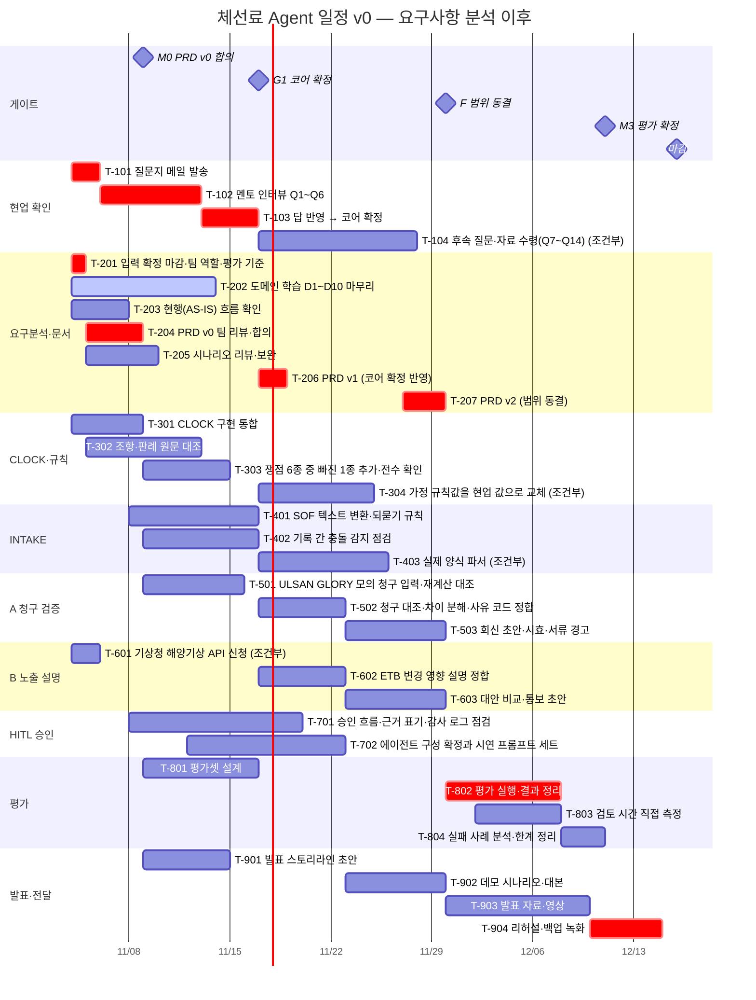

# 체선료 Agent 일정 v0 — 요구사항 분석 이후

> 이 파일은 `make_gantt.py`가 `tasks.csv`와 `gantt.config.json`에서 **자동 생성**한다. 직접 고치지 말고 원본을 고친 뒤 `python3 make_gantt.py`를 다시 실행한다.

- 기간: **11/4(수) 2026 ~ 12/16(수) 2026** (42일, 가정 (시작일부터 6주))
- 날짜 규칙: `start_pct`·`end_pct`는 이 기간을 100%로 본 비율이고, `start_date`·`end_date`가 있으면 그것이 우선한다.
- owner는 역할 제안입니다 [가정]. 팀 인원과 역할이 확정되면 이름으로 바꾸세요.
- 차트(상호작용): [`gantt.html`](gantt.html) — 브라우저로 연다. 분기(A/B) 버튼으로 안 고른 쪽 레인을 접어 볼 수 있다.
- 표 데이터: [`tasks.csv`](tasks.csv)(원본), [`tasks.resolved.csv`](tasks.resolved.csv)(날짜가 풀린 사본 — Excel·Google Sheets·Notion으로 가져갈 때)
- 처음 보는 사람용 요약: [`starter.md`](starter.md)(핵심 작업만), 시트로 가져갈 때는 [`starter.csv`](starter.csv). 차트에서는 '시작용' 보기 버튼.
- 요구 ID(INT-, CLK- …)는 [`../03-prd-v0.md`](../03-prd-v0.md), 시나리오 ID(S-)는 [`../04-scenarios.md`](../04-scenarios.md)에 있다.

## 1. 간트 (Mermaid)

GitHub·Obsidian·VS Code 미리보기에서는 아래 블록이 그림으로 보인다. 안 보이면 내용을 <https://mermaid.live/> 에 붙여 넣는다. `crit`(붉은 막대)은 임계 경로, `active`는 진행 중이다.

## 2. 게이트

| 게이트 | 날짜 | 주 | 의미 | 선행 |
|---|---|---|---|---|
| M0 PRD v0 합의 | 11/9(월) | W1 | — | T-204 |
| G1 코어 확정 | 11/17(화) | W2 | 멘토 답 수령 또는 기한 도달 중 먼저 · 무응답이면 A를 기본값으로 제안 | T-103 |
| F 범위 동결 | 11/30(월) | W4 | 이후 신규 작업 금지 · 변경은 변경 요청으로 | T-207 |
| M3 평가 확정 | 12/11(금) | W6 | — | T-804 |
| 마감 | 12/16(수) | W7 | 마감일은 가정 | T-904 |

## 3. 작업

### 현업 확인

| ID | 작업 | 시작 | 끝 | 선행 | 분기 | 요구 | 담당 | 비고 |
|---|---|---|---|---|---|---|---|---|
| T-101 | 질문지 메일 발송 | 11/4(수) | 11/6(금) | — | 공통 | D-01, D-04 | PM | 멘토 답에 달림 · 임계 경로 · 2026-11-04 기준 아직 발송 전 [사용자 확인] · 메일 초안의 성함·팀명·연락처 칸을 채운다 · 답이 늦으면 전체가 밀리는 장기 리드 항목 |
| T-102 | 멘토 인터뷰 Q1~Q6 | 11/6(금) | 11/13(금) | T-101 | 공통 | D-01, D-02, D-03, D-04 | PM, 전원 | 멘토 답에 달림 · 임계 경로 · Q1~Q3이 코어를 정한다 · 답은 하루 안에 문서에 반영 |
| T-103 | 답 반영 → 코어 확정 | 11/13(금) | 11/17(화) | T-102 | 공통 | D-01, D-02, D-03 | PM | 멘토 답에 달림 · 임계 경로 · 정의서·진단·PRD·rules.json·Discovery 상태를 같이 갱신 |
| T-104 | 후속 질문·자료 수령(Q7~Q14) | 11/17(화) | 11/28(토) | T-103 | 공통 | INT-03, CLK-05 | PM | 멘토 답에 달림 · 조건부 · 비식별 샘플을 받을 수 있을 때만 · 못 받으면 합성 데이터로 진행 |

### 요구분석·문서

| ID | 작업 | 시작 | 끝 | 선행 | 분기 | 요구 | 담당 | 비고 |
|---|---|---|---|---|---|---|---|---|
| T-201 | 입력 확정: 마감·팀 역할·평가 기준 | 11/4(수) | 11/5(목) | — | 공통 | D-04 | PM | 임계 경로 · 마감일·평가 기준은 아직 모름 (2026-11-04) · 팀 5~6명은 확인 · 모르면 [확인 필요]로 두고 담당·기한을 정한다 |
| T-202 | 도메인 학습 D1~D10 마무리 | 11/4(수) | 11/14(토) | — | 공통 | — | 전원 | 진행 중 · 학습 플랜 2주(11/02 시작 가정) · 진행 상태 확인 필요 |
| T-203 | 현행(AS-IS) 흐름 확인 | 11/4(수) | 11/8(일) | — | 공통 | — | 도메인 | 04 §1 흐름도를 아는 만큼 고친다 · 확정은 인터뷰 뒤 |
| T-204 | PRD v0 팀 리뷰·합의 | 11/5(목) | 11/9(월) | T-201 | 공통 | D-02, D-05, D-06 | 전원 | 임계 경로 · 팀 리뷰 30분 · 이견은 결정 로그에 기록 |
| T-205 | 시나리오 리뷰·보완 | 11/5(목) | 11/10(화) | — | 공통 | S-C0~S-X2 | 전원 | 예외 흐름이 빠진 곳을 보완 |
| T-206 | PRD v1 (코어 확정 반영) | 11/17(화) | 11/19(목) | T-103 | 공통 | D-01 | PM | 멘토 답에 달림 · 임계 경로 · 안 고른 분기는 부록으로 내린다 |
| T-207 | PRD v2 (범위 동결) | 11/27(금) | 11/30(월) | T-206 | 공통 | — | PM | 임계 경로 · 동결 뒤 변경은 변경 요청으로만 |

### CLOCK·규칙

| ID | 작업 | 시작 | 끝 | 선행 | 분기 | 요구 | 담당 | 비고 |
|---|---|---|---|---|---|---|---|---|
| T-301 | CLOCK 구현 통합 | 11/4(수) | 11/9(월) | — | 공통 | CLK-06, D-05 | 엔진 | clock/ 를 정본으로 · prototype 쪽은 같은 값 교차 검증으로 유지하거나 어댑터로 교체 |
| T-302 | 조항·판례 원문 대조 | 11/5(목) | 11/13(금) | — | 공통 | CLK-01, CLK-02 | 도메인 | Asbatankvoy cl.6~11 · 판례 13건 · '원문 대조 전' 표시 해소 |
| T-303 | 쟁점 6종 중 빠진 1종 추가·전수 확인 | 11/9(월) | 11/15(일) | T-301 | 공통 | CLK-04 | 엔진 | clock/ 에 5종(이동·야간 대기·반액 범위·NOR waiver·서류 대기) 플래그가 있고 매매·용선계약 갭 1종이 없다 · 6종 모두 케이스로 확인 |
| T-304 | [가정] 규칙값을 현업 값으로 교체 | 11/17(화) | 11/25(수) | T-103 | 공통 | CLK-05 | 도메인 | 멘토 답에 달림 · 조건부 · rules.json의 assumed 29개와 verify 11개 중 인터뷰로 확인된 것 |

### INTAKE

| ID | 작업 | 시작 | 끝 | 선행 | 분기 | 요구 | 담당 | 비고 |
|---|---|---|---|---|---|---|---|---|
| T-401 | SOF 텍스트 변환·되묻기 규칙 | 11/8(일) | 11/17(화) | — | 공통 | INT-02, COM-04 | 엔진 | 불확실 필드 표시와 보류 규칙 |
| T-402 | 기록 간 충돌 감지 점검 | 11/9(월) | 11/17(화) | — | 공통 | INT-04 | 엔진 | SOF와 터미널 기록의 시각 차이 기준(ENG-RECONCILE) 확인 |
| T-403 | 실제 양식 파서 | 11/17(화) | 11/26(목) | T-103 | 공통 | INT-03 | 에이전트 | 멘토 답에 달림 · 조건부 · 실제 SOF·NOR 샘플을 받을 때만 · 못 받으면 하지 않음 |

### A 청구 검증

| ID | 작업 | 시작 | 끝 | 선행 | 분기 | 요구 | 담당 | 비고 |
|---|---|---|---|---|---|---|---|---|
| T-501 | ULSAN GLORY 모의 청구 입력·재계산 대조 | 11/9(월) | 11/16(월) | T-301 | A | CLM-01, EVL-02 | 평가 | 기본값이 A일 때를 대비한 사전 작업 · 정답 USD 187500 |
| T-502 | 청구 대조·차이 분해·사유 코드 정합 | 11/17(화) | 11/23(월) | T-103 | A | CLM-01, CLM-02 | 엔진 | 멘토 답에 달림 |
| T-503 | 회신 초안·시효·서류 경고 | 11/23(월) | 11/30(월) | T-502 | A | CLM-03, CLM-04 | 에이전트 | 멘토 답에 달림 |

### B 노출 설명

| ID | 작업 | 시작 | 끝 | 선행 | 분기 | 요구 | 담당 | 비고 |
|---|---|---|---|---|---|---|---|---|
| T-601 | 기상청 해양기상 API 신청 | 11/4(수) | 11/6(금) | — | B | EXP-05 | PM | 조건부 · B가 될 가능성에 대비 · 개발계정도 심의 승인이라 일찍 신청 |
| T-602 | ETB 변경 영향 설명 정합 | 11/17(화) | 11/23(월) | T-103 | B | EXP-01, EXP-02 | 엔진 | 멘토 답에 달림 |
| T-603 | 대안 비교·통보 초안 | 11/23(월) | 11/30(월) | T-602 | B | EXP-03, EXP-04 | 에이전트 | 멘토 답에 달림 |

### HITL 승인

| ID | 작업 | 시작 | 끝 | 선행 | 분기 | 요구 | 담당 | 비고 |
|---|---|---|---|---|---|---|---|---|
| T-701 | 승인 흐름·근거 표기·감사 로그 점검 | 11/8(일) | 11/20(금) | — | 공통 | COM-01, COM-02, COM-03 | 에이전트 | 프로토타입 기능을 요구 기준으로 대조하고 빠진 것을 채운다 |
| T-702 | 에이전트 구성 확정과 시연 프롬프트 세트 | 11/12(목) | 11/23(월) | T-204 | 공통 | D-06, NFR-05 | 에이전트 | MCP 도구 + 외부 LLM 클라이언트 유지 여부 결정 · 시연용 질문 세트 |

### 평가

| ID | 작업 | 시작 | 끝 | 선행 | 분기 | 요구 | 담당 | 비고 |
|---|---|---|---|---|---|---|---|---|
| T-801 | 평가셋 설계 | 11/9(월) | 11/17(화) | T-204 | 공통 | EVL-01, EVL-02, EVL-03 | 평가 | 골든 TC + 청구 30건(심은 오류) 또는 시나리오 20건 |
| T-802 | 평가 실행·결과 정리 | 11/30(월) | 12/8(화) | T-207 | 공통 | EVL-01, EVL-02, EVL-03 | 평가 | 임계 경로 |
| T-803 | 검토 시간 직접 측정 | 12/2(수) | 12/8(화) | T-207 | 공통 | EVL-04 | 평가 | 팀원이 수작업과 에이전트 보조로 같은 건을 처리해 잰다 · 직접 잰 값만 쓴다 |
| T-804 | 실패 사례 분석·한계 정리 | 12/8(화) | 12/11(금) | T-802 | 공통 | EVL-05 | 평가 | 가상 데이터의 한계를 명시 |

### 발표·전달

| ID | 작업 | 시작 | 끝 | 선행 | 분기 | 요구 | 담당 | 비고 |
|---|---|---|---|---|---|---|---|---|
| T-901 | 발표 스토리라인 초안 | 11/9(월) | 11/15(일) | T-204 | 공통 | — | 발표 | SEAGATE에 있는 것·없는 것 → 우리 자리 순서 |
| T-902 | 데모 시나리오·대본 | 11/23(월) | 11/30(월) | T-206 | 공통 | S-A1, S-B1 | 발표 | — |
| T-903 | 발표 자료·영상 | 11/30(월) | 12/10(목) | T-902 | 공통 | — | 발표 | — |
| T-904 | 리허설·백업 녹화 | 12/10(목) | 12/15(화) | T-903 | 공통 | — | 전원 | 임계 경로 |

## 4. 이미 끝난 것 (타임라인 밖)

| ID | 레인 | 내용 | 날짜 | 비고 |
|---|---|---|---|---|
| C-01 | CLOCK·규칙 | CLOCK 엔진 TC-01~05(+01b·05b) 통과 · 테스트 122개 | 11/2(월) | clock/ 폴더 |
| C-02 | 요구분석·문서 | 도메인 문서 00~09 · 시뮬레이터 | 11/2(월) | docs/domain/ |
| C-03 | 요구분석·문서 | SEAGATE 진단 · 목표 정의서 · 인터뷰 질문지 · 학습 로드맵 | 11/2(월) | Claude Doc과 아티팩트 (팀 확정 전 초안) |
| C-04 | A 청구 검증 | 프로토타입 v3 클레임 5건 검토 | 11/2(월) | prototype/ · 테스트 183개 통과 |
| C-05 | B 노출 설명 | 프로토타입 v3 시나리오 S01~S17 계산 | 11/2(월) | 가상 데이터 |
| C-06 | HITL 승인 | 작업함 · 승인 화면 · 감사 로그 (프로토타입) | 11/2(월) | — |
| C-07 | INTAKE | 표준 SOF 이벤트 입력 · 검증 | 11/2(월) | — |
| C-08 | 발표·전달 | 강의 덱 36장 · 설명 영상 3편 | 11/2(월) | — |
| C-09 | 요구분석·문서 | 요구사항 문서 세트 v0 (이 폴더) | 11/4(수) | PRD 가이드 · 작업계획 · PRD v0 · 시나리오 · 간트 · 레퍼런스 |

## 5. 고치는 법

1. 마감이 확정되면 `gantt.config.json`의 `deadline`을 고치고 `deadline_status`를 "확정"으로 바꾼다. 모든 막대가 같은 비율로 늘거나 준다.
2. 작업은 `tasks.csv`에서 고친다. 날짜가 확정된 작업은 `start_date`·`end_date`(YYYY-MM-DD)를 적는다.
3. 코어(A/B)가 정해지면 안 고른 분기의 작업을 `tasks.csv`에서 지우거나 `branch`는 그대로 두고 Won't로 `note`에 적는다.
4. 시작용 요약에 넣을 작업은 `gantt.config.json`의 `starter`(작업 ID 목록)로 고른다. 코어가 B로 바뀌면 T-502·T-503을 T-602·T-603으로 바꾼다.
5. `python3 make_gantt.py`를 실행한다. `--check`만 주면 검사만 한다.
