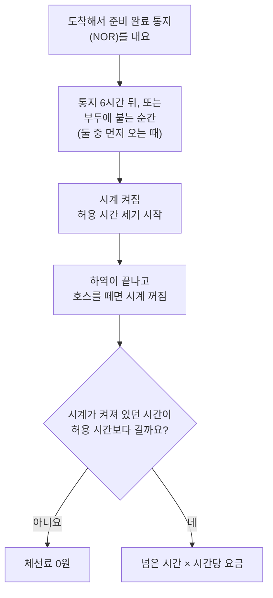
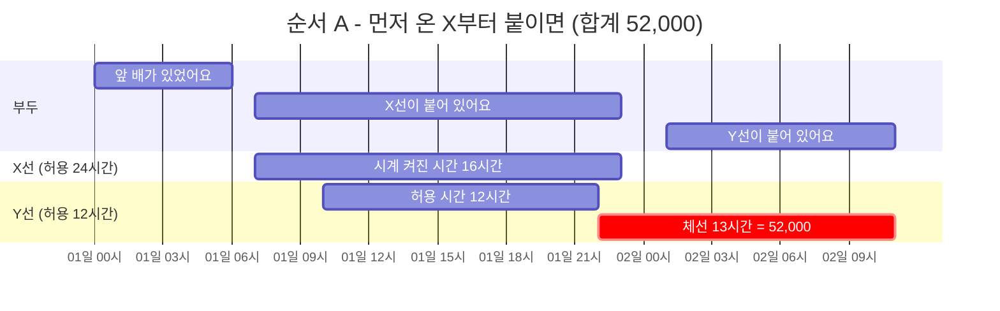
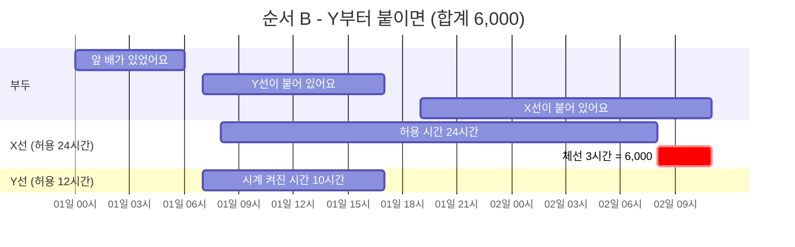
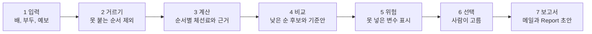

# 쉽게 보는 요구사항 — 어떤 상황을 생각하며 만들어야 할까

- 작성일: 2026-11-05 · 상태: **초안** (팀·멘토 확인 전이에요. 현업에 확인받은 것은 아직 없어요)
- 근거: 과제 원문, 그리고 팀이 만든 요구사항 분석·계산 규칙·질문 정리 문서
- 읽는 법: 처음이면 "이 도우미는 무엇을 하나요?"까지만 읽어도 큰 그림이 잡혀요. 핵심은 "꼭 생각해야 할 상황 14가지"예요.

> **한 줄로 말하면**
>
> 울산 터미널에 배가 줄줄이 들어올 때, 어떤 순서로 부두에 붙이면 '기다리는 값(체선료)'이 가장 적게 드는지 계산해서 여러 후보로 비교해 주는 도우미(Agent)를 만들어요. 정답 하나를 정해 주는 게 아니라 후보와 남은 위험을 보여 주고, 고르는 건 사람이에요.

핵심은 세 가지예요.

- **계산**: 배마다 예상 체선료를 "왜 그 금액인지" 근거와 함께 계산해요.
- **비교**: 접안 순서를 여러 가지로 돌려 보고, 체선료가 낮은 후보를 나란히 보여 줘요.
- **판단은 사람**: 후보마다 남은 위험과 대안을 붙여 주면, 담당자가 하나를 골라요.

## 체선료가 뭐예요?

먼저 말 몇 개만 알면 돼요.

- **부두**: 배가 붙어서 제품을 싣고 내리는 자리예요. 해운에서는 선석이라고도 해요.
- **접안 / 이안**: 배를 부두에 붙이는 일 / 하역이 끝나고 부두에서 떼는 일이에요.
- **호스**: 배와 부두를 잇는 관이에요. 연결하면 하역을 시작하고, 떼면 하역이 끝나요.
- **묘박지**: 부두 자리가 날 때까지 배가 바다에서 기다리는 곳이에요.
- **준비 완료 통지(NOR)**: 배가 "도착했고 하역할 준비가 됐어요"라고 알리는 통지예요. 허용 시간을 재는 시계를 켜는 신호가 돼요.

배를 빌릴 때는 계약으로 "이 시간까지는 항구에 머물러도 추가 요금이 없다"는 **허용 시간**(해운 용어로 레이타임)을 정해 둬요. 허용 시간을 넘기면 넘긴 시간만큼 요금을 내는데, 이게 **체선료**예요. 주차장 무료 시간을 넘기면 초과 요금을 내는 것과 비슷해요. 요금은 하루 기준으로 정하지만 시간 비례로 셈해요.

그럼 허용 시간을 재는 시계는 언제 켜지고 언제 꺼질까요?

**여기서 꼭 알아 둘 점이 있어요.** 부두에 붙기 전에 바다에서 기다리는 시간도 시계에 들어가요. 배는 도착하자마자 준비 완료 통지를 내기 때문이에요. 그래서 "누구를 먼저 부두에 붙이느냐"가 곧 돈이에요.

덧붙이면, 부두 안에서 자리를 옮기는 이동 시간처럼 계약에서 "빼 주는 시간"이 있으면 그만큼은 빼고 세요. 시계가 켜지는 기준(위의 6시간)과 빼 주는 시간은 계약마다 다를 수 있어요.

## 순서만 바꿔도 돈이 크게 달라져요

부두가 하나이고 배가 두 척(X, Y) 있다고 해 봐요. 팀이 손으로 계산해 둔 정답 사례(SC-01)예요. 숫자는 가상이고 단위는 달러예요.

- X가 먼저 도착했고, Y는 2시간 뒤에 도착했어요. 부두는 첫날 오전 6시에 비어요.
- X는 허용 시간이 24시간이고 시간당 2,000이에요. 하역에 14시간 걸려요.
- Y는 허용 시간이 12시간이고 시간당 4,000이에요. 하역에 8시간 걸려요.
- 접안, 호스 연결, 호스 분리, 이안에 각각 1시간이 걸린다고 단순하게 잡았어요.

부두가 하나라서 한 척씩 차례로 붙여야 해요. 순서는 두 가지예요. 아래 그림에서 맨 위 줄은 부두에 어느 배가 붙어 있는지, 아래 줄은 배마다 시계가 켜져 있던 시간이에요. 빨간 막대가 허용 시간을 넘긴(체선료가 붙는) 시간이에요.

**순서 A — 먼저 온 X부터** (도착 순서대로 접안하는 '기준안'이에요)

Y가 오래 기다려요. Y는 허용 12시간을 13시간 넘겨서 13 × 4,000 = 52,000이에요. X는 0이에요. **합계 52,000**

**순서 B — Y부터**

Y는 바로 끝나서 0이에요. X가 허용 24시간을 3시간 넘겨서 3 × 2,000 = 6,000이에요. **합계 6,000**

같은 두 척인데 순서만 바꿨더니 52,000이 6,000이 됐어요. **허용 시간이 짧고 시간당 요금이 비싼 배를 먼저 붙이면**, 허용 시간이 넉넉한 배가 기다려도 체선이 조금만 생기기 때문이에요. 도착 순서대로 한 기준안보다 46,000을 줄인 셈이에요.

이래서 순서를 여러 가지로 돌려 보고 비교해 주는 도우미가 필요해요. 이 사례는 계산 엔진도, 프로토타입도 같은 값을 냈어요(준비·마무리 시간을 같게 맞췄을 때).

## 이 도우미는 무엇을 하나요?

일곱 단계로 일해요.

**쓰는 사람은 셋이에요.**

- **선박 스케줄러**: 대기 중인 배와 부두 상황을 넣고, 후보를 비교해 최종 계획을 골라요.
- **입출항 작업 지시자**: 고른 계획과 남은 위험, 주의할 점을 보고 입항과 출항 작업을 준비해요.
- **체선 지불 부서**: 배마다 예상 체선료와 근거를 미리 보고, 금액이 크게 날지, 다툼이 생길 만한지 점검해요. ('크게'와 '다툼 위험'이 어느 정도인지 기준은 아직 몰라요.)

**원문이 "이번엔 안 해도 된다"고 한 것**도 알아 둬요.

- 회사 내부 시스템에서 실시간으로 데이터를 받아 오는 연동
- 도우미가 접안 계획을 스스로 확정하는 기능

## 꼭 생각해야 할 상황 14가지

도우미가 일하는 중에 "이럴 땐 어떻게 하지?" 싶은 상황이 계속 나와요. 네 가지 질문으로 나눠 보면 쉬워요. 각 상황 밑의 화살표(→)는 "그래서 도우미는 이렇게 해요"라는 뜻이에요.

### 가. 이 순서가 가능한가요? (못 붙는 경우를 걸러 내요)

**상황 1. 부두 하나를 여러 척이 나눠 써요**

한 부두에는 한 번에 한 척만 붙는다고 보고 시작해요. 앞 배가 끝나야 다음 배가 붙고, 기다리는 동안에도 시계는 돌아가요. 부두가 여러 곳이면 "어느 부두에 붙일지"도 같이 정해야 해요.

→ 순서(와 부두)를 바꿔 가며 배마다 기다린 시간을 구하고 총 체선료를 비교해요. 모든 일의 출발점이에요.

**상황 2. 부두마다 받을 수 있는 제품이 달라요**

어떤 배는 어떤 부두에는 붙을 수 없어요. 부두마다 다룰 수 있는 제품이 정해져 있기 때문이에요.

→ 못 붙는 부두를 고른 순서는 후보에서 아예 빼요. 후보 목록에 이런 위반이 하나도 없어야 해요(0건).

**상황 3. 물때(조석)에 따라 붙을 수 있는 시간이 달라요**

배가 물에 깊이 잠기는 정도(흘수)가 크면, 물이 충분히 찰 때까지 기다렸다가 들어가야 하는 부두가 있어요. 프로토타입의 가상 사례에서는 물이 차오르길 1시간 30분 기다려서 3,625달러가 더 붙었어요.

→ 붙을 수 있는 시간대에만 접안하는 후보로 만들어요. 어떤 배가 어떤 물때에 가능한지 구체적인 기준은 현업에 확인해야 해요.

**상황 4. 밤에는 접안이 제한될 수 있어요**

해가 진 뒤에는 접안을 하지 않는 부두나 배가 있을 수 있어요. 앞 배가 밤에 끝나면 다음 배는 아침까지 기다려야 해요. 이 기다린 시간을 체선료에 넣을지는 해석이 갈려서 상황 9에서 다뤄요.

→ 일출·일몰 시각(공공데이터)을 반영해서 밤에 붙이는 순서는 걸러 내요. (원문에는 "입출과 일물"이라고 적혀 있어요. 오타로 보여서 "일출·일몰"로 읽었고, 현업에 확인할 거예요.)

### 나. 시간이 예상과 달라지면?

**상황 5. 폭풍·강풍 예보가 있어요** (발표 데모의 주인공이에요)

바람이 세면 접안이나 하역이 멈춰요. 앞 배가 늦게 끝나면 뒤 배들이 줄줄이 밀리고, 그만큼 체선료가 쌓여요. 날씨로 멈춘 시간은 요금을 절반만 받는 규칙(반액)이 적용될 수 있어요.

→ 예보를 반영해 밀리는 시간만큼 다시 계산해요. 예보가 바뀌면 순서가 달라지는 후보에는 "이 예보에 기대고 있어요"라는 표시를 붙여요.

**상황 6. 배의 도착 시각이 바뀌어요**

배는 일찍 오기도 하고 늦게 오기도 해요. 도착 일시가 바뀌면 좋은 순서도 달라질 수 있어요.

→ 후보마다 "어떤 입력(도착 일시, 일기예보 등)에 기대고 있는지, 그 값이 바뀌면 순서가 달라지는지"를 남은 위험으로 보여 줘요.

**상황 7. 앞 배의 작업이 언제 끝날지 정확히 몰라요**

다음 배가 언제 붙을 수 있는지는 앞 배가 언제 끝나는지에 달려 있어요. 하역에 걸리는 시간, 호스를 연결하고 떼는 시간, 배를 부두에서 떼는 시간을 얼마로 잡느냐에 따라 같은 상황도 금액이 달라져요. 앞의 두 척 사례를 프로토타입의 기본 시간으로 돌리면 순서 A가 52,000이 아니라 58,000이 나와요. 고르는 순서(Y 먼저)는 같지만 금액은 달라요.

→ 금액 옆에 "이런 시간 가정으로 계산했어요"를 같이 적어요. 정답도 시간 가정과 함께 적어요. 원문에는 '예상 작업 종료 시간'이 한 번 나오지만 어떻게 구하는지는 없어서, 현업에 꼭 물어야 해요. 금액에 가장 크게 영향을 주는 값이에요.

### 다. 금액을 어떻게 셈하나요?

**상황 8. 계약마다 규칙이 달라요**

허용 시간을 언제부터 세는지, 날씨나 부두 사정으로 기다린 시간을 빼 주는지는 계약마다 다를 수 있어요.

→ 규칙을 코드에 박아 두지 않고 계약 정보에서 읽어요. 계산 근거에 "어떤 규칙을 썼는지"를 보여 줘요. 계약 정보를 바꾸면 같은 배의 결과도 바뀌어야 해요.

**상황 9. 해석이 갈리는 시간이 있어요**

*원문에는 없고, 팀이 정리한 계산 규칙에서 나온 상황이에요.*

예를 들면 이런 때예요.

- 체선에 들어간 뒤에 이동한 시간을 빼 줄지
- 밤이라 못 붙고 기다린 시간을 누가 부담할지
- 배가 도착하기 전에 낸 준비 완료 통지(NOR)를 인정할지 (일단 무효로 보고 표시해요)

→ 도우미가 한쪽으로 단정하지 않아요. "담당자 확인 필요"로 표시하고 두 가지 계산을 나란히 보여 줘요.

**상황 10. 입력이 빠졌거나 서로 안 맞아요**

*원문에는 없고, 팀이 덧붙인 생각이에요.*

시각 하나가 비어 있거나, 두 기록의 시각이 서로 다를 수 있어요.

→ 마음대로 채우거나 고르지 않아요. "여기가 비었어요"라고 알려 주고, 사람이 채울 때까지 그 계산은 보류하거나 "잠정"이라고 표시해요.

### 라. 얼마나 믿고, 누가 정하나요?

**상황 11. 배가 많아지면 순서 조합이 너무 많아져요**

배가 늘면 가능한 순서가 빠르게 늘어나요.

→ 모든 순서를 돌리지 않고, 제약으로 먼저 걸러 낸 다음 좋은 후보 몇 개만 추려요. 몇 척까지, 후보를 몇 개 보여 줄지는 아직 몰라서 임시로 3일 치, 배 5척에서 9척, 부두 2곳에서 3곳, 후보 3개로 가정했어요.

**상황 12. 계산에 넣지 못한 변수가 남아요**

날씨가 갑자기 바뀌거나, 설비·탱크 사정, 긴급 출하, 현장 안전 같은 것은 숫자로 다 넣기 어려워요.

→ 후보마다 "남은 위험"과 대안, 주의할 점을 붙여요. 위험이 없으면 "없음"이라고 보여 줘요. "지금 확정"이라고 말하지 않아요.

**상황 13. 고르는 건 사람이에요**

결과는 정답이 아니라 판단을 돕는 자료예요. 가장 싼 하나만 내지 않고 여러 후보를 비교해서 보여 줘요.

→ 화면에는 "선택"만 있고 "확정"은 없어요. 최종 접안 계획은 담당자가 정해요.

**상황 14. 모든 금액에 근거가 있어야 해요**

체선료는 금액이 크고 다툼으로 이어질 수 있어요. 숙련자의 감만 남으면 다른 사람이 같은 기준으로 다시 따져 볼 수 없어요.

→ 모든 금액에 도착 일시, 허용 시간, 예상 작업 종료 시간, 하루 요금, 쓴 규칙을 같이 보여 줘요. 보고서 초안의 금액과 시각은 화면과 같아야 하고, 근거 없는 문장은 넣지 않아요.

### 어떤 상황이 얼마나 급할까요?

- 원문이 꼭 해 달라고 한 것(최소 기능): 상황 1, 2, 3, 4, 5, 7, 12, 13, 14
- 원문이 "고려하라"고 한 것: 상황 6, 8, 11
- 원문에는 없고 팀이 덧붙인 것: 상황 9, 10

## 어떤 순서로 진행하면 좋을까요?

원문이 권하는 방식은 두 가지예요.

- **작게 줄여서 끝까지 한 번 통과시키기.** 부두 두세 곳, 배 몇 척짜리 가상 데이터로 입력부터 보고서 초안까지 한 번 이어요. 제약과 변수는 그 위에 **하나씩** 더해요. 한꺼번에 넣고 결과가 틀리면 원인을 못 찾지만, 하나씩 넣으면 "방금 넣은 것 때문"이라고 말할 수 있어요.
- **규칙을 글로 정리하고, 손으로 푼 정답을 미리 만들어 두기.** 프로그램이 낸 값을 정답으로 쓰면 틀려도 모르니까, 정답은 손으로 구해야 해요. 정답이 있으면 코드를 고칠 때마다 맞는지 바로 확인할 수 있어요.

그래서 상황을 하나씩 더해 가요. 매번 "손으로 계산 → 프로그램과 비교 → 다르면 원인 찾기"를 반복해요.

**1단계 — 배 2척, 부두 1곳** (상황 1): 끝났어요. 손계산 정답(SC-01)이 있고, 계산 엔진과 프로토타입이 같은 답을 내요.

**2단계 — 밤 접안 제한 추가** (상황 4): 앞 배가 밤에 끝나서 다음 배가 아침까지 기다리는 사례를 손으로 계산해요 (SC-02).

**3단계 — 부두 2곳, 배 3척** (상황 1, 11): 어느 부두에 붙일지까지 들어간 후보 비교예요 (SC-03).

**4단계 — 부두별 제품 제한** (상황 2): 못 붙는 부두가 있어서 후보가 걸러지는 사례예요 (SC-04).

**5단계 — 폭풍 예보, 발표 데모 상황** (상황 5, 6, 12): 바람이 한계를 넘는 시간에는 접안을 못 하고, 예보가 바뀌면 순서가 달라지는 사례예요 (SC-05).

**6단계 — 예상값과 실제값 비교** (상황 7): 도착 전에 계산한 예상값과, 실제 기록으로 계산한 값을 견줘요 (SC-06).

**정답 사례 목록에 아직 없는 상황도 있어요.** 물때(상황 3), 계약이 달라서 결과가 바뀌는 경우(상황 8), 입력이 빠진 경우(상황 10)는 위 목록에 없어요. 진행하면서 정답 사례를 추가해야 해요.

**지금 어디까지 왔나요?** (11월 4일 기준 문서 내용이에요)

- 한 척의 체선료 계산은 정답 7개와 계산 엔진이 모두 일치해요.
- 프로토타입은 입력부터 보고서 초안까지 한 흐름이 거의 이어져 있어요. 사람이 고르는 승인 단계도 있고, 자동 확정은 없어요.
- 비어 있는 것은 화면에서 배·부두를 직접 입력하는 폼, 보고용 Report 형식, 배 6척 시나리오의 손계산 정답이에요.

## 아직 모르는 것, 그리고 모르는 동안의 가정

모른다고 멈추지 않고, **가정을 적어 두고 진행**하다가 답이 오면 고쳐요. 번호(Q1, Q2 ...)는 질문 정리 문서와 같아요.

**먼저 물어볼 4가지**

- **Q1. 평가는 무엇을 보고, 마감은 언제인가요?** (교수님께)
  가정: 시작일(11월 4일)부터 6주 뒤인 12월 16일을 마감으로 봐요. 평가는 원문의 "검증" 기능(정답 일치율, 기준안 대비 줄인 금액, 제약 위반 0건)을 기준으로 봐요.
- **Q2. ML은 어디에 꼭 써야 하나요?** (교수님께)
  가정: 규칙 기반 계산과 순서 탐색이 중심이고 ML은 필수가 아니라고 봐요. 필요하면 예상 작업 종료 시간을 예측하는 곳에 붙여요.
- **Q3. 현업에서 받을 수 있는 자료가 있나요?** (현업 멘토께: 접안 이력, 계약 샘플, 선박·부두 제원)
  가정: 전부 가상 데이터로 만들고, 일기예보·조석·일출·일몰만 공공데이터포털에서 받아요.
- **Q4. 접안·하역·이안에 보통 얼마나 걸리고, 작업 종료 시간은 어떻게 예상하나요?** (현업 멘토께, 상황 7)
  가정: 하역 물량 ÷ 펌핑 속도에 준비·마무리 시간을 더해서 계산해요.

**현업 멘토께 꼭 듣고 싶은 것 2가지**

- **Q8. 계약마다 규칙이 어떻게 다른가요?** (상황 8)
  가정: 표준 양식 한 가지로 시작하고, 규칙값은 계약 정보에서 읽게 만들어요.
- **Q7. 지불 부서가 말하는 "크게 날 가능성"과 "분쟁 위험"은 무엇을 기준으로 하나요?** (상황 14)
  가정: 예상 금액이 기준을 넘거나, 빼 줄지 의견이 갈릴 수 있는 대기 시간이 있으면 표시해요. 기준 금액은 정해 달라고 요청해요.

**맞는지만 확인하면 되는 것** (우리 가정이 있어서 "맞음"만 받으면 돼요)

- Q5 기준안: 선종별 선착순이고, 제약 때문에 못 지키면 가장 빨리 비는 적합한 부두에 붙여요.
- Q6 규모: 3일 치, 배 5척에서 9척, 부두 2곳에서 3곳, 후보 3개.
- Q9 보고서 양식: 한국어 메일 1통과 1쪽짜리 Report.
- Q10 일출·일몰: 원문의 "입출과 일물"은 "일출과 일몰"이고, 일출·일몰 시각으로 봐요.
- Q12 통화와 단위: 달러, 시간 비례.

그리고 주관 팀과 첫 현업 멘토링 날짜(Q11)도 알아야 현업 질문을 언제 보낼지 정할 수 있어요.

## 더 자세히 보려면

- 과제 원문: `official-brief.md`
- 요구사항 분석 (번호 R·C·X·Q로 정리한 원본): `07-requirements-analysis.md`
- 계산 규칙과 손계산 정답: `09-first-steps.md`
- 질문 정리와 보낼 글: `08-questions.md`
- 체선료 입문 (도메인): `docs/domain/01-demurrage-primer.md`
