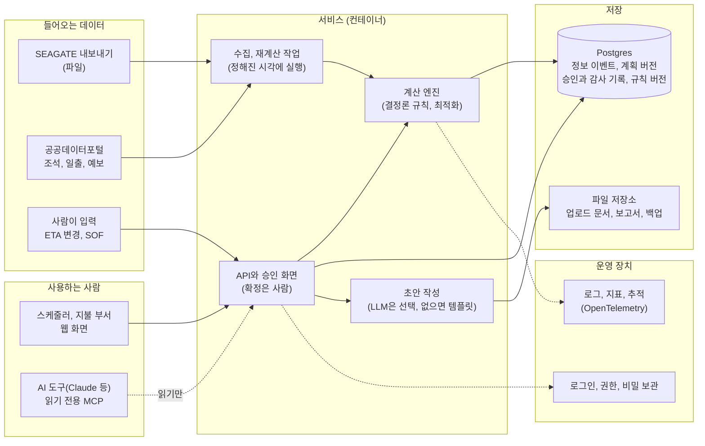
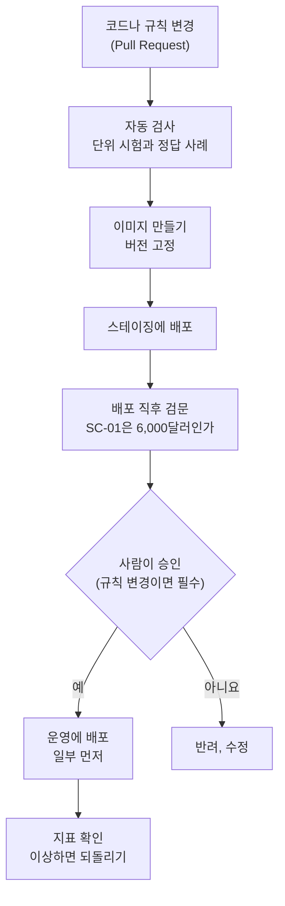
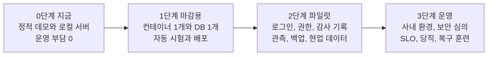

# 운영 아키텍처와 DevOps — 만든다면 어떻게 구성하고, 왜 그렇게 하나

- 작성일: 2026-11-05 · 상태: **초안** (팀·멘토 확인 전이에요. 클라우드와 사내 환경은 아직 정해지지 않았어요)
- 이 글의 범위: 지금 있는 프로토타입(`prototype/`)을 "실제로 돌리는 서비스"로 만든다면 어떤 구조와 도구가 좋고 왜 그런지예요. 원문은 사내 시스템 실시간 연동을 범위 밖으로 했으니, 이 글은 **운영까지 간다면**이라는 가정의 설계예요. [원문 6절]
- 표시: [1] 같은 숫자는 맨 아래 출처 번호예요. 직접 열어서 확인한 자료만 달았어요. "(추정)"은 출처 없이 우리가 정한 부분이에요. [팀 코드]는 저장소의 파일을 읽어 확인한 내용이에요.
- 읽는 법: 어려우면 "먼저 네 가지 답"과 6장(단계별 사다리)만 읽으세요. 3장의 그림이 전체 구조예요.

## 먼저 네 가지 답

1. **어떤 구조인가요?** 작은 서비스 하나(API와 계산 엔진), 데이터베이스 하나, 정해진 시각에 도는 수집·재계산 작업, 사람이 승인하는 화면이에요. 이걸 컨테이너로 만들어 관리형 서비스에 올려요. 쿠버네티스, 메시지 큐, 마이크로서비스는 처음에 필요 없어요.
2. **왜 이렇게 단순해요?** 일이 작아요. 울산 SK 부두에는 한 달에 배 100척쯤 드나들어요(2012년 기사 기준) [25]. 어려운 건 "많이 처리하는 것"이 아니라 **숫자가 맞고, 누가 무엇을 승인했는지 남고, 규칙을 바꿔도 안전한 것**이에요.
3. **지금 코드에서 가장 먼저 바꿀 것은?** 상태 저장이에요. 지금은 JSON 파일 하나인데, 클라우드 컨테이너는 보통 재시작하면 디스크 내용이 사라지고, 서버가 둘 이상이면 서로 덮어써요(추정). 데이터베이스로 옮겨야 해요(5장).
4. **어디까지 하면 되나요?** 팀 프로젝트 마감까지는 **1단계**(컨테이너 1개 + DB 1개 + 자동 시험·배포 + 기본 관측)면 충분해요. 로그인·감사·백업·현업 데이터는 2단계, 사내 환경과 당직은 3단계예요.

## 1장. 먼저 감 잡기 — '운영한다'는 건 무엇을 정하는 일일까

작은 가게를 떠올려 보세요. 가게를 열면 이런 걸 정해야 해요. 운영도 똑같고, 각 질문에 "사람 손이 아니라 자동화로" 답을 만들어 두는 게 DevOps예요.

- 가게 **자리**는 어디로? → 어디서 돌리나 (4-1)
- **장부**는 어디에? → 기록을 어디 두나 (4-2)
- **주문**이 들어오면? → 새 정보를 어떻게 처리하나 (4-3)
- **신입 직원**에게 어디까지 맡기나? → AI의 권한 (4-4)
- **새 메뉴**를 어떻게 안전하게 내나? → 새 버전 배포 (4-5, 4-6)
- **CCTV**로 잘 돌아가는지 어떻게 보나? → 관측 (4-7)
- **열쇠**는 누가 갖나? → 보안과 권한 (4-8)
- **불이 나면?** → 백업과 복구 (4-9)

**용어 8개 (30초)**

- **컨테이너**: 프로그램과 실행에 필요한 것을 한 상자에 담은 것. 어디서 열어도 똑같이 돌아가요.
- **관리형 서비스**: 서버 관리(패치, 확장, 복구)를 클라우드가 대신해 주는 서비스예요.
- **CI/CD**: 코드를 바꾸면 자동으로 시험하고(CI) 자동으로 배포하는(CD) 흐름이에요.
- **코드로 만드는 인프라(IaC)**: 서버와 네트워크 설정을 클릭이 아니라 파일로 적어 두는 거예요.
- **관측(Observability)**: 로그, 지표, 추적으로 안에서 무슨 일이 벌어지는지 보는 거예요.
- **SLO**: "이 정도는 지키겠다"는 내부 목표예요(예: 95%는 5분 안에).
- **카나리 배포**: 새 버전을 조금만 먼저 내보내 보고 괜찮으면 넓히는 거예요.
- **PITR**: 원하는 시각으로 데이터베이스를 되돌리는 복구예요.

## 2장. 이 서비스의 성격 — 구성의 이유 6가지

1. **결정을 돕는 서비스예요(실시간 제어가 아니에요).** 접안 확정은 사람이 해요. 원문도 자동 확정을 범위 밖으로 했어요 [원문 6절]. 그래서 99.99% 가용성보다 **숫자가 맞는지, 근거가 남는지**가 더 중요해요. → 여러 지역에 이중으로 두는 구성은 나중에.
2. **규모가 작아요.** 한 달 100척쯤이고 [25], 정보 이벤트(ETA, 예보, SOF)도 하루 수십에서 수백 건 수준일 거예요(추정). → 서버 한 대로 충분해요. "나중에 늘릴 수 있는 길"만 열어 두면 돼요.
3. **숫자는 규칙이 계산해요.** 금액과 시간 판정은 결정론적 엔진이 하고, 같은 입력이면 같은 답이 나와야 분쟁 때 설명할 수 있어요. → **같은 엔진 버전, 같은 규칙 버전, 같은 입력**을 함께 기록해서 나중에 다시 돌릴 수 있게 해요.
4. **사람이 확정해요.** 누가, 언제, 어떤 후보를, 왜 승인했는지가 남아야 해요. → 기록은 고치거나 지우지 않고 **덧붙이기만** 해요. 변경을 순서대로 모두 기록하면 과거 상태를 다시 만들 수 있고 감사 기록도 된다는 방식(이벤트 소싱)이 이런 거예요 [10]. 이 프로젝트의 "결정 시점에 알던 정보만으로 다시 계산"(Historical Replay)과 같은 생각이에요.
5. **LLM은 가장자리에만 둬요.** 문장 초안과 설명에만 쓰고, 숫자는 엔진 값을 그대로 인용하게 해요. LLM이 없어도 템플릿으로 돌아가요. [팀 코드: `mcp_server.py` 안내문, 초안의 `generated_by: "template"`]
6. **SEAGATE는 우리가 못 건드려요.** 로그인 뒤 화면은 아무도 못 봤고, 일부 페이지는 robots.txt로 자동 수집이 막혀 있어요(팀 문서). → 연동은 "파일 내보내기를 받는" 어댑터로 시작해요.

## 3장. 목표 아키텍처

**블록마다 한 줄 이유**

- **API와 승인 화면**: 사람이 보고 고르는 곳이에요. 결정은 여기서만 일어나요. AI 도구는 읽기만 해요.
- **계산 엔진**: 지금 `engine/*.py` 그대로예요. 표준 라이브러리만 써서 설치할 게 없고, 같은 코드가 서버와 브라우저(Pyodide)에서 돌아요 [팀 코드][22].
- **수집·재계산 작업**: ETA, 예보, SOF가 들어올 때마다 다시 계산해서 작업함 항목을 만들어요. 처음엔 정해진 시각에 도는 작업(Job)이면 돼요.
- **Postgres**: 정보 이벤트(덧붙이기만), 계획 버전, 승인과 감사 기록, 규칙 버전을 한곳에 둬요. 이유는 4-2에 있어요.
- **파일 저장소**: 업로드한 SOF, 만든 보고서, 백업을 둬요.
- **초안 작성**: 선택 사항이에요. LLM을 쓰면 비용, 실패, 민감 정보를 한 곳에서 막을 수 있게 한 겹을 둬요.
- **관측과 보안**: 로그·지표·추적과 로그인·권한·비밀 보관은 처음부터 자리를 잡아 둬요. 나중에 붙이기 어려워서요.

## 4장. 기술 선택과 이유

각 항목은 "고르는 것, 이유, 바꿀 때" 순서예요.

### 4-1. 실행 환경 — 컨테이너와 관리형 컨테이너 서비스

- **고르는 것**: Docker 이미지 하나로 패키징해요. 로컬과 스테이징은 Docker Compose로, 배포는 클라우드의 관리형 컨테이너 서비스에 해요.
- **이유**
  - 컨테이너로 말면 "내 컴퓨터에선 되는데"가 줄어요. 12요소 앱도 개발과 운영 환경을 최대한 비슷하게 두라고 해요 [1].
  - Compose는 여러 컨테이너(앱, DB)를 YAML 파일 하나로 띄우고, 개발과 테스트는 물론 운영에도 쓸 수 있다고 문서가 말해요 [2].
  - 관리형 컨테이너 서비스는 클러스터를 직접 만들지 않아도 확장과 HTTPS를 맡아 줘요. Cloud Run과 Container Apps는 새 버전으로 트래픽을 나눠 보내는 단계적 배포도 지원해요 [3][4]. 구글의 Cloud Run [3], 마이크로소프트의 Azure Container Apps [4], 아마존의 ECS Express Mode [5]가 그런 서비스예요. (아마존 App Runner는 신규 고객에게 닫혔고 ECS Express Mode를 권한다고 안내해요 [6].)
  - 쿠버네티스는 서비스 탐색, 자동 롤아웃과 롤백, 자가 복구, 비밀 관리를 해 줘요 [7]. 서비스가 하나인 우리에겐 대부분 필요 없고 운영할 것만 늘어요(추정). 그래도 컨테이너로 만들어 두면 SK 쪽이 쿠버네티스를 쓸 때 옮길 수 있어요(추정).
- **클라우드가 안 정해졌다면**: 가상 서버 한 대에 Compose로 올려도 돼요. 가장 싸고 배우기 쉬워요. 대신 패치와 백업을 직접 해야 해요(추정).
- **바꿀 때**: 서비스가 여럿으로 늘거나 사내 표준 플랫폼이 쿠버네티스일 때요.

### 4-2. 데이터 — 관리형 Postgres와 덧붙이기 기록

- **고르는 것**: 관리형 Postgres 한 개예요. 정보 이벤트와 감사 기록은 덧붙이기만 하고(수정·삭제 없음), 규칙 값에는 버전을 붙여 저장해요.
- **이유**
  - SQLite는 동시에 쓰는 쪽이 하나여야 하고, 앱과 데이터가 다른 기계에 있거나 쓰는 쪽이 여럿이면 Postgres 같은 서버형 DB를 쓰라고 문서가 말해요 [8]. 컨테이너 여러 개가 같은 DB에 쓰는 순간 SQLite는 맞지 않아요.
  - Postgres는 기본 백업에 변경 기록(WAL)을 계속 쌓아 두면 원하는 시각으로 되돌리는 복구(PITR)가 돼요 [9]. 승인 기록을 잃으면 안 되니까요.
  - 덧붙이기 기록은 과거 상태를 다시 만들 수 있게 해 줘요 [10].
- **바꿀 때**: 서버가 하나뿐인 혼자 쓰는 데모라면 SQLite도 충분해요. 문서도 "하루 10만 건 미만 접속, 쓰기 적음"은 문제없다고 해요 [8]. 우리 규모만 보면 SQLite도 가능하지만, 관리형 컨테이너는 인스턴스가 늘거나 디스크가 임시여서 서버형 DB가 안전해요.

### 4-3. 수집과 재계산 — 정해진 시각에 도는 작업부터

- **고르는 것**: 예보, 조석, 일출 같은 공공데이터는 정해진 시각에 가져오는 작업으로 하고, ETA와 SOF는 사람이 입력하거나 파일로 올리면 같은 재계산 작업이 돌게 해요. 메시지 큐는 나중에요.
- **이유**
  - 이벤트가 하루 수십에서 수백 건 수준이라(추정) 큐 없이도 처리돼요. 관리형 컨테이너 서비스는 일정에 따라 도는 작업(Jobs)을 기본으로 줘요 [3][4].
  - 외부 데이터의 접근 조건이 달라서 한곳에서 관리하는 게 좋아요. 조석예보와 출몰시각은 무료 공개 API예요 [26][27]. 기상청 단기예보와 해양기상관측은 서비스키가 필요하고, 해양기상관측은 공공기관의 방재기상업무용으로 제한돼요 [28][29].
- **바꿀 때**: 실시간 연동이 생겨서 이벤트가 초당 수십 건씩 오면 큐를 도입해요.

### 4-4. 에이전트, LLM, MCP — 권한은 작게, 숫자는 엔진이

- **고르는 것**: 엔진은 LLM 없이도 완결되게 두고, LLM은 초안과 설명에만 써요. MCP 도구는 읽기 전용으로 유지하고(승인, 반려, 발송은 웹 화면에서 사람이), LLM 호출은 한 겹(어댑터)을 거치게 해요.
- **이유**
  - 에이전트는 단순한 구성부터 시작하고 복잡함은 결과가 좋아질 때만 더하라는 게 Anthropic의 조언이에요. 성능을 재고 개선하는 것과 도구 설계도 중요하다고 해요 [21].
  - LLM 앱의 대표 위험은 프롬프트 주입, 민감 정보 노출, 과도한 권한(Excessive Agency), 잘못된 출력 처리, 무제한 소비예요 [19]. 우리에게는 이런 뜻이에요. 메일이나 SOF 같은 외부 문서가 지시문을 숨길 수 있고, 쓰기 도구를 열어 주면 사람 승인을 건너뛸 수 있고, 호출 횟수에 상한이 없으면 비용이 새요. 그래서 호출 횟수와 길이에 상한을 둬요.
  - MCP 보안 문서는 낮은 위험의 읽기 범위로 시작하는 최소 권한과, 다른 곳에서 발급된 토큰을 받지 않는 것을 말해요 [20]. 지금 서버는 로컬 stdio 방식이라 접근이 클라이언트 하나로 한정돼요 [20][팀 코드]. 원격(HTTP)으로 열면 인증과 범위 제한이 필요해요.
  - LLM 호출과 도구 호출을 추적하는 규약(OpenTelemetry GenAI)도 있어요 [15].
- **바꿀 때**: 문서(메일, PDF)를 LLM으로 읽어 입력을 만들게 되면 주입과 출력 검증을 더 엄격히 해요.

### 4-5. CI/CD — 정답 사례를 배포의 문지기로

- **고르는 것**: GitHub Actions(이미 쓰고 있어요). 순서는 **시험 → 이미지 빌드 → 스테이징 배포 → 배포 직후 정답 검문 → 사람 승인 → 운영 배포(일부 먼저) → 지표 확인**이에요.
- **이유**
  - GitHub Actions는 저장소 이벤트에 따라 빌드, 시험, 배포를 자동으로 돌려요 [11]. 지금 `ci.yml`이 단위 시험과 정적 빌드를 이미 돌려요 [팀 코드].
  - 이 서비스에서 가장 위험한 변경은 "규칙 값이 바뀌어서 금액이 조용히 달라지는 것"이에요. 그래서 **정답 사례(TC, SC)가 전부 맞아야** 다음 단계로 가게 해요. 배포 직후에도 "SC-01이 6,000달러를 내는가"를 살아 있는 서비스에 한 번 더 물어요.
  - 변경을 일부에게만 먼저 내보내고 지표를 비교하는 카나리 방식은 이상이 보이면 멈추고 되돌려요 [17]. 우리는 사용자가 적어서 "일부 사용자"보다 "스테이징에서 같은 입력으로 새 버전과 옛 버전을 나란히 돌려 비교"하는 쪽이 현실적이에요(추정).
  - 배포가 잘 되는지는 DORA 지표로 재요. 변경 리드타임, 배포 빈도, 실패한 배포 복구 시간, 변경 실패율, 재작업 비율이에요 [18].

### 4-6. 코드로 만드는 인프라와 비밀 관리 — Terraform과 키 없는 배포

- **고르는 것**: 클라우드 설정은 Terraform 파일로 적어 두고(쓰기, 계획, 적용 순서) [13], 배포할 때 GitHub Actions가 단기 토큰(OIDC)으로 클라우드에 접속해요. 긴 비밀번호를 저장소에 두지 않아요 [12]. 서비스키(공공데이터, LLM)는 클라우드의 비밀 저장소에 둬요.
- **이유**: 설정을 손으로 클릭하면 같은 환경을 다시 만들 수 없어요. 파일로 있으면 리뷰하고 되돌릴 수 있어요 [13]. OIDC는 AWS, Azure, GCP에서 한 작업 동안만 쓰는 토큰을 받게 해서 오래가는 비밀을 줄여요 [12].
- **바꿀 때**: 1단계 초기에는 콘솔 클릭 몇 번으로 끝나서 Terraform이 과할 수 있어요. 2단계에 도입해요(추정).

### 4-7. 관측과 SLO — 기술 지표와 업무 지표를 같이

- **고르는 것**: 로그, 지표, 추적을 OpenTelemetry 형식으로 내보내고, 받는 쪽(대시보드)은 클라우드 기본 도구로 시작해요. 업무 지표를 같이 봐요.
- **이유**: OpenTelemetry는 로그, 지표, 추적을 다루는 벤더 중립 규격이라서 받는 쪽을 바꿔도 코드를 안 바꿔요 [14]. 12요소 앱은 로그를 파일이 아니라 흐르는 이벤트 스트림으로 다루라고 해요 [1].
- **우리 서비스만의 업무 지표**
  - 정보가 들어와서 작업함에 반영되기까지 걸린 시간
  - 외부 데이터(예보, 조석)가 얼마나 낡았는지, 가져오기 실패율
  - 승인 대기 중인 항목 수와 대기 시간 (사람이 병목인지)
  - 후보 채택률과 사람이 뒤집은 비율 (프로토타입의 도입 검증 KPI와 같은 것)
  - LLM을 쓴다면 호출 실패와 비용
- **SLO는 적게, 느슨하게 시작해요.** 지금 수치를 그대로 약속하지 말고, 지키기 벅찬 약속도 피하라고 SRE 책이 말해요 [16]. 제안(추정): "정보가 들어오면 5분 안에 작업함에 반영 95%", "예보 데이터 나이 6시간 이내".

### 4-8. 보안, 권한, 감사

- **고르는 것**: 로그인(SSO) → 역할(스케줄러, 지불 부서, 관리자, 읽기 전용 AI) → 감사 기록(덧붙이기). 그리고 공개 데모(가상 데이터)와 비공개 운영(실데이터)은 **환경 자체를 분리**해요.
- **이유**
  - 접안 계획은 상업적으로 민감하다고 IMO 문서가 적었어요 [24]. 계약 요율과 청구서는 더 그래요(추정).
  - 지금 정적 사이트는 엔진 코드와 데이터가 그대로 공개된다고 배포 문서가 경고해요 [팀 코드]. 실데이터를 거기 넣으면 안 돼요.
  - 파이썬 `http.server`는 "운영용으로 권하지 않고 기본 보안 검사만 한다"고 문서가 적어요 [23]. 지금 `server.py`는 로그인도 HTTPS도 없어요 [팀 코드]. 앞단에 관리형 수신(HTTPS)과 인증을 두거나 운영용 서버로 감싸야 해요.
  - 승인한 사람(`actor`)이 지금은 고정 문자열("터미널 담당자(데모)")이에요 [팀 코드]. 로그인한 사용자로 바꿔야 감사가 돼요.

### 4-9. 백업과 복구

- **고르는 것**: DB는 관리형 자동 백업에 변경 기록(PITR)을 더하고 [9], 파일은 버전이 남는 저장소에 두고, 복구 훈련을 분기에 한 번 해요.
- **목표값은 현업과 정해요**: 얼마나 잃어도 되나(RPO), 얼마나 걸려도 되나(RTO)예요. 결정 보조 서비스라서 사람이 예전 방식으로 돌아갈 수 있으면 몇 시간에서 하루는 견딜 거예요(추정). 그래도 승인과 감사 기록은 잃으면 안 돼요.

## 5장. 지금 코드에서 바꿀 곳 (프로토타입 기준)

1. **상태 저장을 DB로** (`engine/store.py`): JSON 파일 하나에 락을 걸고 임시 파일로 교체해요. 프로세스가 하나일 때만 안전해요 [팀 코드]. 컨테이너가 재시작되거나 인스턴스가 여럿이면 깨져요. `Store`의 저장·기록 인터페이스는 그대로 두고 저장소만 바꾸면 엔진은 안 건드려도 돼요(추정).
2. **서버 앞단 보호** (`server.py`): 표준 라이브러리 서버예요 [23]. 호스트 기본값이 127.0.0.1이라 컨테이너에서는 0.0.0.0으로 열어야 해요. `PORT` 환경변수는 이미 지원해요 [1][팀 코드]. 로그인과 HTTPS가 없어서 관리형 수신과 인증을 붙여요.
3. **컨테이너화**: Dockerfile이 없어요 [팀 코드]. 엔진이 표준 라이브러리만 써서 이미지가 아주 단순해요(파이썬 기본 이미지에 코드를 복사). **파이썬 버전을 고정**해요. CI와 Pyodide는 3.12인데 이 컴퓨터는 3.14예요 [팀 코드]. 이미지도 3.12로 맞춰요.
4. **헬스체크와 로그**: 전용 헬스 경로가 없어요(`/api/meta`가 있어요). 접근 로그는 환경변수 `DESK_LOG`를 켜야만 나오고, 오류는 stderr에 출력해요 [팀 코드]. `/healthz`를 추가하고, JSON 로그를 stdout으로 내보내요 [1].
5. **CI 확장** (`.github/workflows/ci.yml`): 이미 시험과 정적 빌드를 돌리고 권한도 `contents: read`로 최소예요 [팀 코드]. 이미지 빌드, 배포, 배포 직후 정답 검문 단계를 추가해요.
6. **배포 경로 분리** (`tools/deploy_site.py`): 공개 저장소에 강제 푸시해서 데모를 올려요 [팀 코드]. 공개 가상 데이터 데모로만 쓰고, 운영 배포는 이미지에서 비공개 환경으로 따로 가요.
7. **계산 결과에 버전을 붙이기**: `data/*.json`과 `rules.json`(상태: public, verify, assumed, disputed)이 저장소에 있어요 [팀 코드]. 계산 결과에 엔진 버전, 규칙 버전, 입력 해시를 같이 저장하면 나중에 같은 값을 재현할 수 있어요(추정).
8. **MCP**: 로컬 stdio 읽기 전용은 그대로 둬요. 원격으로 열려면 인증과 범위 제한이 필요해요 [20].

## 6장. 단계별 사다리

### 0단계 — 지금 (데모)
- **있는 것**: 정적 사이트(GitHub Pages)에서 파이썬 엔진이 브라우저 안에서 돌아요(Pyodide [22]). 로컬 서버와 CI도 있어요 [팀 코드].
- **좋은 점**: 운영 부담과 비용이 0이고 누구나 열어 봐요.
- **한계**: 결정이 각 브라우저에만 저장되고, 사이트가 공개이고, 외부 CDN에 의존해요 [팀 코드].

### 1단계 — 마감용 (권장 목표)
- **하는 일**: Dockerfile과 Compose(앱과 DB), 상태 저장을 DB로, `/healthz`와 JSON 로그, CI에 이미지 빌드, 한 곳에 배포(관리형 컨테이너 또는 VM과 Compose), 배포 직후 정답 검문, 비밀은 환경변수로.
- **이유**: "운영할 수 있는 모양"을 데모로 보여 주면서 시간과 비용이 적게 들어요.
- **끝났다는 신호**: 코드를 합치면 자동으로 스테이징에 올라가고, 정답 검문이 통과하고, 주소로 접속해 승인을 눌렀다가 다시 열어도 기록이 남아 있어요.
- **하지 않는 것**: 쿠버네티스, 큐, 여러 지역.

### 2단계 — 파일럿 (현업과 함께)
- **하는 일**: 로그인과 역할, 감사 기록 보호, 관측 대시보드와 알림, 백업과 복구 시험, Terraform, 스테이징과 운영 분리, SEAGATE 내보내기 어댑터, 카나리 배포, LLM 위험 점검 [19], 프로토타입의 Shadow Mode로 현업 경로와 나란히 비교.
- **끝났다는 신호**: 현업 한 명이 일주일 동안 비식별 실데이터로 쓰고, 문제가 생기면 기록으로 원인을 추적할 수 있어요.

### 3단계 — 운영 (SK 환경)
- **하는 일**: 사내망과 SSO, 보안 심의, SLO와 당직, 규칙 변경의 승인 절차, 복구 훈련, LLM 거버넌스, SEAGATE와의 정식 인터페이스(SK AX 협의).
- **이유**: 운영 주체와 환경이 정해져야 확정할 수 있어요.

## 7장. 처음부터 하지 말 것 (과설계 경고)

- **쿠버네티스로 시작하기**: 필요한 기능(롤아웃, 자가 복구 등) [7]을 관리형 컨테이너 서비스가 대부분 줘요 [3][4][5]. 서비스가 하나라 이득이 작아요. 평가 가산점이 목적이라면 1단계를 마친 뒤 선택 과제로 해요.
- **마이크로서비스로 쪼개기**: 엔진을 나누면 같은 입력에서 같은 출력을 재현하기 어려워지고 배포 지점이 늘어요(추정).
- **메시지 큐(Kafka 등)**: 이벤트가 하루 수십에서 수백 건 수준이에요(추정).
- **에이전트에 쓰기 권한 주기**: 승인과 발송을 도구로 열어 주면 사람 확정이 무너져요 [19][20].
- **실데이터를 공개 저장소나 Pages에 올리기**: 배포 문서가 경고해요 [팀 코드].
- **SEAGATE 자동 수집(스크래핑)**: 일부 페이지가 robots.txt로 막혀 있어서 하지 않기로 했어요(팀 문서).
- **처음부터 완벽한 SLO**: 약속을 먼저 크게 정하지 말고 느슨하게 시작해요 [16].

## 8장. 팀에서는 (역할과 이번 주 할 일)

- **역할**: 팀의 역할은 PM, 도메인, 엔진, 에이전트, 평가, 발표예요. DevOps 전담이 없으니 **엔진 담당이 겸임**하고, 정답 사례를 가진 **평가 담당이 "정답 검문" 자동화**를 맡으면 자연스러워요(추정).
- **이번 주 해 볼 것 3가지**
  1. Dockerfile과 `compose.yml`을 만들어서 `docker compose up`으로 `python3 server.py`와 같은 화면이 뜨는지 확인해요.
  2. `ci.yml`에 "정답 사례 전부 통과"가 단계로 보이게 하고, 이미지 빌드를 추가해요.
  3. `/healthz`와 JSON 로그를 추가해요.
- **공부 자료** (전부 열어서 확인한 것)
  - 먼저: 12요소 앱 [1] (10분), Docker Compose [2], GitHub Actions [11]
  - 그다음: SRE 책의 SLO 장 [16], OWASP LLM Top 10 [19], MCP 보안 문서 [20]

## 9장. 먼저 물어봐야 할 것 (구성을 바꾸는 질문)

1. **교육과정이 제공하는 클라우드와 LLM이 있나요?** 있으면 그 서비스로, 없으면 VM과 Compose로 가요. (팀 핸드오프 문서에도 "제공 LLM·인프라"가 미확정으로 남아 있어요.)
2. **현업 자료를 클라우드에 올려도 되나요?** 데이터 반출 규정에 따라 달라져요.
3. **SEAGATE에서 어떤 형식과 주기로 파일을 받을 수 있나요?**
4. **쓸 사람은 몇 명이고, 사내망만 되나요?**
5. **언제 꼭 떠 있어야 하나요?** 폭풍 예보처럼 바쁜 때가 있나요?
6. **누가 운영하나요?** SK AX인지 현업인지에 따라 당직과 승인 절차가 달라져요.
7. **기록을 얼마나 보관하나요?** 청구 시효(팀 문서 기준 60일에서 90일)와 분쟁을 생각하면 그 이후까지는 보관해야 할 거예요(추정).

## 출처 (직접 열어서 확인한 것)

1. [The Twelve-Factor App](https://12factor.net/)
2. [Docker Compose 개요](https://docs.docker.com/compose/)
3. [Google Cloud Run — What is Cloud Run](https://docs.cloud.google.com/run/docs/overview/what-is-cloud-run)
4. [Azure Container Apps overview](https://learn.microsoft.com/en-us/azure/container-apps/overview)
5. [Amazon ECS Express Mode](https://docs.aws.amazon.com/AmazonECS/latest/developerguide/express-service-overview.html)
6. [AWS App Runner — 신규 고객 중단 안내가 적힌 소개 페이지](https://docs.aws.amazon.com/apprunner/latest/dg/what-is-apprunner.html)
7. [Kubernetes — Overview](https://kubernetes.io/docs/concepts/overview/)
8. [SQLite — Appropriate Uses For SQLite](https://www.sqlite.org/whentouse.html)
9. [PostgreSQL — Continuous Archiving and Point-in-Time Recovery](https://www.postgresql.org/docs/current/continuous-archiving.html)
10. [Martin Fowler — Event Sourcing](https://martinfowler.com/eaaDev/EventSourcing.html)
11. [GitHub Actions — Understand GitHub Actions](https://docs.github.com/en/actions/get-started/understand-github-actions)
12. [GitHub Actions — OpenID Connect](https://docs.github.com/en/actions/concepts/security/openid-connect)
13. [Terraform — Introduction](https://developer.hashicorp.com/terraform/intro)
14. [OpenTelemetry — What is OpenTelemetry?](https://opentelemetry.io/docs/what-is-opentelemetry/)
15. [OpenTelemetry — Semantic conventions for generative AI](https://opentelemetry.io/docs/specs/semconv/gen-ai/) (규약 본문은 별도 저장소로 옮겨졌다고 안내돼 있어요)
16. [Google SRE Book — Service Level Objectives](https://sre.google/sre-book/service-level-objectives/)
17. [Google SRE Workbook — Canarying Releases](https://sre.google/workbook/canarying-releases/)
18. [DORA — Software delivery performance metrics](https://dora.dev/guides/dora-metrics-four-keys/)
19. [OWASP Top 10 for LLM Applications (2025)](https://genai.owasp.org/llm-top-10/)
20. [Model Context Protocol — Security Best Practices](https://modelcontextprotocol.io/docs/2026-07-28/tutorials/security/security_best_practices.md)
21. [Anthropic — Building effective agents](https://www.anthropic.com/engineering/building-effective-agents)
22. [Pyodide](https://pyodide.org/en/stable/)
23. [Python — http.server](https://docs.python.org/3/library/http.server.html)
24. [IMO MEPC 75/INF.22 (2020-01-24) — Just In Time Arrival Guide](https://sustainableworldports.org/wp-content/uploads/MEPC-75-INF.22-Just-In-Time-Arrival-Guide-Barriers-and-Solutions-Secretariat.pdf)
25. [아주경제 (2012-10-24) — SK이노베이션 50년, 가장 바빠진 '수출선적부두'](https://www.ajunews.com/view/20121024000001)
26. [공공데이터포털 — 국립해양조사원 조석예보(시계열)](https://www.data.go.kr/data/15156022/openapi.do)
27. [공공데이터포털 — 한국천문연구원 출몰시각 정보](https://www.data.go.kr/data/15012688/openapi.do)
28. [공공데이터포털 — 기상청 단기예보 조회서비스](https://www.data.go.kr/data/15084084/openapi.do)
29. [공공데이터포털 — 기상청 해양기상관측자료 조회서비스](https://www.data.go.kr/data/15043550/openapi.do)

**[원문]** `docs/requirements/official-brief.md` · **[팀 코드]** `prototype/server.py`, `prototype/engine/store.py`, `prototype/mcp_server.py`, `prototype/.github/workflows/ci.yml`, `prototype/docs/deploy.md`, `prototype/docs/how-it-works.md` · **[팀 문서]** `docs/seagate-handoff.md`. 이 글의 클라우드 서비스 소개는 각 회사의 공식 문서 내용이고, 우리 환경에서 실제로 배포해 보지는 않았어요.
