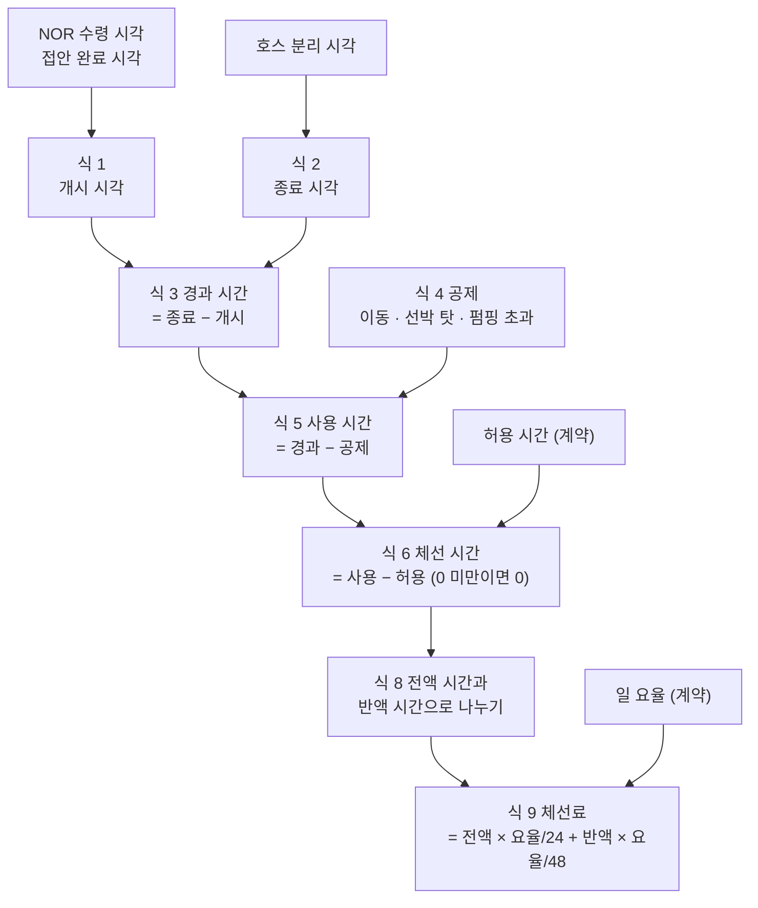
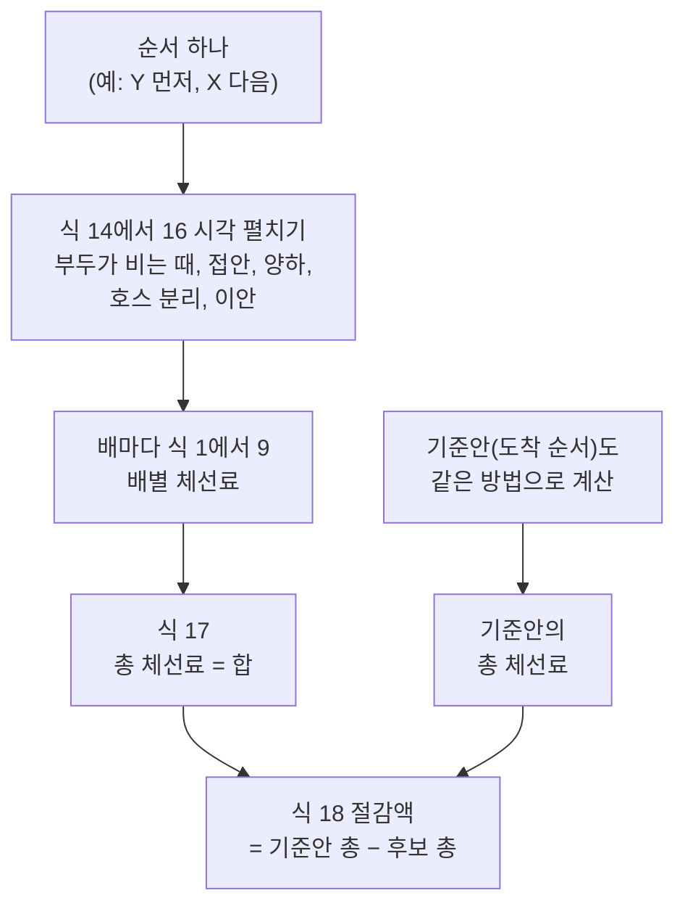

# 체선료 계산 공식 — 한 척에서 여러 척까지

- 작성일: 2026-11-05 · 상태: **초안** (팀·멘토 확인 전)
- 한 줄: 체선료 계산에 쓰는 식을 번호 순서대로 모았어요. 한 척의 시계, 돈, 두 겹 계약, 도착 전 예상, 여러 척의 순서, 위험, 검증 순이에요.
- 짝 자료: 영상 1편에서 4편, 팀 문서 `docs/domain/04-worked-examples.md`(손계산 정답 7개), 계산 엔진 `clock/`
- 읽는 법: 바쁘면 "0. 한 장 요약"과 "2. 한 척"만 읽어도 돼요. 숫자는 모두 가상이고 단위는 달러예요. [1] 같은 번호는 맨 아래 출처예요.

## 확인한 것과 못 한 것

**확인한 것**
- 이 문서의 식을 엔진과 따로 구현해서, 팀 정답 7개와 두 척 사례(SC-01)에 넣어 봤어요. 전부 같은 값이 나왔어요.
- 저장소 계산 엔진(`clock/`)이 내는 값과도 같아요. 체선이 시작되는 시각까지 같아요.
- 한 척 식의 근거 문구는 Asbatankvoy 서식 사본에서 직접 읽어 확인했어요 [1].
- 시트용 공식은 LibreOffice로 정답 사례 6건을 계산시켜 맞는 걸 확인했어요.
- 식 7, 식 20, 식 23은 무작위 시험으로도 확인했어요. 시험에 쓴 숫자 분포는 제가 정한 거라서 "참고용"이에요.

**못 한 것**
- SK 울산의 실제 용선계약과 매매계약은 못 봤어요. 현업 확인은 0건이에요. 통지시간 6시간, 허용 시간, 요율은 계약마다 달라서 입력으로 읽어야 해요.
- [가정]이 붙은 값(주간 시간대, 접안·이안 작업 시간 등)은 임시 값이에요.

---

## 0. 한 장 요약 (복사해서 쓰세요)

```
■ 한 척
 1 개시        = max( NOR 수령 , min( NOR 수령 + 통지시간 , 접안 완료 ) )
 2 종료        = 호스 분리 시각
 3 경과        = 종료 − 개시
 4 공제        = 이동 + 선박 탓 + 펌핑 초과
 5 사용        = 경과 − 공제
 6 체선 시간   = max( 0 , 사용 − 허용 )
 7 체선 시작   = 개시 + 허용 + (그 전에 시작한 공제 시간)
 8 나누기      = 체선 시간 = 전액 시간 + 반액 시간
 9 체선료      = 전액 시간 × 일 요율/24 + 반액 시간 × 일 요율/48
10 여유        = 허용 − 사용          (체선이 없을 때. 2시간 미만이면 경고)

■ 두 겹 계약
11 갭          = 낼 돈(용선계약) − 받을 돈(매매계약)
12 청구 기한   = 양하 완료 + 60일(통지) , 양하 완료 + 90일(서류)

■ 도착 전에 예상하기
13 양하 시간   = 물량 ÷ 속도 ,  속도 = min( 배 펌프 , 육상 수용 , 배관 한도 )
14 부두가 비는 때 = 앞 배 이안 완료 + 회전 시간
15 접안 완료   = 가장 이른 때 이후, 제약을 다 지키는 첫 시각
16 시각 펼치기 = 접안 → 호스 연결 → 양하 → 호스 분리(= 종료) → 이안

■ 여러 척
17 총 체선료   = 배마다 식 1에서 9를 계산한 값의 합
18 절감액      = 기준안 총 − 후보 총          (기준안 = 도착 순서)
19 순서 수     = n!
20 맞바꾸기    = (i 먼저) − (j 먼저) = 요율_j × 점유_i − 요율_i × 점유_j

■ 위험
21 한 시간 늦으면 = 요율/24 (여유 없음) , 0 (여유 1시간 넘게 남음)
22 평균 체선료    = 합( 확률 × 체선료 )
23 체선 확률      = 체선이 생기는 경우들의 확률 합

■ 검증
24 일치율      = 정답과 같은 사례 수 ÷ 정답 사례 수
25 절감률      = 절감액 ÷ 기준안 총
26 제약 위반   = 0 이어야 해요
```

---

## 1. 먼저 약속 몇 가지

- **시각**은 현지시각이고 분 단위로 세요. D1은 첫날, D0은 그 전날이에요.
- **요율**은 계약에 "하루에 얼마"로 적혀요. 서식 Part I의 박스 I가 하루 단위 체선료예요 [1]. 8조는 시간 단위로 내되 모자란 시간은 비례해서 낸다고 해요 [1]. 그래서 **시간당 = 일 요율 ÷ 24, 반액 = 일 요율 ÷ 48, 분당 = 일 요율 ÷ 1,440**이에요.
- **반올림**은 마지막에만 해요. 계산은 센트까지 하고, 정답과 견줄 때만 달러로 반올림해요. 0.5 이상이면 올려요(예: 7,291.67이 7,292).
- **말 풀이**: NOR은 "준비 다 됐어요" 통지, all fast는 부두에 다 묶인 때(해상 터미널은 계류 완료), 허용 시간은 레이타임, 체선은 허용 시간을 넘긴 시간이에요.

---

## 2. 한 척의 체선료 (식 1에서 10)

식끼리 이렇게 이어져요. 위에서 아래로 한 번만 따라가면 돼요.



### 식 1. 시계가 켜지는 때

```
개시 = max( NOR 수령 , min( NOR 수령 + 통지시간 , 접안 완료 ) )
```

**쉽게 말하면**: NOR을 받고 6시간이 지나거나, 그 전에 부두에 다 묶이면, 둘 중 먼저 오는 때 시계가 켜져요. 6조가 그렇게 말해요 [1]. NOR을 받기 전에는 켜지지 않는 걸로 계산해요(엔진 기준 [가정]).

**예**: SC-01의 Y선은 NOR 04:00에 접안은 다음날 01:00이에요. min(10:00, 다음날 01:00)이라 D1 10:00에 켜져요.

**조심할 것**
- 6시간은 이 서식의 값이에요. 계약마다 다를 수 있어서 입력으로 읽어요.
- 도착(투묘) 전에 낸 NOR은 무효로 봐요(판례 원칙이라 원문 확인은 안 했어요). 재제출이 있으면 재제출 시각으로 식 1을 다시 계산하고(TC-05b), 재제출이 없으면 하역 개시 시각이 개시예요(TC-05는 D2 09:00). 대리점이 무효 NOR을 받아 줬을 때 선주가 "하자는 사라졌다"고 주장할 수 있어서, 두 가지로 계산해 둬요.
- 5조는 계약서에 적힌 시작일 전에는 시계가 켜지지 않는다고 해요 [1]. 즉 개시는 그 날짜보다 빠를 수 없어요. 엔진에는 아직 이 규칙이 없어요.

### 식 2. 시계가 멈추는 때

```
종료 = 호스 분리 시각
```

**쉽게 말하면**: 하역이 끝났을 때가 아니라 호스를 뗀 때 멈춰요. 11조가 호스를 뗄 때까지 레이타임이 계속된다고 해요 [1].

**예**: TC-02는 양하가 D3 05:30에 끝나고 호스 분리가 06:30이에요. 종료는 06:30이에요.

### 식 3. 경과 시간

```
경과 = 종료 − 개시
```

**예**: TC-02는 D1 20:00에서 D3 06:30까지 34시간 30분이에요.

### 식 4. 시계에서 빼는 시간(공제)

```
공제 = 이동 + 선박 탓 + 펌핑 초과
```

- **이동**(7조) [1]: 묘박지에서 부두로 옮겨 가는 시간(양묘부터 접안 완료까지)은 사용 시간에 안 세요. 개시 전에 일어난 이동은 이미 안 세고 있으니 또 빼지 않아요(TC-01). 체선 중에 일어난 이동은 쟁점이에요. 7조는 "사용된 레이타임"만 말하고 체선 중은 말하지 않아요 [1]. 기본은 "센다"(체선이면 계속 체선), 용선주는 "뺀다"고 주장할 수 있어서 두 값을 모두 계산해요(TC-03은 187,500 대 177,500).
- **선박 탓**(7조) [1]: 배의 상태나 고장, 설비 부족으로 늦어진 시간은 안 세요.
- **펌핑 초과**(Rider): 아래 식이고, 두 조건이 모두 맞을 때만 빼요. 평균 매니폴드 압력이 보증 압력보다 낮고, 육상에 제한이 없었다는 기록이 있을 때예요. 서식 본문에는 펌핑 보증 문구가 없어서 Rider로 붙는 조항이에요 [1].

```
펌핑 초과 = max( 0 , 실제 양하 시간 − 보증 시간 )
```

**예**: TC-02는 이동이 D2 06:30에서 08:00까지라 1시간 30분을 빼요. TC-04는 실제 양하 31시간에서 보증 24시간을 빼서 7시간을 빼요.

**안 빼는 것**: 부두를 기다린 시간은 기본으로 세요. 9조가 용선주는 "도착했을 때 닿을 수 있는 곳"을 정해야 한다고 해서예요 [1]. 야간 하역 금지는 누가 정했느냐에 따라 달라요. 선주나 항만당국이 정했으면 안 세고, 용선주·송하인·수하인이 정했으면 세요(7조) [1]. 울산 SBM의 야간 계류 금지가 어느 쪽인지는 현업에 물어야 해요.

### 식 5. 사용 시간

```
사용 = 경과 − 공제
```

**예**: TC-02는 34시간 30분 − 1시간 30분 = 33시간이에요.

### 식 6. 체선 시간

```
체선 시간 = max( 0 , 사용 − 허용 )
```

**쉽게 말하면**: 쓴 시간이 허용 시간을 넘은 만큼이 체선이에요. 못 미치면 0이에요.

**예**: TC-02는 33 − 30 = 3시간이에요. SC-01 순서 A의 Y선은 25 − 12 = 13시간이에요.

**허용 시간은 계약에서 읽어요**(코드에 박지 않아요). 서식 Part I의 박스 H 이름이 "총 레이타임"이에요 [1]. 그래서 [추론] 양하항에서는 선적항에서 쓰고 남은 시간이 허용 시간이에요. TC-01의 36시간도 "72시간 중 36시간을 선적항에서 썼다"는 가정이에요. 계약에 따라 항구별로 나눠 적기도 해요.

### 식 7. 체선이 시작되는 때

```
체선 시작 = 개시 + 허용 + (허용 시간이 다 차기 전에 시작한 공제 시간의 합)
```

**쉽게 말하면**: 시계가 허용 시간만큼 돌면 체선이 시작돼요. 그런데 중간에 빠진 시간만큼 뒤로 밀려요. 체선이 없으면 이 시각도 없어요.

**예**: TC-02는 D1 20:00 + 30시간 = D3 02:00이고, 그 전에 빠진 이동 1시간 30분을 더해 D3 03:30에 체선이 시작돼요. 엔진 계산서도 D3 03:30이에요.

**왜 필요한가**: 반액 구간이나 체선 중 이동처럼 "체선 중에 일어난 일인가?"를 가르려면 이 시각이 있어야 해요. 허용 시간이 다 차는 바로 그 순간에 시작하는 공제는 체선 쪽 몫으로 쳐요(엔진과 같은 규칙).

### 식 8. 전액 시간과 반액 시간

```
체선 시간 = 전액 시간 + 반액 시간
반액 시간 = 체선 구간과 겹치는 "반액 사유" 중단 시간
```

**쉽게 말하면**: 체선 중에 폭풍 같은 사유로 하역이 멈춘 시간은 요율의 절반만 받아요. 8조의 사유는 화재, 폭발, 폭풍, 파업·직장 폐쇄·노동 제한, 그리고 용선주·공급자·송하인·수하인 설비의 고장이에요 [1].

**예**: TC-03은 체선 40시간 30분 중 폭풍 중단이 6시간이에요. 반액 6시간, 전액 34시간 30분이에요.

**조심할 것**
- 8조는 "그 사유로 생긴 체선"에 반액을 말해요 [1]. 레이타임 중에 일어난 폭풍이 만든 체선을 반액으로 볼지는 해석이 갈려서 두 가지로 계산해요.
- 배의 선원이나 예선, 도선사의 파업으로 늦어진 시간은 체선료 자체가 없어요(8조) [1].

### 식 9. 체선료

```
체선료 = 전액 시간 × 일 요율/24 + 반액 시간 × 일 요율/48
```

**예**: TC-03은 34.5 × 120,000 ÷ 24 + 6 × 120,000 ÷ 48 = 172,500 + 15,000 = **187,500**이에요.

### 식 10. 여유

```
여유 = 허용 − 사용        (체선이 없을 때만. 2시간 미만이면 경고 [가정])
```

**쉽게 말하면**: 체선은 없지만 얼마나 아슬아슬했는지예요. 여유가 작으면 작은 지연도 바로 돈이 돼요.

**예**: TC-01은 사용 35시간 30분, 허용 36시간이라 여유가 30분이에요. 경고 대상이에요.

> 참고: 조출료(일찍 끝냈을 때 받는 보상)는 이 서식 본문에 없어요 [1]. 팀 문서는 건화물 계약에는 흔하고 탱커 계약에는 보통 없다고 하고(`docs/domain/01`), 있으면 체선료율의 절반이라고 적어요(`docs/domain/02`). 이 프로젝트에서는 다루지 않아요.

### 구글 시트에서 계산하기

한 줄에 사례 하나를 넣는 방식이에요. 열은 B 수령한 NOR, C 접안 완료, D 호스 분리, E 통지시간(시간), F 공제(시간), G 허용(시간), H 반액(시간), I 일 요율, J 허용 시간이 차기 전에 빠진 공제(시간)예요. 시각 칸은 날짜와 시각이 한 칸에 들어가게 쓰세요(예: 2026-11-02 14:00).

```
K 개시        =MAX(B2, MIN(B2+E2/24, C2))
L 경과(시간)  =ROUND((D2-K2)*1440, 0)/60
M 사용(시간)  =L2-F2
N 체선(시간)  =MAX(0, M2-G2)
O 전액(시간)  =N2-H2
P 체선료      =ROUND(O2*I2/24 + H2*I2/48, 2)
Q 체선 시작   =IF(N2>0, K2+(G2+J2)/24, "")
R 여유(시간)  =IF(N2=0, G2-M2, "")
```

날짜끼리 빼면 아주 작은 소수 오차가 생겨서(예: 52,000.0000005) 경과 시간을 분 단위로 맞추는 ROUND를 넣었어요. 이 공식으로 TC-01, TC-02, TC-03, TC-05b, SC-01 두 건을 LibreOffice에서 계산시켜 정답과 같은 걸 확인했어요. 구글 시트도 같은 함수예요.

---

## 3. 맞는지 확인한 결과

| 사례 | 식으로 구한 체선 시간 | 식으로 구한 금액 | 팀 정답과 |
|---|---|---|---|
| TC-01 | 0 (여유 30분) | 0 | 같음 |
| TC-01b | 3시간 30분 | 17,500 | 같음 |
| TC-02 | 3시간 | 6,875 | 같음 |
| TC-03 | 40시간 30분 (전액 34시간 30분 + 반액 6시간) | 187,500 (체선 중 이동을 빼면 177,500) | 같음 |
| TC-04 | 0 (펌핑 초과 7시간 공제) | 0 (공제가 없으면 7,291.67) | 같음 |
| TC-05 | 0 (무효 NOR) | 0 (선주 청구대로면 3,791.67) | 같음 |
| TC-05b | 1시간 30분 | 1,625 | 같음 |
| SC-01 | 순서 A는 Y선 13시간, 순서 B는 X선 3시간 | A 52,000, B 6,000 | 같음 |

식 7(체선 시작)은 공제 위치를 무작위로 바꾼 3,000건에서 모두 같았어요. 처음에는 3건이 어긋났는데, 허용 시간이 다 차는 바로 그 순간에 공제가 시작되는 경우였고 위 문장처럼 규칙을 고쳤어요.

---

## 4. 두 겹 계약 (식 11, 12)

### 식 11. 낼 돈, 받을 돈, 갭

```
낼 돈   = 식 1에서 9를 용선계약 조건으로 계산   (선주에게)
받을 돈 = 식 1에서 9를 매매계약 조건으로 계산   (거래 상대에게. 요율은 상한을 못 넘어요)
갭      = 낼 돈 − 받을 돈
```

**쉽게 말하면**: 같은 배, 같은 항구여도 계약이 두 장이에요. 선주와의 계약과 거래 상대와의 계약이요. 허용 시간이나 시작 규칙, 요율 상한이 다르면 계산이 두 번 나와요. 갭이 양수면 그만큼은 SK가 떠안아요.

**조심할 것**: 매매계약의 패턴은 팀 문서(`docs/domain/05-charter-party-clauses.md` 4절)에서 온 거라 [추론]이에요. 엔진에는 두 계산서를 견주는 코드가 아직 없어요(`clock/README.md` 7절).

### 식 12. 청구 기한

```
통지 기한 = 양하 완료일 + 60일
서류 기한 = 양하 완료일 + 90일
```

팀 문서(`docs/domain/05` 3절)가 Shellvoy 6 기준으로 적은 값이라 원문 대조 전이에요 [확인 필요]. Asbatankvoy 서식 본문에는 청구 기한 조항이 없어요 [1]. Rider나 매매계약에서 와요.

---

## 5. 도착 전에 예상하기 (식 13에서 16)

예상도 규칙은 같아요. 지난 일의 시각 대신 **예측한 시각**을 식 1에서 9에 넣을 뿐이에요. 다만 접안 완료와 호스 분리 시각을 우리가 만들어야 해서 아래 식이 필요해요.

### 식 13. 양하 시간

```
양하 시간 = 물량 ÷ 양하 속도 + 예상 중단 시간
양하 속도 = min( 배 펌프 능력 , 육상 수용률(탱크 여유) , 선석 배관 한도 )
```

**예**(가상): 물량 42,000을 속도 3,000/시간으로 내리면 14시간이에요. SC-01의 X선과 같아요. 물량과 속도는 같은 단위(세제곱미터나 배럴)로 쓰세요. 이 속도 규칙은 프로토타입의 `PLAN-PUMP-RATE`예요.

### 식 14. 부두가 비는 때

```
부두가 비는 때 = max( 앞 배 이안 완료 + 선석 회전 시간 , 정비 등 사용 불가 시간의 끝 )
```

**예**: SC-01은 회전 시간 0이라 앞 배가 이안을 끝내자마자 다음 배 접안 준비가 시작돼요. 프로토타입의 기본값은 60분 [가정]이에요.

### 식 15. 접안 완료 시각

```
가장 이른 때 = max( 부두가 비는 때 + 접안 작업 시간 , 도착 + 이동 시간 , 지금 + 이동 시간 )
접안 완료    = 가장 이른 때 이후, 모든 제약을 지키는 첫 시각
```

"지금 + 이동 시간"은 예상할 때 과거로 돌아가 접안하는 계산을 막는 하한이에요.

제약은 주간 창, 물때(조석), 바람과 파고, 부두에 맞는 제품과 배 크기, 도선사와 예선 같은 것들이에요. 그중 주간 창은 이렇게 써요.

```
낮 조건 = 접안 작업 구간 [접안 완료 − 접안 작업 시간 , 접안 완료] 이
          같은 날 07:00 이상 17:30 이하에 통째로 들어간다
```

접안 작업이 1시간이면 접안 완료는 08:00에서 17:30 사이만 돼요. 부두가 06:00에 비어도 작업은 07:00에 시작해서 08:00에 끝나고, 새벽 01:00에 비면 그날 07:00에 시작해요. 접안 작업이 아닌 일(호스 연결, 양하, 호스 분리, 이안)은 밤에도 할 수 있어요.

**조심할 것**: 주간 07:00에서 17:30은 [가정]이고, 일정 크기 이상 배의 접안에만 걸리는 제한이에요(SK3에서 8번 선석). SBM은 야간 계류 자체가 안 돼요. 둘 다 팀 문서(`docs/domain/05` 5절)가 SEAGATE의 공개 입항 안내에서 가져온 내용이에요. **두 엔진이 낮을 다르게 판정해요.** 프로토타입(`prototype/engine/timeutil.py`의 `op_ok`)은 위 식처럼 접안 작업 구간 전체를 보고, `clock/`의 야간 대기 판정은 접안 완료 시각만 창 안인지 봐요. 같은 입력도 값이 달라질 수 있어서 팀이 하나로 정하고 현업에 물어야 해요. 위 식은 프로토타입 방식이고, SC-02 후보 문제를 프로토타입에 넣어 손으로 구한 값과 같은 걸 확인했어요. (처음 쓴 문서에는 접안 완료 시각만 보는 식이 적혀 있었는데, 프로토타입과 달라서 고쳤어요.)

### 식 16. 한 척의 시각 펼치기

```
양하 개시  = 접안 완료 + 호스 연결 (+ 양하 준비)
양하 완료  = 양하 개시 + 양하 시간
호스 분리  = 양하 완료 + 호스 분리 작업         ← 식 2의 종료 시각
이안 완료  = 호스 분리 + (서류) + 이안 작업      ← 다음 배의 식 14에 들어가요
점유 시간  = 접안 + 호스 연결 + 양하 + 호스 분리 + 이안   (부두를 쓰는 시간)
```

**예**(SC-01의 X선, 작업은 각 1시간): 부두가 비는 때 06:00, 접안 07:00, 양하 08:00에서 22:00, 호스 분리 23:00, 이안 완료 다음날 00:00이에요. 점유 시간은 18시간이에요(Y선은 12시간).

---

## 6. 여러 척의 순서 (식 17에서 20)

순서 하나를 정하면 식 14에서 16으로 시각이 펼쳐지고, 배마다 식 1에서 9를 계산해서 합해요.



### 식 17. 총 체선료

```
총 체선료(순서) = 배1의 체선료 + 배2의 체선료 + …
```

순서가 바뀌면 각 배의 접안 완료 시각이 바뀌고, 그러면 식 1에서 9의 값이 달라져요. 최적화의 목적함수가 이 값이에요.

### 식 18. 절감액

```
절감액 = 총 체선료(기준안) − 총 체선료(후보)
```

기준안은 도착 순서(NOR을 받은 순서)예요. 과제 원문 3절의 기능 5가 "도착 순서대로 접안한 기준안보다 얼마나 줄였는지"를 보여 달라고 해요.

**예**: SC-01은 52,000 − 6,000 = **46,000**이에요.

### 식 19. 순서가 몇 가지인가

```
순서 수 = n!      (부두 하나일 때)
```

3척은 6가지, 5척은 120가지, 9척은 362,880가지예요. 부두가 여러 곳이면 어느 부두에 붙일지까지 곱해져서 더 늘어나요. 그래서 제약으로 먼저 거르고 남은 후보만 계산해요.

### 식 20. 두 배를 맞바꾸면 얼마나 달라지나

앞뒤로 붙은 두 배 i와 j를 맞바꿀 때예요. 요율은 시간당, 점유는 식 16의 점유 시간이에요.

```
(i 먼저의 총) − (j 먼저의 총) = 요율_j × 점유_i − 요율_i × 점유_j
```

값이 음수면 i를 먼저 보내는 쪽이 싸요.

**왜 이런 식이 되나**: i를 먼저 보내면 j가 i의 점유 시간만큼 더 기다리고(요율_j × 점유_i), 반대로 하면 i가 j의 점유 시간만큼 더 기다려요(요율_i × 점유_j). 두 배의 시계 시작이 순서와 상관없고 둘 다 체선에 들어가 있을 때 정확히 맞아요. 이런 조건의 무작위 두 척 상황 4,000건에서 모두 같았어요.

**예**: SC-01에서 X 먼저와 Y 먼저의 차이를 어림하면 4,000 × 18 − 2,000 × 12 = **48,000**이고, 부호가 양수라 Y 먼저가 싸요. 정확한 계산은 46,000이에요. X선은 허용 시간에 여유가 있어서 조건이 딱 맞지는 않거든요.

**여기서 나오는 어림 규칙**: "시간당 요율 ÷ 점유 시간"이 큰 배를 먼저 보내요. SC-01은 X가 111, Y가 333이라 Y 먼저예요. 한 대의 기계에서 완료 시간의 가중합을 줄이는 정석 규칙(WSPT)과 같은 모양이에요 [2]. 다만 우리 문제는 허용 시간이 있어서 그 규칙의 보장이 없어요.

**얼마나 맞나**: 제가 만든 무작위 상황(배들이 모두 부두가 빌 때까지 기다리는 경우)에서 어림 규칙이 고른 순서가 최적과 같은 비율은 3척 63%, 4척 54%, 5척 51%였고, 평균으로 최적보다 각각 11%, 5%, 3% 더 들었어요. 분포를 제가 정했으니 참고용이에요. 그래서 이 규칙은 "왜 이 순서가 좋아 보이는지" 설명하는 감으로만 쓰고, 후보는 항상 식 17로 다 계산해서 골라요.

---

## 7. 불확실할 때 (식 21에서 23)

도착 시각이나 양하 시간, 날씨는 바뀌어요. 그래서 "얼마 나온다"보다 "얼마까지 나올 수 있다"가 필요해요.

### 식 21. 한 시간 늦으면 얼마가 더 드나

```
사용 ≥ 허용          → 늘어나는 돈 = 요율/24
사용 ≤ 허용 − 1      → 0
그 사이              → (사용 + 1 − 허용) × 요율/24
```

**쉽게 말하면**: 여유가 남아 있는 동안은 지연이 공짜이고, 여유가 바닥나면 한 시간마다 요율/24씩 늘어요. 꺾은선 모양이에요.

**예**(Y선, 허용 12시간, 시간당 4,000): 사용 9시간이면 0, 11.5시간이면 2,000, 12시간 이상이면 한 시간에 4,000이에요.

### 식 22. 평균 체선료

```
평균 체선료 = 합( 시나리오 확률 × 그 시나리오의 체선료 )
```

**예**(Y선, 허용 12시간, 시간당 4,000, 가상 시나리오): 사용 10시간 50%, 13시간 30%, 16시간 20%이면 체선료는 각각 0, 4,000, 16,000이에요. 평균은 0 × 0.5 + 4,000 × 0.3 + 16,000 × 0.2 = **4,400**이에요.

**조심할 것**: 평균 사용 시간(12.1시간)으로 계산하면 0.1시간, 400달러밖에 안 나와요. 위험을 크게 놓쳐요. 시나리오별로 계산한 뒤에 평균을 내세요.

### 식 23. 체선 확률

```
체선 확률 = 체선료가 0보다 큰 시나리오들의 확률 합
```

**예**: 위 시나리오는 0.3 + 0.2 = **50%**예요.

**수학을 좋아하는 팀원용(선택)**: 사용 시간이 평균 m, 표준편차 s인 정규분포라고 가정하면 닫힌 식이 있어요. Φ는 표준정규분포의 누적확률, φ는 밀도예요.

```
d = (m − 허용) / s
평균 체선 시간 = (m − 허용) × Φ(d) + s × φ(d)
체선 확률      = Φ(d)
평균 체선료    = 평균 체선 시간 × 요율/24
```

**예**: m = 10시간, s = 3시간, 허용 12시간이면 평균 체선 시간 0.453시간, 체선 확률 25.2%예요. 시간당 4,000이면 평균 체선료는 약 1,813이에요. 200만 번 모의 계산도 0.454시간으로 같았어요. 사용 시간이 정규분포라는 건 가정이에요. 실제 분포는 현업 자료가 있어야 알 수 있어서, 기본은 시나리오 방식(식 22)으로 하세요.

---

## 8. 검증 (식 24에서 26)

과제 원문 3절의 기능 5가 발표에서 보여 달라는 세 가지예요.

```
일치율   = (엔진 금액이 정답과 같은 사례 수) ÷ (정답 사례 수)
절감률   = 절감액 ÷ 총 체선료(기준안)
제약 위반 = 후보 일정에서 규칙을 어긴 배·구간의 수      (목표 0)
```

- "같다"의 기준은 센트까지 계산한 금액을 달러로 반올림했을 때 같은 거예요(문서 정답이 달러 단위라서).
- 기준안의 총이 0이면 절감률은 나누지 않고 "해당 없음"이라고 적어요.
- 몇 % 줄이겠다는 목표 수치는 정하지 않았어요. 근거 없는 숫자가 되기 때문이에요. 사례마다 줄인 금액을 정직하게 보여 줘요.

---

## 9. SC-01을 식으로 끝까지 따라가기

**조건**: 부두 하나, D1 06:00에 비어요. 접안, 호스 연결, 호스 분리, 이안은 각 1시간이고 회전 시간과 이동은 0이에요. 이 시간 가정 아래에서만 정답이에요.

```
X선: NOR D1 02:00 · 허용 24시간 · 일 요율 48,000 · 양하 14시간
Y선: NOR D1 04:00 · 허용 12시간 · 일 요율 96,000 · 양하 8시간
```

**순서 A (X 먼저, 기준안)**

```
X  식 14에서 16: 비는 때 06:00 → 접안 07:00 → 양하 08:00에서 22:00 → 호스 분리 23:00 → 이안 D2 00:00
   식 1: min(08:00, 07:00) = 07:00      식 3: 23:00 − 07:00 = 16시간
   식 6: max(0, 16 − 24) = 0            → 0달러

Y  식 14에서 16: 비는 때 D2 00:00 → 접안 D2 01:00 → 양하 02:00에서 10:00 → 호스 분리 D2 11:00
   식 1: min(10:00, D2 01:00) = D1 10:00   식 3: D2 11:00 − D1 10:00 = 25시간
   식 6: 25 − 12 = 13시간               식 9: 13 × 4,000 = 52,000달러

합계 52,000
```

**순서 B (Y 먼저)**

```
Y  비는 때 06:00 → 접안 07:00 → 호스 분리 17:00 → 이안 18:00
   식 1: min(10:00, 07:00) = 07:00      사용 10시간 → 식 6: 0 → 0달러

X  비는 때 18:00 → 접안 19:00 → 호스 분리 D2 11:00
   식 1: min(08:00, 19:00) = 08:00      식 3: 27시간
   식 6: 27 − 24 = 3시간                식 9: 3 × 2,000 = 6,000달러

합계 6,000
```

**식 18**: 52,000 − 6,000 = **46,000달러 절감**이에요. 시간당 요율은 일 요율 ÷ 24라서 X는 2,000, Y는 4,000이에요.

### 새 사례를 손으로 풀 때 순서

1. 시각표부터 만들어요(식 14에서 16). 부두가 비는 때부터 배마다 접안, 양하, 호스 분리, 이안을 차례로 써요.
2. 배마다 개시를 구해요(식 1).
3. 종료(식 2)와 경과(식 3)를 구해요.
4. 뺄 시간을 찾아 사용 시간을 구해요(식 4, 5).
5. 체선 시간, 전액과 반액, 금액을 구해요(식 6, 8, 9).
6. 배별 금액을 합해요(식 17). 기준안도 같은 방법으로 구해서 절감액을 내요(식 18).
7. 계산한 사례마다 "어떤 시간 가정으로 풀었는지"를 적어 두세요. 같은 상황도 가정이 다르면 금액이 달라져요(SC-01 가정에서 52,000인 순서 A가 프로토타입 기본값에서는 58,000이에요).

---

## 10. 아직 못 정한 것

- **규칙 값**: 통지시간, 허용 시간, 요율, 주간 시간대(07:00에서 17:30), 접안·호스·이안 작업 시간, 선석 회전 시간은 지금 [가정]이에요. 현업에 물어서 바꿔요.
- **판정하지 않고 두 가지로 계산하는 것**: 체선 중 이동, 야간 접안 제한으로 기다린 시간의 부담, 레이타임 중 폭풍의 반액, 무효 NOR을 받아 준 것의 의미, 서류 대기. 엔진은 이런 곳에서 기본 계산과 대안 계산을 함께 내요.
- **낮 판정 방식**: 접안 작업 전체가 07:00에서 17:30 안에 들어가야 하는지(프로토타입), 접안 완료 시각만 그 안이면 되는지(`clock/`)가 정해지지 않았어요. 현업에 물어서 하나로 맞춰요. 같은 입력에서 접안 시각이 1시간 달라질 수 있어요.
- **엔진에 아직 없는 규칙**: 계약서에 적힌 시작일(5조), 검역, 항만당국의 야간 하역 금지, 밸러스트 배출 시간, 용선주가 지시한 선석 간 이동(9조), 두 계약서 비교(식 11). 기상으로 기다린 시간의 판정도 풍속 입력이 있어야 해요.
- **서식 사본의 한계**: 출처 [1]은 대학 사이트에 올라온 Asbatankvoy 사본이에요. 실제 계약은 수정 조항이 붙는 일이 많아요. 예를 들어 영국 항소법원의 Front Commander 판결이 인용한 계약에는 이동 시간을 "체선 시간"에도 안 센다는 문구가 들어 있어요 [3]. 서식 사본의 7조에는 그 문구가 없어요. 이런 차이가 체선 중 이동의 산입 여부를 가르니, 계약서 원문 대조가 필요해요.

---

## 11. 식과 룰 ID와 코드 위치 (개발자용)

| 식 | 룰 ID | 코드 위치 |
|---|---|---|
| 1 | ASB-06-NOR-START · LAW-NOR-ARRIVAL · LAW-NOR-WAIVER | `clock/laytime/engine.py` compute_statement(by_notice) |
| 2 | ASB-11-END-HOSES | 같은 함수의 `end` |
| 4 | ASB-07-SHIFTING-EXCL · ASB-07-VESSEL-FAULT · RIDER-PUMPING | `_laytime_effect` · `_demurrage_effect` · `_apply_pumping` |
| 6, 7, 8 | LAW-ONCE-ON-DEM · ASB-08-HALF-RATE | `_walk` |
| 9 | ASB-08-RATE-PRORATA | compute_statement의 `amount` 줄 |
| 10 | ENG-LOW-MARGIN | `clock/laytime/rules.py`의 LOW_MARGIN_HOURS |
| 13에서 16 | PLAN-PUMP-RATE · PLAN-TURNOVER · ULS-DAYTIME-DEF | `prototype/engine/sim.py`의 `_plan_berthing` · `_simulate_group` |
| 17, 18 | — | `prototype/engine/optimize.py`의 Evaluator |

---

## 출처 (직접 열어서 확인한 것)

1. [Asbatankvoy 서식 사본 (스완지대학교 사이트의 PDF)](https://www.swansea.ac.uk/media/Exhibit-to-PO1.pdf) — 5·6·7·8·9·10·11조와 Part I 박스 H·I를 읽어 확인했어요. 펌핑 보증, 조출료, 청구 기한 조항이 본문에 없다는 것도 이 사본에서 찾아봤어요. ASBA 공식본이 아니라 사본이라 정식본과 대조를 권해요.
2. [Wikipedia — Single-machine scheduling](https://en.wikipedia.org/wiki/Single-machine_scheduling) — "Minimizing the sum of completion times" 절에서 WSPT 규칙(처리 시간 ÷ 가중치가 작은 순서)을 확인했어요. 이 페이지는 체선처럼 납기가 있는 경우(가중 지연)는 다루지 않아요.
3. [Tidebrook Maritime v Vitol (The Front Commander), 영국 항소법원 2006](https://caselaw.nationalarchives.gov.uk/ewca/civ/2006/944) — 6(a)항에서 7조의 이동 시간 문구를 "체선 시간에도 안 센다"는 말을 덧붙여 인용해요. 본문 확인은 요약 도구를 거쳤으니 판결문에서 직접 확인하길 권해요.

팀 문서와 엔진 값은 저장소 안의 파일(`docs/domain/04`, `05`, `clock/README.md`, `docs/requirements/09-first-steps.md`)에서 가져왔어요. 이번에 직접 돌려 본 확인 스크립트는 저장소 밖에서만 실행했어요.
