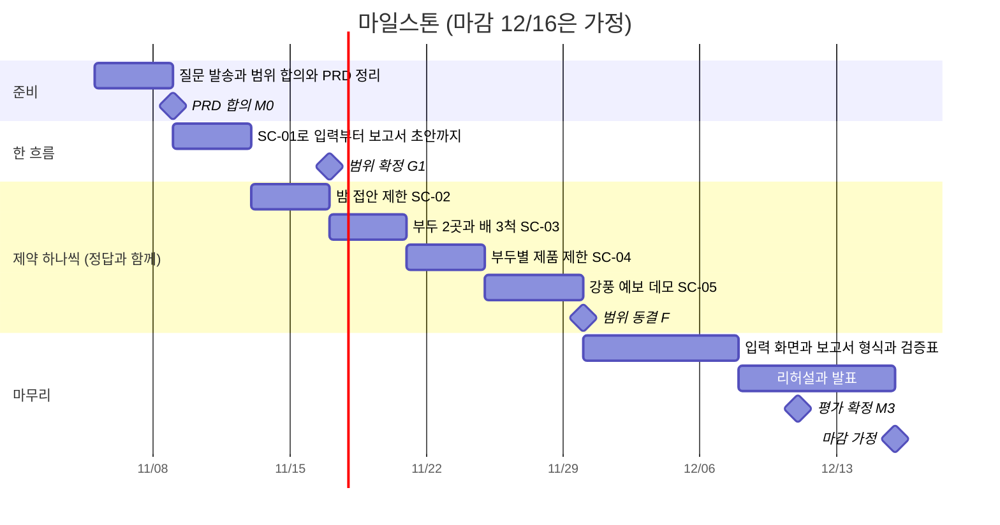

# 프로젝트 방향 가이드 — 무엇을 최적화하나, 무엇을 고려하나, 마일스톤, 조원 공부

- 작성일: 2026-11-05 · 상태: **초안** (팀·멘토 확인 전)
- 짝 자료: 영상 4편(`docs/domain/media/04-optimization-flow.mp4`), 「쉽게 보는 요구사항」, 「현업 이해 가이드」
- 표시: [1] 같은 숫자는 맨 아래 출처 번호예요. 직접 열어서 확인한 자료만 달았어요. "(추정)"은 출처 없이 우리가 정리한 부분이에요. [원문]은 과제 원문이에요.
- 읽는 법: 바쁘면 "먼저 네 가지 답"과 "마일스톤"과 "조원 공부"만 읽어도 돼요.

## 먼저 네 가지 답

1. **전체냐, 한 선박이냐?** **전체**예요. 최적화하는 대상은 여러 척의 접안 순서이고, 줄이는 값은 **총 예상 체선료**예요. 한 선박의 체선료 계산은 그 총합을 만드는 부품이에요. 한 척만 보면 모든 배가 "내가 먼저"를 원해서 답이 나오지 않아요.
2. **프로젝트 목표는?** "제약을 지키는 접안 순서 후보를 만들어, 기준안(도착 순서)보다 총 예상 체선료가 얼마나 줄어드는지 근거와 함께 보여 주고, 담당자가 고르게 돕는 도우미"예요. 성공은 숫자 세 개로 재요: 정답 일치율, 기준안 대비 줄인 금액, 제약 위반 0건.
3. **마일스톤은?** 팀 간트의 날짜(마감 12/16은 가정)에 맞춰, "한 흐름 시연 → 제약 하나씩 + 정답 → 입력·보고서·검증표 → 평가 확정 → 발표" 순서로 잡았어요.
4. **조원은 무엇을 공부하나요?** 전원 1시간(영상 약 6분 + 글 두 편 + 데모 10분)을 같이 하고, 그다음은 역할별로 "읽을 것 2개, 해 볼 것 1개, 내놓을 것 1개"예요.

## 1. 범위 — 전체 최적화인가, 한 선박 최적화인가

**결론: 전체(여러 척의 순서)가 대상이고, 한 선박은 계산과 설명의 단위예요.**

- **근거 1: 원문이 그렇게 써 있어요.** 후보를 "총 예상 체선료 순으로 나란히" 비교하고, 성과도 "기준안보다 총 예상 체선료를 얼마나 줄였는지"로 보여 달라고 했어요. [원문 3절]
- **근거 2: 한 척만 보면 답이 없어요.** 영상의 두 척 사례에서 X호를 먼저 붙이면 X호는 0달러, Y호는 52,000달러예요. Y호를 먼저 붙이면 Y호는 0달러, X호는 6,000달러예요. 배마다 "내가 먼저"가 유리해서, 총합(52,000 대 6,000)으로 정해야 해요.
- **근거 3: 학계와 업계도 총합이나 총 체류 시간을 줄여요.** 접안 배정 연구는 보통 배들이 항구에 머문 시간의 합을 최소화해요. 에라스무스대 논문은 선주가 체류 시간에 큰 비용을 청구할 수 있어서라고 이유를 적었어요 [3]. 벨기에 탱크 터미널 연구도 "총 체류 시간이나 총 배정 비용" 같은 합계 지표를 써요 [4].

**한 선박의 일은 이래요.** 배마다 도착·NOR 시각, 허용 시간, 예상 작업 종료 시간, 요금, 쓴 규칙으로 체선 시간과 금액을 계산하고 **근거**를 붙여요(원문 기능 1). 이게 후보 비교의 부품이고, 체선 지불 부서가 "배별 근거"를 보는 화면이에요.

**총합을 정할 때 걸리는 점 두 가지**
- **무엇의 합이냐**: 체류 시간의 합이 아니라 체선료의 합이어야 해요. 같은 대기 1시간도 배마다 요금이 달라서예요. (뒤의 고려사항 1)
- **누구의 돈이냐**: 배마다 SK가 내는 돈인지 받는 돈인지가 계약에 따라 달라요. 총합은 "SK가 실제로 부담하는 금액" 기준이어야 해요. (뒤의 고려사항 6)

## 2. 고려해야 할 것 12가지와 이유

각 항목은 "왜 → 어떻게 반영 → 레퍼런스" 순서예요.

### 1. 목적함수 — 무엇을 줄이나
- **왜**: 학계 모델은 흔히 배의 체류 시간 합을 줄여요 [3][4]. 그런데 허용 시간과 요금이 다르면 같은 1시간의 값이 달라요. 터미널은 체선료를 덜 만드는 배를 먼저 챙길 수도 있어서 접안 계획이 "상업적으로 민감"하다고 IMO 문서가 적었어요 [1]. 상용 접안 도구도 체선료를 핵심 지표로 봐요. Dropboard는 대기 시간을 보여 주고 앞으로의 체선료를 예측한다고 소개해요 [14].
- **어떻게**: 목적함수는 배별 예상 체선료의 합으로 하고(요율과 허용 시간 반영), 보조 지표로 대기 시간, 최악 시나리오 값, 계획 변경 횟수를 같이 봐요.

### 2. 기준안(베이스라인) — 줄인 금액을 재는 자
- **왜**: 성과가 "기준안 대비 줄인 금액"이라서 기준안의 정의가 곧 성과 숫자예요. 실제 터미널 규칙은 선착순이에요. 다만 하루(24시간) 전까지 빠짐없는 주문과 NOR이 있어야 줄에 서요 [2]. 탱커·벌크의 일반 관행도 선착순이고 [1], 학술 비교에서도 선착순은 기준선이에요 [3].
- **어떻게**: 기준안 = 도착 순서대로 접안. 순수 선착순인지, 선종별 선착순인지, 못 지킬 땐 어떻게 하는지는 현업에 확인해요(질문 Q5).
- **참고**: 에라스무스대 논문의 가상 7개 사례에서 선착순의 최적 대비 격차는 15%에서 84%였어요 [3]. 소규모 가상 사례라서 울산 효과로 옮겨 쓰면 안 돼요.

### 3. 계약 규칙 — 계약마다 시계가 달라요
- **왜**: 같은 상황도 계약에 따라 결과가 갈려요. 혼잡으로 못 붙은 시간은 용선자 부담이라는 영국 판례 [7], 정부 통제를 면책으로 볼지 특약으로 용선자 부담으로 볼지 [9], 한국 판결에서 서식과 'BT/BT' 조항 해석이 금액을 갈랐다는 점 [10]이 그 예예요. 통지 시간(6시간), 이동 공제, 반액 같은 규칙도 서식마다 달라요 [8].
- **어떻게**: 규칙을 코드에 박지 말고 계약 정보에서 읽고, 근거에 "어떤 규칙을 썼는지"를 보여 줘요 [원문 6절]. 계약 정보를 바꾸면 결과가 바뀌는 시험(정답 사례)을 하나 만들어요.

### 4. 시간 가정과 불확실성 — 금액을 가장 크게 흔드는 것
- **왜**: 다음 배가 언제 붙는지는 앞 배가 언제 끝나는지에 달려 있어요. 같은 두 척도 접안·호스 연결 시간을 어떻게 잡느냐에 따라 순서 A가 52,000이 58,000이 돼요(팀 손계산 09). 배는 시간의 최대 9%를 정박지 대기에 쓰고, 트레이더가 도착 직전에 항구나 부두를 바꾸기도 해요 [1].
- **어떻게**: 금액 옆에 시간 가정을 적고, 후보마다 "어떤 입력(도착 일시, 예보)에 기대는지"를 위험으로 보여요 [원문 6절]. 정보가 바뀔 때마다 다시 계산해요. Vopak 친저우는 15분마다 다시 계산한다고 해요(업체 발표) [5].
- **참고**: 도착 시각을 맞춰 대기를 줄이는 방법(JIT)이 있어요. BIMCO가 2021년에 벌크용 조항을 냈고 [17], 2026년 8월에는 도착 전 '가상 NOR' 조항을 만드는 중이에요(초안) [18]. 탱커 서식에 바로 쓰이는지는 확인하지 못했어요.

### 5. 제약(탱크 포함) — 못 붙는 순서는 걸러요
- **왜**: 부두별 접안 가능 제품, 조석, 일출·일몰, 기상, 도선·예선, 탱크 여유가 순서를 막아요 [원문 3절]. 실제 터미널은 작업 2시간 전에 탱크가 준비됐는지와 받을 빈 공간이 있는지를 보고, 안 되면 배를 부르지 않아요 [2]. 부두 배치가 복잡한 벨기에 탱크 터미널은 계류 제한 같은 안전 규칙을 모델에 넣어 실제 의사결정 도구로 써요 [4]. Vopak 친저우는 탱크 재고를 추정해 입력으로 써요(업체 발표) [5]. AspenTech의 스케줄러는 배의 흘수·폭·길이, 제품 호환, 경제성을 보고 배정 안 된 배를 부두에 자동으로 배정한다고 소개해요(업체 기고) [15].
- **어떻게**: 제약을 규칙 표(데이터)로 관리해서 담당자가 고치게 하고, **하나씩 더하면서** 정답 사례로 확인해요 [원문 6절].

### 6. 누구의 돈인가 — 총합의 기준
- **왜**: 탱커·벌크에서 터미널과 선사 사이엔 계약이 없어요. 용선자가 터미널과 서비스 계약을 맺고, 하역이 길어지면 터미널에 체선료를 청구할 수 있고, 그 돈은 결국 선주에게 넘어가요 [1]. SK는 터미널 운영자이면서 화주라서 배마다 SK가 내는지 받는지가 달라요(팀 도메인 문서의 두 겹 계약).
- **어떻게**: 배마다 "계약 층(용선, 매매)과 SK의 역할" 필드를 두고, 총합을 SK 부담 기준으로 계산해요. 현업 확인 필요(질문 Q8).

### 7. 탐색 규모와 방법 — 조합이 폭발해요
- **왜**: 배 N척의 순서는 N!가지예요. 9척이면 362,880가지예요. 에라스무스대 연구에서 정확해법(CPLEX)은 현실 크기에서 최적해를 못 낼 수 있었고, 휴리스틱(SWO)은 10초 안에 선착순보다 나은 답을 냈지만(격차 4%에서 20%) 정확해법(0%에서 9%)에는 못 미쳤어요 [3]. 벨기에 탱크 터미널은 휴리스틱을 실제 도구로 쓰고 있어요 [4].
- **어떻게**: 제약으로 먼저 거르고, 작은 규모는 전부 돌려 보고, 커지면 휴리스틱으로 추려요. 후보는 3개 정도만 보여요 [원문 6절]. 스케줄링 모델링은 OR-Tools CP-SAT 예제로 배울 수 있어요 [24].

### 8. 근거와 설명 — 분쟁 때 쓰는 증거
- **왜**: 체선료는 금액이 크고 다툼이 잦아요. 서류 한 장 때문에 40일 넘게 지체한 울산지법 사례 [10], 체선료를 안 내겠다는 용선자가 나온 2022년 튀르키예 해협 [11], 계약 문언을 두고 다투는 2026년 호르무즈 [9]가 있어요. 상용 도구도 SOF를 읽어 계약 조항대로 계산하고 근거를 남기는 데 집중해요 [12][13].
- **어떻게**: 모든 금액에 도착·NOR 시각, 허용 시간, 요금, 쓴 규칙을 붙여요. 해석이 갈리는 곳은 단정하지 말고 두 가지 계산을 나란히 보여요.

### 9. 사람이 결정해요
- **왜**: 원문이 자동 확정을 범위 밖으로 했어요 [원문 6절]. 실제 터미널도 안전이나 전체 효율을 위해 규칙에서 벗어날 재량을 남겨 둬요 [2].
- **어떻게**: 화면에는 '선택'만 두고 '확정'은 두지 않아요. 선택한 이유는 기록으로 남겨요.

### 10. 검증 — 정말 줄었나, 어떻게 아나
- **왜**: 업체 발표 수치(예: 화주 체선료 −20%)는 독립 검증이 없어요 [5]. 반면 Vopak 프리포트는 8개월, 62척의 전후 측정(체선 약 124시간 감소)을 공개했어요 [6].
- **어떻게**: 손계산 정답과 자동 계산의 일치율, 시나리오별 기준안 대비 줄인 금액, 제약 위반 0건을 표로 보여요 [원문 3절]. 정확해법과의 격차로 후보 품질을 재는 방법도 있어요 [3]. 데모는 가상 데이터라고 분명히 말해요.

### 11. 데이터 — 받을 수 있는 것과 없는 것
- **왜**: 원문은 일기예보, 조석, 일출·일몰을 공공데이터포털에서 받으라고 했어요 [원문 5절]. 직접 확인한 것은 이래요.
  - 국립해양조사원 **조석예보**: 시계열, 무료, 출처 표시 [20]
  - 한국천문연구원 **출몰시각**: 일출·일몰·박명 [21]
  - 기상청 **단기예보**: 5km 격자, 서비스키 필요 [22]
  - 기상청 **해양기상관측**(부이·파고): 공공기관의 방재기상업무용으로 제한된다고 적혀 있어 우리 팀이 쓸 수 있는지 불확실해요 [23]
- **어떻게**: 풍속과 파고는 단기예보나 가상값으로 대체할 계획을 같이 세워요. 접안 이력, 계약, 부두 제원은 공개되지 않으니 현업에게 받거나 가상으로 만들고, 정답은 팀이 직접 만들어요 [원문 5·6절].

### 12. ML과 에이전트의 자리
- **왜**: 원문의 핵심 기술에 ML, Agent, 데이터가 있지만 어디에 쓸지는 정해 주지 않았어요(질문 Q2). 가장 자연스러운 ML 자리는 **예상 작업 종료 시간** 예측이에요. 탱커 터미널의 접안 체류 시간을 터미널 작업 기록과 AIS 선박 추적 데이터로 예측한 연구가 있어요(정확도 98.81%는 저자가 보고한 값) [19]. 금액 계산과 제약 판정은 규칙이 맞아요. 검증할 수 있어야 해서예요. 에너지 기업 사례로는 Neste가 2021년부터 AI 스케줄링으로 선박 운항을 최적화해 왔고, 업체는 연료·항만 비용 최대 4% 절감이라고 밝혔어요(독립 검증 없음) [16].
- **어떻게**: ML은 작업 시간 같은 입력을 추정하는 데, 계산과 판정은 코드로, LLM은 설명과 초안에 써요(숫자는 엔진 값을 그대로 인용). 에이전트는 단순한 구성부터 시작하고 복잡함은 효과가 확인될 때만 더해요 [26]. 도구를 연결하는 표준으로 MCP가 있어요 [25].

## 3. 프로젝트 목표

**한 문장**: 울산 터미널의 대기 선박과 부두 조건을 넣으면, 제약을 지키는 접안 순서 후보를 만들어 기준안(도착 순서)보다 총 예상 체선료가 얼마나 줄어드는지 근거와 함께 보여 주고, 담당자가 하나를 골라 보고서 초안까지 받게 하는 도우미(Agent).

**성공 기준 세 가지** [원문 3절 기능 5]
- 손계산 정답과 자동 계산이 맞는 비율 (목표: 정답 사례 전부 일치)
- 시나리오마다 기준안 대비 줄인 총 예상 체선료 (표로)
- 제약을 어긴 후보 0건

**데모**: 기상 악화가 예보된 날 배 여러 척이 몰리는 상황에서 후보를 비교하고, 하나를 고르고, 보고서 초안까지 받는 흐름이에요 [원문 4절].

**목표 수치(몇 % 절감)는 정하지 않아요.** 원문에 없고, 실제 데이터도 없어서 근거 없는 숫자가 돼요. 대신 "기준안 대비 줄인 금액"을 사례마다 정직하게 보여요.

**하지 않는 것**: 사내 시스템 실시간 연동, 도우미의 자동 확정 [원문 6절].

**이미 있는 것**(팀 문서 기준, 11월 4일): 한 척의 체선료 계산 정답 7개와 계산 엔진이 일치하고, 두 척 사례(SC-01)는 손계산과 프로토타입이 같은 답이에요. 비어 있는 것은 입력 폼, 보고용 Report 형식, 6척 시나리오의 손계산 정답이에요.

## 4. 마일스톤

날짜는 팀 간트(11/4부터 12/16)에 맞췄어요. **마감 12/16은 가정**이라 알게 되면 날짜만 밀면 돼요.

**마일스톤마다 "이게 되면 끝"**

- **M0 · 11/9 PRD 합의**: 원문 기준으로 고친 PRD와 범위("전체 순서 최적화, 총 체선료, 기준안은 도착 순서")를 팀이 같은 말로 설명할 수 있다. 질문(교수님 Q1·Q2·Q11)을 보냈다.
- **한 흐름 · 11/13**: 두 척 사례(SC-01)로 입력, 계산, 후보 비교, 위험 표시, 보고서 초안이 한 번 끝까지 돈다. (프로토타입이 거의 통과한 상태라서 원문 기준 점검표로 확인)
- **G1 · 11/17 범위 확정**: 멘토 답이 오면 반영하고, 안 오면 가정으로 간다. 기준안 정의와 시간 가정을 문서에 고정한다.
- **제약 하나씩 · 11/13에서 11/30까지**: 제약 하나를 더할 때마다 손계산 정답을 만들고 프로그램과 비교한다. 밤 접안 제한(SC-02), 부두 2곳과 3척(SC-03), 부두별 제품 제한(SC-04), 강풍 예보(SC-05, 데모 상황). **정답 목록에 없는 물때(조석), 계약이 달라지는 경우, 입력이 빠진 경우**도 이 구간에 사례를 추가한다.
- **F · 11/30 범위 동결**: 이후 새 기능은 추가하지 않고 변경 요청으로만 받는다.
- **마무리 · 11/30에서 12/8까지**: 스케줄러가 배와 부두를 입력하는 화면, 보고용 Report 형식(메일 포함), 검증 표(일치율, 기준안 대비 절감, 제약 위반)를 완성한다.
- **M3 · 12/11 평가 확정**: 검증 표가 확정되고, 한계(가상 데이터, 시간 가정)를 문서에 적는다.
- **발표 · 12/16**: 리허설과 백업 녹화까지 마친다.

**막힐 만한 것 세 가지**
- 현업 답이 늦어요 → 가정(질문 정리 문서의 "우리 가정")으로 진행하고 답이 오면 고쳐요.
- 정답 사례가 부족해요 → 손계산을 역할별로 나눠 하나씩 만들어요(조원 공부와 같이).
- 범위가 번져요(조석, 계약, 탱크를 한꺼번에) → **하나씩** 더해요 [원문 6절].

## 5. 조원들에게 공부시키기

### 전원이 같이 (1시간)

1. 영상 4편 보기 (약 6분)
2. 「쉽게 보는 요구사항」 읽기 (15분)
3. 「현업 이해 가이드」 1장에서 3장 읽기 (15분)
4. 데모 열어 보기 (10분, https://minkyu-k530.github.io/demurrage-desk/ 의 '개념' 화면과 '작업함')
5. 서로 한 줄씩 "이해한 것 / 막힌 것" 말하기 (15분)

### 역할별 (읽을 것 2개, 해 볼 것 1개, 내놓을 것 1개)

팀은 5명에서 6명이고 역할은 PM, 도메인, 엔진, 에이전트, 평가, 발표예요(팀 간트 기준). 5명이면 한 사람이 둘을 겸해요.

**PM**
- 읽을 것: 과제 원문, 「요구사항 분석」 6장(질문 Q1부터 Q12까지). 터미널이 접안 순서를 어떻게 정하는지 보려면 Vopak 후자이라 계획 규칙(1쪽) [2].
- 해 볼 것: 교수님께 질문(Q1·Q2·Q11) 보내기, 마일스톤 합의 30분 열기.
- 내놓을 것: 팀이 합의한 범위 한 장.

**도메인(계약, 레이타임)**
- 읽을 것: 영상 1에서 3편, 레이타임 해설 [8], 팀 문서 「먼저 할 것 두 가지」(09).
- 해 볼 것: 밤 접안 제한 사례(SC-02)를 손으로 계산하기.
- 내놓을 것: 계산표가 붙은 정답 사례 1개.

**엔진(최적화, 시뮬레이션)**
- 읽을 것: 에라스무스대 논문 서론과 3장(선착순 대 휴리스틱 대 정확해법) [3], OR-Tools CP-SAT 스케줄링 예제 [24].
- 해 볼 것: `prototype/engine/optimize.py`를 읽고 제약 하나를 더해서 후보가 걸러지는지 확인하기.
- 내놓을 것: 제약 1개와 시험 1개.

**에이전트(설명, 보고서)**
- 읽을 것: Anthropic의 에이전트 구성 글 [26], MCP 소개 [25].
- 해 볼 것: 후보 카드에서 메일 초안을 만드는 문장 틀 고치기(숫자는 엔진 값만 인용).
- 내놓을 것: 보고서 초안 양식 1쪽.

**평가(정답 세트, 검증)**
- 읽을 것: 팀 문서 09의 정답 정리, Vopak 프리포트의 전후 측정 사례 [6], 에라스무스대 논문의 결과 표(최적성 격차로 비교하는 법) [3].
- 해 볼 것: 검증 표 틀(일치율, 기준안 대비 줄인 금액, 제약 위반) 만들기. 공공데이터 3종 [20][21][22]이 실제로 받아지는지도 확인.
- 내놓을 것: 검증 표 1장.

**발표(영상, 데모)**
- 읽을 것: 영상 4편, 「현업 이해 가이드」 3장(하루 이야기).
- 해 볼 것: 기상 악화와 여러 척이 몰리는 데모 대본 1쪽 쓰기.
- 내놓을 것: 데모 대본.

### 조원에게 이렇게 말하면 돼요

> 이번 주(11/5에서 11/9) 할 일이에요. ① 영상 4편(약 6분)과 「쉽게 보는 요구사항」을 읽어요. ② 아래 내 역할의 "읽을 것 2개"를 읽고 "해 볼 것"을 해 봐요. ③ 금요일에 각자 "이해한 것 / 막힌 것"을 한 줄씩 공유해요. 모르는 건 막힌 것에 그대로 적으면 돼요.

## 6. 지금 바로 할 일 3가지

1. **질문 보내기**: 교수님께 Q1(평가·마감), Q2(ML), Q11(주관 팀과 첫 멘토링)을 먼저 보내요. 글은 질문 정리 문서(`08-questions.md`)에 있어요.
2. **범위 합의 30분**: 이 글 1장("전체 순서 최적화, 총 체선료, 기준안은 도착 순서")에 팀이 동의하는지 확인해요.
3. **공부 시작**: 전원 1시간을 같이 하고, 역할별 "해 볼 것"을 하나씩 나눠요.

## 출처 (직접 열어서 확인한 것)

1. [IMO MEPC 75/INF.22 (2020-01-24) — Just In Time Arrival Guide](https://sustainableworldports.org/wp-content/uploads/MEPC-75-INF.22-Just-In-Time-Arrival-Guide-Barriers-and-Solutions-Secretariat.pdf)
2. [Vopak Horizon Fujairah — 계획 규칙(PDF)](https://www.vopak.com/system/files/planning_rules_vopak_horizon_fujairah_2.pdf)
3. [Brouwer (2013) Resource Optimisation at Maritime Oil Terminals, 에라스무스대 학사논문](https://thesis.eur.nl/pub/13808/13808-Brouwer.pdf)
4. [Correcher 외 (2019) The berth allocation problem in terminals with irregular layouts, EJOR 272(3)](https://econpapers.repec.org/RePEc:eee:ejores:v:272:y:2019:i:3:p:1096-1108)
5. [LNG Industry (2025-03-14) — Vopak launches 66 Yunlian AI-powered solution](https://www.lngindustry.com/liquid-natural-gas/14032025/vopak-launches-66-yunlian-ai-powered-solution)
6. [Maritime Professional — Partners Aim to Reduce Time Ships Spend in Port (Vopak Freeport)](https://www.maritimeprofessional.com/news/partners-reduce-time-ships-spend-394251)
7. [Handybulk — Reachable on Arrival: Meaning, Laytime and Demurrage](https://www.handybulk.com/reachable-on-arrival-in-ship-chartering-meaning-laytime-and-demurrage/)
8. [Handybulk — Laytime in Dry Cargo and Tanker Charters: Arrival, NOR, Time Counting, Demurrage and Despatch](https://www.handybulk.com/laytime-in-dry-cargo-and-tanker-charters-arrival-nor-time-counting-demurrage-and-despatch/)
9. [Haiwen & Partners (2026-05-19) — The Strait of Hormuz Crisis: Charterparty, Arbitration and Risk Allocation](https://en.ctils.com/en/articles/5857)
10. [이양기·이기영·김진수 (2020) 항해용선계약에서 체박손해금에 관한 사례연구: 국내 판결을 중심으로, 무역학회지 45(4)](https://koreascience.kr/article/JAKO202033263788632.pdf)
11. [gCaptain (블룸버그 인용, 2022-12-08) — Oil tankers stuck near Turkey costing millions to wait](https://gcaptain.com/oil-tankers-stuck-near-turkey-costing-millions-to-wait)
12. [Veson IMOS 문서 — Laytime Calculation](https://vesonjira.atlassian.net/wiki/spaces/help/pages/64888271/IMOS+-+Laytime+Calculation)
13. [Hellenic Shipping News (2023-08-15) — VOYAGER Portal](https://www.hellenicshippingnews.com/?p=998274)
14. [Tank Storage (2021-09-27) — TotalEnergies selects Dropboard for berth scheduling](https://tankstorage.com/news/totalenergies-selects-dropboard-for-berth-scheduling/)
15. [Hydrocarbon Engineering (2014-08-11, AspenTech 기고) — Supertanker super savings](https://www.hydrocarbonengineering.com/special-reports/11082014/Supertanker-super-savings-1025/)
16. [Hellenic Shipping News (2025-07-03) — Seaber's optimization solution expanded to Neste](https://www.hellenicshippingnews.com/seabers-optimization-solution-expanded-to-nestes-european-shipping-operations/)
17. [BIMCO — Just in Time Arrival Clause for Voyage Charter Parties 2021](https://www.bimco.org/contractual-affairs/bimco-clauses/current-clauses/just-in-time-arrival-clause-for-voyage-charter-parties-2021/)
18. [BIMCO 뉴스 (2026-08-21) — Virtual NOR와 JIT 조항 초안](https://www.bimco.org/news-insights/bimco-news/2026/08/21-virtual-nor/)
19. [Zhai 외 — Predicting Berth Stay for Tanker Terminals: A Systematic and Dynamic Approach (arXiv:2204.04085)](https://arxiv.org/abs/2204.04085)
20. [공공데이터포털 — 국립해양조사원 조석예보(시계열)](https://www.data.go.kr/data/15156022/openapi.do)
21. [공공데이터포털 — 한국천문연구원 출몰시각 정보](https://www.data.go.kr/data/15012688/openapi.do)
22. [공공데이터포털 — 기상청 단기예보 조회서비스](https://www.data.go.kr/data/15084084/openapi.do)
23. [공공데이터포털 — 기상청 해양기상관측자료 조회서비스](https://www.data.go.kr/data/15043550/openapi.do)
24. [Google OR-Tools — Job shop 스케줄링 예제(CP-SAT)](https://developers.google.com/optimization/scheduling/job_shop)
25. [Model Context Protocol — What is MCP?](https://modelcontextprotocol.io/docs/getting-started/intro)
26. [Anthropic — Building effective agents](https://www.anthropic.com/engineering/building-effective-agents)

**[원문]** `docs/requirements/official-brief.md` · **[팀 자료]** `docs/requirements/09-first-steps.md`, `docs/requirements/07-requirements-analysis.md`, `docs/requirements/gantt/starter.md`, `docs/domain/01-demurrage-primer.md`. 업체 발표 수치는 독립 검증이 없고, 판례 요약은 해설 사이트 기준이에요.
