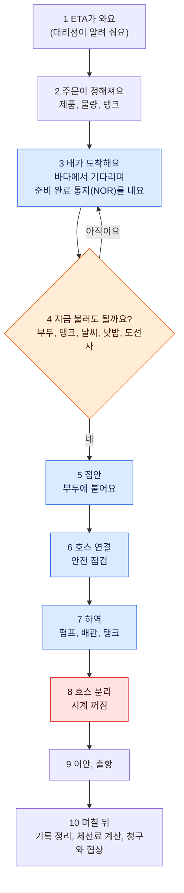
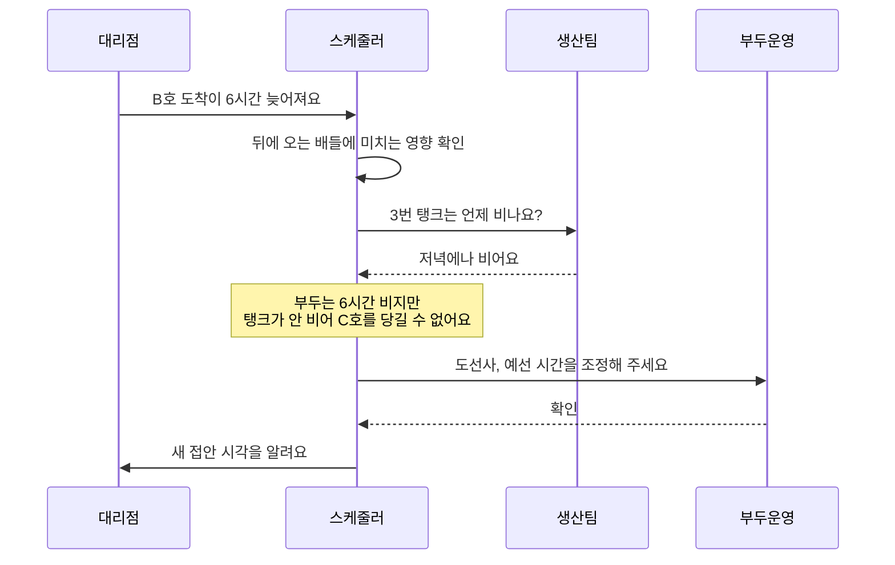
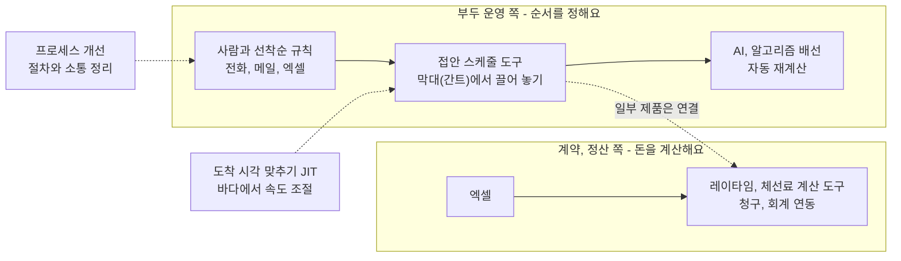

# 현업을 머릿속으로 돌려 보기 — 터미널의 하루, 실제 사례, 업계 솔루션, SEAGATE

- 작성일: 2026-11-05 · 상태: **초안** (현업 확인 전)
- 왜 이 글을 쓰나: 요구사항이 어렵게 느껴지는 건 "현업이 어떻게 돌아가는지" 그림이 머릿속에 없어서예요. 그래서 규칙과 숫자보다 **장면**부터 따라가요.
- 먼저 솔직하게: 우리 팀은 현업 확인을 아직 한 건도 못 받았고, SEAGATE 로그인 뒤 화면도 아무도 못 봤어요. 그래서 이 글의 "현업 모습"은 공개 자료와 업계 일반으로 그린 **그림(추정)** 이에요. 틀린 곳은 멘토에게 고쳐 달라고 하면 돼요.
- 표시: [1] 같은 숫자는 맨 아래 출처 번호예요. 직접 열어서 확인한 자료만 달았어요. "(추정)"은 출처 없이 우리가 그린 부분이에요.
- 읽는 법: 바쁘면 "먼저 네 가지 답"과 2장 그림, 3장 하루 이야기만 읽으세요. 나머지는 필요할 때 찾아봐요.

## 먼저 네 가지 답

1. **어떻게 이해하면 되나요?** 규칙과 숫자부터 외우지 말고 장면을 순서대로 따라가요. 배 한 척의 여정(2장), 배 두 척이 부두 하나를 놓고 다투는 장면(앞 글의 52,000 대 6,000), 스케줄러의 하루(3장), 거기에 사건(늦음, 바람, 밤)을 하나씩 얹기(8장 연습) 순서예요.
2. **실제 사례는요?** 한국 법원 판결 2건, 영국 판례, 2022년 튀르키예 해협, 2026년 호르무즈가 있어요. 모두 결국 "기다림의 위험을 누가 지느냐"를 두고 다퉈요(5장).
3. **업계는 무엇을 쓰나요?** 가장 흔한 건 "선착순 규칙과 사람의 판단"이에요. 그 위에 접안 스케줄 도구, AI 배선, 사후 계산·청구 도구가 있어요(4장, 6장).
4. **SEAGATE는요?** 공개 자료로는 메뉴 구조까지만 알 수 있어요. 어떻게 쓰이는지는 현업만 알아요(7장).

## 1장. 큰 그림 — 터미널은 '주차장', 배는 '손님'

주차장을 떠올려 보세요.

- 주차칸이 몇 개 없어요. (= 부두)
- 손님마다 "무료 시간"과 "초과 요금"이 달라요. (= 허용 시간, 체선료 요율)
- 관리인이 누구를 먼저 들일지 정해요. (= 스케줄러)

그런데 진짜 터미널은 주차장보다 훨씬 까다로워요.

- 앞 차가 언제 나갈지 정확히 몰라요.
- 바람이 세면 아예 못 대거나 작업이 멈춰요.
- 어떤 칸은 큰 차가 못 들어가고, 어떤 칸은 밤에 못 써요.
- 칸이 비어도 창고(탱크)가 꽉 차 있으면 짐을 내릴 수 없어요.
- 손님이 내는 요금이 커요. 작은 화물선은 하루 수천 달러에서 1만 달러 남짓, 큰 유조선은 10만 달러가 넘기도 해요(5장 사례).

그리고 SK는 부두를 운영하는 쪽이면서 배를 빌리는 쪽(화주)이기도 해요. 그래서 터미널에서 배가 오래 기다리면 그 비용이 계약을 따라 결국 SK로 돌아오기 쉬워요. "터미널 효율"과 "체선료"는 같은 문제의 두 얼굴이에요. (팀 도메인 문서의 추정)

**누가 등장하나요?** 팀의 이해관계자 지도 기준이고, 조직도 확인 전이라 모두 추정이에요.

- **스케줄러**: 누구를 언제 어느 부두에 붙일지 정해요. 체선료는 줄이고 부두는 놀리고 싶지 않아요.
- **생산·탱크 담당**: 탱크가 비는 시간과 공정 일정을 알아요. 탱크가 꽉 차면 하역이 안 돼요.
- **부두 현장**: 접안과 하역을 실제로 해요. 안전이 먼저라 바람이 한계를 넘으면 멈춰요.
- **선박 대리점, 선장**: 배를 대신해 연락해요. 배는 하루하루가 돈이라 빨리 붙고 빨리 끝내고 싶어요.
- **도선사, 예선**: 배를 부두까지 안내하고 끌어 줘요. 정해진 시간대에 배정돼요.
- **트레이딩, 정산 담당**: 계약대로 체선료를 계산하고 청구서를 따져요.

## 2장. 배 한 척의 여정

배 한 척이 울산에 와서 떠나고 정산이 끝나기까지를 열 칸으로 줄였어요.

- **파란색**은 허용 시간을 재는 시계가 돌아가는 구간이에요. 3번은 NOR을 내고 통지 시간(보통 6시간)이 지난 뒤부터예요.
- **주황색**은 스케줄러가 가장 크게 고민하는 곳이에요.
- **빨간색**은 시계가 멈추는 곳이에요.

**4번 "지금 불러도 될까요?"가 핵심이에요.** 부두가 비었다고 바로 부르지 않아요. 탱크가 준비됐는지, 바람이 괜찮은지, 해가 떠 있는지, 도선사와 예선이 있는지를 봐야 해요. 실제 터미널(Vopak 후자이라)은 작업 2시간 전에 탱크가 준비됐는지와 짐을 받을 빈 공간이 있는지를 확인하고, 하나라도 안 되면 그 배를 부르지 않고 대기열로 되돌려요 [2]. 이 판단이 늦거나 틀리면 파란 구간이 길어져요.

울산은 SEAGATE 공개 입항 안내에 부두별 규칙이 적혀 있어요. 예를 들어 SK 부이(SBM)는 밤에 계류할 수 없고, SK 3번에서 8번 부두에서는 큰 배의 접안을 낮에만 해요(이안은 24시간). 입출항 보고는 울산 PTMS(VHF 14번 채널)로 하고, 접안과 이안에는 도선사가 꼭 타요(일부 묘박지 제외). 이 내용은 팀이 공개 페이지를 직접 읽어 정리한 거예요. [팀 자료]

## 3장. 스케줄러의 하루 (상상해 보기)

> 아래는 **예시**예요. 울산의 공개 규칙(밤 접안 제한 등)과 업계 일반을 섞어 만든 이야기이고, 현업이 실제로 이렇게 하는지는 확인 전이에요. 이 이야기를 멘토에게 보여 주고 "어디가 달라요?"라고 묻는 게 목적이에요.

**무대**: 오늘 배 3척이 들어와요. 부두는 두 곳이에요.

- 부두 1: 큰 배용이에요. 해가 진 뒤에는 접안할 수 없어요.
- 부두 2: 작은 배용이에요. 밤에도 쓸 수 있어요.
- 배 A(큰 배)는 오후 3시쯤, 배 B(작은 배)는 정오쯤, 배 C(작은 배)는 저녁 7시쯤 도착할 예정이에요. 내일 새벽에는 강풍 예보가 있어요.

**장면 1 — 아침: 오늘의 판을 짜요.** 스케줄러는 B를 정오에 부두 2에, A를 오후 4시에 부두 1에 붙이고, C는 B가 끝난 뒤 부두 2에 붙이는 판을 짜요. 짤 때 보는 것은 탱크가 언제 비는지, 도선사와 예선 시간, 일몰 시각, 풍속 예보예요.

**장면 2 — 10시 30분: "B가 6시간 늦어요."** 대리점에서 연락이 와요. 스케줄러는 아래처럼 생산팀에 탱크 사정을 묻고 판을 다시 짜요. 이번에는 탱크가 저녁에나 비어서 C를 앞당길 수 없어요. 부두 2는 6시간 비어 있지만 방법이 없어요.

이때 스케줄러가 알고 싶은 건 "이 변경이 돈으로 얼마인가"예요. 그 자리에서 바로 계산해 주는 도구가 없으면 감으로 판단하게 돼요. (추정 — 우리 도우미가 들어갈 자리예요)

**장면 3 — 오후 2시: 강풍 예보가 바뀌어요.** 내일 새벽 3시에서 9시 사이에 바람이 한계를 넘는다는 예보예요. A는 오후에 붙으면 밤새 하역하다가 새벽에 걸릴 수 있어요. 하역이 멈추면 뒤에 오는 배들이 줄줄이 밀려요. 탱커 계약에서는 날씨로 멈춰도 시계가 서지 않는 경우가 많고, 체선에 들어간 뒤라면 요금이 절반이 되는 규칙이 있어요(팀 도메인 문서 기준). 그래서 "어느 배를 먼저 끝낼까"를 다시 따져요.

**장면 4 — 저녁 6시: A가 늦게 도착해요.** A가 자기 사정으로 저녁 6시에 도착했어요. 해가 졌으니 부두 1에는 내일 아침까지 붙일 수 없어요. 바다에서 13시간쯤 기다리는데, NOR을 낸 뒤 6시간이 지나면 시계가 돌아요. 이 대기를 체선료에 넣을지는 해석이 갈려요. 영국 판례에는 이런 대기를 용선자가 부담하는 방향의 판단이 많아요(5장). 그래서 스케줄러는 "왜 못 붙였는지(일몰, 규칙)"를 기록해 둬요.

**장면 5 — 며칠 뒤: 정산.** 시각을 적은 기록(SOF)이 모여요. 정산 담당은 계약대로 시계를 다시 계산해서 선주의 청구서와 맞춰 봐요. 야간 대기와 강풍 구간에서 의견이 갈리면 협상해요. 이때 "그날 몇 시에 무엇 때문에 못 붙였는지" 기록이 있으면 유리해요. (팀 도메인 문서의 추정)

## 4장. 현업은 순서를 어떻게 정하나

**실제 터미널이 공개한 규칙을 보면 감이 와요.** 아랍에미리트의 독립 터미널 Vopak 후자이라가 '계획 규칙'을 공개해 뒀어요 [2]. 핵심만 풀면 이래요.

- 순서는 **선착순**이에요. 단, 하루(24시간) 전까지 빠짐없는 작업 주문이 들어오고 NOR이 있어야 줄에 서요. 24시간 전에 주문하지 못한 배는 주문이 완성된 뒤 24시간이 지나야 접안 대상이 돼요.
- 주문과 변경은 **서면**으로 확인돼야 해요. 배 이름, 제품 품질, 물량, 탱크, 작업 종류, ETA가 있어야 대기열 자리가 생겨요.
- 작업 **2시간 전에** 탱크가 준비됐는지, 싣는 배라면 제품이 충분한지, 내리는 배라면 받을 빈 공간이 있는지 확인해요. 하나라도 안 되면 그 배는 부르지 않고 대기열로 돌려요.
- 12시간 전까지 한 변경은, 하는 중이거나 계획된 다른 작업에 영향을 주지 않는 한 대기열 자리를 그대로 지켜요. 그 밖의 변경은 새 정보로 다시 짜요.
- 안전이나 전체 효율에 도움이 되면 터미널이 규칙에서 벗어날 수 있다고 적어 뒀어요.

**업계 문서도 같은 얘기를 해요.** 2020년 IMO(국제해사기구) 회의 문서에 실린 업계 연합체(GIA)의 '도착 시각 맞추기' 안내서는, 탱커와 벌크 부문에서는 터미널이 선사와 계약이 없어서 보통 선착순으로 한다고 적었어요. 다만 용선자는 터미널과 서비스 계약이 있어서, 하역이 계약보다 길어지면 터미널에 체선료를 청구할 수 있어요(결국 선주에게 넘어가는 돈이에요). 그래서 터미널이 체선료를 덜 만드는 배를 먼저 챙길 수도 있고, 이 때문에 접안 계획은 "상업적으로 민감"하다고 해요 [3]. 2013년 한 학사논문은 해상 원유 터미널의 선석·배관 배정이 "지금까지 대부분 손으로 이뤄진다"고 적었어요 [4]. (오래된 학생 논문이라 참고만 해요.)

**그래서 우리 프로젝트에는 이런 뜻이에요.**

- "기준안 = 도착 순서대로"는 현업의 일반 관행과 맞아요. 질문 Q5(기준안이 뭐냐)의 근거가 돼요.
- 현업은 최적화 계산보다 "규칙을 지키되 예외는 사람이 판단"하는 쪽에 가까워 보여요. (추정)
- 그 예외 판단에 "이 순서면 누구 체선이 얼마나 줄어요?"라는 숫자가 붙으면 도움이 돼요. 우리 도우미가 들어갈 자리예요. (추정)
- 규칙은 터미널마다 달라요. 울산 SK의 규칙은 현업에게 받아야 해요.

## 5장. 체선료 실제 사례 6개

**1) 울산지방법원 2014년 판결 (2012가합1883)**
석탄을 싣고 울산항에 온 배가 선하증권 원본(화물을 찾을 권리 서류)이 없어서 하역이 멈췄어요. 은행 보증서로 해결하려 했지만 은행이 보증서를 취소하면서 선장이 하역을 중단했고, 하역은 한참 뒤에야 끝났어요. 법원은 이 지체에 대한 보상(체박손해금)을 하루 3,000달러 × 약 40.7일 = 122,187.60달러로 계산했어요 [5].
→ 서류 한 장이 시계를 몇 주 돌릴 수 있어요. (석탄선이라 탱커와 서식이 달라요. 체박손해금은 체선료와 비슷하게 쓰는 지체 보상금이고, 법적으로는 구분되기도 해요.)

**2) 서울남부지방법원 2017년 판결 (2016가단13431)**
한국에서 싣고 카타르 도하항에 간 배가 2015년 8월 5일에 도착해 NOR을 냈지만, 항구가 붐벼서 부두에 못 붙고 5일 넘게 기다렸어요. 법원은 이 대기에 대한 지체 보상을 하루 13,000달러 기준으로 약 7만 달러(70,552.04달러)로 계산했고, 용선자에게 잘못이 없어도 낼 수 있다는 취지로 봤어요 [5].
→ "항구가 붐볐다"는 이유로는 빠져나가기 어려웠어요. (벌크선 서식이에요.)

**3) 영국 판례 — The Laura Prima 등**
탱커 용선계약에서 배가 항구에 도착했는데 혼잡으로 부두에 붙지 못한 사건이에요. 영국 귀족원은 "도착하자마자 닿을 수 있는 부두를 주겠다"는 용선자의 약속을 일상적인 상업적 의미 그대로 받아들여, 혼잡 지연도 용선자가 책임진다고 했어요 [6]. 야간 항행 제한, 예선 부족, 날씨가 겹친 The Fjordaas와 The Sea Queen도 같은 방향이에요 [6].
→ 팀 문서가 '쟁점'으로 표시한 야간 대기와 날씨 대기 문제의 뿌리가 여기 있어요. (해설 사이트의 요약이라 판결문 원문은 못 봤어요. 팀 문서에는 서식이 Asbatankvoy로 적혀 있는데, 해설은 Exxonvoy 1969라고 해요. 확인해서 고치면 좋아요.)

**4) 2022년 12월 튀르키예 해협**
튀르키예가 해협을 지나는 유조선에 "보험에 가입했다는 증명"을 요구하자, 탱커 약 26척(블룸버그 집계)이 줄을 섰어요. 대기 일당은 10만 달러 안팎이었고 추가 운임만 약 1,300만 달러였어요. 체선료는 보통 용선자가 내지만, 이번에는 안 내겠다고 한 용선자도 있었어요 [7].
→ 나라 규칙 하나가 바뀌어도 수십 척이 서고, "누가 내나"가 계약 문제로 번져요.

**5) 2026년 호르무즈 해협**
한국 정유사가 운영하는 원유 운반선 7척이 해협에 묶였다는 보도가 3월 5일에 나왔어요(HD현대오일뱅크 2척, GS칼텍스 1척 포함) [8]. 법무법인들은 이런 대기의 비용을 누가 지느냐가 계약 문구에 달렸다고 정리했어요. 어떤 탱커 서식은 정부의 통제를 용선자 면책 사유로 보지만, 별도의 '호르무즈 특약'이 있으면 용선자가 체선료 수준으로 내야 할 수도 있어요 [10]. 미국 로펌은 체선료, 레이타임, 불가항력(force majeure) 분쟁이 이어질 거라고 봤어요 [9]. 결론은 아직 나오지 않았어요.
→ "계약마다 규칙이 다르다"는 말의 실제 모습이에요. (이 보도들에는 한국 정유사가 낸 체선료 금액은 나오지 않아요.)

**6) 울산 SK 부두의 규모감 (2012년 기사)**
SK이노베이션 울산 콤플렉스는 수출 선적 부두 8곳에 연 약 1,200척(한 달 100여 척)이 드나들고, 기자가 방문한 날 외항에서 기다리는 배가 30척이 넘었다고 해요 [11].
→ 하루 평균 3척 남짓이 오가고, 바다에서 줄 서는 모습이 일상이었다는 뜻이에요. (14년 전 기사라 지금과 다를 수 있어요.)

**세 가지 공통 교훈**

1. 분쟁은 거의 "기다림의 위험을 누가 지나"로 모여요.
2. 같은 일이라도 계약 문구에 따라 결과가 갈려요.
3. 시각과 사유 기록이 돈을 지켜요. 서류 한 장, 도착 시각 하나가 결과를 바꿔요.

**못 찾은 것**: 국내 정유사가 실제로 낸 체선료 금액이나 분쟁 사례는 공개 자료로 찾지 못했어요. SK의 체선료 규모는 현업에게 물어야 해요.

## 6장. 최적화에 실제로 쓰는 솔루션

도구는 크게 두 갈래예요. **순서를 정하는 쪽(부두 운영)**과 **돈을 계산하는 쪽(계약·정산)**이에요.

### 순서를 정하는 쪽

- **사람 + 선착순 + 전화·메일·엑셀**: 가장 흔해요 [3][4]. 2014년 AspenTech 기고도 정유소가 원래는 스프레드시트와 인쇄한 부두 일정표로 일했다고 적었어요 [14].
- **접안 스케줄 도구**: 부두별 막대 위에서 배를 끌어다 놓는 방식이에요.
  - Veson IMOS Berth Scheduling은 드래그로 순서를 바꾸면 배와 화물에 따른 경고가 뜨고, 계획한 접안 일정이 레이타임 계산으로 이어진다고 소개해요(업체 설명) [12].
  - Systems Navigator의 Dropboard는 2021년에 토탈에너지스의 유럽 정유·석유화학 부문이 접안 계획용으로 골랐어요. 대기 시간을 보여 주고, 앞으로의 체선료를 예측하고, 체선의 원인을 찾게 돕는다고 해요. 정량 효과는 공개되지 않았어요 [13].
  - AspenTech의 Aspen Petroleum Scheduler는 원유·제품 선적, 부두 일정, 정유 일정을 함께 다뤄요. 배정이 안 된 배를 흘수·폭·길이, 제품 호환, 경제성에 맞는 부두에 자동으로 배정해요. 200개 넘는 정유소가 쓴다는 건 업체 주장이에요 [14].
- **AI·알고리즘 배선**: Vopak 친저우(중국)가 2025년 2월에 가동했어요. 유전 알고리즘과 개미 군집 알고리즘으로 15분마다 다시 계산하고, 배 한 척당 평균 68개 시나리오를 따져 봐요. 업체·현장 발표로 화주 체선료 20% 감소, 선박 대기시간 20% 감소 등이 나왔지만 독립 검증은 없어요 [1].
- **소프트웨어 없이 절차부터**: Vopak 프리포트 터미널과 Stolt Tankers, Dow, SGS가 2023년 5월부터 12월까지 했어요. 부두에 붙어서 하역과 상관없이 쓰는 시간을 배당 평균 2시간 줄였고, 62척에서 체선이 합쳐서 약 124시간 줄었어요. 새 소프트웨어 없이 절차를 표준화하고 소통 채널을 정리했을 뿐이에요 [15]. 최적화가 알고리즘만은 아니라는 뜻이에요.
- **도착 시각 맞추기(JIT)**: 항구 앞에서 기다리지 않게 배가 바다에서 속도를 조절해요. BIMCO가 2021년에 벌크용 'JIT 도착 조항'을 냈고 [16], 2026년 8월에는 도착 전에 '가상 NOR'을 낼 수 있게 하는 조항을 만드는 중이라고 밝혔어요(초안 단계) [17]. 탱커 서식에도 바로 쓰이는지는 확인하지 못했어요. IMO 안내서는 배가 시간의 최대 9%를 정박지 대기에 쓴다고 했어요 [3].

### 돈을 계산하는 쪽

- **Veson IMOS**: 레이타임과 체선료를 계산하고, 그 결과가 월별 발생분과 항차 손익 회계로 이어져요. 탱커용으로 항차 중간에 나눠 청구하는 기능(Demurrage on Account)도 있어요(업체 문서) [18].
- **VOYAGER Portal**: 손으로 쓴 것까지 포함한 SOF를 읽어 계약 조항대로 자동 계산하고, 항차의 체선 위험을 추정해요. 업체는 정산 팀 시간을 최대 50% 줄인다고 주장해요 [19].

### 화주 쪽 배선

- **Seaber와 Neste**: 핀란드 에너지 기업 Neste가 2021년부터 AI 스케줄링으로 선박 운항을 최적화하고 있어요. 업체는 연료·항만 비용 최대 4% 절감이라고 밝혔어요 [20]. 터미널 안의 접안 순서가 아니라 "어떤 배를 어디로 보낼까"를 다루는 도구예요.

### 눈여겨볼 점

- 숫자 대부분이 **업체 발표**예요. 우리 프로젝트의 기대효과로 옮겨 쓰면 안 돼요. (팀의 벤치마크 원칙과 같아요)
- 도구는 '순서 쪽'과 '계산 쪽'으로 나뉘지만, Veson처럼 둘을 한 묶음으로 잇는 제품도 있어요. 그래서 "사이를 잇는 건 우리뿐"이라고 말하면 위험해요. 안전한 말은 "SEAGATE 위에서, 근거와 설명이 붙은 후보를 사람이 고르게 한다"예요. (추정)
- 학계에는 수학(MILP, 휴리스틱)으로 푸는 논문이 많아요. 팀이 정리한 7건은 프로토타입 앱의 '벤치마크' 화면에 있어요. [팀 자료]
- 국내 정유사의 도입 사례는 공개 자료로 찾지 못했어요.

## 7장. SEAGATE는 어떻게 하고 있나

**먼저 솔직한 답이에요.** 공개된 건 간판(메뉴)까지예요. 간판 뒤에서 무엇을 어떻게 쓰는지는 로그인한 사람만 알아요. 이 글을 쓰면서 웹을 다시 찾아봤지만 SEAGATE 기능을 설명한 기사나 자료는 더 나오지 않았어요.

**알려진 것** (팀이 공개 페이지를 직접 읽어 정리한 내용이에요 [팀 자료])

- 정식 이름은 'SK에너지 항무웹사이트'예요. SK에너지가 소유하고 SK AX가 운영을 맡는다고 개인정보처리방침에 적혀 있어요.
- 공개 영역에는 회사 소개, 울산·인천 입항 가이드, 계류 시설 제원, 안전 규정이 있어요. 입항 가이드에 보고 절차와 부두별 야간·주간 접안 규칙이 있어요.
- 로그인 뒤 메뉴는 이름만 확인됐어요.
  - 예약: Berth Rez, 제품재고관리, 원유재고예측
  - 심사: Ship Vetting, Ship Inspection, Ship Particulars
  - 계획: Order List, Berthing Schedule, 부두제약관리, Berth Optimization, ETB Change Log, Berthing Simulation
  - 하역·실적: Cargo Working, Performance Record
  - 집계·리포트: Performance Summary(Demurrage 포함), Report(체선리스트, 체선지표, 체선사유, 주간체선 등)

**메뉴 이름으로 추정하면** (확인 전)

- 접안 계획, 최적화, 시뮬레이션이 있어요. 6장의 "접안 스케줄 도구" 영역이에요.
- 탱크 재고 예측이 선석 예약과 같은 메뉴에 있어요. 탱크와 접안을 같이 보는 구조로 보여요. Vopak 친저우도 탱크 재고를 입력으로 써요 [1].
- 체선은 '시간' 중심 리포트로 보여요. 계약(허용 시간, 요율, 예외)으로 금액을 계산하는 메뉴는 이름으로는 안 보여요. 6장의 "계산 쪽" 영역이에요. 팀 진단의 'H4'(체선 시간과 체선료 사이의 간극)와 같은 방향이에요.

**모르는 것** (현업에 물어야 해요)

- Berth Optimization과 Berthing Simulation을 실제로 쓰나요? 쓴다면 알고리즘인가요, 규칙인가요?
- 체선사유는 누가 어떻게 입력하나요?
- Demurrage 요약은 시간만 보여 주나요, 금액도 보여 주나요?
- 계약 정보는 SEAGATE에 있나요, 트레이딩 쪽 엑셀에 있나요?

**조직 메모**: 2023년 11월 보도에 따르면 SK에너지의 원유 운영·해상 출하 조직이 2024년 1월 1일부로 분사해(가칭 SK탱크터미널, SK이노베이션 100% 자회사) 울산 CLX의 저장 탱크와 선박이 붙는 부두 시설을 맡는다고 해요 [21]. 지금 SEAGATE를 누가 소유하고 운영하는지, 과제의 '주관 부서'가 어디인지 멘토에게 확인해 보면 좋아요.

## 8장. 머릿속 시뮬레이션 연습

이미 팀이 만든 데모가 있어요. 주소는 https://minkyu-k530.github.io/demurrage-desk/ 예요. 가상 데이터이고, 처음 열면 계산 엔진이 올라오느라 10초에서 30초 걸려요.

1. **(10분) 2장 그림을 소리 내어 설명해 봐요.** 단계마다 "지금 시계가 돌아가나?"를 말해 봐요.
2. **(10분) 데모의 '개념' 화면.** 레이타임 시계 그림을 8단계까지 넘겨 봐요.
3. **(10분) 데모의 '작업함'.** 11/03 00:00의 기준 계획을 본 뒤, 11/04 08:00의 강풍 예보 항목(IMP-1104-0800)을 열어 후보 카드를 읽고 "이 옵션 적용"을 눌러 봐요. 위쪽이 '계획 v2'로 바뀌어요.
4. **(10분) 데모의 '타임라인'.** ▶ 재생을 눌러 사건(ETA, 예보)이 들어올 때마다 그림이 어떻게 바뀌는지 봐요. "무슨 사건 때문에 누가 밀렸나"를 한 문장으로 말해 봐요.
5. **(30분) 3장 하루 이야기를 멘토에게 보여 주고 "어디가 달라요?"라고 물어요.**

더 단순한 옛 시뮬레이터도 있어요. `docs/domain/demurrage-simulator.html`을 열고 '접안 계획 편집'에서 순서를 바꿔 보거나 "D2 14:00에서 20:00 강풍 중단"을 켜 보면 어느 배가 어떻게 밀리는지 보여요.

**멘토에게 이렇게 부탁해 보세요.** 열린 질문보다 "고쳐 주세요"가 답하기 쉬워요.

- "이 하루 이야기에서 틀린 곳을 고쳐 주세요."
- "최근에 체선료가 크게 났던 하루를 하나 복기해 주세요. 그날 어떤 정보가 언제 들어왔고, 무엇을 결정했나요?"
- "접안계획 화면을 같이 보면서 하루를 설명해 주세요. (또는 화면 캡처 한 장)"
- "누가 누구에게 어떻게 연락하나요? (전화, 메일, 무선)"

## 출처 (직접 열어서 확인한 것)

1. [LNG Industry (2025-03-14) — Vopak launches 66 Yunlian AI-powered solution](https://www.lngindustry.com/liquid-natural-gas/14032025/vopak-launches-66-yunlian-ai-powered-solution)
2. [Vopak Horizon Fujairah — 계획 규칙(PDF)](https://www.vopak.com/system/files/planning_rules_vopak_horizon_fujairah_2.pdf)
3. [IMO MEPC 75/INF.22 (2020-01-24) — Just In Time Arrival Guide](https://sustainableworldports.org/wp-content/uploads/MEPC-75-INF.22-Just-In-Time-Arrival-Guide-Barriers-and-Solutions-Secretariat.pdf)
4. [Brouwer (2013) Resource Optimisation at Maritime Oil Terminals, 에라스무스대 학사논문](https://thesis.eur.nl/pub/13808/13808-Brouwer.pdf)
5. [이양기·이기영·김진수 (2020) 항해용선계약에서 체박손해금에 관한 사례연구: 국내 판결을 중심으로, 무역학회지 45(4)](https://koreascience.kr/article/JAKO202033263788632.pdf)
6. [Handybulk — Reachable on Arrival: Meaning, Laytime and Demurrage](https://www.handybulk.com/reachable-on-arrival-in-ship-chartering-meaning-laytime-and-demurrage/)
7. [gCaptain (블룸버그 인용, 2022-12-08) — Oil tankers stuck near Turkey costing millions to wait](https://gcaptain.com/oil-tankers-stuck-near-turkey-costing-millions-to-wait)
8. [아시아경제 (2026-03-05) — 한국 정유사 원유 운반선 7척 호르무즈에 묶임](https://www.asiae.co.kr/en/article/2026030510304643049)
9. [Holland & Knight (2026-04-08) — When the Smoke Clears: Maritime Contract Claims After Hormuz Disruption](https://www.hklaw.com/en/insights/publications/2026/04/when-the-smoke-clears-maritime-contract-claims-after-hormuz-disruption)
10. [Haiwen & Partners (2026-05-19) — The Strait of Hormuz Crisis: Charterparty, Arbitration and Risk Allocation](https://en.ctils.com/en/articles/5857)
11. [아주경제 (2012-10-24) — SK이노베이션 50년, 가장 바빠진 '수출선적부두'](https://www.ajunews.com/view/20121024000001)
12. [Veson IMOS Berth Scheduling (업체 소개)](https://veson.com/products/imos/berth-scheduling)
13. [Tank Storage (2021-09-27) — TotalEnergies selects Dropboard for berth scheduling](https://tankstorage.com/news/totalenergies-selects-dropboard-for-berth-scheduling/)
14. [Hydrocarbon Engineering (2014-08-11, AspenTech 기고) — Supertanker super savings](https://www.hydrocarbonengineering.com/special-reports/11082014/Supertanker-super-savings-1025/)
15. [Maritime Professional — Partners Aim to Reduce Time Ships Spend in Port (Vopak Freeport)](https://www.maritimeprofessional.com/news/partners-reduce-time-ships-spend-394251)
16. [BIMCO — Just in Time Arrival Clause for Voyage Charter Parties 2021](https://www.bimco.org/contractual-affairs/bimco-clauses/current-clauses/just-in-time-arrival-clause-for-voyage-charter-parties-2021/)
17. [BIMCO 뉴스 (2026-08-21) — Virtual NOR와 JIT 조항 초안](https://www.bimco.org/news-insights/bimco-news/2026/08/21-virtual-nor/)
18. [Veson IMOS 문서 — Laytime Calculation](https://vesonjira.atlassian.net/wiki/spaces/help/pages/64888271/IMOS+-+Laytime+Calculation)
19. [Hellenic Shipping News (2023-08-15) — VOYAGER Portal](https://www.hellenicshippingnews.com/?p=998274)
20. [Hellenic Shipping News (2025-07-03) — Seaber's optimization solution expanded to Neste](https://www.hellenicshippingnews.com/seabers-optimization-solution-expanded-to-nestes-european-shipping-operations/)
21. [아시아경제 (2023-11-13) — SK Energy to Spin Off Tank Terminal Division](https://www.asiae.co.kr/en/article/2023111308031550333)

**[팀 자료]** `docs/seagate-diagnosis.md`, `docs/domain/lecture/04-terminal-operations.md`, `docs/domain/01-demurrage-primer.md`, `prototype/docs/concepts.md`, `prototype/docs/usage.md`, `prototype/data/discovery/benchmark.json`. 팀이 2026-11-02에 정리한 것이고, 이 글에서 새로 열어 확인하지는 않았어요. 업체 발표 수치와 해설 사이트의 판례 요약은 독립 검증이 없어요.
